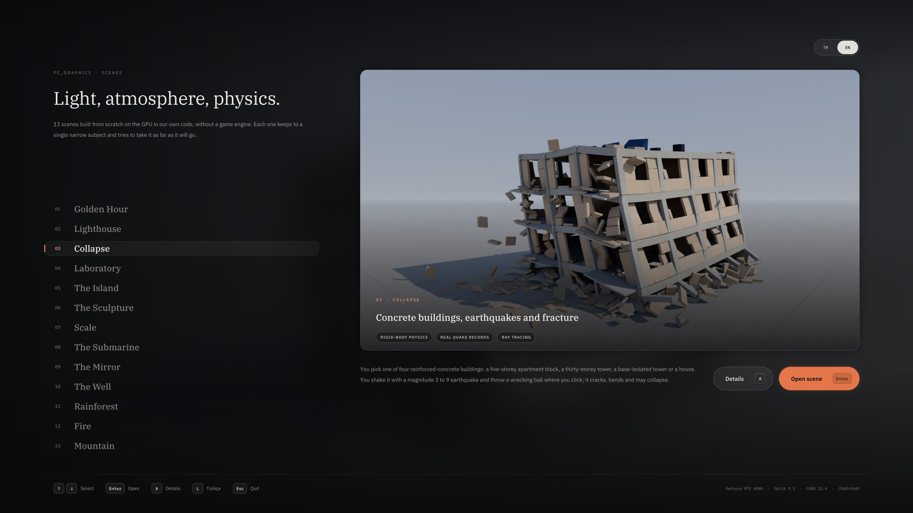
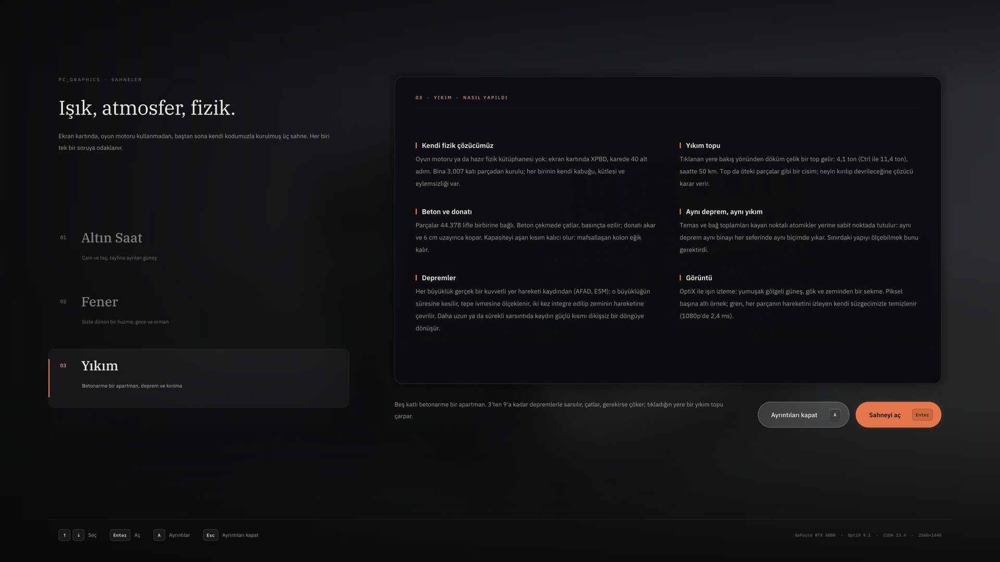

<div align="center">

# pc_graphics

**Art-directed scenes on the GPU, each with one narrow goal: correct light, then beauty, then physics.**

[](https://isocpp.org)
[](https://developer.nvidia.com/cuda-toolkit)
[](https://developer.nvidia.com/rtx/ray-tracing/optix)
[](#building)
[](#building)
[](#two-modes)
[](#licence)

[The application](#the-application) · [Scenes](#scenes) · [Scene 1 in depth](#what-scene-1-computes) · [Scene 3 in depth](#scene-3-the-physics) · [Building](#building) · [Running](#running) · [Layout](#repository-layout)

*[Türkçe](README.tr.md)*

</div>

---


A personal workshop for computer graphics as art direction: a series of scenes, each in its own session with one
narrow goal. It is not a game engine and it is not a benchmark. The first scene was about light being mathematically
right, the second about beauty, the third about physics: a building that feels real coming down in a way that feels
real.

Everything is written for one machine (an RTX 4080 driving a 2560×1440 IPS monitor) in C++, CUDA and OptiX, with no
engine underneath. Scene 1 is a spectral path tracer with a **still mode** that accumulates towards a reference image
and a **live mode** that keeps 20 to 30 frames per second with NVIDIA's AI denoiser. Scene 2 is a real-time volumetric
night. Scene 3 is a rigid-body and fracture solver of its own, drawn by a plain daylight ray tracer.

## The application

The three scenes live in one program. It opens on a gallery; a scene loads behind a loading screen (its programs
compile and its world is built on a worker thread, so the window stays alive) and then runs under an interface that is
the same for all of them: who and what at the bottom left, timings at the top right, the way out at the bottom right,
the keys on F1. The panel at the bottom left takes the mouse: a scene can put rows of choices, sliders and buttons there
(in Yıkım the magnitude, the length, start and stop). The gallery gives each scene a short description, and how it was
made under **Details**. Esc always leads back, and a scene that closes gives the GPU back entirely. The application
speaks Turkish or English (TR | EN at the top right of the gallery, or L); the choice is remembered.

| The gallery | Details: how it was made |
| --- | --- |
|  |  |


The look is one family for everything, IBM Plex: Serif for names, Sans for words, Mono for numbers and keys. Dark glass
panels over the pictures, and one accent colour per scene, taken from its light: warm gold, cold blue, safety orange.
A scene is a folder with its renderer, its settings and its OptiX programs, plus one line in the scene registry;
[docs/MIMARI.md](docs/MIMARI.md) (Turkish) describes the contract and how to add one.

## Scenes

### 1 · Glass and stone at golden hour *(Altın saatte cam ve taş)* · October 2026

A room in the language of Tadao Ando: cast concrete with form-panel joints and tie holes, a polished terrazzo floor
with brass divider strips, white plaster, a shallow pool. The sun stands eight degrees above the horizon and enters
only through narrow slits. In the beams hang crystal prisms; each one throws its own spectrum across the walls, and
in the haze the dispersed light opens into coloured fans. Soap bubbles drift through the light.

| Prism still life | The light plan from above |
| --- | --- |
|  |  |

The scene went through two art passes. The first answered *"is the light right?"* and produced a correct but quiet
image. The second answered *"what does the eye see at a glance?"*: a dark room, five slits, fourteen crystals, warm
balance. The renderer did not change between them; the scene did.

| First light (phase 1) | Live mode, 24 fps |
| --- | --- |
|  |  |

### 2 · Lighthouse *(Fener)* · October 2026

A night in the manner of Playdead's *Inside*: fog thick enough to carry a rotating beam, black fir silhouettes, a
near-monochrome palette with one warm window. Two fixed views, chosen from three value studies drawn before any 3D:
"the window" from a forested island and "the height" from a far headland. Space walks the camera 778 m between them
through the forest, with eye adaptation for the darkness inside it; Tab turns it into a small first-person walk.


| Inside the forest | From the far headland |
| --- | --- |
|  |  |

Surfaces, then single-scattering volume at full resolution, temporal accumulation, TAA and bloom: 7.6 ms a frame at
1440p. Some of it is deliberately not physical (named as such in [docs/fener/DURUM.md](docs/fener/DURUM.md)): the
beam's forward scattering is cut from about 100 to 5 times the side scattering, because a beam that lights the whole
fog when the camera is inside it is correct and flat.

### 3 · Collapse *(Yıkım)* · October 2026

Three buildings of the same concrete, steel and brick. A five-storey apartment block of the kind that fills Turkish
towns: shops behind glass on a tall ground storey, brick infill, balconies, a flat roof with water tanks and solar
collectors. A thirty-storey tower, 97 m: a frame around a plain-concrete core, a glass lobby at the front. And a one-storey
house with a gable roof: ridge beam, gable walls, a chimney. Earthquakes from magnitude 3 to 9 shake the ground under
them, each made from a real strong-motion record, or the viewer throws a wrecking ball with the mouse. The light is a plain sunny day on purpose; the effort went into the physics.


| Magnitude 6: the balcony parapets fall | Magnitude 7: the ground storey loses its infill, the frame stands |
| --- | --- |
|  |  |

| Bars left where a corner column was blown out | Magnitude 9: the soft storey gives way |
| --- | --- |
|  |  |

It runs live at 1080p, about 50 frames per second on the RTX 4080 with the denoising filter on, physics and picture side
by side on the GPU. Pick the magnitude (3 to 9) and the length (the magnitude's own up to until stopped) on the panel
with the mouse or with keys, start it; click to throw a wrecking ball, slow time down to a tenth.

| The tower: 30 storeys, 97 m, 8,404 pieces | The house: gable roof, 456 pieces |
| --- | --- |
|  |  |

| A wrecking ball hits a corner column (4.2 t, 14 m/s) | The column's foot thrown out, the column hanging askew, its bars bare |
| --- | --- |
|  |  |

## What scene 1 computes

| | |
| --- | --- |
| **Spectral transport** | Path tracing with four hero wavelengths per path (Wilkie et al. 2014), 360 to 830 nm sampled after the eye's sensitivity (pbrt-v4), CIE 1931 observer, reflectances as Jakob and Hanika sigmoid spectra fitted from sRGB on the host. |
| **Sun and sky** | A 5778 K blackbody with limb darkening, attenuated by a spherical atmosphere (Rayleigh, Mie aerosol, ozone Chappuis band). The sky is a 512×256×48-bin spectral map from single scattering through the same atmosphere, recomputed whenever the sun moves. At 10° elevation the sun comes out at about 3480 K. |
| **Light sampling** | Next-event estimation towards the sun's disk and towards the sky *through the openings* (portals), combined with BSDF sampling by multiple importance sampling. |
| **Materials** | Ando concrete (1820×910 mm panels, six tie holes each, V-joints, mottling), polished terrazzo with brass strips, plaster, SF11 and BK7 glass (Sellmeier), water (dispersion, Pope and Fry absorption, capillary-gravity ripples), soap film (Airy thin-film interference), brass. Procedural detail is baked once into a tileable noise texture from the same functions. |
| **Caustics** | Progressive spectral photon mapping (Knaus and Zwicker 2011): photons aimed from the sun at the glass and water, a GPU hash grid sorted with CUB, the gather radius shrinking frame by frame. |
| **Volumetric caustics** | Photon beams (Jarosz et al. 2011): the caustic photons' flights through the haze get their own acceleration structure, and camera rays collect them with ray tracing hardware. |
| **Haze** | Homogeneous participating medium, single scattering of sunlight, with distances sampled inside the analytically computed sunbeams. |
| **Camera and display** | Thin lens with a nine-bladed aperture, Gaussian pixel filter, AgX tone mapping, a lens-glare pyramid, white balance by Bradford adaptation, blue-noise dither for the 8-bit panel. |
| **Denoising** | OptiX AI denoiser with albedo and normal guides. The caustics never pass through it: they are added afterwards so that the spectra stay sharp. |

What the photon pass contributes, at the same 512 samples per pixel:

| Photons off: path tracing alone | Photons on |
| --- | --- |
|  |  |

## Two modes (scene 1)

| | Still | Live |
| --- | --- | --- |
| Goal | converge to the reference | stay fluid |
| Resolution | 2560×1440 traced | 1280×720 traced, upscaled ×2 by `TEMPORAL_UPSCALE2X` |
| Samples | accumulate without limit | one per pixel per frame |
| Denoiser | AI denoiser while under 8192 samples, then the raw image | temporal model every frame |
| Scene 1, crystals | ~8 samples/s | **24 fps** |
| Scene 1, still life (first lighting) | ~16 to 20 samples/s | 26 to 35 fps |

Space switches between them. In live mode the water ripples and the dust and bubbles drift.

## Decisions worth reading (scene 1)

- **One OptiX program, shading in ray generation.** Rays are traced with `optixTraverse`, threads are regrouped by
  material with `optixReorder` (shader execution reordering), then shaded in place. Measured: without reordering the
  path tracer is **6× slower**.
- **Spheres are custom primitives.** OptiX's built-in sphere is not hit from inside; the water-filled glass sphere
  came out black and bubbles behaved as single films. A one-flag experiment showed zero inside hits; the custom
  intersection reports both roots.
- **Measure before reducing variance.** Two techniques I expected to win (connecting to sunlit patches with
  three-way MIS, and importance sampling the sky map) were unbiased and correct, but lost at equal *time*. The real
  lever was cost: procedural textures took two thirds of the frame; baking them gave 2.3×. Both techniques remain
  in the code, off by default.
- **Caustics stay outside the denoiser.** Tried the other way: it smeared the spectra.
- **Weak dispersion is not paid for.** Water's refractive index varies by about 0.01 across the visible range; camera
  paths refract it along the hero wavelength only. Photons, which carry one wavelength each, stay fully dispersive.
- **Stratified spectral split for the prism.** Pixels that see dispersive glass trace the same path four times with
  the same random numbers, carrying a different wavelength through the glass each time. Giving those pixels 16
  separate samples instead was measured to stall the launch (11 to 48 ms): the samples ran serially in one thread.
- **Dust only for the camera.** Thousands of dust motes in their own acceleration structure with visibility mask 2:
  only primary rays see them. Cost went from 21 ms to nothing measurable.
- **Technically impressive is not the same as visually impressive.** The first finished scene was physically right
  and visually plain. Abundance and colour (fourteen crystals instead of one prism) and a dark room changed that in
  one short pass, without touching the renderer.

## What is verified (scene 1)

| Check | Result |
| --- | --- |
| Spectral self-test (`--selftest`) | D65 white point x 0.31271, y 0.32907; D65 renders as sRGB white to ±0.001; Sellmeier SF11 and BK7 at the Fraunhofer F, d, C lines within 6×10⁻⁵ of the catalogue; Fresnel, thin-film zeros and the Newton colour sequence of a soap film; sigmoid spectrum fit round trip |
| White furnace (`--furnace`) | every surface white, uniform sky: mean luminance 1 within 0.02 to 0.03 % on two seeds. It caught two real bugs on the way |
| Photons against path tracing | sun enlarged to 5° so plain path tracing can find caustics: ratio in caustic regions **0.991**, no double counting |
| Convergence | relative pixel error 0.62, 0.35, 0.19, 0.11 at 16, 64, 256, 1024 samples: the expected 1/√n |
| Distance to a 16,384-sample reference (NVIDIA FLIP, still life) | still mode with denoiser: 0.077 at 16 samples (0.7 s), 0.061 at 256, 0.041 at 1024; live mode 0.115 |
| Non-finite values | none in any run |
| On the real monitor | window on the RTX 4080 (`GL_RENDERER` logged), 2560×1440 at 165 Hz; live frame rate confirmed independently by RivaTuner's overlay |

**Not verified:** motion in live mode was judged from numbers (frame-to-frame difference) and single frames, not by
eye. The sky has no multiple scattering, so it is somewhat darker and less blue than a real one. Caustic light is
gathered at the first two diffuse bounces only (about 0.7 % missing). In live mode the prism's spectrum is grainy.

## Scene 3: the physics

The goal was film realism, not engineering accuracy: a collapse that feels heavy and plausible, from a solver that
holds together under real earthquake records.

| | |
| --- | --- |
| **Bodies** | Rigid convex pieces: 3,006 in the apartment block, 8,404 in the tower, 456 in the house (column and beam segments, slab panels, core walls, brick blocks, balconies, roofs), each with its own hull, mass and inertia. Positions in double precision. Slanting pieces (the roof, the gables) are boxes cut by planes; two pieces cut by the same plane from opposite sides are glued across it, with fibres drawn from a fine sampling of where both are. |
| **Bonds** | 6,857 interfaces carrying 44,378 fibres, after the applied element method: concrete cracks in tension and crushes in compression (30 % residual), bars yield and snap at 6 cm of plastic elongation, shear is cohesion and then friction plus dowel action. What exceeds a capacity becomes a permanent offset, so a column that has hinged stays bent. |
| **Solver** | XPBD on the GPU, 40 substeps a frame. Interfaces are solved Gauss-Seidel in 13 graph colours (the lower bound: the most interfaces on one body), with the multiplier accumulated across passes so capacities bound the total force. Contacts are Jacobi, and both bodies of a pair take the same share (one over the larger of their contact counts), so a pair keeps its momentum. The substep loop is a CUDA graph with branches: the interfaces on a high-priority branch while the contacts work on a copy of the poses taken after the integration (Jacobi between the two). Standing, its time comes from the colour passes more than from the piece count (11-15 ms for both the apartment block and the tower with 2.8 times as many pieces); during the tower's collapse 20-23 ms. |
| **Contact** | A narrow phase lists the pairs whose boxes can touch (one thread a pair); then eight lanes a pair, four pairs to a warp, and the big pairs (two slabs pancaked face to face) a whole warp each on a branch of their own. Sample points, in chunks culled by their boxes, against the other hull's planes; normal corrections averaged within the pair, then one friction impulse at the patch centre with static and dynamic budgets and anchors (as in PhysX), torsional friction and restitution. |
| **Determinism** | Contact and interface sums in 2⁻⁴⁰ fixed point instead of floating-point atomics, and nothing else left to the order threads arrive in (the friction anchors' table is rebuilt between frames): the same earthquake brings the same building down the same way, every run. One gap is open: the tower's collapse matches to 24 s, and has once parted later. |
| **Damping** | 5.3 % of critical, measured from free vibration: mass-proportional, relative to the ground, bonded bodies only, with capped accelerations so falling debris stays free. |
| **Earthquakes** | By magnitude, 3 to 9: what the building feels from a quake of that size some 15 km away. Each is made from the waveform of a real strong-motion record (ESM and AFAD TADAS: 2023 Antakya, 1999 Yarımca and İzmit, 2020 Bayraklı), cut to the strong-motion length that size brings, played faster for the small ones, scaled to that size's peak ground acceleration and baseline-corrected so the ground ends where it started; then integrated twice to the ground's displacement. A game's scale, not a seismological one: magnitude alone does not fix the shaking. Longer, or until stopped, the strong part becomes a seamless loop: its end blended into its start, integrated around the loop with the mean of acceleration and velocity taken out (the ground does not drift), played under an envelope with the record's own rise and fall. Stopping fades the ground out over 1.5 s. |
| **Wrecking ball** | A cast steel ball from the camera's side to the clicked point, at most one a second. Its power is a slider: size and speed together, from 0.52 t at 8 m/s (it barely moves a column) through the balanced 4.2 t at 14 m/s (breaks a corner column's foot out) to 11.4 t at 70 m/s (straight through the building), aimed for gravity. A body like the others, a convex hull of 256 tangent planes, shaded with the sphere's normal. The solver decides what breaks and what topples. |
| **Picture** | OptiX: every piece an instance of its own hull, transforms written by the physics straight into the instance buffer, top level rebuilt every frame. Sun with soft shadows, sky, one bounce off the ground, a metre grid that rides the earthquake. Reinforcing bars are drawn from the fibres' state: across a crack while they hold, as bent stubs once they are gone. |
| **Denoising** | Six samples a frame are grainy while things move. A light SVGF of our own: the lighting (beauty over albedo) is carried along each piece's own motion from frame to frame, checked by body, normal and distance, clamped to the new frame's neighbourhood when a shadow sweeps over it, then a-trous passes that stop at other bodies, normals, depth steps and lighting edges. 2.4 ms at 1080p. The OptiX AI denoiser is one key away (G): cleaner still, but it costs 9.7 ms and slows the physics that shares the GPU. |

What each magnitude does to the three buildings (one run each, measured ~8 s after the shaking ends; the fastest piece
in every run stays below a free fall from the building's top):

| Magnitude | Peak ground acceleration | Strong shaking | Apartment block | Tower | House |
| --- | --- | --- | --- | --- | --- |
| 3 · weak | 0.012 g | 3 s | nothing breaks | not measured | not measured |
| 4 · light | 0.035 g | 5 s | hairline cracks | not measured | not measured |
| 5 · moderate | 0.13 g | 8 s | cracks inside the bonds, nothing falls | nothing breaks | nothing breaks |
| 6 · strong | 0.20 g | 14 s | balcony parapets and some ground-storey infill fall | hairline cracks, drift 0.07 % | two cracks |
| 7 · severe | 0.33 g | 26 s | heavy damage, drift 0.60 %, the frame stands | soft storey: the lobby storey fails, the tower topples whole | six cracks |
| 8 · destructive | 0.70 g | 32 s | soft-storey collapse, the roof drops 13.5 m | not measured | collapses |
| 9 · catastrophic | 1.1 g | 45 s | collapse, the roof drops 12.7 m | collapses | collapses |

Under the real records at full scale (the apartment block, before the contact-share fix) it stood through 2020 Bayraklı, 1999 İzmit and 1999 Yarımca, and fell under 2023
Antakya and Yarımca ×1.5. Pazarcık's record (3.0 g vector peak) sat right at the threshold: it brought the building down
until a modelling bug was fixed at the very end (below), and it stands after it. A building at its limit is chaotic;
that is why the solver had to become deterministic before any of these results meant anything. That record is not
among the magnitudes: its energy sits in short periods, and scaled until the building falls it throws debris unlike
anything else.

Decisions worth reading:

- **Capacities bound the accumulated force, not each pass.** Bounded per pass, two passes carried twice the yield
  moment: a 6 m cantilever that should drop sagged 8.7 cm and stopped. Small "hinge" tests now check every section on
  its own; a frame's behaviour can only be read if its parts are right.
- **Friction belongs to the patch, not the point.** Per-point friction let a block creep 5 mm/s on a 25° slope, and
  friction that only undid the slip within a substep let a 15-block pyramid spread 0.65 m in 30 s; one friction
  impulse per patch, with anchors, brought that to 0.6 mm. Ordered normal corrections spun a box that landed flat;
  they are averaged within the pair.
- **Pushing overlaps apart builds up speed.** Debris pressed into the ground left at 22 to 52 m/s. Separation speed is
  capped; a ratchet in the first cap (allowing the previous separation speed) was found by tracing one block frame by
  frame.
- **A cut column still carries the building.** Wedged under four storeys it holds by contact and friction; removing a
  column means taking the body out of the world.
- **Floating-point atomics made a borderline building fall in one run and stand in the next.** Fixed-point sums made
  it reproducible, which is what made every later measurement mean something.
- **Damping, third attempt.** Explicit damping across interfaces stayed at 0.5 % whatever the coefficient; implicit
  stiffness damping softened the building (period 0.45 → 1.43 s); mass-proportional damping with capped accelerations
  gave 5.3 % without changing the period.
- **The live window draws one state while the GPU computes the next.** Physics and picture on two streams with an
  event between them: 28 fps became 55 to 75.
- **Showing the inner state is a check.** The first frame with reinforcing bars showed bars sticking out of fallen
  brick parapets. A piece's own steel ratio (the balconies') leaked into the brick it touched: bars with zero
  strength that still stiffened the parapet's base 1.8 times, and raised the force that cracks it by as much. No test
  and no clip had shown it. Fixing it moved Pazarcık ×1 from collapse to standing.
- **Pushing an overlap out must not throw things.** Overlaps were pushed out at up to 2 m/s. A brick parapet's
  crushing bond lets it sink a couple of centimetres into the beam; when its last fibre went, the overlap was pushed
  out at once and a 150 kg block left upwards at 3 to 4 m/s (Özcan saw it: light pieces flying instead of falling).
  At 0.5 m/s, bricks thrown from the building (more than 2 m/s gained in one frame, above 1 m) went from 93 to 1
  under Pazarcık and from 44 to 0 before Antakya's collapse; the tests and what each record does to the building
  stayed the same.
- **A denoiser that fits beside the physics.** The OptiX AI denoiser took the grain away completely, but at 9.7 ms it
  slowed the physics from 14.5 to 23 ms (they share the GPU): 40 fps and an earthquake at two thirds of its speed.
  Rigid bodies make a cheaper filter work well: their motion is known exactly, so each surface point keeps its own
  history. Its first version left lit blotches where a falling building's shadow swept the ground; clamping the history
  to the new frame's neighbourhood removed them.
- **A slow physics step is a slow world.** The window takes at most one step a frame, so the tower's collapse at
  40 to 50 ms a step ran at a third of real time. A clock in each part of the contact kernel showed where the time went:
  scanning the samples again in the later iterations (56 %) and the first scan (30 %), waiting on memory more than
  computing. Cheaper arithmetic per point gave nothing measurable; a shortcut that changed the physics (one contact
  iteration instead of four: 16 ms) left the tower standing at magnitude 7. What helped: a narrow phase of one thread
  a pair, eight lanes a pair instead of a warp, the big pairs on a branch of their own reusing their first iteration's
  points, and the contacts running alongside the interfaces, whose 26 small kernels a substep had left most of the GPU
  idle. 20 to 23 ms during the collapse.
- **Measuring it twice found a race.** Run twice, the tower's collapse came out differently (50 and 101 thousand
  broken fibres at the same moment); the apartment block's did not. A pair could take another pair's stale slot in the
  friction anchors' hash table on its way, and the anchor behind it was reset or not depending on which pair came
  first. The table is rebuilt between frames now and a pair looks for its own entry first: the runs match to 24 s.
  Past that they parted once (the roof's drift 75.3 against 76.6 m): a second source, not found yet.
- **A cut face may share only a thin band.** The house's slanting roof and gables are boxes cut by planes; their bonds
  first came from a 4 x 4 grid spread over the box's face, and where the shared part was a thin slanting band the ridge
  got no fibre at all: 163 fibres broke while the house settled under its own weight. Sampling the shared part finely
  and taking the fibres from there: none.
- **A roof either pushes or rests.** Two roof halves leaning on each other pushed the eaves out (2,174 cracked fibres; the
  house without its roof: none). A ridge beam was added, but glued to the gables' faces it pushed them out by 6-9 mm;
  resting on top of them, the house settles with no crack. Each step was found by counting broken and cracked fibres at
  rest, not by eye.
- **An average that does not keep momentum blew up in the biggest collapse.** Contact corrections were divided by each
  body's own contact count. In the tower's collapse two pieces wedged together, one touching many others, pushed each
  other unevenly and rose to 190 m at 105 m/s. With the same share for both bodies of a pair the fastest piece is 43.5
  m/s (a free fall from the top: 43.8); the tests and the apartment block's behaviour stayed the same.
- **A blow is a body, not magic.** A click used to take the piece out of the world (Özcan: the column "just vanishes").
  Now it throws a ball. A 1.4 t ball moved a corner column by only 7 cm: in a model of rigid pieces a blow cannot crush
  locally, it spreads over the whole 2.2 m piece, and the shear capacity of its two bonds eats the momentum before the
  slip reaches breaking. A 4.2 t ball broke the column's foot out and toppled the rest; the solver was not touched.
- **Measure the structure, not what stands on it.** "Roof drift" was averaged over the highest pieces, which were the
  brick parapet; a parapet thrown off read as the roof falling 9.7 m from a building still standing.

**Not verified:** a 5 m cantilever of ten rigid segments is 2.9 times too soft at the default substep count (long rigid
chains converge slowly; the building's measured period, 0.45 s, is close to the code formula's 0.54 s). The building
is not checked against an engineering analysis; the solver's tests (free fall, stacking, slopes, energy, hinges,
determinism, damping, the earthquake loop) are physical sanity checks, 32 of 34 passing, the two failures being the cantilever. Motion was
judged by Özcan from clips, not by the author's eye.

## Building

**Requirements:** Windows 11, an NVIDIA RTX GPU with a driver that ships OptiX 9.1 (tested on an RTX 4080 with
driver 617.14), Visual Studio 2026 with the C++ workload (MSVC 14.51, its bundled CMake and Ninja), Git Bash, and
Python 3 for the tools (`numpy`, `pillow`, `OpenEXR`, `flip-evaluator`).

```bash
bash third_party/fetch.sh        # CUDA 13.4.2 redistributables, OptiX 9.1 headers, GLFW, stb (incl. stb_truetype), tinyexr
```

Nothing is installed and the graphics driver is not touched: CUDA comes as NVIDIA's per-component archives into
`third_party/`, which is not committed.

```bat
cmd /c build.bat                 :: configures once, then builds build\pc_graphics.exe (the one program)
```

The OptiX device programs (`src/scenes/<scene>/device/`) are compiled at run time with NVRTC, so editing them needs no
rebuild: press **F5** in the scene.

## Running

```bat
build\pc_graphics.exe                       :: the gallery, borderless full screen on the primary monitor
build\pc_graphics.exe --scene yikim         :: straight into a scene (altinsaat, fener, yikim); Esc leads to the gallery
build\pc_graphics.exe --windowed            :: in a 1280x720 window
build\pc_graphics.exe --set key=value       :: a setting of the scenes (scenes/<id>.cfg), repeatable
build\pc_graphics.exe --lang en             :: English (or tr); otherwise the one chosen last in the gallery
build\pc_graphics.exe --autotest            :: the whole application once through by script; screens to captures\arayuz
```

| Everywhere | |
| --- | --- |
| Esc | back: help → scene → gallery → out |
| F1 | the scene's keys |
| H | hide the interface |
| F12 | screenshot of the scene (`captures\<scene>_<date>`; scene 1 also writes a linear EXR) |
| F5 | reload the scene's settings and recompile its OptiX programs (scenes 1 and 2) |
| ↑ ↓, 1 to 3, Enter, mouse | choose and open in the gallery |
| A | the scene's details in the gallery (how it was made) |
| L | the language in the gallery: Turkish ↔ English (TR \| EN at the top right) |

| Scene 1 · Golden Hour | Scene 2 · Lighthouse | Scene 3 · Collapse |
| --- | --- | --- |
| Space still ↔ live · C next camera · ↑ ↓ exposure · ← → focus · R reset · P, V, N, D, G photons, haze, next-event estimation, denoiser, sun patches · 1 to 5 beauty, albedo, normal, caustics, cost | Space walk A ↔ B · B jump to the other view · P pause time · ← → time ∓1 s · ↑ ↓ exposure · 1 to 5 views · Tab first-person walk (WASD, mouse, Shift run, Space jump) | the panel's Building: apartment block, tower, house · 3 to 9 magnitude · ← → length (at the end: until stopped) · Space start or stop (with the mouse on the panel too) · T slow motion · P pause · left click wrecking ball (at most one a second) · ↑ ↓ its power · R rebuild · right mouse look · WASD, E/Q fly · Shift faster · wheel zoom · B bars · G denoising |

The scenes' tools run without a window, from the same program:

```bat
build\pc_graphics.exe --headless --spp 2048 --denoise --out captures\name          :: scene 1 (also with --scene altinsaat)
build\pc_graphics.exe --headless --live 80 --out captures\live\name
build\pc_graphics.exe --selftest
build\pc_graphics.exe --scene fener --headless --frames 64 --out captures\name
build\pc_graphics.exe --scene fener --map captures\harita.png
build\pc_graphics.exe --scene yikim --test                                          :: the solver's physical tests
build\pc_graphics.exe --scene yikim --clip sarsinti --seconds 40 --set deprem.magnitude=7 --out captures\yikim\name
```

Each scene's list is at the top of its `src/scenes/<scene>/<scene>_app.cpp`. A short Turkish guide for a demonstration
is in [DEMO.md](DEMO.md) (Turkish: [GOSTERI.md](GOSTERI.md)).

## Repository layout

```
src/
  app/                the application: window, gallery, loading, the interface over a scene, help, scene registry
  ui/                 the interface kit: rounded panels, shadows, images, text in IBM Plex (OpenGL 2, one GLSL program)
  core/               what the scenes share: settings files, image reading and writing, GPU readings (NVML), bloom
  shared/             headers shared by host and device code: vectors, tone mapping, spectra
  scenes/
    altinsaat/        scene 1: spectral path tracer, photon grid, AI denoiser; device/ its OptiX programs
    fener/            scene 2: world generation, real-time light pipeline, player; device/
    yikim/            scene 3: hulls, the GPU solver (phys.cu), the building, earthquakes, tests, denoising filter; device/
scenes/               the scenes' settings (<scene>.cfg)
assets/               fonts (IBM Plex), gallery pictures, blue-noise texture, earthquake records (ESM, AFAD TADAS)
tools/                EXR statistics, FLIP and RMSE comparison, noise maps, contact sheets, prism planner, value studies
docs/                 working journal in Turkish: application status and architecture; one folder per scene (plan, status)
third_party/fetch.sh  fetches the dependencies; the folder itself is not committed
```

## Next scenes

- Talked about, not started: a small complete game without an engine, set in the lighthouse's world (relight the
  lighthouse, the beam as a puzzle, danger in the dark).
- Scene 3 could still take dust (the fog machinery of scene 2 is the starting point), rougher fracture surfaces and
  glass; it was closed without them, on purpose: its goal was the physics.

## Licence

Private repository. All rights reserved. Third-party components are fetched at build time under their own licences:
the NVIDIA CUDA redistributables and OptiX SDK headers, GLFW (zlib), stb (public domain), tinyexr (BSD). The IBM Plex
fonts in `assets/fonts` are under the SIL Open Font License (`assets/fonts/LICENSE.txt`). Earthquake records: ESM, the
Engineering Strong-Motion database (Mascandola et al., doi 10.13127/esm.3), and AFAD TADAS.

Developed with Claude Code (Anthropic) in long autonomous sessions; the measurements behind every decision are in
[docs/DURUM.md](docs/DURUM.md) (the application), [docs/altinsaat/DURUM.md](docs/altinsaat/DURUM.md),
[docs/fener/DURUM.md](docs/fener/DURUM.md) and [docs/yikim/DURUM.md](docs/yikim/DURUM.md), and an honest account of where
the work on scene 1 went wrong is in [docs/altinsaat/SINIRLAR.md](docs/altinsaat/SINIRLAR.md).
