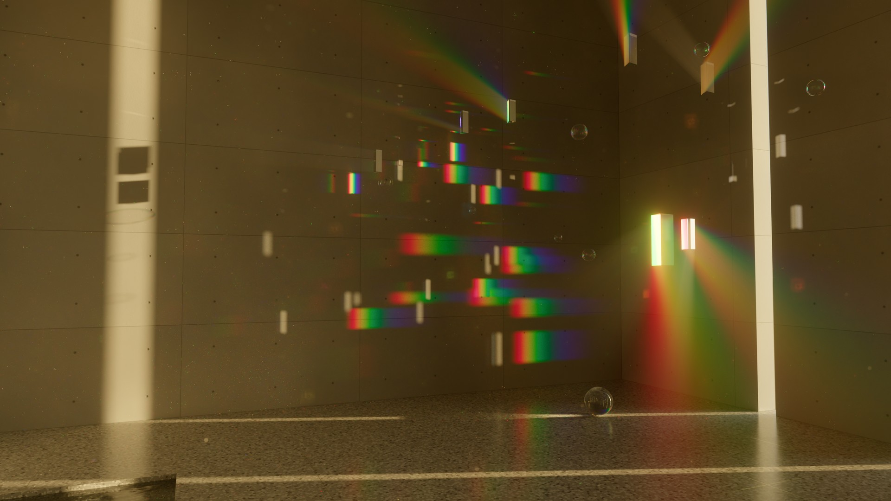
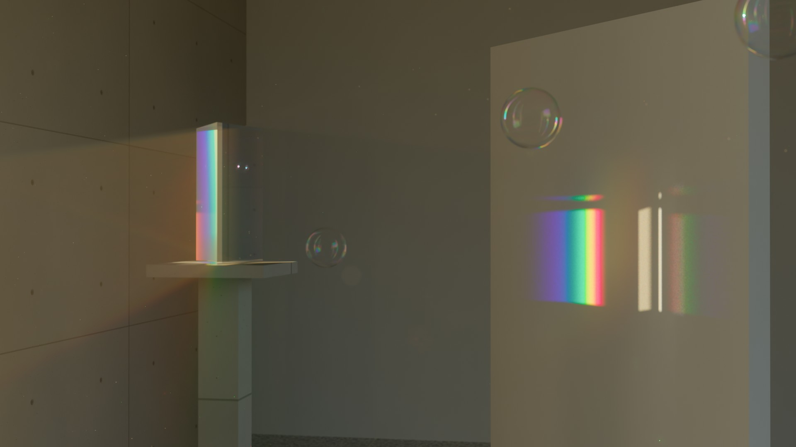
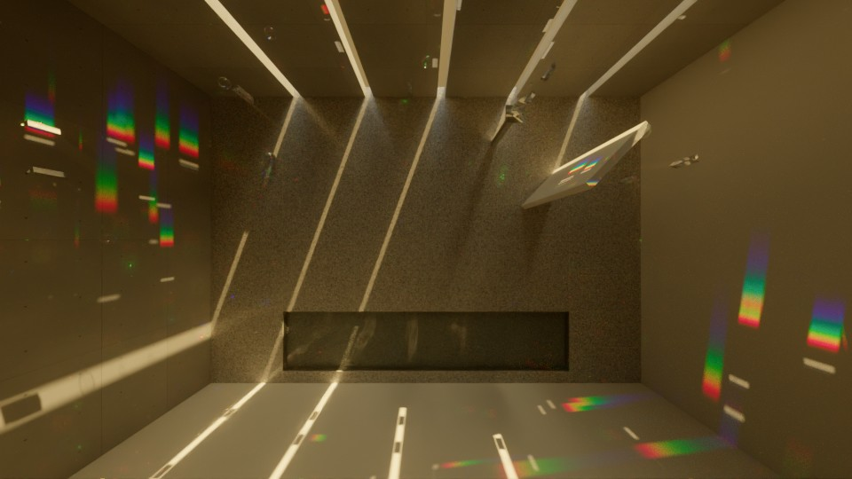
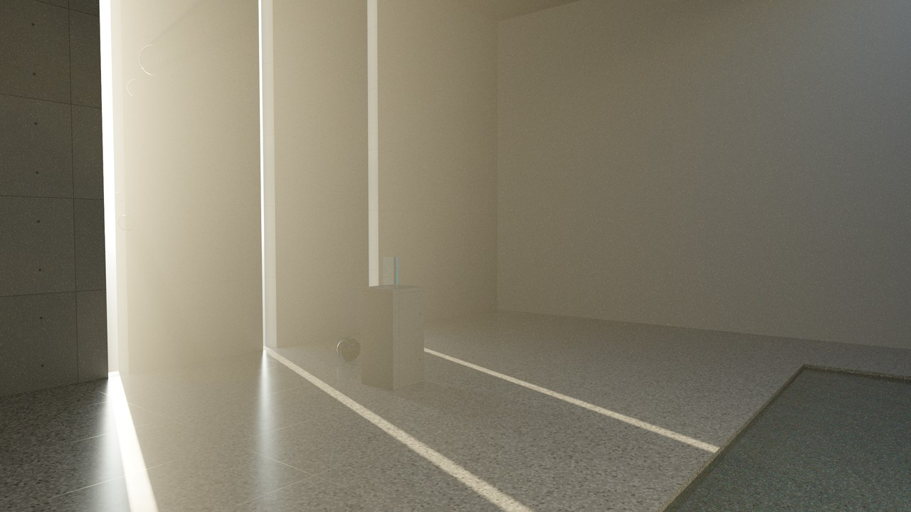
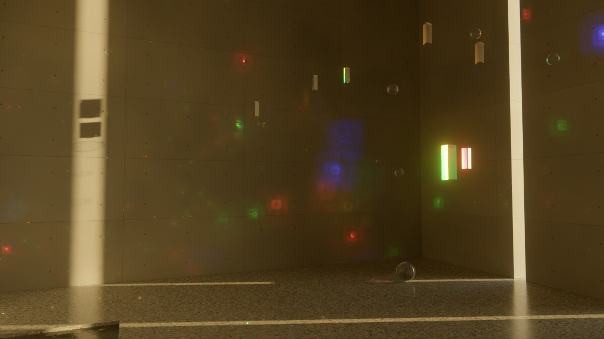
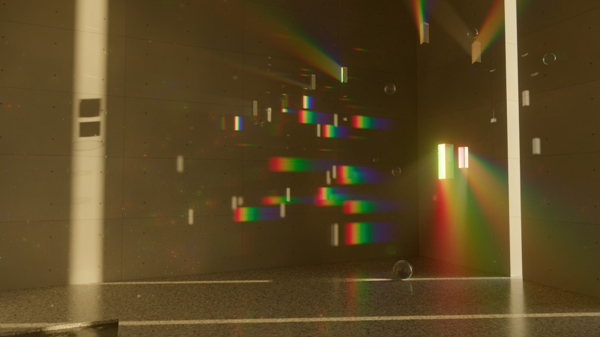

<div align="center">

# pc_graphics

**Art-directed scenes on a spectral path tracer. Every ray of light is computed; nothing is painted on.**

[](https://isocpp.org)
[](https://developer.nvidia.com/cuda-toolkit)
[](https://developer.nvidia.com/rtx/ray-tracing/optix)
[](#building)
[](#building)
[](#two-modes)
[](#licence)

[Scenes](#scenes) · [What it computes](#what-it-computes) · [Two modes](#two-modes) · [Decisions](#decisions-worth-reading) · [What is verified](#what-is-verified) · [Building](#building) · [Running](#running) · [Next](#next-scenes)

*[Türkçe](README.tr.md)*

</div>

---



A personal workshop for computer graphics as art direction: one renderer, a series of scenes. It is not a game
engine and it is not a benchmark. Each scene is built around light: what the eye should see first, and what the
physics has to get right for that to be believable.

The renderer is a spectral path tracer written for one machine (an RTX 4080 driving a 2560×1440 IPS monitor). It
runs in two modes: a **still mode** that accumulates towards a reference image, and a **live mode** that keeps
20 to 30 frames per second with the help of NVIDIA's AI denoiser.

## Scenes

### 1 · Glass and stone at golden hour *(Altın saatte cam ve taş)* · October 2026

A room in the language of Tadao Ando: cast concrete with form-panel joints and tie holes, a polished terrazzo floor
with brass divider strips, white plaster, a shallow pool. The sun stands eight degrees above the horizon and enters
only through narrow slits. In the beams hang crystal prisms; each one throws its own spectrum across the walls, and
in the haze the dispersed light opens into coloured fans. Soap bubbles drift through the light.

| Prism still life | The light plan from above |
| --- | --- |
|  |  |

The scene went through two art passes. The first answered *"is the light right?"* and produced a correct but quiet
image. The second answered *"what does the eye see at a glance?"*: a dark room, five slits, fourteen crystals, warm
balance. The renderer did not change between them; the scene did.

| First light (phase 1) | Live mode, 24 fps |
| --- | --- |
|  |  |

## What it computes

| | |
| --- | --- |
| **Spectral transport** | Path tracing with four hero wavelengths per path (Wilkie et al. 2014), 360 to 830 nm sampled after the eye's sensitivity (pbrt-v4), CIE 1931 observer, reflectances as Jakob and Hanika sigmoid spectra fitted from sRGB on the host. |
| **Sun and sky** | A 5778 K blackbody with limb darkening, attenuated by a spherical atmosphere (Rayleigh, Mie aerosol, ozone Chappuis band). The sky is a 512×256×48-bin spectral map from single scattering through the same atmosphere, recomputed whenever the sun moves. At 10° elevation the sun comes out at about 3480 K. |
| **Light sampling** | Next-event estimation towards the sun's disk and towards the sky *through the openings* (portals), combined with BSDF sampling by multiple importance sampling. |
| **Materials** | Ando concrete (1820×910 mm panels, six tie holes each, V-joints, mottling), polished terrazzo with brass strips, plaster, SF11 and BK7 glass (Sellmeier), water (dispersion, Pope and Fry absorption, capillary-gravity ripples), soap film (Airy thin-film interference), brass. Procedural detail is baked once into a tileable noise texture from the same functions. |
| **Caustics** | Progressive spectral photon mapping (Knaus and Zwicker 2011): photons aimed from the sun at the glass and water, a GPU hash grid sorted with CUB, the gather radius shrinking frame by frame. |
| **Volumetric caustics** | Photon beams (Jarosz et al. 2011): the caustic photons' flights through the haze get their own acceleration structure, and camera rays collect them with ray tracing hardware. |
| **Haze** | Homogeneous participating medium, single scattering of sunlight, with distances sampled inside the analytically computed sunbeams. |
| **Camera and display** | Thin lens with a nine-bladed aperture, Gaussian pixel filter, AgX tone mapping, a lens-glare pyramid, white balance by Bradford adaptation, blue-noise dither for the 8-bit panel. |
| **Denoising** | OptiX AI denoiser with albedo and normal guides. The caustics never pass through it: they are added afterwards so that the spectra stay sharp. |

What the photon pass contributes, at the same 512 samples per pixel:

| Photons off: path tracing alone | Photons on |
| --- | --- |
|  |  |

## Two modes

| | Still | Live |
| --- | --- | --- |
| Goal | converge to the reference | stay fluid |
| Resolution | 2560×1440 traced | 1280×720 traced, upscaled ×2 by `TEMPORAL_UPSCALE2X` |
| Samples | accumulate without limit | one per pixel per frame |
| Denoiser | AI denoiser while under 8192 samples, then the raw image | temporal model every frame |
| Scene 1, crystals | ~8 samples/s | **24 fps** |
| Scene 1, still life (first lighting) | ~16 to 20 samples/s | 26 to 35 fps |

Space switches between them. In live mode the water ripples and the dust and bubbles drift.

## Decisions worth reading

- **One OptiX program, shading in ray generation.** Rays are traced with `optixTraverse`, threads are regrouped by
  material with `optixReorder` (shader execution reordering), then shaded in place. Measured: without reordering the
  path tracer is **6× slower**.
- **Spheres are custom primitives.** OptiX's built-in sphere is not hit from inside; the water-filled glass sphere
  came out black and bubbles behaved as single films. A one-flag experiment showed zero inside hits; the custom
  intersection reports both roots.
- **Measure before reducing variance.** Two techniques I expected to win (connecting to sunlit patches with
  three-way MIS, and importance sampling the sky map) were unbiased and correct, but lost at equal *time*. The real
  lever was cost: procedural textures took two thirds of the frame; baking them gave 2.3×. Both techniques remain
  in the code, off by default.
- **Caustics stay outside the denoiser.** Tried the other way: it smeared the spectra.
- **Weak dispersion is not paid for.** Water's refractive index varies by about 0.01 across the visible range; camera
  paths refract it along the hero wavelength only. Photons, which carry one wavelength each, stay fully dispersive.
- **Stratified spectral split for the prism.** Pixels that see dispersive glass trace the same path four times with
  the same random numbers, carrying a different wavelength through the glass each time. Giving those pixels 16
  separate samples instead was measured to stall the launch (11 to 48 ms): the samples ran serially in one thread.
- **Dust only for the camera.** Thousands of dust motes in their own acceleration structure with visibility mask 2:
  only primary rays see them. Cost went from 21 ms to nothing measurable.
- **Technically impressive is not the same as visually impressive.** The first finished scene was physically right
  and visually plain. Abundance and colour (fourteen crystals instead of one prism) and a dark room changed that in
  one short pass, without touching the renderer.

## What is verified

| Check | Result |
| --- | --- |
| Spectral self-test (`--selftest`) | D65 white point x 0.31271, y 0.32907; D65 renders as sRGB white to ±0.001; Sellmeier SF11 and BK7 at the Fraunhofer F, d, C lines within 6×10⁻⁵ of the catalogue; Fresnel, thin-film zeros and the Newton colour sequence of a soap film; sigmoid spectrum fit round trip |
| White furnace (`--furnace`) | every surface white, uniform sky: mean luminance 1 within 0.02 to 0.03 % on two seeds. It caught two real bugs on the way |
| Photons against path tracing | sun enlarged to 5° so plain path tracing can find caustics: ratio in caustic regions **0.991**, no double counting |
| Convergence | relative pixel error 0.62, 0.35, 0.19, 0.11 at 16, 64, 256, 1024 samples: the expected 1/√n |
| Distance to a 16,384-sample reference (NVIDIA FLIP, still life) | still mode with denoiser: 0.077 at 16 samples (0.7 s), 0.061 at 256, 0.041 at 1024; live mode 0.115 |
| Non-finite values | none in any run |
| On the real monitor | window on the RTX 4080 (`GL_RENDERER` logged), 2560×1440 at 165 Hz; live frame rate confirmed independently by RivaTuner's overlay |

**Not verified:** motion in live mode was judged from numbers (frame-to-frame difference) and single frames, not by
eye. The sky has no multiple scattering, so it is somewhat darker and less blue than a real one. Caustic light is
gathered at the first two diffuse bounces only (about 0.7 % missing). In live mode the prism's spectrum is grainy.

## Building

**Requirements:** Windows 11, an NVIDIA RTX GPU with a driver that ships OptiX 9.1 (tested on an RTX 4080 with
driver 617.14), Visual Studio 2026 with the C++ workload (MSVC 14.51, its bundled CMake and Ninja), Git Bash, and
Python 3 for the tools (`numpy`, `pillow`, `OpenEXR`, `flip-evaluator`).

```bash
bash third_party/fetch.sh        # CUDA 13.4.2 redistributables, OptiX 9.1 headers, GLFW, stb, tinyexr
```

Nothing is installed and the graphics driver is not touched: CUDA comes as NVIDIA's per-component archives into
`third_party/`, which is not committed.

```bat
cmd /c build.bat                 :: configures once, then builds build\pc_graphics.exe
```

The OptiX device programs in `src/device/` are compiled at run time with NVRTC, so editing them needs no rebuild:
press **F5** in the window.

## Running

```bat
build\pc_graphics.exe                                   :: borderless full screen, still mode
build\pc_graphics.exe --headless --spp 2048 --denoise --out captures\name
build\pc_graphics.exe --headless --live 80 --out captures\live\name
build\pc_graphics.exe --selftest
build\pc_graphics.exe --headless --furnace --spp 512 --out captures\furnace
```

| Key | |
| --- | --- |
| Space | still ↔ live |
| C | next camera |
| H | heads-up display (fps, milliseconds per pass, samples, watts, temperature) |
| S | screenshot, PNG and linear EXR |
| ↑ ↓ / ← → | exposure / focus distance |
| D, P, V, N | denoiser, photons, haze, next-event estimation on and off |
| 1 to 5 | beauty, albedo, normal, caustics only, cost heat map |
| F5 | recompile the device programs and reload `scene.cfg` |

Scene parameters (sun, haze, white balance, cameras, crystals) live in `scene.cfg`. A short Turkish guide for the
demonstration is in [GOSTERI.md](GOSTERI.md).

## Repository layout

```
src/
  main.cpp            window, keys, headless and live measurement modes
  renderer.cpp        OptiX context, NVRTC, pipeline, acceleration structures, launches
  scene.cpp           the room, materials, cameras, spectral fitting and self-tests
  photons.cu          photon hash grid (CUB radix sort), beam bounding boxes
  kernels.cu          denoiser inputs, lens-glare pyramid
  denoiser.cpp        OptiX AI denoiser: AOV, temporal, temporal 2× upscale
  device/             OptiX programs: path tracer, photons, sky, tone mapping (compiled at run time)
  shared/             code shared by host and device: vectors, spectra, parameters, display transform
tools/                EXR statistics, FLIP and RMSE comparison, noise maps, contact sheets, prism planner
assets/               blue-noise texture (void and cluster, generated by tools/bluenoise.py)
docs/                 working journal in Turkish: plan, status board with every measurement, limits report
third_party/fetch.sh  fetches the dependencies; the folder itself is not committed
```

## Next scenes

- **A lighthouse in the manner of *Inside*** (Playdead): fog thick enough to carry a rotating beam, silhouettes
  against a pale sky, rain, a near-monochrome palette with one accent. The volumetric machinery from scene 1 (beam
  sampling, single scattering, photon beams) is the starting point.
- Scene selection from the command line, one configuration file per scene.

## Licence

Private repository. All rights reserved. Third-party components are fetched at build time under their own licences:
the NVIDIA CUDA redistributables and OptiX SDK headers, GLFW (zlib), stb (public domain), tinyexr (BSD).

Developed with Claude Code (Anthropic) in long autonomous sessions; the measurements behind every decision are in
[docs/DURUM.md](docs/DURUM.md), and an honest account of where the work went wrong is in
[docs/SINIRLAR.md](docs/SINIRLAR.md).
