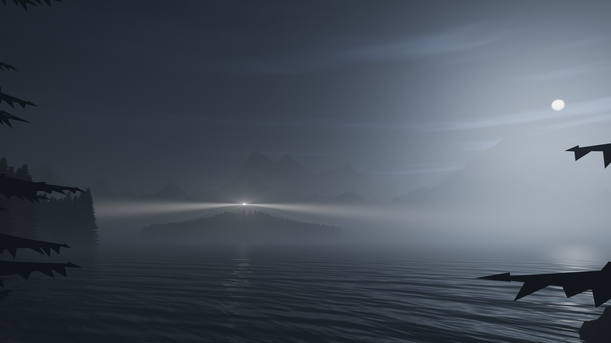
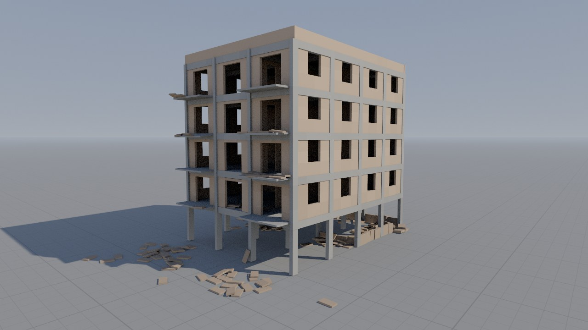
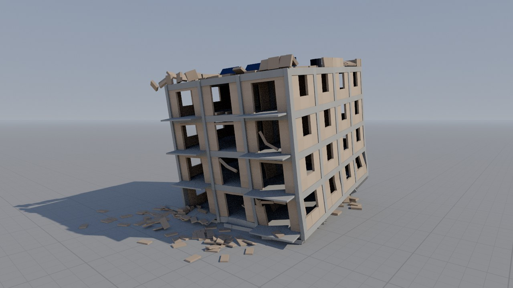
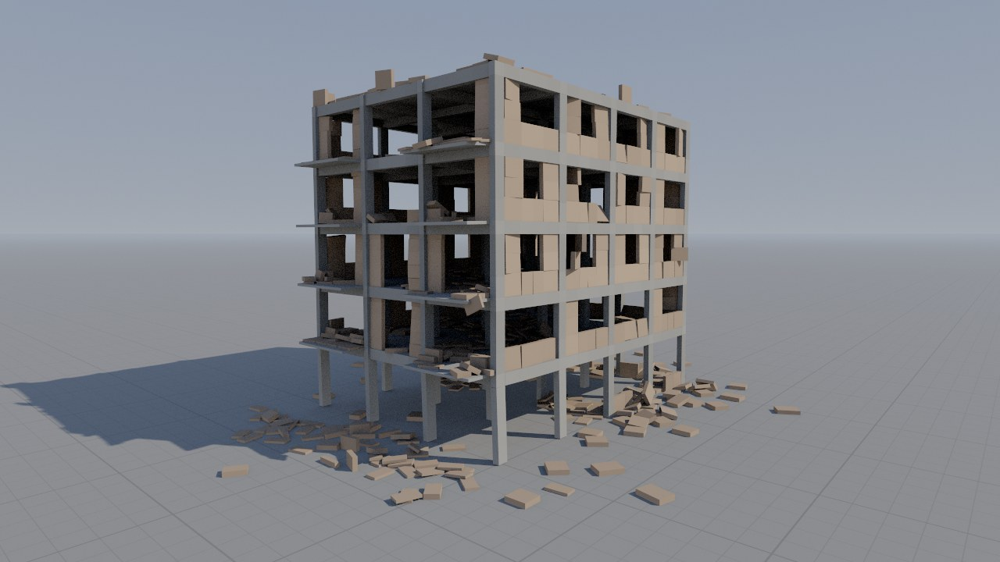

<div align="center">

# pc_graphics

**Art-directed scenes on the GPU, each with one narrow goal: correct light, then beauty, then physics.**

[](https://isocpp.org)
[](https://developer.nvidia.com/cuda-toolkit)
[](https://developer.nvidia.com/rtx/ray-tracing/optix)
[](#building)
[](#building)
[](#two-modes)
[](#licence)

[Scenes](#scenes) · [Scene 1 in depth](#what-scene-1-computes) · [Scene 3 in depth](#scene-3-the-physics) · [Building](#building) · [Running](#running) · [Next](#next-scenes)

*[Türkçe](README.tr.md)*

</div>

---


A personal workshop for computer graphics as art direction: a series of scenes, each in its own session with one
narrow goal. It is not a game engine and it is not a benchmark. The first scene was about light being mathematically
right, the second about beauty, the third about physics: a building that feels real coming down in a way that feels
real.

Everything is written for one machine (an RTX 4080 driving a 2560×1440 IPS monitor) in C++, CUDA and OptiX, with no
engine underneath. Scene 1 is a spectral path tracer with a **still mode** that accumulates towards a reference image
and a **live mode** that keeps 20 to 30 frames per second with NVIDIA's AI denoiser. Scene 2 is a real-time volumetric
night. Scene 3 is a rigid-body and fracture solver of its own, drawn by a plain daylight ray tracer.

## Scenes

### 1 · Glass and stone at golden hour *(Altın saatte cam ve taş)* · October 2026

A room in the language of Tadao Ando: cast concrete with form-panel joints and tie holes, a polished terrazzo floor
with brass divider strips, white plaster, a shallow pool. The sun stands eight degrees above the horizon and enters
only through narrow slits. In the beams hang crystal prisms; each one throws its own spectrum across the walls, and
in the haze the dispersed light opens into coloured fans. Soap bubbles drift through the light.

| Prism still life | The light plan from above |
| --- | --- |
|  |  |

The scene went through two art passes. The first answered *"is the light right?"* and produced a correct but quiet
image. The second answered *"what does the eye see at a glance?"*: a dark room, five slits, fourteen crystals, warm
balance. The renderer did not change between them; the scene did.

| First light (phase 1) | Live mode, 24 fps |
| --- | --- |
|  |  |

### 2 · Lighthouse *(Fener)* · October 2026

A night in the manner of Playdead's *Inside*: fog thick enough to carry a rotating beam, black fir silhouettes, a
near-monochrome palette with one warm window. Two fixed views, chosen from three value studies drawn before any 3D:
"the window" from a forested island and "the height" from a far headland. Space walks the camera 778 m between them
through the forest, with eye adaptation for the darkness inside it; Tab turns it into a small first-person walk.


| Inside the forest | From the far headland |
| --- | --- |
|  |  |

Surfaces, then single-scattering volume at full resolution, temporal accumulation, TAA and bloom: 7.6 ms a frame at
1440p. Some of it is deliberately not physical (named as such in [docs/fener/DURUM.md](docs/fener/DURUM.md)): the
beam's forward scattering is cut from about 100 to 5 times the side scattering, because a beam that lights the whole
fog when the camera is inside it is correct and flat.

### 3 · Collapse *(Yıkım)* · October 2026

A five-storey reinforced concrete apartment block of the kind that fills Turkish towns: shops behind glass on a tall
ground storey, brick infill, balconies, a flat roof with water tanks and solar collectors. Real earthquake records
shake the ground under it, or the viewer blows its columns out with the mouse. The light is a plain sunny day on
purpose; the effort went into the physics.


| The same building, 1999 Yarımca record at 1.0× | and at 1.5× |
| --- | --- |
|  |  |

| Bars left where a corner column was blown out | 2023 Pazarcık at 1.0×: standing, stripped of its infill |
| --- | --- |
|  |  |

It runs live: a full-screen window at 1080p, 55 to 75 frames per second on the RTX 4080, physics and picture side by
side on the GPU. Click to blow pieces out, start any of the five records, slow time down to a tenth.

## What scene 1 computes

| | |
| --- | --- |
| **Spectral transport** | Path tracing with four hero wavelengths per path (Wilkie et al. 2014), 360 to 830 nm sampled after the eye's sensitivity (pbrt-v4), CIE 1931 observer, reflectances as Jakob and Hanika sigmoid spectra fitted from sRGB on the host. |
| **Sun and sky** | A 5778 K blackbody with limb darkening, attenuated by a spherical atmosphere (Rayleigh, Mie aerosol, ozone Chappuis band). The sky is a 512×256×48-bin spectral map from single scattering through the same atmosphere, recomputed whenever the sun moves. At 10° elevation the sun comes out at about 3480 K. |
| **Light sampling** | Next-event estimation towards the sun's disk and towards the sky *through the openings* (portals), combined with BSDF sampling by multiple importance sampling. |
| **Materials** | Ando concrete (1820×910 mm panels, six tie holes each, V-joints, mottling), polished terrazzo with brass strips, plaster, SF11 and BK7 glass (Sellmeier), water (dispersion, Pope and Fry absorption, capillary-gravity ripples), soap film (Airy thin-film interference), brass. Procedural detail is baked once into a tileable noise texture from the same functions. |
| **Caustics** | Progressive spectral photon mapping (Knaus and Zwicker 2011): photons aimed from the sun at the glass and water, a GPU hash grid sorted with CUB, the gather radius shrinking frame by frame. |
| **Volumetric caustics** | Photon beams (Jarosz et al. 2011): the caustic photons' flights through the haze get their own acceleration structure, and camera rays collect them with ray tracing hardware. |
| **Haze** | Homogeneous participating medium, single scattering of sunlight, with distances sampled inside the analytically computed sunbeams. |
| **Camera and display** | Thin lens with a nine-bladed aperture, Gaussian pixel filter, AgX tone mapping, a lens-glare pyramid, white balance by Bradford adaptation, blue-noise dither for the 8-bit panel. |
| **Denoising** | OptiX AI denoiser with albedo and normal guides. The caustics never pass through it: they are added afterwards so that the spectra stay sharp. |

What the photon pass contributes, at the same 512 samples per pixel:

| Photons off: path tracing alone | Photons on |
| --- | --- |
|  |  |

## Two modes (scene 1)

| | Still | Live |
| --- | --- | --- |
| Goal | converge to the reference | stay fluid |
| Resolution | 2560×1440 traced | 1280×720 traced, upscaled ×2 by `TEMPORAL_UPSCALE2X` |
| Samples | accumulate without limit | one per pixel per frame |
| Denoiser | AI denoiser while under 8192 samples, then the raw image | temporal model every frame |
| Scene 1, crystals | ~8 samples/s | **24 fps** |
| Scene 1, still life (first lighting) | ~16 to 20 samples/s | 26 to 35 fps |

Space switches between them. In live mode the water ripples and the dust and bubbles drift.

## Decisions worth reading (scene 1)

- **One OptiX program, shading in ray generation.** Rays are traced with `optixTraverse`, threads are regrouped by
  material with `optixReorder` (shader execution reordering), then shaded in place. Measured: without reordering the
  path tracer is **6× slower**.
- **Spheres are custom primitives.** OptiX's built-in sphere is not hit from inside; the water-filled glass sphere
  came out black and bubbles behaved as single films. A one-flag experiment showed zero inside hits; the custom
  intersection reports both roots.
- **Measure before reducing variance.** Two techniques I expected to win (connecting to sunlit patches with
  three-way MIS, and importance sampling the sky map) were unbiased and correct, but lost at equal *time*. The real
  lever was cost: procedural textures took two thirds of the frame; baking them gave 2.3×. Both techniques remain
  in the code, off by default.
- **Caustics stay outside the denoiser.** Tried the other way: it smeared the spectra.
- **Weak dispersion is not paid for.** Water's refractive index varies by about 0.01 across the visible range; camera
  paths refract it along the hero wavelength only. Photons, which carry one wavelength each, stay fully dispersive.
- **Stratified spectral split for the prism.** Pixels that see dispersive glass trace the same path four times with
  the same random numbers, carrying a different wavelength through the glass each time. Giving those pixels 16
  separate samples instead was measured to stall the launch (11 to 48 ms): the samples ran serially in one thread.
- **Dust only for the camera.** Thousands of dust motes in their own acceleration structure with visibility mask 2:
  only primary rays see them. Cost went from 21 ms to nothing measurable.
- **Technically impressive is not the same as visually impressive.** The first finished scene was physically right
  and visually plain. Abundance and colour (fourteen crystals instead of one prism) and a dark room changed that in
  one short pass, without touching the renderer.

## What is verified (scene 1)

| Check | Result |
| --- | --- |
| Spectral self-test (`--selftest`) | D65 white point x 0.31271, y 0.32907; D65 renders as sRGB white to ±0.001; Sellmeier SF11 and BK7 at the Fraunhofer F, d, C lines within 6×10⁻⁵ of the catalogue; Fresnel, thin-film zeros and the Newton colour sequence of a soap film; sigmoid spectrum fit round trip |
| White furnace (`--furnace`) | every surface white, uniform sky: mean luminance 1 within 0.02 to 0.03 % on two seeds. It caught two real bugs on the way |
| Photons against path tracing | sun enlarged to 5° so plain path tracing can find caustics: ratio in caustic regions **0.991**, no double counting |
| Convergence | relative pixel error 0.62, 0.35, 0.19, 0.11 at 16, 64, 256, 1024 samples: the expected 1/√n |
| Distance to a 16,384-sample reference (NVIDIA FLIP, still life) | still mode with denoiser: 0.077 at 16 samples (0.7 s), 0.061 at 256, 0.041 at 1024; live mode 0.115 |
| Non-finite values | none in any run |
| On the real monitor | window on the RTX 4080 (`GL_RENDERER` logged), 2560×1440 at 165 Hz; live frame rate confirmed independently by RivaTuner's overlay |

**Not verified:** motion in live mode was judged from numbers (frame-to-frame difference) and single frames, not by
eye. The sky has no multiple scattering, so it is somewhat darker and less blue than a real one. Caustic light is
gathered at the first two diffuse bounces only (about 0.7 % missing). In live mode the prism's spectrum is grainy.

## Scene 3: the physics

The goal was film realism, not engineering accuracy: a collapse that feels heavy and plausible, from a solver that
holds together under real earthquake records.

| | |
| --- | --- |
| **Bodies** | 3,007 rigid convex pieces (column and beam segments, slab panels, brick blocks, balconies, roof items), each with its own hull, mass and inertia. Positions in double precision. |
| **Bonds** | 6,857 interfaces carrying 44,378 fibres, after the applied element method: concrete cracks in tension and crushes in compression (30 % residual), bars yield and snap at 6 cm of plastic elongation, shear is cohesion and then friction plus dowel action. What exceeds a capacity becomes a permanent offset, so a column that has hinged stays bent. |
| **Solver** | XPBD on the GPU, 40 substeps a frame. Interfaces are solved Gauss-Seidel in 13 graph colours (the lower bound: the most interfaces on one body), with the multiplier accumulated across passes so capacities bound the total force. The substep loop is a CUDA graph. |
| **Contact** | One warp per pair of bodies: sample points against the other hull's planes, normal corrections averaged within the pair, then one friction impulse at the patch centre with static and dynamic budgets and anchors (as in PhysX), torsional friction and restitution. |
| **Determinism** | Contact and interface sums in 2⁻⁴⁰ fixed point instead of floating-point atomics: the same earthquake brings the same building down the same way, every run. |
| **Damping** | 5.3 % of critical, measured from free vibration: mass-proportional, relative to the ground, bonded bodies only, with capped accelerations so falling debris stays free. |
| **Earthquakes** | Five strong-motion records from ESM and AFAD TADAS (2023 Pazarcık and Antakya, 1999 Yarımca and İzmit, 2020 Bayraklı), integrated twice to ground displacement; the ground is a moving kinematic body. Playback starts 15 s before each record's strongest moment. |
| **Picture** | OptiX: every piece an instance of its own hull, transforms written by the physics straight into the instance buffer, top level rebuilt every frame. Sun with soft shadows, sky, one bounce off the ground, a metre grid that rides the earthquake. Reinforcing bars are drawn from the fibres' state: across a crack while they hold, as bent stubs once they are gone. |

What the building does (roof drift relative to the ground, deterministic):

| Record | Peak ground acceleration | Result |
| --- | --- | --- |
| 2020 Bayraklı ×1 | 0.12 g | stands, drift 0.29 % |
| 1999 İzmit ×1 | 0.25 g | stands, 0.26 % |
| 1999 Yarımca ×1 | 0.34 g | stands, 0.70 % |
| 1999 Yarımca ×1.5 | | soft-storey collapse, the roof comes down 12.5 m |
| 2023 Antakya ×1 | 0.67 g | collapses, the roof comes down 12.3 m |
| 2023 Pazarcık ×1 | 2.25 g (one component) | stands, heavily damaged: drift 0.81 %, parapets and much of the infill fall |
| 2023 Pazarcık ×1.25 | | collapses, the roof comes down 12.1 m |

Pazarcık ×1 sits right at the threshold: it brought the building down until a modelling bug was fixed at the very end
(below), and it stands after it. A building at its limit is chaotic; that is why the solver had to become
deterministic before any of these results meant anything.

Decisions worth reading:

- **Capacities bound the accumulated force, not each pass.** Bounded per pass, two passes carried twice the yield
  moment: a 6 m cantilever that should drop sagged 8.7 cm and stopped. Small "hinge" tests now check every section on
  its own; a frame's behaviour can only be read if its parts are right.
- **Friction belongs to the patch, not the point.** Per-point friction let a block creep 5 mm/s on a 25° slope, and
  friction that only undid the slip within a substep let a 15-block pyramid spread 0.65 m in 30 s; one friction
  impulse per patch, with anchors, brought that to 0.6 mm. Ordered normal corrections spun a box that landed flat;
  they are averaged within the pair.
- **Pushing overlaps apart builds up speed.** Debris pressed into the ground left at 22 to 52 m/s. Separation speed is
  capped; a ratchet in the first cap (allowing the previous separation speed) was found by tracing one block frame by
  frame.
- **A cut column still carries the building.** Wedged under four storeys it holds by contact and friction; removing a
  column means taking the body out of the world.
- **Floating-point atomics made a borderline building fall in one run and stand in the next.** Fixed-point sums made
  it reproducible, which is what made every later measurement mean something.
- **Damping, third attempt.** Explicit damping across interfaces stayed at 0.5 % whatever the coefficient; implicit
  stiffness damping softened the building (period 0.45 → 1.43 s); mass-proportional damping with capped accelerations
  gave 5.3 % without changing the period.
- **The live window draws one state while the GPU computes the next.** Physics and picture on two streams with an
  event between them: 28 fps became 55 to 75.
- **Showing the inner state is a check.** The first frame with reinforcing bars showed bars sticking out of fallen
  brick parapets. A piece's own steel ratio (the balconies') leaked into the brick it touched: bars with zero
  strength that still stiffened the parapet's base 1.8 times, and raised the force that cracks it by as much. No test
  and no clip had shown it. Fixing it moved Pazarcık ×1 from collapse to standing.
- **Pushing an overlap out must not throw things.** Overlaps were pushed out at up to 2 m/s. A brick parapet's
  crushing bond lets it sink a couple of centimetres into the beam; when its last fibre went, the overlap was pushed
  out at once and a 150 kg block left upwards at 3 to 4 m/s (Özcan saw it: light pieces flying instead of falling).
  At 0.5 m/s, bricks thrown from the building (more than 2 m/s gained in one frame, above 1 m) went from 93 to 1
  under Pazarcık and from 44 to 0 before Antakya's collapse; the tests and what each record does to the building
  stayed the same.
- **Measure the structure, not what stands on it.** "Roof drift" was averaged over the highest pieces, which were the
  brick parapet; a parapet thrown off read as the roof falling 9.7 m from a building still standing.

**Not verified:** a 5 m cantilever of ten rigid segments is 2.9 times too soft at the default substep count (long rigid
chains converge slowly; the building's measured period, 0.45 s, is close to the code formula's 0.54 s). The building
is not checked against an engineering analysis; the solver's tests (free fall, stacking, slopes, energy, hinges,
determinism, damping) are physical sanity checks, 24 of 26 passing, the two failures being the cantilever. Motion was
judged by Özcan from clips, not by the author's eye.

## Building

**Requirements:** Windows 11, an NVIDIA RTX GPU with a driver that ships OptiX 9.1 (tested on an RTX 4080 with
driver 617.14), Visual Studio 2026 with the C++ workload (MSVC 14.51, its bundled CMake and Ninja), Git Bash, and
Python 3 for the tools (`numpy`, `pillow`, `OpenEXR`, `flip-evaluator`).

```bash
bash third_party/fetch.sh        # CUDA 13.4.2 redistributables, OptiX 9.1 headers, GLFW, stb, tinyexr
```

Nothing is installed and the graphics driver is not touched: CUDA comes as NVIDIA's per-component archives into
`third_party/`, which is not committed.

```bat
cmd /c build.bat                 :: configures once, then builds build\pc_graphics.exe
```

The OptiX device programs in `src/device/` are compiled at run time with NVRTC, so editing them needs no rebuild:
press **F5** in the window.

## Running

```bat
build\pc_graphics.exe                                   :: borderless full screen, still mode
build\pc_graphics.exe --headless --spp 2048 --denoise --out captures\name
build\pc_graphics.exe --headless --live 80 --out captures\live\name
build\pc_graphics.exe --selftest
build\pc_graphics.exe --headless --furnace --spp 512 --out captures\furnace
```

| Key | |
| --- | --- |
| Space | still ↔ live |
| C | next camera |
| H | heads-up display (fps, milliseconds per pass, samples, watts, temperature) |
| S | screenshot, PNG and linear EXR |
| ↑ ↓ / ← → | exposure / focus distance |
| D, P, V, N | denoiser, photons, haze, next-event estimation on and off |
| 1 to 5 | beauty, albedo, normal, caustics only, cost heat map |
| F5 | recompile the device programs and reload `scene.cfg` |

Scene parameters (sun, haze, white balance, cameras, crystals) live in `scene.cfg`. A short Turkish guide for the
demonstration is in [GOSTERI.md](GOSTERI.md).

Scene 2 opens with `build\fener.exe` (Space: walk between the two views, Tab: first-person walk; keys in GOSTERI.md).
Scene 3:

```bat
build\yikim.exe                                         :: full-screen live window
build\yikim.exe --test                                  :: the solver's physical tests
build\yikim.exe --clip sarsinti --seconds 40 --set deprem.record=2 --out captures\yikim\name
build\yikim.exe --clip kolon --still 3 --out captures\yikim\name
```

| Key | |
| --- | --- |
| Left click | blast the piece under the cursor (Ctrl: a bigger charge) |
| Right mouse, WASD, E/Q, Shift, wheel | look, fly, up/down, faster, zoom |
| Space | start or stop the earthquake |
| 1 to 5 | record: Pazarcık, Antakya, Yarımca, İzmit, Bayraklı |
| + / − | intensity in steps of 0.25 |
| T | slow motion: 1, 0.25, 0.1 |
| P, B, R | pause, reinforcing bars on and off, rebuild the building |
| F12, H, Esc | screenshot, hide the text, quit |

Settings for scene 3 (building, materials, solver, camera, sun) are in `scenes/yikim.cfg`; any of them can be
overridden with `--set key=value`.

## Repository layout

```
src/
  main.cpp            window, keys, headless and live measurement modes; routes --scene fener and --scene yikim
  renderer.cpp        OptiX context, NVRTC, pipeline, acceleration structures, launches
  scene.cpp           the room, materials, cameras, spectral fitting and self-tests
  photons.cu          photon hash grid (CUB radix sort), beam bounding boxes
  kernels.cu          denoiser inputs, lens-glare pyramid
  denoiser.cpp        OptiX AI denoiser: AOV, temporal, temporal 2× upscale
  fener/              scene 2: world generation, real-time light pipeline, player mode
  yikim/              scene 3: hulls, the GPU solver (phys.cu), the building, earthquake records, tests, window
  device/             OptiX programs for the three scenes (compiled at run time)
  shared/             code shared by host and device: vectors, spectra, parameters, display transform
scenes/               settings of scenes 2 and 3
tools/                EXR statistics, FLIP and RMSE comparison, noise maps, contact sheets, prism planner, value studies
assets/               blue-noise texture; deprem/: the five earthquake records (ESM, AFAD TADAS)
docs/                 working journal in Turkish: plan, status board with every measurement, limits report;
                      fener/ and yikim/ the same for scenes 2 and 3
third_party/fetch.sh  fetches the dependencies; the folder itself is not committed
```

## Next scenes

- Talked about, not started: a small complete game without an engine, set in the lighthouse's world (relight the
  lighthouse, the beam as a puzzle, danger in the dark).
- Scene 3 could still take dust (the fog machinery of scene 2 is the starting point), rougher fracture surfaces and
  glass; it was closed without them, on purpose: its goal was the physics.

## Licence

Private repository. All rights reserved. Third-party components are fetched at build time under their own licences:
the NVIDIA CUDA redistributables and OptiX SDK headers, GLFW (zlib), stb (public domain), tinyexr (BSD). Earthquake
records: ESM, the Engineering Strong-Motion database (Mascandola et al., doi 10.13127/esm.3), and AFAD TADAS.

Developed with Claude Code (Anthropic) in long autonomous sessions; the measurements behind every decision are in
[docs/DURUM.md](docs/DURUM.md), [docs/fener/DURUM.md](docs/fener/DURUM.md) and [docs/yikim/DURUM.md](docs/yikim/DURUM.md),
and an honest account of where the work on scene 1 went wrong is in [docs/SINIRLAR.md](docs/SINIRLAR.md).
