<div align="center">

# pc_graphics

**Art-directed scenes on the GPU, each with one narrow goal: correct light, then beauty, then physics.**

[](https://isocpp.org)
[](https://developer.nvidia.com/cuda-toolkit)
[](https://developer.nvidia.com/rtx/ray-tracing/optix)
[](#building)
[](#building)
[](#two-modes)
[](#licence)

[The application](#the-application) · [Scenes](#scenes) · [Scene 1 in depth](#what-scene-1-computes) · [Scene 3 in depth](#scene-3-the-physics) · [Building](#building) · [Running](#running) · [Layout](#repository-layout)

*[Türkçe](README.tr.md)*

</div>

---


A personal workshop for computer graphics as art direction: a series of scenes, each in its own session with one
narrow goal. It is not a game engine and it is not a benchmark. The first scene was about light being mathematically
right, the second about beauty, the third about physics: a building that feels real coming down in a way that feels
real. The fourth is a high-speed photography table: liquids and grains, computed finely, watched in slow motion.

Everything is written for one machine (an RTX 4080 driving a 2560×1440 IPS monitor) in C++, CUDA and OptiX, with no
engine underneath. Scene 1 is a spectral path tracer with a **still mode** that accumulates towards a reference image
and a **live mode** that keeps 20 to 30 frames per second with NVIDIA's AI denoiser. Scene 2 is a real-time volumetric
night. Scene 3 is a rigid-body and fracture solver of its own, drawn by a plain daylight ray tracer. Scene 4 is a
particle solver (fluids, grains, breakable bonds) whose fast moments are recomputed finely in the background and
kept as physics, not video. Scene 5 is under water: a deterministic spectral ray tracer whose light goes on through
the air above the surface, along a lane from a small island's pier to a wreck and a rope into the blue. Scene 6 is
geometry alone: a Menger sponge on a plinth, zoomed into ten thousand times. Scene 7 is scale: from a beach at
Çandarlı out to the edge of the universe with real data, and in, below the light, through the instrument's eye to the
Planck length, 62 decades. Scene 8 is a submarine's control room: all its light traced and baked beforehand, the
graphics card's whole strength going to the picture. Scene 9 is reflection: a mirror labyrinth of Moorish arches, seen
from inside a chrome sphere, every mirror a pane of float glass silvered behind, the reflection of the reflection of the
reflection as sharp as the room itself.

## The application

The twelve scenes live in one program. It opens on a gallery; a scene loads behind a loading screen (its programs
compile and its world is built on a worker thread, so the window stays alive) and then runs under an interface that is
the same for all of them: who and what at the bottom left, timings at the top right, the way out at the bottom right,
the keys on F1. The panel at the bottom left takes the mouse: a scene can put rows of choices, sliders and buttons there
(in Yıkım the magnitude, the length, start and stop). The gallery gives each scene a short description, and how it was
made under **Details**. Esc always leads back, and a scene that closes gives the GPU back entirely. The application
speaks Turkish or English (TR | EN at the top right of the gallery, or L); the choice is remembered.

| The gallery | Details: how it was made |
| --- | --- |
|  |  |

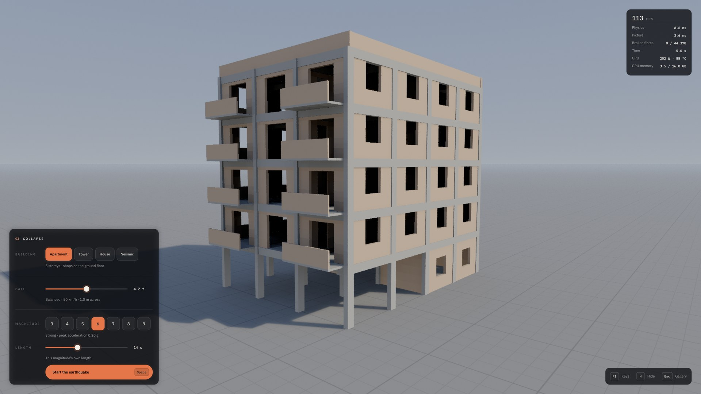

The look is one family for everything, IBM Plex: Serif for names, Sans for words, Mono for numbers and keys. Dark glass
panels over the pictures, and one accent colour per scene, taken from its light: warm gold, cold blue, safety orange,
sea green, sea blue, lavender, rose, night red, mirror glass.
A scene is a folder with its renderer, its settings and its OptiX programs, plus one line in the scene registry;
[docs/MIMARI.md](docs/MIMARI.md) (Turkish) describes the contract and how to add one.

## Scenes

### 1 · Glass and stone at golden hour *(Altın saatte cam ve taş)* · October 2026

A room in the language of Tadao Ando: cast concrete with form-panel joints and tie holes, a polished terrazzo floor
with brass divider strips, white plaster, a shallow pool. The sun stands eight degrees above the horizon and enters
only through narrow slits. In the beams hang crystal prisms; each one throws its own spectrum across the walls, and
in the haze the dispersed light opens into coloured fans. Soap bubbles drift through the light.

| Prism still life | The light plan from above |
| --- | --- |
|  |  |

The scene went through two art passes. The first answered *"is the light right?"* and produced a correct but quiet
image. The second answered *"what does the eye see at a glance?"*: a dark room, five slits, fourteen crystals, warm
balance. The renderer did not change between them; the scene did.

| First light (phase 1) | Live mode, 24 fps |
| --- | --- |
|  | 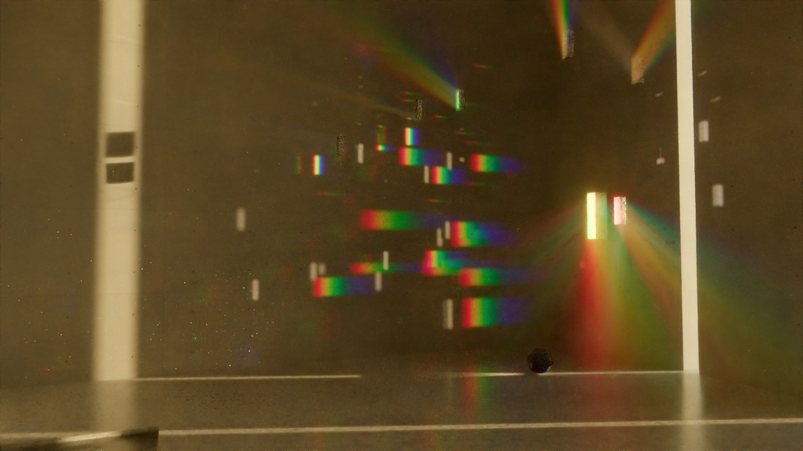 |

### 2 · Lighthouse *(Fener)* · October 2026

A night in the manner of Playdead's *Inside*: fog thick enough to carry a rotating beam, black fir silhouettes, a
near-monochrome palette with one warm window. Two fixed views, chosen from three value studies drawn before any 3D:
"the window" from a forested island and "the height" from a far headland. Space walks the camera 778 m between them
through the forest, with eye adaptation for the darkness inside it; Tab turns it into a small first-person walk.


| Inside the forest | From the far headland |
| --- | --- |
|  |  |

Surfaces, then single-scattering volume at full resolution, temporal accumulation, TAA and bloom: 7.6 ms a frame at
1440p. Some of it is deliberately not physical (named as such in [docs/fener/DURUM.md](docs/fener/DURUM.md)): the
beam's forward scattering is cut from about 100 to 5 times the side scattering, because a beam that lights the whole
fog when the camera is inside it is correct and flat.

### 3 · Collapse *(Yıkım)* · October 2026

Four buildings. Three of the same concrete, steel and brick. A five-storey apartment block of the kind that fills Turkish
towns: shops behind glass on a tall ground storey, brick infill, balconies, a flat roof with water tanks and solar
collectors. A thirty-storey tower, 97 m: a frame around a plain-concrete core, a glass lobby at the front. And a one-storey
house with a gable roof: ridge beam, gable walls, a chimney. And a seismic tower after Japanese practice: glass in
three tiers narrowing to a steel spire, on rubber isolators, so that it sways and glides but stands. Earthquakes from magnitude 3 to 9 shake the ground under
them, each made from a real strong-motion record, or the viewer throws a wrecking ball with the mouse. The light is a plain sunny day on purpose; the effort went into the physics.


| Magnitude 6: the balcony parapets fall | Magnitude 7: the ground storey loses its infill, the frame stands |
| --- | --- |
| 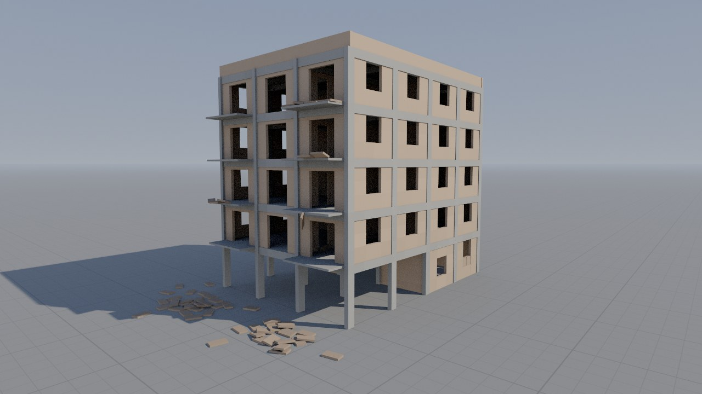 | 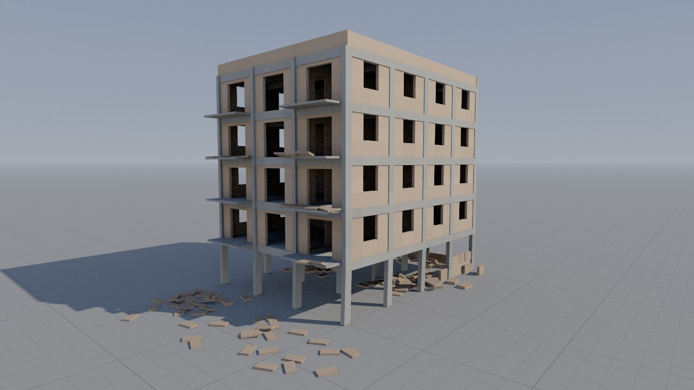 |

| Bars left where a corner column was blown out | Magnitude 9: the soft storey gives way |
| --- | --- |
|  |  |

It runs live at 1080p, about 50 frames per second on the RTX 4080 with the denoising filter on, physics and picture side
by side on the GPU. Pick the magnitude (3 to 9) and the length (the magnitude's own up to until stopped) on the panel
with the mouse or with keys, start it; click to throw a wrecking ball, slow time down to a tenth.

| The tower: 30 storeys, 97 m, 8,404 pieces | The house: gable roof, 456 pieces |
| --- | --- |
| 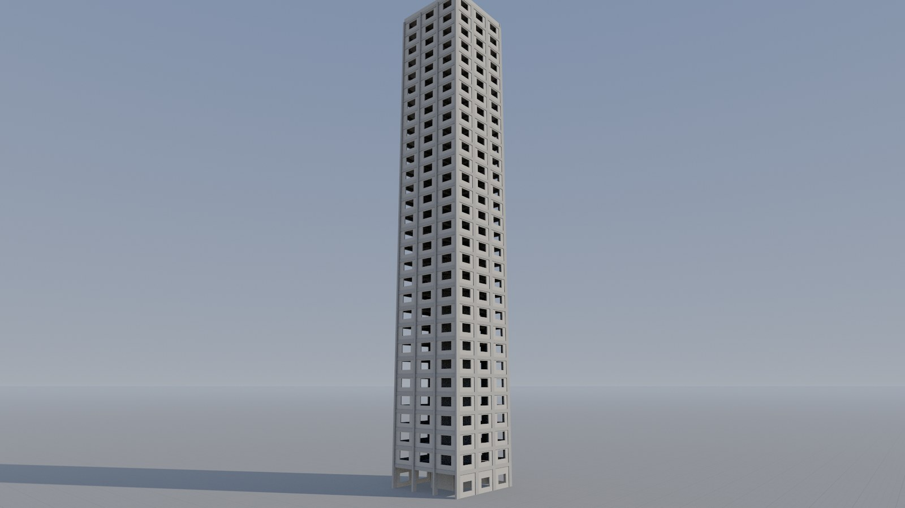 |  |

| The seismic tower: 26 storeys and a spire, ~123 m, 5,142 pieces, on base isolators |
| --- |
| 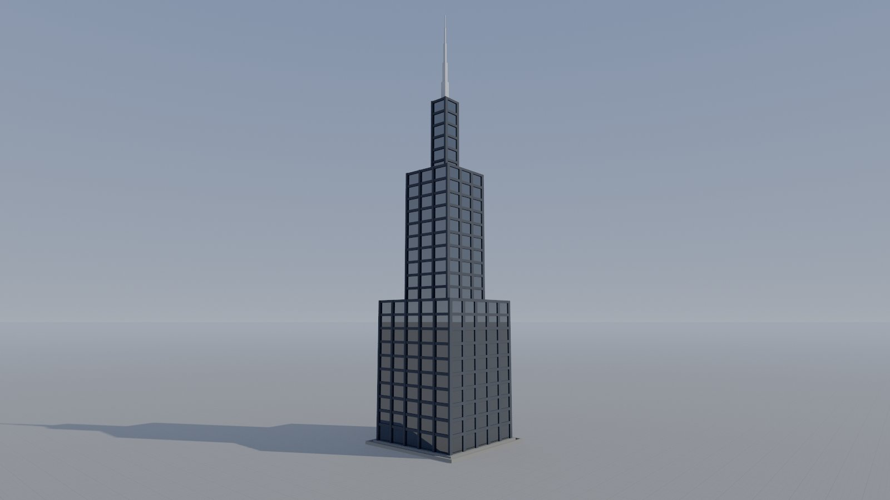 |

| A wrecking ball hits a corner column (4.2 t, 14 m/s) | The column's foot thrown out, the column hanging askew, its bars bare |
| --- | --- |
|  |  |

### 4 · Laboratory *(Laboratuvar)* · October 2026

A high-speed photography table: a dark set with a large soft panel behind the experiment, the classic light of liquid
photography (glass and liquids read by their refracted edges). Eight experiments, seven of particles in one solver of
our own, one of rigid cubes in another, whatever the physics says:

- **Water** poured from a tilting beaker into a tumbler, from 12 to 45 cm: it splashes, overflows, pools on the table.
- **Honey** off a dipper onto a glass dish (live, drag the dipper with the mouse): one amber thread that folds and
  coils on the dish, then spreads into a pool.
- **Sand** from a funnel onto the table and into a beaker (live): it heaps at 32.5° (dry sand: 30-35°).
- **A water balloon** on the table, pricked with a needle: the rubber peels back in 20-30 ms while the water keeps the
  balloon's shape for a moment, then slumps.
- **A watermelon** shot with a rifle (5.56, 7.62×51, .50 BMG; real loads): it swells for a few milliseconds, then the
  rind opens like a crown.
- **A drop of milk** into a thin layer of milk (0.4 mm particles, 1/5000 s): the crown opens and throws droplets.
- **A block of ballistic gelatin** shot with a pistol (.22, 9 mm, .50 AE): the track and its temporary cavity inside
  the clear block, the block shuddering.
- **A cube of small plastic cubes** (a puzzle cube's six colours, 64 to a million of them, from 25 mm to 1 mm each) with
  a charge at its middle, from 3 micrograms of TNT (a few cubes trickle off) to 2 grams (a burst): every small cube a
  rigid body that lands on a face, tumbles, bounces and slides; the small ones slowed by the air.


The fast ones can be **recorded**: the trigger plays at once on a coarse world (marked so); asked for, a fine world
(0.4-2.5 mm particles, up to 250,000 of them) computes the same inputs on a worker thread and keeps every 1/600 to
1/5000 of a second on the GPU (the gel takes a shot a second; the fine pass replays them all, every step kept round each
shot, 120 a second between). Slow motion on the live world is the same physics, slower: the solver's substeps keep their
length and come less often, the picture moves between them (shrunk substeps once blew a resting dish of milk apart). What is computed can be watched at once, like a video loading; when it is done it plays
once at real speed, then it is free: scrub the time bar, slow down to 1/10 or 1/100, freeze, fly round it with WASD.
Nothing is a video: what is kept is the physics, drawn live from any view. Honey and sand are only live, since their
flowing is the scene.

| The pour (fine recording, 1.45 s) | Sand, poured live: a 32.5° cone |
| --- | --- |
|  | 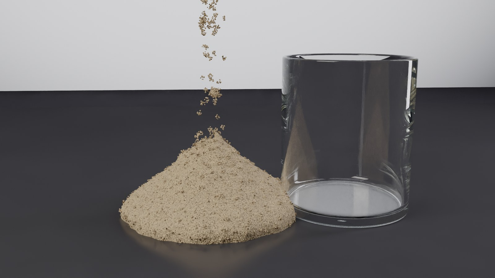 |


| Honey on a glass dish | A 7.62×51 round through a watermelon, 0 to 24 ms |
| --- | --- |
|  |  |

| A milk drop's crown, 16 ms | A 9 mm round through ballistic gel, 1.2 ms: the track and its cavity |
| --- | --- |
|  |  |

How each is made, and what was measured on the way (the Turkish working journal has it all,
[docs/laboratuvar/DURUM.md](docs/laboratuvar/DURUM.md)):

- **One solver** (after NVIDIA FleX): Position Based Fluids for water and honey, XPBD bonds for rubber, melon and gel,
  grains for sand; a melon particle that has lost all its bonds turns to juice.
  Glass ware is one layer of kinematic particles over the glass's surface, moved with the hand that tilts it.
- **Water** leaves the lip as one rope only with a little viscosity, cohesion and surface tension (without them it
  frayed into noodles at once; four variants compared by eye).
- **Sand** ran flat like a liquid at first (friction shared among a grain's contacts like the push stops only a part
  of its sliding): friction shared by the square root, more passes, and static friction at the velocity level brought
  the pile from 0° to 32.5°, the threshold chosen by measuring (`--lab-test kum`).
- **The balloon's** stretched rubber tore under the water's weight until its bonds had enough passes a substep (the
  same settings that held a coarse balloon failed a fine one: XPBD's stiffness depends on resolution); its stretch is
  brought in slowly while it settles; a tear's tip is given the stress a coarse lattice cannot concentrate there.
- **Honey's** viscosity is taken over each particle's own neighbours (a thin thread is then as thick as the bulk),
  repeated a substep, and it leaves a nozzle that holds its newest layers. Even so its thread fell apart into drops
  (PBF has no stress that resists stretching); viscoelastic springs between its layers (after Clavet et al. 2005,
  their rest length creeping after the length) keep it one thread that thins, folds and coils on the dish, then let
  go so the coils merge into a pool.
- **The melon's** rind is two layers (green skin, pale rind) on a cup-shaped stand; its bonds carry natural flaws
  (identical bonds all broke at once, into crumbs); the bullet's path comes from the gelatin-calibrated ballistics of
  the earlier Tanecik scene.
- **The cubes** have a solver of their own: each a rigid body, box on box by separating axes with the incident face
  clipped (ODE's way), Gauss-Seidel by colour on the GPU (cells a third of a diagonal wide, 64 colours: two cubes of one
  colour can never touch), split impulses (an overlap pushed out gives no speed), shock propagation for stacks
  (Guendelman, Bridson & Fedkiw 2003), Coulomb friction point by point, speculative contacts, air drag, sleep. Tests:
  an 8-high stack of 512 awake cubes stands still to 0.09 mm, a bounce comes back to e² h, a slide stops at
  v²/(2 μ g), a 1 mm cube falls at its drag's terminal speed. The blast is Gurney's per direction (a face's middle
  flies twice as fast as a corner), the table reflecting the downward half.
- **The picture:** path tracing with OptiX; thick glass and refracting liquids with exact Fresnel, a liquid in its
  glass crossing one interface (the hair of air between their surfaces would otherwise mirror); surfaces rebuilt from
  the particles every frame (anisotropic kernels); sand drawn as a surface with grain-sized texture plus fine grains;
  4 samples a frame blended over time (reprojected through the camera; a pixel keeps its history only while a steady
  ray through it still meets the same point and travels as far, so a moving stream leaves no trail), soft boxes seen
  in glass and liquid counted exactly at the mirror direction, then the OptiX AI denoiser. Denoising each frame on
  its own made glass edges swim; blended, water's swim fell tenfold.

Open: the honey thread's surface is lumpy (it is one to three particles thick); melon fragments are drawn as soft rebuilt surfaces, not sharp fractures; the
balloon rests on the table rather than hanging (hanging, the light rubber could not carry the water's weight to the
knot in time).

### 5 · The Island *(Ada)* · October 2026

|  |
|---|
|  |
|  |

Under water in the Mediterranean, swum like a scuba diver. You start in a dark hall under the concrete head of a small
island's pier; along a lane of buoys the sand deepens slowly: amphorae gathered against rocks at 12 m, a half-fallen
galleon at 22 m, and at the far end a mooring buoy's rope going down into a blue with no bottom in sight. Above the
water is seen only from below; there is no surfacing, and too deep the oxygen's partial pressure sends you back.

- **Sharpness without temporal tricks:** every pixel is drawn with the same fixed sub-pixel samples every frame (4,
  rotated grid; no jitter, no history), edge pixels get 12 in all by default (up to 32), a Blackman-Harris filter a
  little wider than a pixel joins them. Measured against a converged reference (`tools/kararlilik.py`), the shimmer is
  under half of scene 2's TAA everywhere it was measured (swimming into the pier's hall, approaching the wreck).
- **Real-time light through what stands above the water:** the sun's shadow ray goes on through the air past the
  surface, and the light leaving the water bends with the waves there, so the light leaking between the walkway's
  boards and through the broken holes of the head's slab sways on the sand as the caustics do. For the light shafts a
  sun map over each structure keeps how far the refracted sun gets down from every point of the surface and how much of
  it the deck lets through (mipmapped, read as wide as the sun's disc is at that depth: the stripes are as soft as real
  ones); a sky map does the same for the water's diffuse light, so under the head the water itself goes dark.
- **Spectral water, baked:** absorption and scattering every 5 nm from published measurements (Pope and Fry, a Jerlov
  type, Fournier-Forand), the sun and sky spectra, the eye's curves, baked into tables by the light's path length; the
  diffuse light field for seven floor depths down to 110 m. The eye adapts half its colour to the light around it and
  30 % of its brightness: the hall stays dark.
- **Caustics without noise (beams):** every cell of the FFT surface is a beam of light spread exactly over the area it
  covers at each depth slice; nothing is counted, so nothing boils. They fade below 30 m where the sun's disc has
  blurred them. About 5 ms.
- **The wreck:** a 38 m galleon built timber by timber from one hull function (deadrise, tumblehome, sheer, transom):
  frames, strakes of planking with butt joints, two decks with hatches, the quarterdeck and poop with the great cabin's
  stern windows, the forecastle, gunports and guns, broken masts, the rudder, an anchor, sea fans on the rails. Bow down
  on the slope, listing to starboard; the starboard side has fallen in. You can swim inside.
- **The rest:** the island's limestone and two reef arms as distance fields (surface nets), angular blocks; mussels on
  the piles and on the buoy's rope (about 11 000); floats that ride the waves (their heights sampled on the GPU every
  frame); the amphorae of the earlier part among their rocks (ArchAIDE profiles, CC BY 4.0); pebbles, red starfish, sea
  cucumbers, fan mussel shells, black urchins.
- **Pressure:** P = 1.013 + 0.1005 d bar, ppO2 = 0.2095 P. Past 1.6 bar (~66 m) a toxicity dose builds (faster the higher
  it is; the real delay is shortened, and the code says so): the view narrows, goes black, and you start again at the
  ladder. Nitrogen narcosis is a matter of the mind, not drawn.

Open: 33-35 fps in the application's own test (the pier's hall, where you start, is the slowest at ~32 ms a frame);
the wreck's interior light and the look were judged on still frames from the command line, and no one has swum it
live yet. Everything in `docs/koy/DURUM.md`.

### 6 · The Sculpture *(Heykel)* · October 2026

|  |
|---|
|  |
|  |

The scene of geometry and nothing else: a white, matte Menger sponge cut along its diagonal, stood up on a plinth in
a dark room; six-pointed stars in the cut. Zoom towards any point of it: new stars and square tunnels open down to ten
thousand times, where the screen is 0.15 mm across (about two hairs).

- **As sharp as a vector drawing:** at every point only holes at least four pixels wide are drawn (smaller ones would
  only be grain); as you come closer the next level's holes open as true square tunnels widening from their centres, so
  every in-between shape is still a Menger sponge and nothing pops in.
- **One world, moving or still** (scene 5's way): no random numbers and no accumulation. Every pixel takes the same four
  fixed sub-pixel samples every frame; a still view keeps the frame it was drawn with, so nothing settles afterwards, and
  the lamp never jumps (its target glides onto what you zoom at, a blocked line gives way to a clear one smoothly).
  Measured against a converged reference while dragging the light: 0.0017 (the first, path-traced version: 0.0125).
- **Ten thousand times in floats, by perturbation:** there a pixel is a few float steps of the position. One anchor's
  orbit goes through the folds in doubles on the processor and every pixel follows it as a small difference in floats;
  the folds are piecewise linear, so every branch has an exact difference formula, decided by differences kept from the
  doubles. Against a straight double-precision estimate: six ten-thousandths of a pixel at ten thousand times.
- **Light that follows you in:** a spot on whatever you click (drag swings it around that point), which comes closer as
  you zoom and finds an open line when a wall gets in its way; a ring light on the lens that casts no shadow the camera
  could see; a dim light from the ceiling.
- **The dive tour (T):** four dives chosen from sixteen random ones, down to ten thousand times, stopping at every decade.

The first version (a pseudo-Kleinian "cathedral", path traced) was replaced after Özcan's first look: grainy, flickering,
and its surface was pixel-sized circles at every scale. Everything in `docs/heykel/DURUM.md` (Turkish).

### 7 · Scale *(Ölçek)* · October 2026

| 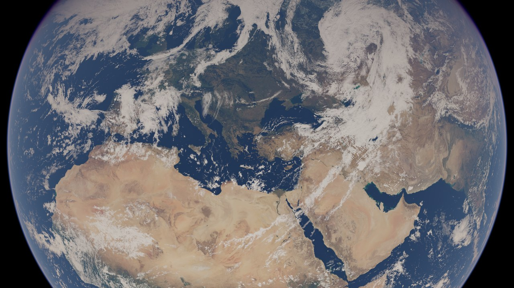 | 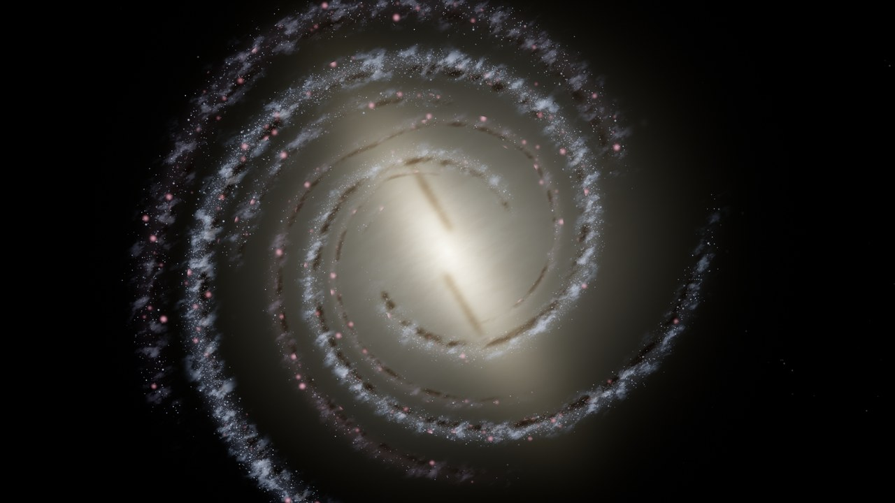 |
|---|---|
|  | 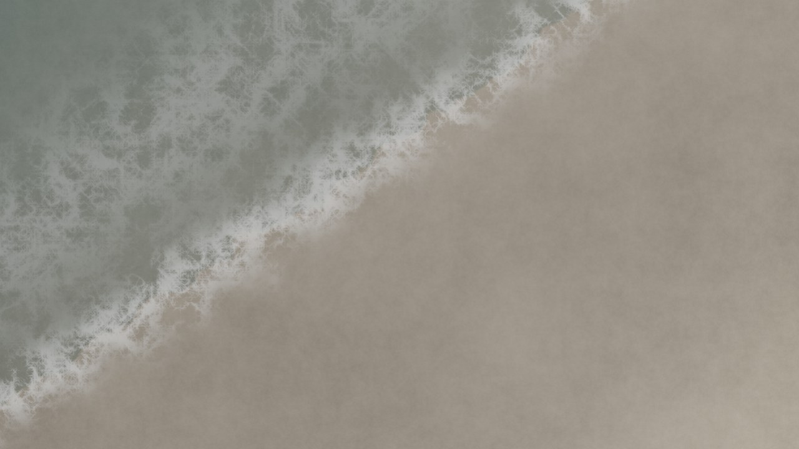 |
| 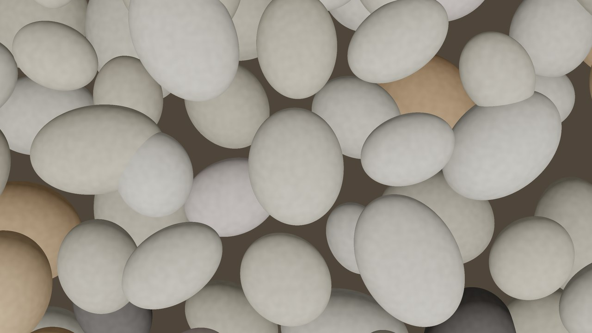 | 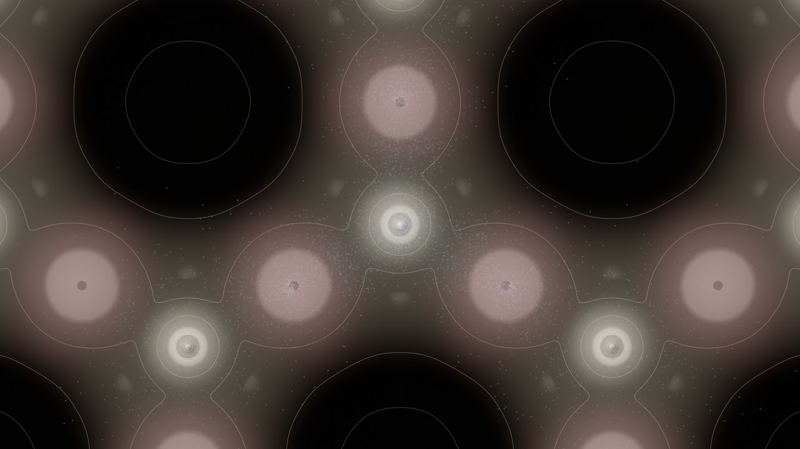 |
| 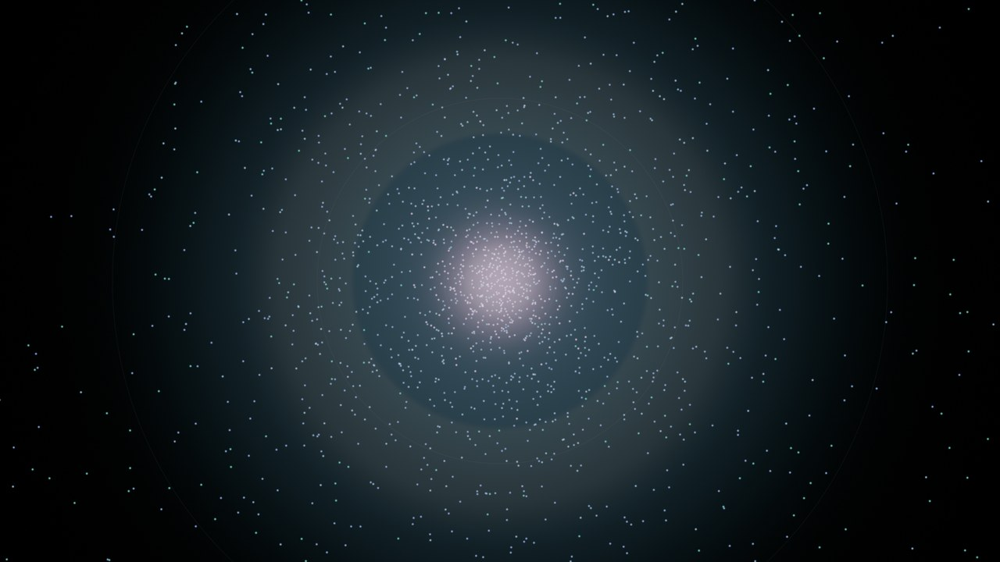 |  |
|  |  |
| 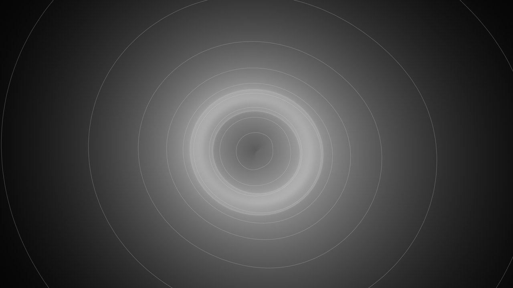 | |

The scene of scale. You start at the beach in front of the castle at Çandarlı (Izmir, Dikili) and move out or in with
the wheel alone: out to the edge of the universe, in to the Planck length. 62 decades, without a cut or a fade.
Everything where and as large as it truly was at noon on 5 October 2026, and the empty stretches between at their true
length.

- **No absolute position:** everything hangs on a tree of anchors (Laniakea, the Local Group, the Galaxy's centre, the
  Sun, the Earth, the beach point, an atom, its nucleus, a proton, a quark). The way between two neighbours is summed
  only up to their common ancestor, and the camera is always kept against its focus. For the five decades on the
  screen at once, floats are enough: 10⁻⁴ of a pixel at worst.
- **Where there is light, real data:**
  - the beach from Sentinel-2 (10 m), the shoreline a distance field from it;
  - the Earth from Blue Marble, with those days' MODIS and VIIRS clouds on it. The satellite's glint on the sea was
    sorted out with VIIRS's cloud optical thickness product;
  - single-scattering air, the Moon from LRO;
  - the asteroid and Kuiper belts from the Minor Planet Center's 1.57 million orbits (rings, time-averaged), Jupiter's
    Trojans as two swarms; the planets as points on their orbits (a flash at the end of the exposure);
  - 109,400 stars from HYG; the Milky Way with its arms from measurements (Reid et al. 2019, the long bar Wegg et al.
    2015), its look towards the familiar drawing (two stellar arms, two of gas, clusters and nebulae); M31 and M33 by
    the same model in their true orientation;
  - 43,490 galaxies from 2MRS. Beyond them a cosmic web from the true statistics, by the Zel'dovich approximation, seen
    as a slice (gigaparsecs of depth piled up turn the web into fog, which is why every survey picture is a slice).
- **Below the light, representation with true numbers:** colour fades at the light's wavelength into the microscopes'
  grey pictures; from the atom down, particles in a representational palette.
  - Terraces as an electron microscope sees them, atoms as an atomic force microscope does, then quartz's density map
    (Clementi-Raimondi Slater orbitals, in the chemists' colours).
  - The atom: its electrons as points of light in their shells' radial distributions, the valence ones along its four
    bonds (sp3). They stream past like stars on the way in.
  - Silicon-28's 28 nucleons (protons warm, neutrons cold), a proton's three quarks (colour charges), the Y of gluon
    flux, sea quarks.
  - About the quark, virtual pairs' loops at every scale; their kinds by the couplings at that size (the Standard
    Model, one loop), the mix evening out deeper down.
  - At the bottom, spacetime foam's bubbles and a golden closed string (theory).
- **Time as if it flows:** every layer keeps its own clock, all by one rule (faster outwards, slower inwards). What
  moves faster than the eye's shutter is averaged: an orbit becomes a ring, a vibrating string a band with bright edges.
  None of it changes home: you always come down to the beach at the same noon, in the same light.
- **No grain, no flicker:** every pixel takes the same four fixed samples every frame, and whatever shrinks below a
  pixel turns into a point keeping its light. The exposure is a designed function of scale, never read from the
  picture. Every frame of the way takes ≤ 16 ms; a test path sweeps it in steps of 0.01 decade and measures the jumps,
  the particles followed by their identities.

Plan, decisions, departures from the plan and measurements in `docs/olcek/` (Turkish).

#### The second option: Speed *(Hız)*

| 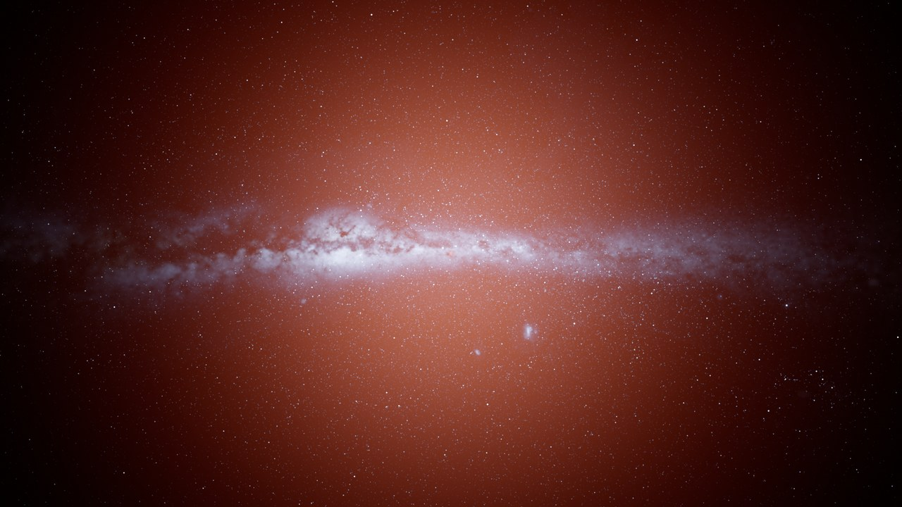 |  |
|---|---|
|  | 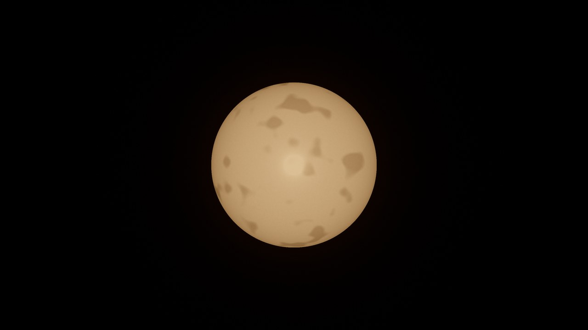 |
| 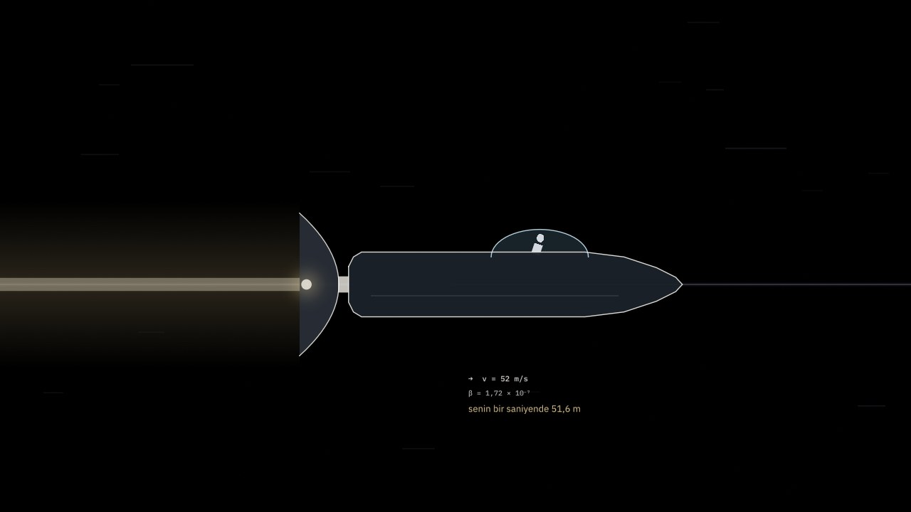 |  |

By rocket from the Earth to Proxima Centauri, and on to Andromeda: special relativity complete, nothing teleported, time
always real (no speeding up: the length of the journey is the distance).

- **The journey:** W thrust, S brake, Space the automatic arrival at the target chosen on the panel (Proxima or
  Andromeda, at any time; under way elsewhere it stops and turns first). Proxima, 4.25 light years: 15.2 minutes on your
  clock, 4.25 years on the Earth's. Andromeda, 2.4 million light years: 72 minutes, 2.4 million years.
- **The drive:** 1 g at rest and always rising: 1% of light's speed in a minute, 10% in two, 99% in five and a half,
  21 nines (1 − β = 10⁻²¹) in eight, at 11 million g. Held constant in 1,638 slices with the closed forms of constant
  acceleration in each, by rapidity (1 − β keeps its digits); an independent oracle (mpmath, 50 digits) agrees to
  1.5 × 10⁻¹⁵.
- **The rocket's eye:** every pixel's ray turned back to the rest frame (aberration), its light Doppler-shifted as a
  blackbody's through the CIE 1931 tables:
  - 109,400 stars; the Milky Way's diffuse light (ESO/S. Brunier's panorama, its stars taken out, at mip levels as wide
    as a pixel's footprint);
  - the cosmic microwave background with the Sun's dipole (Planck 2018);
  - the galaxies (the Milky Way from outside, M31, M33, 2MRS);
  - the Sun, the Earth with today's clouds, the Moon;
  - Proxima and its b, Alpha Centauri A and B at their measured places (Gaia DR3, Akeson et al. 2021).

  As the speed grows the sky crowds ahead; past half light's speed the Sun left behind comes round to the front by
  aberration, blue-white. At about five nines the cosmic background rises ahead as a red sun, then orange, white and
  blue; beyond, its light leaves the visible band. The eye adapts as an eye does (half in the dark,
  wholly in daylight, to the face it looks at) and has its own glare.
- **The energy eye** (on at first; E): every band's light, in false colour by the band its peak is in (microwaves to
  gamma rays). Zeroed at the start: the background's glow at rest is taken out, the motion's gain shows. A key shows
  where the light dead ahead peaks.
- **From the side:** a map in the Earth's frame. The camera follows the 14 m rocket (γ times shorter), the interstellar
  medium's points stream past as light streaks, keys 1-6 jump between the scale's stops.
- **The stops:** the Earth from the geostationary radius; Proxima's spotted, flaring face 1.69° wide, its planet b,
  Alpha Centauri A and B (−6.8 and −5.5) and our Sun in Cassiopeia; Andromeda 70° wide from 100,000 light years.
- **Five graphs:** speed and γ; spacetime (the rocket's grid folding towards the light line); the way (two rulers);
  the clocks (yours, the Earth's, the Earth as seen); the cost (energy, a photon rocket's fuel, the light from ahead).

Plan and measurements in `docs/olcek/hiz/` (Turkish).

### 8 · The Submarine *(Denizaltı)* · October 2026

| 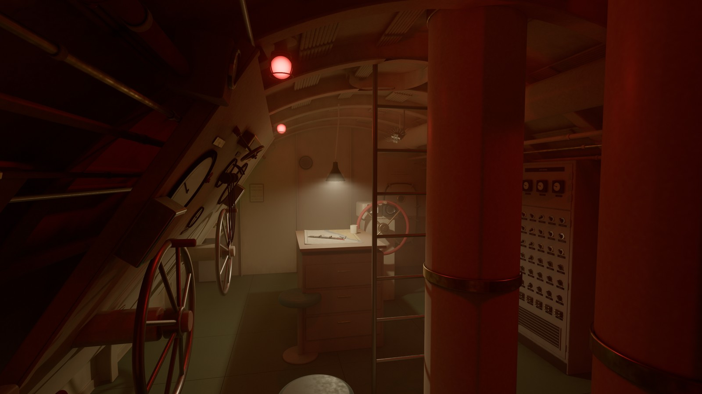 | 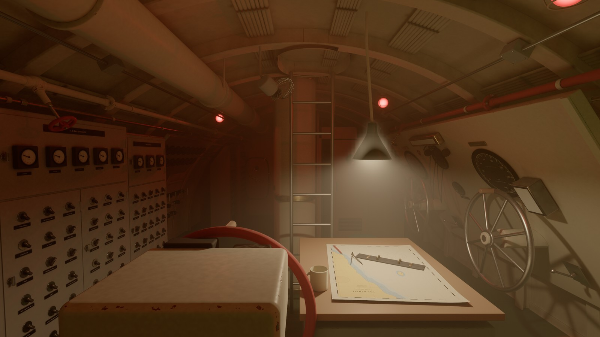 |
|---|---|
|  | 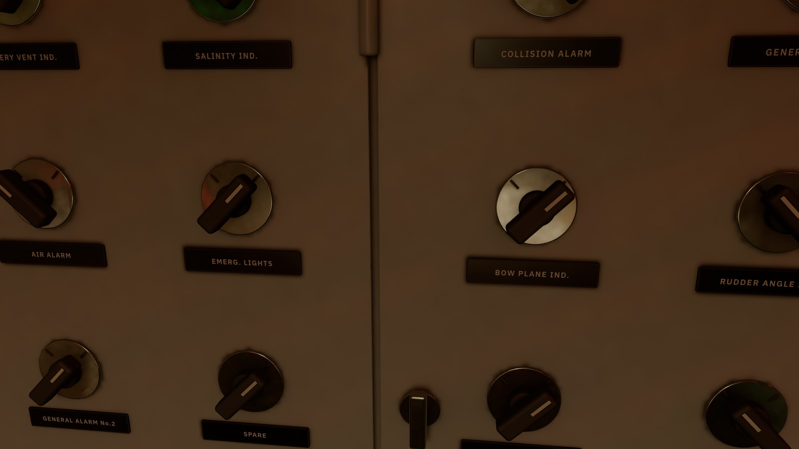 |

The Island's sibling; its focus is atmosphere. The control room of a Tench-class fleet submarine (after TCG
Uluçalireis, ex USS Thornback) as she was in Turkish service, under night red: a boat in commission, kept up but
lived in. The Island used current technology directly; here it is used indirectly: **all the light is baked beforehand,
none is computed live**, and the graphics card's whole strength goes to the picture. You walk a narrow room and can
look at anything from 10 to 15 cm.

- **Real measurements:** 8.23 m (frame 47 + 9" to 58 + 3"), a pressure hull 4.886 m across at its widest, 1" of cork inside the plating, a T
  frame every 76.2 cm, the deck 12 cm below the axis, 51 × 97 cm oval watertight doors. The layout follows Thornback's
  1953/68 general arrangement plans and the US Navy's 1946 training manual (NAVPERS 16160). Sources in
  `docs/denizalti/REFERANS.md`.
- **Every part made in code:** pipes and bends, flanges, nuts and threaded studs, globe valves, handwheels, gauges, rotary
  switches, fuses, caged lamps, hinges and latches. No knife edges: every corner is rounded. The boards stand in front of
  the hull's pipe runs on brackets to the frames; a check computed that none cuts into a frame or a pipe.
- **Printed faces:** the dials, the labels and the chart are drawn into a decal atlas, 0.2 mm a pixel on the 16" depth
  gauge, the lettering cut 0.25 mm into the brass plates. On the table lies a **sea chart** of a made-up coast:
  depth contours, soundings, a compass rose, a lighthouse, rocks, a wreck, the watch's course in pencil, a coffee ring.
- **Baked light (OptiX):** the light arriving at every point of every surface is written with its direction (L1
  spherical harmonics), each path followed up to 12 bounces, each sample leaving from another point of its texel (shadow
  edges come out graded, without steps). The lamps' highlights are drawn live, their shadows read from baked visibility
  (the 2010s' "stationary light" path). The haze is baked in 4 cm cells with the lamps' shadows. There are 54
  reflection probes, each roughness traced on its own. About five minutes on the first opening, from the cache after
  that.
- **Tessellation:** the surfaces are cut and raised for the camera every frame. On High a triangle on relief (threads,
  weld beads, cork granules, engraving) is as small as a sample. Curves are rounded by Phong; there are no cracks,
  measured by counting black pixels from six viewpoints.
- **Supersampling:** each pixel is shaded up to 16 times. There are no random numbers; the pattern is the same every
  frame. 8K at 16x is for photographs only (F12), taken in 1920 × 1080 tiles with guard bands.
- **Settings:** Low/Medium/High each for tessellation, graphics, light and effects; resolution 720p to 8K, SSAA 1x to
  16x. At 1440p, High without SSAA takes ~14 ms, with 4x SSAA ~33 ms.

Plan, decisions and measurements in `docs/denizalti/` (Turkish).

### 9 · The Mirror *(Ayna)* · October 2026

| 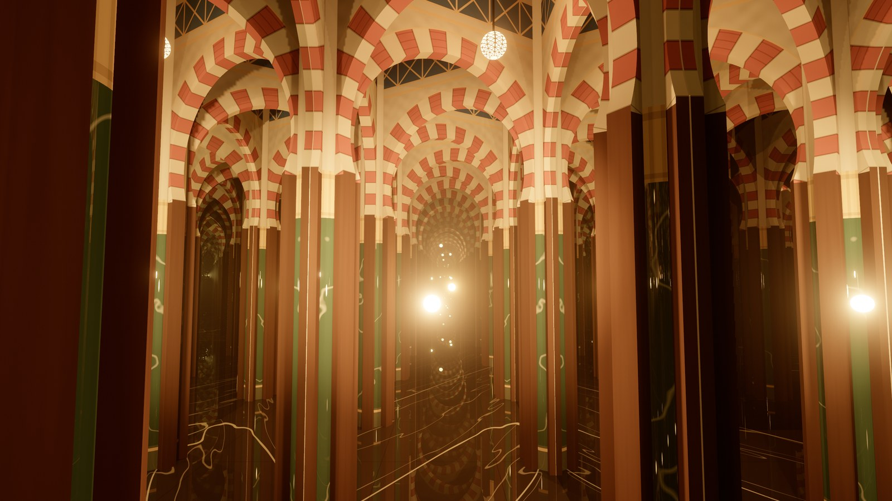 |  |
|---|---|
| 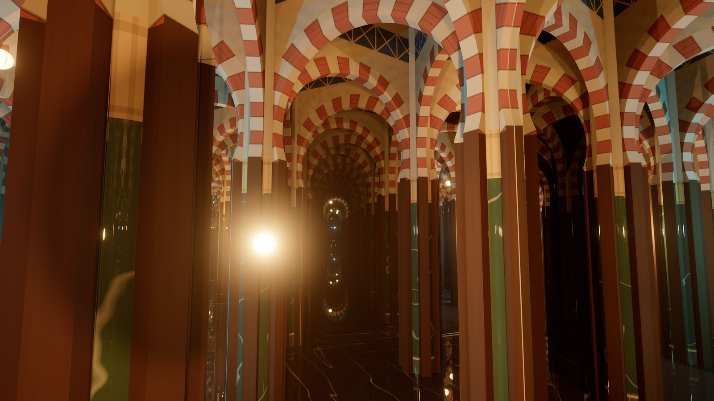 |  |

Its focus is reflection: *the reflection of the reflection of the reflection, at full quality*. A compact mirror
labyrinth on a 60° triangular lattice (after the Luzern labyrinth of 1896), dressed after the Mezquita of Córdoba and
the Alhambra. You are a chrome sphere floating through it; you see yourself only in the mirrors. You shine your own light
from a slit in the sphere, in eight colours and eight strengths, and leave coloured lamps behind; the mirrors multiply
everything without end.

- **Physics, not settings:** every mirror is 6 mm of float glass with silver behind it: Fresnel at the front, refraction
  in and out, the silver's reflectance, the glass's absorption both ways, all from measured constants (Rubin 1985 for
  the glass, Johnson and Christy 1972 for silver, Rakić 1998 for our chrome). Straight on, 79% of red and 84% of green
  and blue come back: the deep tunnel darkens and turns cyan-green by itself. The ray is shifted inside the glass as a
  real mirror shifts it.
- **An exact tracer of its own, not OptiX:** the mirrors stand on lattice lines, so a ray walks from cell to cell and
  meets in each only that cell's floor, ceiling, three columns and three wall modules (face, window reveal, the mirror's
  glass or the passage's middle plane). Every surface is exact; there is no marching, no bounding volume and no
  self-intersection offset. The tunnel's fortieth copy lies within a ten-thousandth of a pixel of where it is computed.
- **Light by the mirrors, exactly:** a path tracer can not find a point light's way off a mirror onto a wall. Here a tree
  of beams finds it in plan (cell to cell; Heckbert and Hanrahan, 1984): each light's image in each mirror and the wedge
  of it that passes the windows and the columns, checked in 3D above the jambs. No sampling, no grain; against a billion
  photons through the same tracer it agrees to 99%.
- **Light maps:** the lamps and lanterns stand still, so their light (straight and by every mirror) is baked into the
  surfaces when they are left (23 million texels, finer on the reveals and columns seen from a hand's breadth). Our own
  light moves with us: it is baked again every frame at half resolution, and straight in its own cell computed per
  pixel. Our sphere's shadow on the lamps' light is worked out every frame.
- **Sharp behind the mirror:** every ray carries its footprint, which a flat mirror leaves alone and our sphere widens;
  the patterns are filtered by it, so a pattern behind a mirror is as sharp and as still as seen straight at the same
  distance (measured: the same picture through an ideal mirror, pixel for pixel). Small lamps count by their share of the
  footprint, so the deep tunnel's lamps do not twinkle.
- **Picture:** six fixed samples a pixel, the same every frame, no accumulation, no denoiser; a light forward-scattering
  mist in closed form along every piece of the way; 30 to 40 frames a second at 2560 × 1440. No quality settings.

Plan, decisions, measurements and what is not verified in `docs/ayna/` (Turkish).

### 10 · The Well *(Kuyu)* · October 2026

| 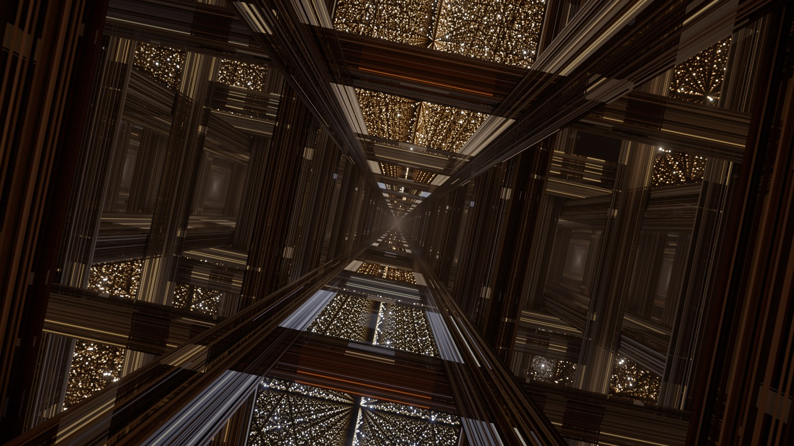 | 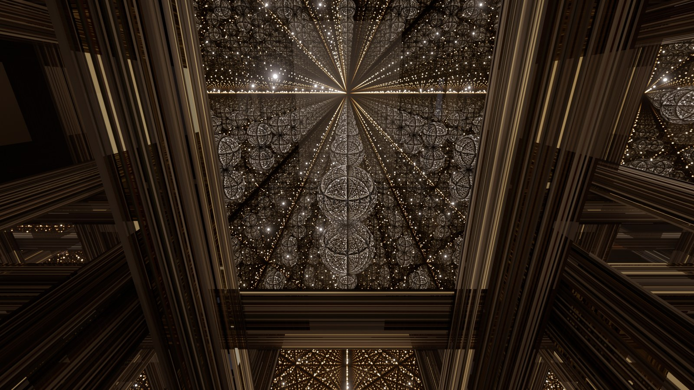 |
|---|---|
|  |  |

Its focus is infinity, seen from outside: *closed worlds of endless reflection, watched by an observer who falls past
them*. The sibling of scene 9 (there we were inside the labyrinth; here the infinite rooms are closed and we are out).
An endless cubic lattice of glass rooms, each a one-way mirror box with its own light and its own furniture; every edge
of every room runs on without end as a bundle of stretched threads, after the tesseract of *Interstellar*. We fall slowly
down a shaft between two columns of rooms.

- **One-way walls from physics:** a room's wall is half-inch grey float glass (its data sheet: 18% visible transmission)
  with a 45 nm silver film on the inside (Johnson and Christy 1972, the thin film's Airy sums) and an antireflection coat
  outside. Inside, 94.5% comes back and the light goes round without end; from outside the glass reflects 4%; through it,
  0.7% either way (the same both ways, as reciprocity wants: the one-way look is only the bright inside against the dark
  outside). Thin silver lets blue through more than red: the deep reflections turn amber, with no setting. Checked
  against an independent calculation (Abelès matrices) to 1e-6.
- **Twenty kinds of room**, each turned by one of the cube's 48 symmetries so neighbours differ: bulbs hung at many
  heights (Kusama's infinity rooms), a single lamp, cold moonlight, a chrome sphere, a copper pendulum swinging at
  T = 2π√(l/g), a mirror at 45°, a corner reflector, a row of lamps, a candle, and dark rooms with no light of their own.
- **An exact tracer of its own (CUDA):** a ray walks the lattice cell by cell, meeting in each only its room and its
  twelve bundles; the bundles' slats are a relief walked exactly. Inside a room it bounces between the silver walls,
  the mirrors and the metal until nothing it could still gather would show: the bound is a bulb's whole light over the
  ray's footprint, cut at half a code value of the exposed picture. The 30th image of a lamp lies within a
  ten-thousandth of a pixel of where the image lattice puts it.
- **The structure lit only by the rooms:** the threads are lit by the light that leaks out of the rooms' glass. The
  lattice repeats, so one cell's bundles carry a table (460 thousand texels, 4096 rays each along a Fibonacci spiral: no
  random numbers) of how much each room face round them gives, shadows included; the rooms' own glow (they do not
  repeat) is multiplied in as the picture is drawn. Varnished threads reflect by Fresnel, gold-leaf ones as gold.
- **Small lights that do not twinkle:** a pixel's samples entering the same room share one ray inside; the lamps' deep
  images, dots under a pixel, are gathered by a Gaussian footprint of the pixel's area (a disc counts a moving dot by two
  to four pixels in turn and it twinkles). Six fixed samples a pixel, no accumulation, no denoiser; 33 to 42 frames a
  second at 2560 × 1440. No quality settings.

Plan, decisions, measurements and what is not verified in `docs/kuyu/` (Turkish).

### 11 · The Forest *(Orman)* · October 2026

|  |  |
|---|---|
|  | 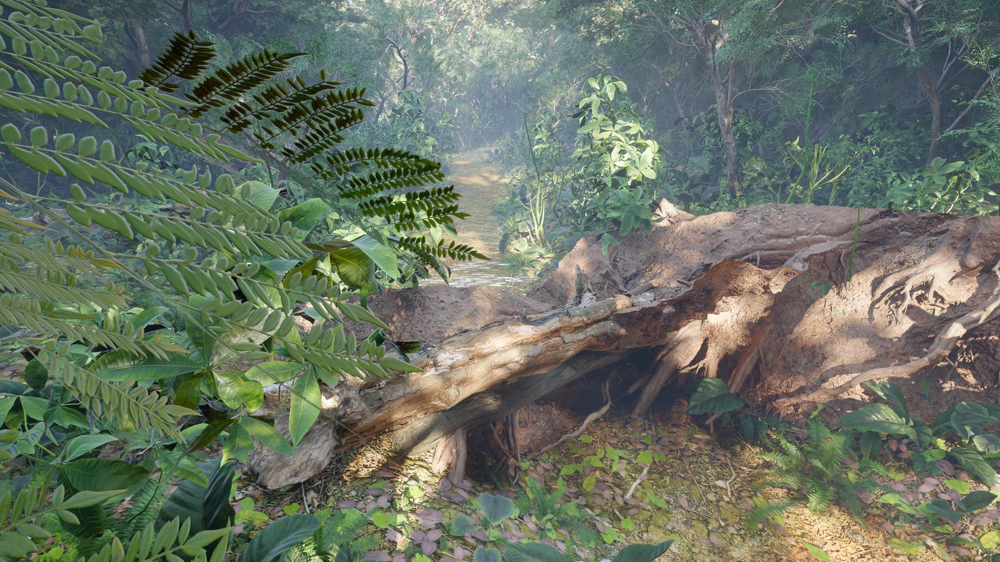 |

Its focus is density: *a small piece of rainforest where something is everywhere, as in a real one; staged chaos, not
endless repetition*. Game forests are mostly built from three or four materials (tall tree, ground cover, wood, soil)
and look clean; here it is a 30 m patch early in the morning after rain, with a stream, a fallen trunk and growth layer
upon layer, and the graphics card's whole strength goes to how much there is. W A S D walks, the mouse looks.

- **Scans only:** nothing is modelled by hand. 26 open-licence scans (Poly Haven and ambientCG, CC0: trees, shrubs,
  ferns, roots, rocks, trunks, leaf atlases) become 80 prototypes, fetched and checked by `assets/orman/fetch.py`.
- **Placement with causes:** the fallen trunk rests on both banks above the stream, rocks lie half-buried at the bank
  and stones in the bed, ferns grow thick in the damp, broad leaves in clumps, moss on the wet edge of the bed; each
  layer (floor, shrubs, saplings, young trees, debris) has its own reason and its own spacing. Fallen leaves come from
  the islands of the leaf atlases as one mesh, each lying on the ground's own triangles, heaped against trunks and
  stones.
- **The picture is ray traced too (OptiX):** one ray a pixel a frame, gathered over frames by NVIDIA's DLSS Ray
  Reconstruction at native resolution (DLAA). A leaf's alpha keeps its coverage down the mip chain and the sun's shadow
  ray lets through a leaf's open share: the sun dapples do not glitter and walking does not make the leaves crawl.
- **Light baked, the sun live:** a 30 cm grid of 3.7 million probes (L1 spherical harmonics: sky and sun, then one
  bounce) carries the soft light; the sun is a shadow ray from every sample; mist lies thickest on the ground, its
  shafts from a baked 10 cm volume of the sun's visibility. The stream reflects and refracts, tea-coloured in its depth.
- **A forest with no edge:** the patch sits among 80 copies of one 44 m forest tile (9 × 9 cells, 396 m, two levels of
  instancing); the stream is never copied, each cell grows its own strip of it. The last row of cells is sewn to the
  first, a torus: walk straight for 396 m and you are back at the stream from the other side. The coordinates stay
  small, and the eye and DLSS's history cross the seam unbroken.
- 8.3 million instances, about 108 billion instanced triangles (the program's own count), 2.2 GB of textures; 17 to
  21 ms a frame at 2560 × 1440, 45 to 56 frames a second in the application, about 8 GB on the card, about 35 s to
  load. The panel also offers 1, 4, 8 or 16 fixed samples a pixel, for comparison.

Plan, decisions, measurements and what is not verified in `docs/orman/` (Turkish).

### 12 · The Fire *(Ateş)* · October 2026

|  | 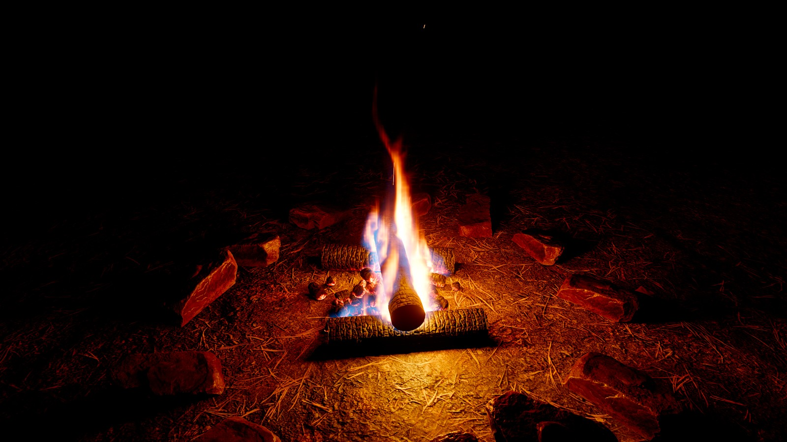 |
|---|---|
|  |  |

Its focus is a fire that is *scientific and hyper-real*, where 3D scenes usually make fire a token. A wood fire burns
in a stone pit outdoors on a moonless night, and nothing it does is drawn by hand. W A S D walks round the pit, C
crouches, R lays the fire again.

- **The gas:** hot gas flows over the pit on a 7.5 mm grid (128 × 192 × 128): buoyancy, the volume heat expands, the
  air's changing density. The wood's volatiles burn as fast as they mix with oxygen; soot forms on the fuel side,
  burns at the flame front and glows by Planck's law; the flame's blue comes from the CH*, C2 Swan and CO2* bands.
- **The wood:** each log is cut into patches, each patch layered from its surface to its core: it heats, dries and
  breaks down by Di Blasi's three reactions into gas, tar and char. The char burns at its surface (the embers) and its
  ash covers it; logs and coals keep each other hot by their radiation.
- **Light and sparks:** the stones, the ground and the logs are lit by the gas's own emission, their shadows ray
  traced (OptiX), gathered by NVIDIA's DLSS Ray Reconstruction at native resolution. Each spark is a flake of char
  thrown out by a crackle or torn off a glowing crust, carried by the gas, burning with the oxygen it meets.
- **A clean black:** the dither is fixed blue noise on the display's code values and fades out by black; the night sky
  reads 0 in every pixel, and the live picture flickers no more than a reference of 16 sub-pixel × 64 light samples.
- About 40 frames a second at 2560 × 1440, the simulation some 16 ms of the 25.
- **Closed narrower than planned:** the plan was a fire to tend: lit with a match, fed, blown on, choking and flaring
  again from its embers. Its look was reached, its dynamics were not (a match could not light the kindling, blowing
  did not show, the logs did not break up into a bed of embers), so the scene was closed as a fire to look at and those
  moves were taken out. Left alone it burns at about 8 to 9 kW.

Plan, decisions, measurements and what is not verified in `docs/ates/` (Turkish).

## What scene 1 computes

| | |
| --- | --- |
| **Spectral transport** | Path tracing with four hero wavelengths per path (Wilkie et al. 2014), 360 to 830 nm sampled after the eye's sensitivity (pbrt-v4), CIE 1931 observer, reflectances as Jakob and Hanika sigmoid spectra fitted from sRGB on the host. |
| **Sun and sky** | A 5778 K blackbody with limb darkening, attenuated by a spherical atmosphere (Rayleigh, Mie aerosol, ozone Chappuis band). The sky is a 512×256×48-bin spectral map from single scattering through the same atmosphere, recomputed whenever the sun moves. At 10° elevation the sun comes out at about 3480 K. |
| **Light sampling** | Next-event estimation towards the sun's disk and towards the sky *through the openings* (portals), combined with BSDF sampling by multiple importance sampling. |
| **Materials** | Ando concrete (1820×910 mm panels, six tie holes each, V-joints, mottling), polished terrazzo with brass strips, plaster, SF11 and BK7 glass (Sellmeier), water (dispersion, Pope and Fry absorption, capillary-gravity ripples), soap film (Airy thin-film interference), brass. Procedural detail is baked once into a tileable noise texture from the same functions. |
| **Caustics** | Progressive spectral photon mapping (Knaus and Zwicker 2011): photons aimed from the sun at the glass and water, a GPU hash grid sorted with CUB, the gather radius shrinking frame by frame. |
| **Volumetric caustics** | Photon beams (Jarosz et al. 2011): the caustic photons' flights through the haze get their own acceleration structure, and camera rays collect them with ray tracing hardware. |
| **Haze** | Homogeneous participating medium, single scattering of sunlight, with distances sampled inside the analytically computed sunbeams. |
| **Camera and display** | Thin lens with a nine-bladed aperture, Gaussian pixel filter, AgX tone mapping, a lens-glare pyramid, white balance by Bradford adaptation, blue-noise dither for the 8-bit panel. |
| **Denoising** | OptiX AI denoiser with albedo and normal guides. The caustics never pass through it: they are added afterwards so that the spectra stay sharp. |

What the photon pass contributes, at the same 512 samples per pixel:

| Photons off: path tracing alone | Photons on |
| --- | --- |
|  |  |

## Two modes (scene 1)

| | Still | Live |
| --- | --- | --- |
| Goal | converge to the reference | stay fluid |
| Resolution | 2560×1440 traced | 1280×720 traced, upscaled ×2 by `TEMPORAL_UPSCALE2X` |
| Samples | accumulate without limit | one per pixel per frame |
| Denoiser | AI denoiser while under 8192 samples, then the raw image | temporal model every frame |
| Scene 1, crystals | ~8 samples/s | **24 fps** |
| Scene 1, still life (first lighting) | ~16 to 20 samples/s | 26 to 35 fps |

Space switches between them. In live mode the water ripples and the dust and bubbles drift.

## Decisions worth reading (scene 1)

- **One OptiX program, shading in ray generation.** Rays are traced with `optixTraverse`, threads are regrouped by
  material with `optixReorder` (shader execution reordering), then shaded in place. Measured: without reordering the
  path tracer is **6× slower**.
- **Spheres are custom primitives.** OptiX's built-in sphere is not hit from inside; the water-filled glass sphere
  came out black and bubbles behaved as single films. A one-flag experiment showed zero inside hits; the custom
  intersection reports both roots.
- **Measure before reducing variance.** Two techniques I expected to win (connecting to sunlit patches with
  three-way MIS, and importance sampling the sky map) were unbiased and correct, but lost at equal *time*. The real
  lever was cost: procedural textures took two thirds of the frame; baking them gave 2.3×. Both techniques remain
  in the code, off by default.
- **Caustics stay outside the denoiser.** Tried the other way: it smeared the spectra.
- **Weak dispersion is not paid for.** Water's refractive index varies by about 0.01 across the visible range; camera
  paths refract it along the hero wavelength only. Photons, which carry one wavelength each, stay fully dispersive.
- **Stratified spectral split for the prism.** Pixels that see dispersive glass trace the same path four times with
  the same random numbers, carrying a different wavelength through the glass each time. Giving those pixels 16
  separate samples instead was measured to stall the launch (11 to 48 ms): the samples ran serially in one thread.
- **Dust only for the camera.** Thousands of dust motes in their own acceleration structure with visibility mask 2:
  only primary rays see them. Cost went from 21 ms to nothing measurable.
- **Technically impressive is not the same as visually impressive.** The first finished scene was physically right
  and visually plain. Abundance and colour (fourteen crystals instead of one prism) and a dark room changed that in
  one short pass, without touching the renderer.

## What is verified (scene 1)

| Check | Result |
| --- | --- |
| Spectral self-test (`--selftest`) | D65 white point x 0.31271, y 0.32907; D65 renders as sRGB white to ±0.001; Sellmeier SF11 and BK7 at the Fraunhofer F, d, C lines within 6×10⁻⁵ of the catalogue; Fresnel, thin-film zeros and the Newton colour sequence of a soap film; sigmoid spectrum fit round trip |
| White furnace (`--furnace`) | every surface white, uniform sky: mean luminance 1 within 0.02 to 0.03 % on two seeds. It caught two real bugs on the way |
| Photons against path tracing | sun enlarged to 5° so plain path tracing can find caustics: ratio in caustic regions **0.991**, no double counting |
| Convergence | relative pixel error 0.62, 0.35, 0.19, 0.11 at 16, 64, 256, 1024 samples: the expected 1/√n |
| Distance to a 16,384-sample reference (NVIDIA FLIP, still life) | still mode with denoiser: 0.077 at 16 samples (0.7 s), 0.061 at 256, 0.041 at 1024; live mode 0.115 |
| Non-finite values | none in any run |
| On the real monitor | window on the RTX 4080 (`GL_RENDERER` logged), 2560×1440 at 165 Hz; live frame rate confirmed independently by RivaTuner's overlay |

**Not verified:** motion in live mode was judged from numbers (frame-to-frame difference) and single frames, not by
eye. The sky has no multiple scattering, so it is somewhat darker and less blue than a real one. Caustic light is
gathered at the first two diffuse bounces only (about 0.7 % missing). In live mode the prism's spectrum is grainy.

## Scene 3: the physics

The goal was film realism, not engineering accuracy: a collapse that feels heavy and plausible, from a solver that
holds together under real earthquake records.

| | |
| --- | --- |
| **Bodies** | Rigid convex pieces: 3,006 in the apartment block, 8,404 in the tower, 456 in the house (column and beam segments, slab panels, core walls, brick blocks, balconies, roofs), each with its own hull, mass and inertia. Positions in double precision. Slanting pieces (the roof, the gables) are boxes cut by planes; two pieces cut by the same plane from opposite sides are glued across it, with fibres drawn from a fine sampling of where both are. |
| **Bonds** | 6,857 interfaces carrying 44,378 fibres, after the applied element method: concrete cracks in tension and crushes in compression (30 % residual), bars yield and snap at 6 cm of plastic elongation, shear is cohesion and then friction plus dowel action. What exceeds a capacity becomes a permanent offset, so a column that has hinged stays bent. |
| **Solver** | XPBD on the GPU, 40 substeps a frame. Interfaces are solved Gauss-Seidel in 13 graph colours (the lower bound: the most interfaces on one body), with the multiplier accumulated across passes so capacities bound the total force. Contacts are Jacobi, and both bodies of a pair take the same share (one over the larger of their contact counts), so a pair keeps its momentum. The substep loop is a CUDA graph with branches: the interfaces on a high-priority branch while the contacts work on a copy of the poses taken after the integration (Jacobi between the two). Standing, its time comes from the colour passes more than from the piece count (11-15 ms for both the apartment block and the tower with 2.8 times as many pieces); during the tower's collapse 20-23 ms. |
| **Contact** | A narrow phase lists the pairs whose boxes can touch (one thread a pair); then eight lanes a pair, four pairs to a warp, and the big pairs (two slabs pancaked face to face) a whole warp each on a branch of their own. Sample points, in chunks culled by their boxes, against the other hull's planes; normal corrections averaged within the pair, then one friction impulse at the patch centre with static and dynamic budgets and anchors (as in PhysX), torsional friction and restitution. |
| **Base isolation** | The seismic tower's mat is not bonded to the ground: it rests on rubber, a material soft across (its shear modulus set so that the tower on it swings with a period of 3.5 s, longer than an earthquake's strong shaking) and stiff in compression, that never breaks; a curb round a moat rides with the ground. High-strength concrete (40 MPa) and bars (420 MPa). Measured: nothing breaks at 6, a few panes at 8, at 9 it stands with holes in it. |
| **Glass** | A dark tint under a mirror reflection whose share follows Schlick's Fresnel (a coated pane); the reflection is traced once and lit like everything else. |
| **Determinism** | Contact and interface sums in 2⁻⁴⁰ fixed point instead of floating-point atomics, and nothing else left to the order threads arrive in (the friction anchors' table is rebuilt between frames): the same earthquake brings the same building down the same way, every run. One gap is open: the tower's collapse matches to 24 s, and has once parted later. |
| **Damping** | 5.3 % of critical, measured from free vibration: mass-proportional, relative to the ground, bonded bodies only, with capped accelerations so falling debris stays free. |
| **Earthquakes** | By magnitude, 3 to 9: what the building feels from a quake of that size some 15 km away. Each is made from the waveform of a real strong-motion record (ESM and AFAD TADAS: 2023 Antakya, 1999 Yarımca and İzmit, 2020 Bayraklı), cut to the strong-motion length that size brings, played faster for the small ones, scaled to that size's peak ground acceleration and baseline-corrected so the ground ends where it started; then integrated twice to the ground's displacement. A game's scale, not a seismological one: magnitude alone does not fix the shaking. Longer, or until stopped, the strong part becomes a seamless loop: its end blended into its start, integrated around the loop with the mean of acceleration and velocity taken out (the ground does not drift), played under an envelope with the record's own rise and fall. Stopping fades the ground out over 1.5 s. |
| **Wrecking ball** | A cast steel ball from the camera's side to the clicked point, at most one a second. Its power is a slider: size and speed together, from 0.52 t at 8 m/s (it barely moves a column) through the balanced 4.2 t at 14 m/s (breaks a corner column's foot out) to a meteor, overdone on purpose: 5 m across, 520 t at 110 m/s (one brings the tower down), aimed for gravity. A body like the others, a convex hull of 256 tangent planes, shaded with the sphere's normal. The solver decides what breaks and what topples. |
| **Picture** | OptiX: every piece an instance of its own hull, transforms written by the physics straight into the instance buffer, top level rebuilt every frame. Sun with soft shadows, sky, one bounce off the ground, a metre grid that rides the earthquake. Reinforcing bars are drawn from the fibres' state: across a crack while they hold, as bent stubs once they are gone. |
| **Denoising** | Six samples a frame are grainy while things move. A light SVGF of our own: the lighting (beauty over albedo) is carried along each piece's own motion from frame to frame, checked by body, normal and distance, clamped to the new frame's neighbourhood when a shadow sweeps over it, then a-trous passes that stop at other bodies, normals, depth steps and lighting edges. 2.4 ms at 1080p. The OptiX AI denoiser is one key away (G): cleaner still, but it costs 9.7 ms and slows the physics that shares the GPU. |

What each magnitude does to the three buildings (one run each, measured ~8 s after the shaking ends; the fastest piece
in every run stays below a free fall from the building's top):

| Magnitude | Peak ground acceleration | Strong shaking | Apartment block | Tower | House |
| --- | --- | --- | --- | --- | --- |
| 3 · weak | 0.012 g | 3 s | nothing breaks | not measured | not measured |
| 4 · light | 0.035 g | 5 s | hairline cracks | not measured | not measured |
| 5 · moderate | 0.13 g | 8 s | cracks inside the bonds, nothing falls | nothing breaks | nothing breaks |
| 6 · strong | 0.20 g | 14 s | balcony parapets and some ground-storey infill fall | hairline cracks, drift 0.07 % | two cracks |
| 7 · severe | 0.33 g | 26 s | heavy damage, drift 0.60 %, the frame stands | soft storey: the lobby storey fails, the tower topples whole | six cracks |
| 8 · destructive | 0.70 g | 32 s | soft-storey collapse, the roof drops 13.5 m | not measured | collapses |
| 9 · catastrophic | 1.1 g | 45 s | collapse, the roof drops 12.7 m | collapses | collapses |

Under the real records at full scale (the apartment block, before the contact-share fix) it stood through 2020 Bayraklı, 1999 İzmit and 1999 Yarımca, and fell under 2023
Antakya and Yarımca ×1.5. Pazarcık's record (3.0 g vector peak) sat right at the threshold: it brought the building down
until a modelling bug was fixed at the very end (below), and it stands after it. A building at its limit is chaotic;
that is why the solver had to become deterministic before any of these results meant anything. That record is not
among the magnitudes: its energy sits in short periods, and scaled until the building falls it throws debris unlike
anything else.

Decisions worth reading:

- **Capacities bound the accumulated force, not each pass.** Bounded per pass, two passes carried twice the yield
  moment: a 6 m cantilever that should drop sagged 8.7 cm and stopped. Small "hinge" tests now check every section on
  its own; a frame's behaviour can only be read if its parts are right.
- **Friction belongs to the patch, not the point.** Per-point friction let a block creep 5 mm/s on a 25° slope, and
  friction that only undid the slip within a substep let a 15-block pyramid spread 0.65 m in 30 s; one friction
  impulse per patch, with anchors, brought that to 0.6 mm. Ordered normal corrections spun a box that landed flat;
  they are averaged within the pair.
- **Pushing overlaps apart builds up speed.** Debris pressed into the ground left at 22 to 52 m/s. Separation speed is
  capped; a ratchet in the first cap (allowing the previous separation speed) was found by tracing one block frame by
  frame.
- **A cut column still carries the building.** Wedged under four storeys it holds by contact and friction; removing a
  column means taking the body out of the world.
- **Floating-point atomics made a borderline building fall in one run and stand in the next.** Fixed-point sums made
  it reproducible, which is what made every later measurement mean something.
- **Damping, third attempt.** Explicit damping across interfaces stayed at 0.5 % whatever the coefficient; implicit
  stiffness damping softened the building (period 0.45 → 1.43 s); mass-proportional damping with capped accelerations
  gave 5.3 % without changing the period.
- **The live window draws one state while the GPU computes the next.** Physics and picture on two streams with an
  event between them: 28 fps became 55 to 75.
- **Showing the inner state is a check.** The first frame with reinforcing bars showed bars sticking out of fallen
  brick parapets. A piece's own steel ratio (the balconies') leaked into the brick it touched: bars with zero
  strength that still stiffened the parapet's base 1.8 times, and raised the force that cracks it by as much. No test
  and no clip had shown it. Fixing it moved Pazarcık ×1 from collapse to standing.
- **Pushing an overlap out must not throw things.** Overlaps were pushed out at up to 2 m/s. A brick parapet's
  crushing bond lets it sink a couple of centimetres into the beam; when its last fibre went, the overlap was pushed
  out at once and a 150 kg block left upwards at 3 to 4 m/s (Özcan saw it: light pieces flying instead of falling).
  At 0.5 m/s, bricks thrown from the building (more than 2 m/s gained in one frame, above 1 m) went from 93 to 1
  under Pazarcık and from 44 to 0 before Antakya's collapse; the tests and what each record does to the building
  stayed the same.
- **A denoiser that fits beside the physics.** The OptiX AI denoiser took the grain away completely, but at 9.7 ms it
  slowed the physics from 14.5 to 23 ms (they share the GPU): 40 fps and an earthquake at two thirds of its speed.
  Rigid bodies make a cheaper filter work well: their motion is known exactly, so each surface point keeps its own
  history. Its first version left lit blotches where a falling building's shadow swept the ground; clamping the history
  to the new frame's neighbourhood removed them.
- **A slow physics step is a slow world.** The window takes at most one step a frame, so the tower's collapse at
  40 to 50 ms a step ran at a third of real time. A clock in each part of the contact kernel showed where the time went:
  scanning the samples again in the later iterations (56 %) and the first scan (30 %), waiting on memory more than
  computing. Cheaper arithmetic per point gave nothing measurable; a shortcut that changed the physics (one contact
  iteration instead of four: 16 ms) left the tower standing at magnitude 7. What helped: a narrow phase of one thread
  a pair, eight lanes a pair instead of a warp, the big pairs on a branch of their own reusing their first iteration's
  points, and the contacts running alongside the interfaces, whose 26 small kernels a substep had left most of the GPU
  idle. 20 to 23 ms during the collapse.
- **Measuring it twice found a race.** Run twice, the tower's collapse came out differently (50 and 101 thousand
  broken fibres at the same moment); the apartment block's did not. A pair could take another pair's stale slot in the
  friction anchors' hash table on its way, and the anchor behind it was reset or not depending on which pair came
  first. The table is rebuilt between frames now and a pair looks for its own entry first: the runs match to 24 s.
  Past that they parted once (the roof's drift 75.3 against 76.6 m): a second source, not found yet.
- **A cut face may share only a thin band.** The house's slanting roof and gables are boxes cut by planes; their bonds
  first came from a 4 x 4 grid spread over the box's face, and where the shared part was a thin slanting band the ridge
  got no fibre at all: 163 fibres broke while the house settled under its own weight. Sampling the shared part finely
  and taking the fibres from there: none.
- **A roof either pushes or rests.** Two roof halves leaning on each other pushed the eaves out (2,174 cracked fibres; the
  house without its roof: none). A ridge beam was added, but glued to the gables' faces it pushed them out by 6-9 mm;
  resting on top of them, the house settles with no crack. Each step was found by counting broken and cracked fibres at
  rest, not by eye.
- **An average that does not keep momentum blew up in the biggest collapse.** Contact corrections were divided by each
  body's own contact count. In the tower's collapse two pieces wedged together, one touching many others, pushed each
  other unevenly and rose to 190 m at 105 m/s. With the same share for both bodies of a pair the fastest piece is 43.5
  m/s (a free fall from the top: 43.8); the tests and the apartment block's behaviour stayed the same.
- **A blow is a body, not magic.** A click used to take the piece out of the world (Özcan: the column "just vanishes").
  Now it throws a ball. A 1.4 t ball moved a corner column by only 7 cm: in a model of rigid pieces a blow cannot crush
  locally, it spreads over the whole 2.2 m piece, and the shear capacity of its two bonds eats the momentum before the
  slip reaches breaking. A 4.2 t ball broke the column's foot out and toppled the rest; the solver was not touched.
- **Measure the structure, not what stands on it.** "Roof drift" was averaged over the highest pieces, which were the
  brick parapet; a parapet thrown off read as the roof falling 9.7 m from a building still standing.

**Not verified:** a 5 m cantilever of ten rigid segments is 2.9 times too soft at the default substep count (long rigid
chains converge slowly; the building's measured period, 0.45 s, is close to the code formula's 0.54 s). The building
is not checked against an engineering analysis; the solver's tests (free fall, stacking, slopes, energy, hinges,
determinism, damping, the earthquake loop) are physical sanity checks, 32 of 34 passing, the two failures being the cantilever. Motion was
judged by Özcan from clips, not by the author's eye.

## Building

**Requirements:** Windows 11, an NVIDIA RTX GPU with a driver that ships OptiX 9.1 (tested on an RTX 4080 with
driver 617.14), Visual Studio 2026 with the C++ workload (MSVC 14.51, its bundled CMake and Ninja), Git Bash, and
Python 3 for the tools (`numpy`, `pillow`, `OpenEXR`, `flip-evaluator`).

```bash
bash third_party/fetch.sh        # CUDA 13.4.2 redistributables, OptiX 9.1 headers, GLFW, stb (incl. stb_truetype), tinyexr
```

Nothing is installed and the graphics driver is not touched: CUDA comes as NVIDIA's per-component archives into
`third_party/`, which is not committed.

```bat
cmd /c build.bat                 :: configures once, then builds build\pc_graphics.exe (the one program)
```

The OptiX device programs (`src/scenes/<scene>/device/`) are compiled at run time with NVRTC, so editing them needs no
rebuild: press **F5** in the scene.

## Running

```bat
build\pc_graphics.exe                       :: the gallery, borderless full screen on the primary monitor
build\pc_graphics.exe --scene yikim         :: straight into a scene (altinsaat, fener, yikim, laboratuvar); Esc leads to the gallery
build\pc_graphics.exe --windowed            :: in a 1280x720 window
build\pc_graphics.exe --set key=value       :: a setting of the scenes (scenes/<id>.cfg), repeatable
build\pc_graphics.exe --lang en             :: English (or tr); otherwise the one chosen last in the gallery
build\pc_graphics.exe --autotest            :: the whole application once through by script; screens to captures\arayuz
```

| Everywhere | |
| --- | --- |
| Esc | back: help → scene → gallery → out |
| F1 | the scene's keys |
| H | hide the interface |
| F12 | screenshot of the scene (`captures\<scene>_<date>`; scene 1 also writes a linear EXR) |
| F5 | reload the scene's settings and recompile its OptiX programs (scenes 1 and 2) |
| ↑ ↓, 1 to 4, Enter, mouse | choose and open in the gallery |
| A | the scene's details in the gallery (how it was made) |
| L | the language in the gallery: Turkish ↔ English (TR \| EN at the top right) |

| Scene 1 · Golden Hour | Scene 2 · Lighthouse | Scene 3 · Collapse | Scene 4 · Laboratory |
| --- | --- | --- | --- |
| Space still ↔ live · C next camera · ↑ ↓ exposure · ← → focus · R reset · P, V, N, D, G photons, haze, next-event estimation, denoiser, sun patches · 1 to 5 beauty, albedo, normal, caustics, cost | Space walk A ↔ B · B jump to the other view · P pause time · ← → time ∓1 s · ↑ ↓ exposure · 1 to 5 views · Tab first-person walk (WASD, mouse, Shift run, Space jump) | the panel's Building: apartment block, tower, house · 3 to 9 magnitude · ← → length (at the end: until stopped) · Space start or stop (with the mouse on the panel too) · T slow motion · P pause · left click wrecking ball (at most one a second) · ↑ ↓ its power · R rebuild · right mouse look · WASD, E/Q fly · Shift faster · wheel zoom · B bars · G denoising | 1 to 5 experiment · Space pour, run, stop · left click needle, fire; honey and sand: drag to move · B steel ball · T speed ×1, ×1/10, ×1/100 · P pause or play · ← → step a recording · right mouse look · WASD, E/Q fly · R set up again |

The scenes' tools run without a window, from the same program:

```bat
build\pc_graphics.exe --headless --spp 2048 --denoise --out captures\name          :: scene 1 (also with --scene altinsaat)
build\pc_graphics.exe --headless --live 80 --out captures\live\name
build\pc_graphics.exe --selftest
build\pc_graphics.exe --scene fener --headless --frames 64 --out captures\name
build\pc_graphics.exe --scene fener --map captures\harita.png
build\pc_graphics.exe --scene yikim --test                                          :: the solver's physical tests
build\pc_graphics.exe --scene yikim --clip sarsinti --seconds 40 --set deprem.magnitude=7 --out captures\yikim\name
build\pc_graphics.exe --scene laboratuvar --still --deney balon --tetik --kayit --t 0.024 --spp 192 --out captures\x.png
build\pc_graphics.exe --scene laboratuvar --lab-test                                :: the experiments' measurements
```

Each scene's list is at the top of its `src/scenes/<scene>/<scene>_app.cpp`. A short Turkish guide for a demonstration
is in [DEMO.md](DEMO.md) (Turkish: [GOSTERI.md](GOSTERI.md)).

## Repository layout

```
src/
  app/                the application: window, gallery, loading, the interface over a scene, help, scene registry
  ui/                 the interface kit: rounded panels, shadows, images, text in IBM Plex (OpenGL 2, one GLSL program)
  core/               what the scenes share: settings files, image reading and writing, GPU readings (NVML), bloom
  shared/             headers shared by host and device code: vectors, tone mapping, spectra
  scenes/
    altinsaat/        scene 1: spectral path tracer, photon grid, AI denoiser; device/ its OptiX programs
    fener/            scene 2: world generation, real-time light pipeline, player; device/
    yikim/            scene 3: hulls, the GPU solver (phys.cu), the building, earthquakes, tests, denoising filter; device/
    laboratuvar/      scene 4: the particle solver, liquid surfaces, experiments, recordings, ballistics; device/
    koy/              scene 5: deterministic spectral ray tracer, the island, under water, the wreck, amphorae; device/
    heykel/           scene 6: the Menger sponge, ten thousand times closer by perturbation (CUDA)
    olcek/            scene 7: tree of anchors, layer clocks, CUDA renderer, maps, density maps, the desert and the bottom
    denizalti/        scene 8: room and equipment kit, decal atlas, OptiX oven (device/), OpenGL 4.6 tessellation pipeline (glsl/)
    ayna/             scene 9: the lattice tracer, the maze, the beams, light maps, the mist, the materials (CUDA)
    kuyu/             scene 10: the endless lattice, one-way walls, the rooms' insides, the structure's light table (CUDA)
    orman/            scene 11: glTF scans, the forest's placement, tile and torus, baked probe grid, DLSS-RR; device/
scenes/               the scenes' settings (<scene>.cfg)
assets/               fonts (IBM Plex), gallery pictures, blue-noise texture, earthquake records (ESM, AFAD TADAS)
tools/                EXR statistics, FLIP and RMSE comparison, noise maps, contact sheets, prism planner, value studies;
                      Scale's data (olcek_bugun.py: today's sky, olcek_veri.py: maps, stars, galaxies, web; its output not committed)
docs/                 working journal in Turkish: application status and architecture; one folder per scene (plan, status)
third_party/fetch.sh  fetches the dependencies; the folder itself is not committed
```

## Next scenes

- Talked about, not started: a small complete game without an engine, set in the lighthouse's world (relight the
  lighthouse, the beam as a puzzle, danger in the dark).
- Scene 3 could still take dust (the fog machinery of scene 2 is the starting point), rougher fracture surfaces and
  glass; it was closed without them, on purpose: its goal was the physics.

## Licence

Private repository. All rights reserved. Scene 5's amphora profiles are written into the code from ArchAIDE consortium
(2019), vector profiles of the University of Southampton's drawings (P. Copeland, *Roman Amphorae: a digital resource*,
2014), CC BY 4.0, https://doi.org/10.5284/1050896; its scanned textures (Poly Haven, ambientCG) are CC0 and fetched by
`assets/koy/fetch.py` (`assets/koy/LICENSES.md`). Scene 11's scans (Poly Haven, ambientCG) are CC0 too, fetched by
`assets/orman/fetch.py` (sources in `docs/orman/VARLIK.md`). Third-party components are fetched at build time under their own licences:
the NVIDIA CUDA redistributables and OptiX SDK headers, the NVIDIA DLSS SDK (NVIDIA RTX SDK licence), GLFW (zlib), stb
(public domain), tinyexr (BSD), cgltf (MIT). The IBM Plex
fonts in `assets/fonts` are under the SIL Open Font License (`assets/fonts/LICENSE.txt`). Earthquake records: ESM, the
Engineering Strong-Motion database (Mascandola et al., doi 10.13127/esm.3), and AFAD TADAS.

Developed with Claude Code (Anthropic) in long autonomous sessions; the measurements behind every decision are in
[docs/DURUM.md](docs/DURUM.md) (the application), [docs/altinsaat/DURUM.md](docs/altinsaat/DURUM.md),
[docs/fener/DURUM.md](docs/fener/DURUM.md) and [docs/yikim/DURUM.md](docs/yikim/DURUM.md), and an honest account of where
the work on scene 1 went wrong is in [docs/altinsaat/SINIRLAR.md](docs/altinsaat/SINIRLAR.md).
