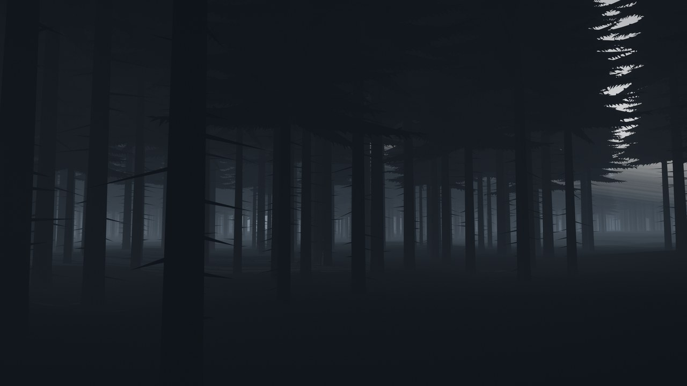
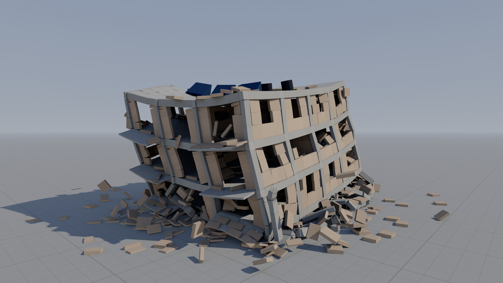

<div align="center">

# pc_graphics

**Ekran kartında sanat yönetimli sahneler; her birinin tek, dar bir hedefi var: doğru ışık, sonra güzellik, sonra fizik.**

[](https://isocpp.org)
[](https://developer.nvidia.com/cuda-toolkit)
[](https://developer.nvidia.com/rtx/ray-tracing/optix)
[](#derleme)
[](#derleme)
[](#durağan-ve-canlı)
[](#lisans)

[Sahneler](#sahneler) · [Sahne 1 ayrıntı](#sahne-1-neyi-hesaplıyor) · [Sahne 3 ayrıntı](#sahne-3-fizik) · [Derleme](#derleme) · [Çalıştırma](#çalıştırma) · [Sıradaki](#sıradaki-sahneler)

*[English](README.md)*

</div>

---


Bilgisayar grafiğini sanat yönetimi olarak çalışmak için kişisel bir atölye: bir dizi sahne, her biri kendi
oturumunda tek ve dar bir hedefle. Oyun motoru da değil, performans testi de değil. İlk sahne ışığın matematiksel
olarak doğru olmasıyla, ikincisi güzellikle, üçüncüsü fizikle ilgiliydi: gerçek hissettiren bir binanın gerçek
hissettiren biçimde yıkılması.

Hepsi tek bir makine için (2560×1440 IPS monitörü süren bir RTX 4080) C++, CUDA ve OptiX ile yazıldı; altında motor
yok. Sahne 1 spektral bir yol izleyicidir: referans görüntüye yakınsayan **durağan kip** ve NVIDIA'nın yapay zekâ
gürültü gidericisiyle saniyede 20-30 kare tutan **canlı kip**. Sahne 2 gerçek zamanlı, hacimsel bir gece. Sahne 3
kendi yazdığımız bir katı cisim ve kırılma çözücüsü; sade bir gündüz ışın izleyicisiyle çiziliyor.

## Sahneler

### 1 · Altın saatte cam ve taş · Ekim 2026

Tadao Ando dilinde bir oda: kalıp derzli ve kalıp delikli brüt beton, pirinç derz şeritli cilalı terrazzo zemin,
beyaz sıva, sığ bir havuz. Güneş ufkun sekiz derece üstünde ve yalnız dar yarıklardan giriyor. Huzmelerde kristal
prizmalar asılı; her biri duvarlara kendi tayfını saçıyor, pusun içinde dağılan ışık renkli yelpazelere açılıyor.
Işığın içinde sabun köpükleri süzülüyor.

| Prizma natürmortu | Işık planı, tepeden |
| --- | --- |
|  |  |

Sahne iki sanat turundan geçti. İlki *"ışık doğru mu?"* sorusunu yanıtladı ve doğru ama sessiz bir görüntü verdi.
İkincisi *"göz bir bakışta ne görüyor?"* sorusunu yanıtladı: karanlık oda, beş yarık, on dört kristal, sıcak denge.
İkisi arasında çizici değişmedi; sahne değişti.

| İlk ışık (1. aşama) | Canlı kip, 24 fps |
| --- | --- |
|  |  |

### 2 · Fener · Ekim 2026

Playdead'in *Inside*'ı tarzında bir gece: dönen huzmeyi taşıyacak kadar yoğun sis, kara köknar silüetleri, tek bir
sıcak pencereyle neredeyse tek renkli bir palet. Herhangi bir 3B'den önce çizilen üç değer etüdünden seçilmiş iki
sabit bakış: ormanlı bir adadan "Pencere" ve uzak bir burundan "Yücelik". Boşluk kamerayı ikisi arasında 778 m orman
içinden yürütür, ormanın karanlığı için göz uyumuyla; Tab küçük bir birinci şahıs yürüyüşe çevirir.


| Ormanın içi | Uzak burundan |
| --- | --- |
|  |  |

Yüzeyler, sonra tam çözünürlükte tek saçılımlı hacim, zamansal birikim, TAA ve parlama: 1440p'de kare başına 7,6 ms.
Bir kısmı bilerek fizik dışıdır (adıyla [docs/fener/DURUM.md](docs/fener/DURUM.md)'de): huzmenin ileri saçılımı yan
saçılımın ~100 katından 5 katına indirildi; kamera içindeyken bütün sisi yakan huzme doğrudur ama düzdür.

### 3 · Yıkım · Ekim 2026

Türkiye'nin kasabalarını dolduran türden beş katlı betonarme bir apartman: yüksek zemin katta camlı dükkânlar, tuğla
dolgu duvarlar, balkonlar, su depoları ve güneş kollektörleriyle düz çatı. Altındaki zemini gerçek deprem kayıtları
sallıyor, ya da izleyen kişi kolonlarını fareyle patlatıyor. Işık bilerek sade bir güneşli gün; emek fiziğe gitti.



| Aynı bina, 1999 Yarımca kaydı ×1,0 | ve ×1,5 |
| --- | --- |
|  |  |

| Patlatılan köşe kolonundan kalan demirler | 2023 Pazarcık ×1,0: ayakta, dolgusu dökülmüş |
| --- | --- |
|  |  |

Canlı çalışır: 1080p tam ekran pencere, RTX 4080'de saniyede 55-75 kare, fizik ve görüntü ekran kartında yan yana.
Tıklayıp parça patlat, beş kayıttan birini başlat, zamanı onda birine kadar yavaşlat.

## Sahne 1: neyi hesaplıyor

| | |
| --- | --- |
| **Spektral ışık taşıma** | Yol başına dört kahraman dalga boyuyla yol izleme (Wilkie ve diğ. 2014), gözün duyarlılığına göre örneklenen 360-830 nm (pbrt-v4), CIE 1931 gözlemcisi, sRGB'den uydurulan Jakob-Hanika sigmoid yansıtırlıkları. |
| **Güneş ve gök** | Kenar kararmalı 5778 K kara cisim, küresel bir atmosferde zayıflatılmış (Rayleigh, Mie aerosol, ozonun Chappuis bandı). Gök, aynı atmosferde tek saçılımdan hesaplanan 512×256×48 kanallı spektral bir harita; güneş her hareket ettiğinde yeniden hesaplanır. 10° yükseklikte güneş ~3480 K çıkar. |
| **Işık örnekleme** | Güneş diskine ve göğe *açıklıklar üzerinden* (portal) doğrudan ışık örneklemesi, BSDF örneklemesiyle çoklu önem örneklemesi (MIS) ile birleşir. |
| **Malzemeler** | Ando betonu (1820×910 mm panolar, her birinde altı kalıp deliği, V derzler, lekelenme), pirinç şeritli cilalı terrazzo, sıva, SF11 ve BK7 cam (Sellmeier), su (dağılım, Pope-Fry soğurması, kılcal-yerçekimi dalgacıkları), sabun filmi (Airy ince film girişimi), pirinç. Prosedürel ayrıntı aynı fonksiyonlardan bir kez döşenebilir dokuya pişirilir. |
| **Kostikler** | Aşamalı spektral foton haritası (Knaus ve Zwicker 2011): güneşten cama ve suya yöneltilen fotonlar, CUB ile sıralanan GPU hash ızgarası, kare kare küçülen toplama yarıçapı. |
| **Hacimsel kostikler** | Foton ışınları (Jarosz ve diğ. 2011): kostik fotonlarının pus içindeki uçuşları kendi ivme yapısını alır, kamera ışınları onları ışın izleme donanımıyla toplar. |
| **Pus** | Homojen katılımcı ortam, güneş ışığının tek saçılımı; mesafeler analitik olarak hesaplanan güneş huzmelerinin içinde örneklenir. |
| **Kamera ve ekran** | Dokuz bıçaklı diyaframlı ince mercek, Gauss piksel süzgeci, AgX ton eşleme, lens parlaması piramidi, Bradford uyarlamasıyla beyaz dengesi, 8 bit panel için mavi gürültü titreşimi. |
| **Gürültü giderme** | Albedo ve normal kılavuzlu OptiX yapay zekâ gürültü gidericisi. Kostikler ondan hiç geçmez: tayflar keskin kalsın diye sonradan eklenir. |

Foton geçişinin katkısı, aynı 512 örnekte:

| Fotonlar kapalı: yalnız yol izleme | Fotonlar açık |
| --- | --- |
|  |  |

## Durağan ve canlı (sahne 1)

| | Durağan | Canlı |
| --- | --- | --- |
| Hedef | referansa yakınsamak | akıcı kalmak |
| Çözünürlük | 2560×1440 izlenir | 1280×720 izlenir, `TEMPORAL_UPSCALE2X` ile ×2 büyütülür |
| Örnek | sınırsız birikir | kare başına piksel başına bir |
| Gürültü giderici | 8192 örneğe kadar yapay zekâ, sonra ham görüntü | her karede zamansal model |
| Sahne 1, kristaller | saniyede ~8 örnek | **24 fps** |
| Sahne 1, natürmort (ilk ışık ayarı) | saniyede ~16-20 örnek | 26-35 fps |

Boşluk tuşu ikisi arasında geçer. Canlı kipte su dalgalanır, toz ve köpükler süzülür.

## Okunmaya değer kararlar (sahne 1)

- **Tek OptiX programı, gölgelendirme ışın üretiminde.** Işınlar `optixTraverse` ile izlenir, iş parçacıkları
  `optixReorder` ile malzemeye göre yeniden gruplanır (gölgelendirici yürütme yeniden sıralaması), sonra yerinde
  gölgelendirilir. Ölçüldü: yeniden sıralama olmadan yol izleyici **6 kat yavaş**.
- **Küreler özel ilkel.** OptiX'in yerleşik küresi içeriden vurulmuyor; su dolu cam küre siyah çıktı, köpükler tek
  film gibi davrandı. Tek bayraklık bir deney içeriden sıfır vuruş gösterdi; özel kesişim iki kökü de raporluyor.
- **Varyans azaltmadan önce ölç.** Kazanmasını beklediğim iki teknik (güneşli lekelere üç yönlü MIS'le bağlanmak ve
  gök haritasının önem örneklemesi) yansız ve doğruydu ama eşit *sürede* kaybetti. Asıl kaldıraç maliyetti:
  prosedürel dokular karenin üçte ikisini alıyordu; pişirmek 2,3 kat verdi. İki teknik de kodda, varsayılan kapalı.
- **Kostikler gürültü gidericinin dışında kalır.** Tersi denendi: tayfları yaydı.
- **Zayıf dağılım için bedel ödenmez.** Suyun kırılma indisi görünür aralıkta ~0,01 değişir; kamera yolları onu
  yalnız kahraman dalga boyunda kırar. Her biri tek dalga boyu taşıyan fotonlar tamamen dağıtıcı kalır.
- **Prizma için tabakalı tayf bölme.** Dağıtıcı camı gören pikseller aynı yolu aynı rastgele sayılarla dört kez
  izler, camda her seferinde başka bir dalga boyunu taşır. Bu piksellere 16 ayrı örnek vermek ölçüldüğünde başlatmayı
  bekletti (11 → 48 ms): örnekler tek iş parçacığında sırayla koşuyordu.
- **Toz yalnız kamera için.** Binlerce toz zerresi kendi ivme yapısında, görünürlük maskesi 2 ile: yalnız birincil
  ışınlar görür. Maliyet 21 ms'den ölçülemeyecek kadar küçüğe indi.
- **Teknik olarak etkileyici olmak görsel olarak etkileyici olmakla aynı şey değil.** İlk biten sahne fiziksel olarak
  doğru, görsel olarak sadeydi. Çokluk ve renk (tek prizma yerine on dört kristal) ve karanlık bir oda bunu tek kısa
  turda değiştirdi; çiziciye dokunulmadı.

## Doğrulananlar (sahne 1)

| Denetim | Sonuç |
| --- | --- |
| Spektral seçim testi (`--selftest`) | D65 beyaz noktası x 0,31271, y 0,32907; D65 sRGB beyazına ±0,001; SF11 ve BK7 Fraunhofer F, d, C çizgilerinde katalogdan 6×10⁻⁵ içinde; Fresnel, ince film sıfırları ve sabun filminin Newton renk dizisi; sigmoid tayf uydurma gidiş-dönüş |
| Beyaz fırın (`--furnace`) | her yüzey beyaz, düzgün gök: ortalama parlaklık iki tohumda %0,02-0,03 içinde 1. Yolda iki gerçek hata yakaladı |
| Fotonlar, yol izlemeye karşı | düz yol izleme kostikleri bulabilsin diye güneş 5°'ye büyütüldü: kostik bölgelerde oran **0,991**, çift sayma yok |
| Yakınsama | 16, 64, 256, 1024 örnekte göreli piksel hatası 0,62, 0,35, 0,19, 0,11: beklenen 1/√n |
| 16.384 örneklik referansa uzaklık (NVIDIA FLIP, natürmort) | gürültü gidericili durağan: 16 örnekte 0,077 (0,7 s), 256'da 0,061, 1024'te 0,041; canlı 0,115 |
| Sonlu olmayan değer | hiçbir çalıştırmada yok |
| Gerçek monitörde | pencere RTX 4080 üzerinde (`GL_RENDERER` günlükte), 2560×1440 @ 165 Hz; canlı kare hızı RivaTuner göstergesiyle bağımsız olarak doğrulandı |

**Doğrulanmayanlar:** canlı kipte hareket gözle değil sayılarla (ardışık kare farkı) ve tek tek karelerle
değerlendirildi. Gökte çoklu saçılım yok; gerçek gökten biraz koyu ve daha az mavi. Kostik ışık yalnız ilk iki dağınık
sekmede toplanıyor (~%0,7 eksik). Canlı kipte prizmanın tayfı karıncalı.

## Sahne 3: fizik

Hedef mühendislik doğruluğu değil, film gerçekçiliğiydi: ağır ve inandırıcı hissettiren bir çöküş, ve gerçek deprem
kayıtları altında dağılmayan bir çözücü.

| | |
| --- | --- |
| **Cisimler** | 3.007 katı dışbükey parça (kolon ve kiriş parçaları, döşeme panelleri, tuğla bloklar, balkonlar, çatı ögeleri); her birinin kendi kabuğu, kütlesi ve eylemsizliği. Konumlar çift duyarlıkta. |
| **Bağlar** | 44.378 lif taşıyan 6.857 arayüz, uygulamalı eleman yönteminden (AEM) esinli: beton çekmede çatlar, basınçta ezilir (%30 kalan dayanım), donatı akar ve 6 cm plastik uzamada kopar, kayma önce kohezyon sonra sürtünme + dübel. Kapasiteyi aşan kısım kalıcı ofset olur: mafsallaşan kolon eğik kalır. |
| **Çözücü** | Ekran kartında XPBD, karede 40 alt adım. Arayüzler 13 graf renginde Gauss-Seidel ile çözülür (alt sınır: bir cisme değen en çok arayüz); çarpan geçişler boyunca biriktirilir, kapasite toplam kuvveti sınırlar. Alt adım döngüsü bir CUDA Graph. |
| **Temas** | Cisim çifti başına bir warp: örnek noktalar ötekinin kabuk düzlemlerine karşı, normal düzeltmeler çift içinde ortalanır, sonra yama merkezinde statik ve dinamik bütçeli, çapalı (PhysX gibi) tek sürtünme; burulma sürtünmesi ve sekme. |
| **Determinizm** | Temas ve arayüz toplamları kayan noktalı atomikler yerine 2⁻⁴⁰ sabit noktada: aynı deprem aynı binayı her koşuda aynı biçimde yıkar. |
| **Sönüm** | Serbest titreşimden ölçülen kritik sönümün %5,3'ü: kütleye orantılı, zemine göre, yalnız bağlı cisimlere, ivmesi sınırlı (düşen enkaz serbest kalır). |
| **Depremler** | ESM ve AFAD TADAS'tan beş kuvvetli yer hareketi kaydı (2023 Pazarcık ve Antakya, 1999 Yarımca ve İzmit, 2020 Bayraklı), iki kez integre edilip yer değiştirmeye çevrilir; zemin hareket eden kinematik bir cisim. Oynatma her kaydın en güçlü anından 15 sn önce başlar. |
| **Görüntü** | OptiX: her parça kendi kabuğunun bir örneği, dönüşümleri fizik doğrudan örnek tamponuna yazar, üst yapı her kare yeniden kurulur. Yumuşak gölgeli güneş, gök, zeminden bir sekme, depremle birlikte kayan metre ızgarası. Donatı liflerin durumundan çizilir: tuttukça çatlağın üstünden geçer, koptuğunda eğri filizler olarak çıkar. |

Binanın yaptığı (çatının zemine göre en büyük ötelemesi, deterministik):

| Kayıt | Yatay tepe ivme | Sonuç |
| --- | --- | --- |
| 2020 Bayraklı ×1 | 0,12 g | ayakta, öteleme %0,29 |
| 1999 İzmit ×1 | 0,25 g | ayakta, %0,28 |
| 1999 Yarımca ×1 | 0,34 g | ayakta, %0,91 |
| 1999 Yarımca ×1,5 | | yumuşak kat göçmesi, çatı 13,0 m iner |
| 2023 Antakya ×1 | 0,67 g | göçer, çatı 12,8 m iner |
| 2023 Pazarcık ×1 | 2,25 g (bir bileşen) | ağır hasarla ayakta: kalıcı %1,34 öteleme, korkuluklar ve dolgu duvarlar savrulur |
| 2023 Pazarcık ×1,25 | | göçer, çatı 12,4 m iner |

Pazarcık ×1 tam eşikte: en sonda düzeltilen bir modelleme hatasına kadar binayı yıkıyordu (aşağıda), düzeltmeden
sonra bina ayakta. Sınırındaki yapı kaotiktir; bu sonuçların bir şey ifade etmesi için çözücünün önce deterministik
olması gerekti.

Okunmaya değer kararlar:

- **Kapasite her geçişi değil, biriken kuvveti sınırlar.** Geçiş başına sınırlanınca iki geçiş akma momentinin iki
  katını taşıdı: düşmesi gereken 6 m konsol 8,7 cm sarkıp durdu. Artık küçük "mafsal" testleri her kesiti tek başına
  sınıyor; çerçevenin davranışı ancak parçaları doğruysa okunabilir.
- **Sürtünme noktanın değil yamanın.** Nokta başına sürtünme 25°'lik eğimde bloğu 5 mm/s sürüdü; yalnız alt adım
  içindeki kaymayı geri alan sürtünme 15 bloklu piramidi 30 sn'de 0,65 m açtı; yama başına tek, çapalı sürtünme bunu
  0,6 mm'ye indirdi. Sıralı normal düzeltmeler düz düşen kutuyu döndürdü; çift içinde ortalanıyor.
- **İç içe geçmeyi itmek hız biriktirir.** Zemine gömülen enkaz 22-52 m/s ile fırladı. Ayrılma hızı sınırlandı; ilk
  sınırdaki cırcır (önceki ayrılma hızına izin) tek bir bloğun kare kare izinden bulundu.
- **Kesilen kolon binayı taşımaya devam eder.** Dört katın altında temas ve sürtünmeyle tutar; kolonu kaldırmak
  cismi dünyadan çıkarmak demek.
- **Kayan noktalı atomikler eşikteki binayı bir koşuda yıkıp öbüründe ayakta bıraktı.** Sabit noktalı toplama
  sonuçları tekrarlanabilir yaptı; sonraki her ölçümü anlamlı kılan buydu.
- **Sönüm, üçüncü deneme.** Arayüzlerde açık sönüm katsayı ne olursa olsun %0,5'te kaldı; kapalı rijitlik sönümü
  binayı yumuşattı (periyot 0,45 → 1,43 s); ivmesi sınırlı, kütleye orantılı sönüm periyodu değiştirmeden %5,3 verdi.
- **Canlı pencere bir durumu çizerken ekran kartı bir sonrakini hesaplar.** Fizik ve görüntü iki akışta, aralarında
  bir olay: 28 fps 55-75 oldu.
- **İç durumu göstermek denetlemektir.** Donatının göründüğü ilk karede yere düşmüş tuğla korkuluklardan demir
  çıkıyordu. Bir parçanın kendi donatı oranı (balkonların) değdiği tuğlaya sızıyordu: dayanımı sıfır ama korkuluğun
  tabanını 1,8 kat katılaştıran, çatlatan kuvveti de o kadar büyüten demirler. Hiçbir test ve klip göstermemişti.
  Düzeltmek Pazarcık ×1'i göçmeden ayakta kalmaya taşıdı.
- **Taşıyıcıyı ölç, üstünde duranı değil.** "Çatı ötelemesi" en üstteki parçaların ortalamasıydı, onlar da tuğla
  korkuluktu; savrulan korkuluk, ayakta duran binada çatının 9,7 m düştüğü diye okundu.

**Doğrulanmayanlar:** on katı parçalı 5 m'lik konsol varsayılan alt adım sayısında 2,9 kat yumuşak (uzun katı
zincirler yavaş yakınsıyor; binanın ölçülen periyodu 0,45 s, yönetmelik formülünün 0,54 s'sine yakın). Bina bir
mühendislik analiziyle karşılaştırılmadı; çözücünün testleri (serbest düşme, yığın, eğim, enerji, mafsal,
determinizm, sönüm) fiziksel akıl sağlığı denetimleri, 26'nın 24'ü geçiyor, kalan ikisi konsol. Hareketi kliplerden
Özcan değerlendirdi, yazarın gözü değil.

## Derleme

**Gerekenler:** Windows 11, OptiX 9.1'i taşıyan sürücüyle bir NVIDIA RTX GPU (RTX 4080 ve 617.14 sürücüsüyle
denendi), C++ iş yüküyle Visual Studio 2026 (MSVC 14.51, içindeki CMake ve Ninja), Git Bash, araçlar için Python 3
(`numpy`, `pillow`, `OpenEXR`, `flip-evaluator`).

```bash
bash third_party/fetch.sh        # CUDA 13.4.2 dağıtım arşivleri, OptiX 9.1 başlıkları, GLFW, stb, tinyexr
```

Hiçbir şey kurulmaz ve ekran kartı sürücüsüne dokunulmaz: CUDA, NVIDIA'nın bileşen arşivleri olarak git'e
işlenmeyen `third_party/` klasörüne iner.

```bat
cmd /c build.bat                 :: bir kez yapılandırır, sonra build\pc_graphics.exe'yi derler
```

`src/device/` içindeki OptiX cihaz programları çalışma anında NVRTC ile derlenir; onları düzenlemek yeniden derleme
istemez: pencerede **F5**'e bas.

## Çalıştırma

```bat
build\pc_graphics.exe                                   :: kenarlıksız tam ekran, durağan kip
build\pc_graphics.exe --headless --spp 2048 --denoise --out captures\ad
build\pc_graphics.exe --headless --live 80 --out captures\live\ad
build\pc_graphics.exe --selftest
build\pc_graphics.exe --headless --furnace --spp 512 --out captures\furnace
```

| Tuş | |
| --- | --- |
| Boşluk | durağan ↔ canlı |
| C | sonraki kamera |
| H | gösterge (fps, geçiş başına ms, örnek, watt, sıcaklık) |
| S | ekran görüntüsü, PNG ve doğrusal EXR |
| ↑ ↓ / ← → | pozlama / odak uzaklığı |
| D, P, V, N | gürültü giderici, fotonlar, pus, doğrudan ışık örneklemesi aç-kapa |
| 1-5 | güzel, albedo, normal, yalnız kostikler, maliyet ısı haritası |
| F5 | cihaz programlarını yeniden derle, `scene.cfg`'yi yeniden oku |

Sahne parametreleri (güneş, pus, beyaz dengesi, kameralar, kristaller) `scene.cfg` içinde. Gösteri için kısa rehber:
[GOSTERI.md](GOSTERI.md).

Sahne 2 `build\fener.exe` ile açılır (Boşluk: iki bakış arasında yürü, Tab: birinci şahıs; tuşlar GOSTERI.md'de).
Sahne 3:

```bat
build\yikim.exe                                         :: tam ekran canlı pencere
build\yikim.exe --test                                  :: çözücünün fizik testleri
build\yikim.exe --clip sarsinti --seconds 40 --set deprem.record=2 --out captures\yikim\ad
build\yikim.exe --clip kolon --still 3 --out captures\yikim\ad
```

| Tuş | |
| --- | --- |
| Sol tık | imlecin altındaki parçayı patlat (Ctrl: büyük patlama) |
| Sağ tık + fare, WASD, E/Q, Shift, tekerlek | bak, uç, yukarı/aşağı, hızlı, yakınlaş |
| Boşluk | depremi başlat ya da durdur |
| 1-5 | kayıt: Pazarcık, Antakya, Yarımca, İzmit, Bayraklı |
| + / − | şiddet, 0,25'lik adımla |
| T | ağır çekim: 1, 0,25, 0,1 |
| P, B, R | durdur, donatıyı göster/gizle, binayı baştan kur |
| F12, H, Esc | ekran görüntüsü, yazıları gizle, çık |

Sahne 3'ün ayarları (bina, malzemeler, çözücü, kamera, güneş) `scenes/yikim.cfg` içinde; her biri
`--set anahtar=deger` ile ezilebilir.

## Depo düzeni

```
src/
  main.cpp            pencere, tuşlar, başsız ve canlı ölçüm kipleri; --scene fener ve --scene yikim yönlendirmesi
  renderer.cpp        OptiX bağlamı, NVRTC, boru hattı, ivme yapıları, başlatmalar
  scene.cpp           oda, malzemeler, kameralar, spektral uydurma ve seçim testleri
  photons.cu          foton hash ızgarası (CUB radix sort), ışın sınır kutuları
  kernels.cu          gürültü giderici girdileri, lens parlaması piramidi
  denoiser.cpp        OptiX yapay zekâ gürültü gidericisi: AOV, zamansal, zamansal 2× büyütme
  fener/              sahne 2: dünya üretimi, gerçek zamanlı ışık hattı, oyuncu kipi
  yikim/              sahne 3: kabuklar, ekran kartı çözücüsü (phys.cu), bina, deprem kayıtları, testler, pencere
  device/             üç sahnenin OptiX programları (çalışma anında derlenir)
  shared/             konak ve cihazın ortak kodu: vektörler, tayflar, parametreler, ekran dönüşümü
scenes/               sahne 2 ve 3'ün ayarları
tools/                EXR istatistikleri, FLIP ve RMSE karşılaştırması, gürültü haritaları, temas tabakaları, prizma planlayıcı, değer etütleri
assets/               mavi gürültü dokusu; deprem/: beş deprem kaydı (ESM, AFAD TADAS)
docs/                 Türkçe çalışma günlüğü: plan, her ölçümüyle durum panosu, sınırlar raporu;
                      fener/ ve yikim/ sahne 2 ve 3 için aynısı
third_party/fetch.sh  bağımlılıkları indirir; klasörün kendisi git'te değil
```

## Sıradaki sahneler

- Konuşuldu, başlatılmadı: motorsuz, küçük ama tam bir oyun, fenerin dünyasında (feneri yeniden yak, huzme bulmacada,
  karanlıkta tehlike).
- Sahne 3'e hâlâ toz (sahne 2'nin sis düzeneği başlangıç noktası), daha pürüzlü kırık yüzeyler ve cam eklenebilir;
  bilerek bunlarsız kapandı: hedefi fizikti.

## Lisans

Özel depo. Tüm hakları saklıdır. Üçüncü taraf bileşenler derleme sırasında kendi lisanslarıyla indirilir: NVIDIA
CUDA dağıtım arşivleri ve OptiX SDK başlıkları, GLFW (zlib), stb (kamu malı), tinyexr (BSD). Deprem kayıtları: ESM,
Engineering Strong-Motion veritabanı (Mascandola ve diğ., doi 10.13127/esm.3) ve AFAD TADAS.

Claude Code (Anthropic) ile uzun otonom oturumlarda geliştirildi; her kararın arkasındaki ölçümler
[docs/DURUM.md](docs/DURUM.md), [docs/fener/DURUM.md](docs/fener/DURUM.md) ve [docs/yikim/DURUM.md](docs/yikim/DURUM.md)'de,
sahne 1'de işin nerede yanlış gittiğinin dürüst dökümü [docs/SINIRLAR.md](docs/SINIRLAR.md)'de.
