<div align="center">

# pc_graphics

**Ekran kartında, motorsuz yazılmış on üç sanat yönetimli sahne. Her biri tek, dar bir konunun içinde kalıyor.**

[](https://isocpp.org)
[](https://developer.nvidia.com/cuda-toolkit)
[](https://developer.nvidia.com/rtx/ray-tracing/optix)
[](#derleme)
[](#derleme)
[](#derleme)
[](#lisans)

[Sahneler](#sahneler) · [Uygulama](#uygulama) · [Sahneler ayrıntılı](#sahneler-ayrıntılı) · [Derleme](#derleme) · [Çalıştırma](#çalıştırma) · [Düzen](#depo-düzeni) · [Lisans](#lisans)

*[English](README.md)*

</div>

> **Bu proje hakkında.** pc_graphics, yapay zekânın sınırlarını keşfetmek ve neler yapabildiğini görmek için
> geliştirilmiş; bilim, mühendislik ve sanat odaklı bir projedir. Her sahne tek bir dar alan için tasarlandı: o alanda
> yapay zekânın bilimi, mühendisliği ve sanatı nereye kadar götürebildiğini görmek ve o alanın en iyisine ulaşmak
> için. Her şey tek bir sisteme göre yazılıp ayarlandı (16 GB'lık RTX 4080, 2560×1440 ekran); başka donanımda
> performans sorunları yaşanabilir.
>
> **About this project.** pc_graphics is a project in science, engineering and art, built to explore the limits of
> AI and to see what it can do. Each scene is designed around one narrow field: to find out how far AI can take the
> science, the engineering and the art of that field, and to aim for the best work there is in it. Everything is
> written and tuned for a single system (an RTX 4080 with 16 GB, driving a 2560×1440 monitor); on other hardware the
> scenes may run slowly or not at all.

---

## Sahneler

| | |
| :---: | :---: |
| [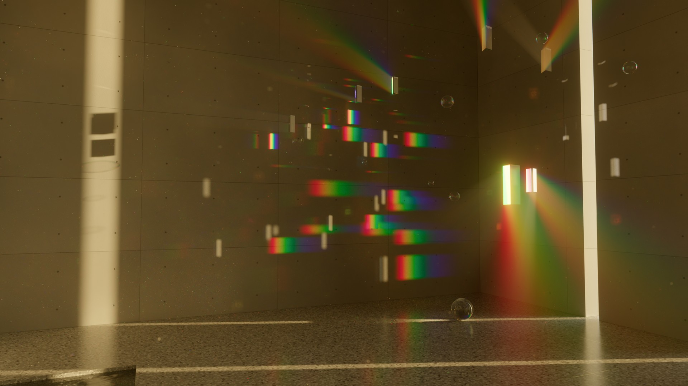](#1--altın-saatte-cam-ve-taş--ekim-2026)<br>**1 · Altın Saat** · tayfsal ışık | [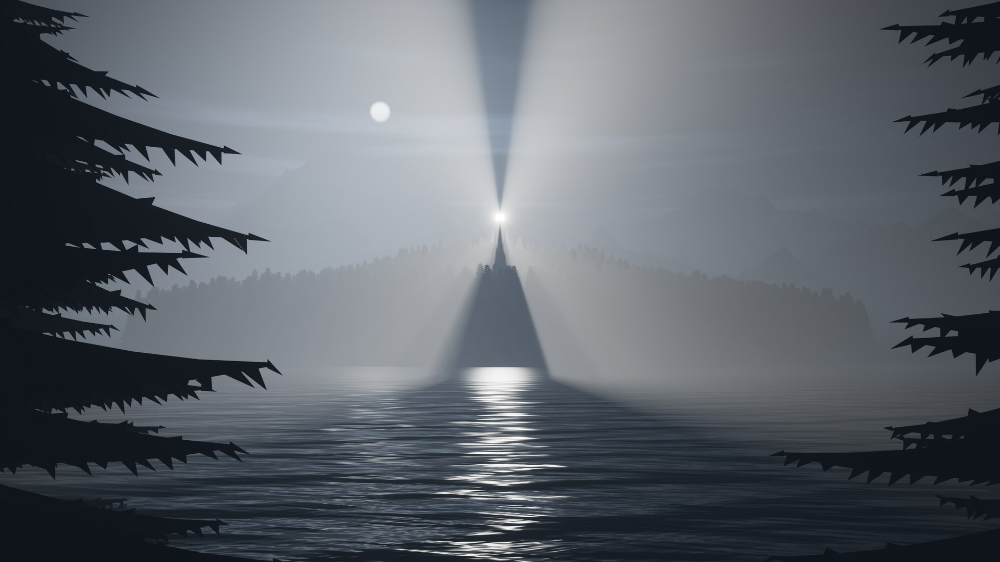](#2--fener--ekim-2026)<br>**2 · Fener** · siste ışık |
| [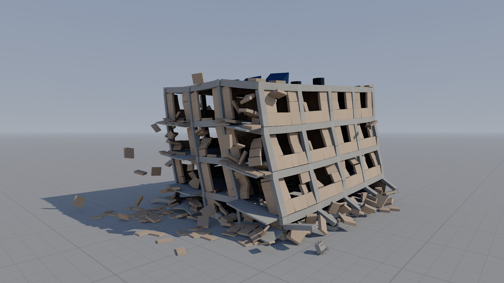](#3--yıkım--ekim-2026)<br>**3 · Yıkım** · katı cisimler ve kırılma | [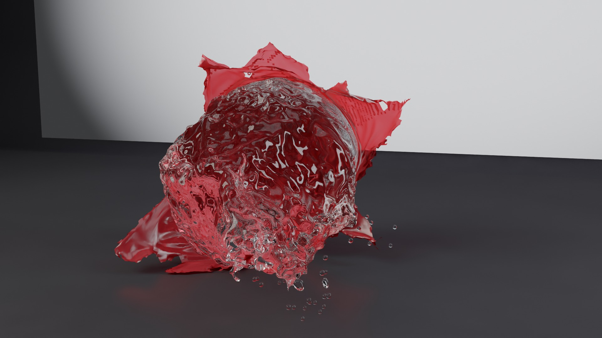](#4--laboratuvar--ekim-2026)<br>**4 · Laboratuvar** · sıvılar ve taneler |
| [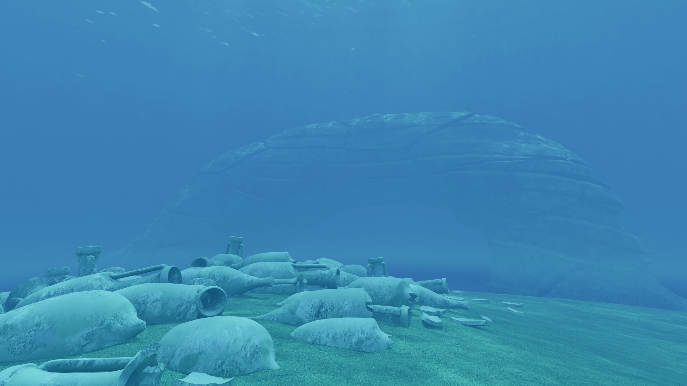](#5--ada--ekim-2026)<br>**5 · Ada** · su altında berraklık | [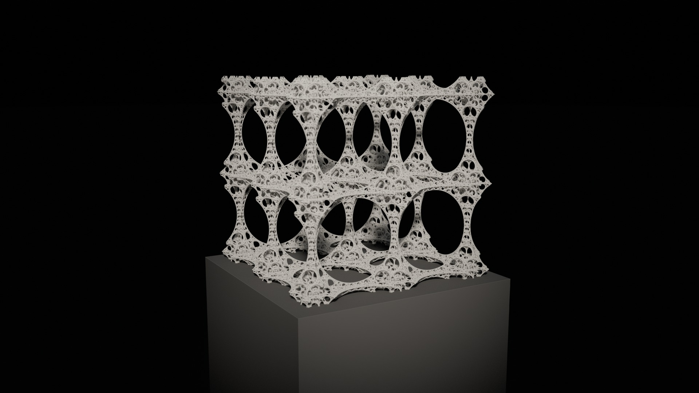](#6--heykel--ekim-2026)<br>**6 · Heykel** · geometri |
| [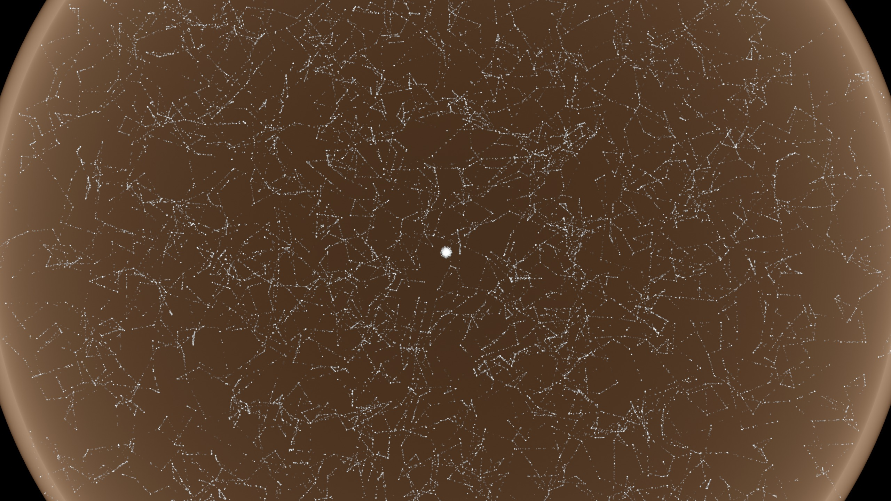](#7--ölçek--ekim-2026)<br>**7 · Ölçek** · 62 büyüklük mertebesi | [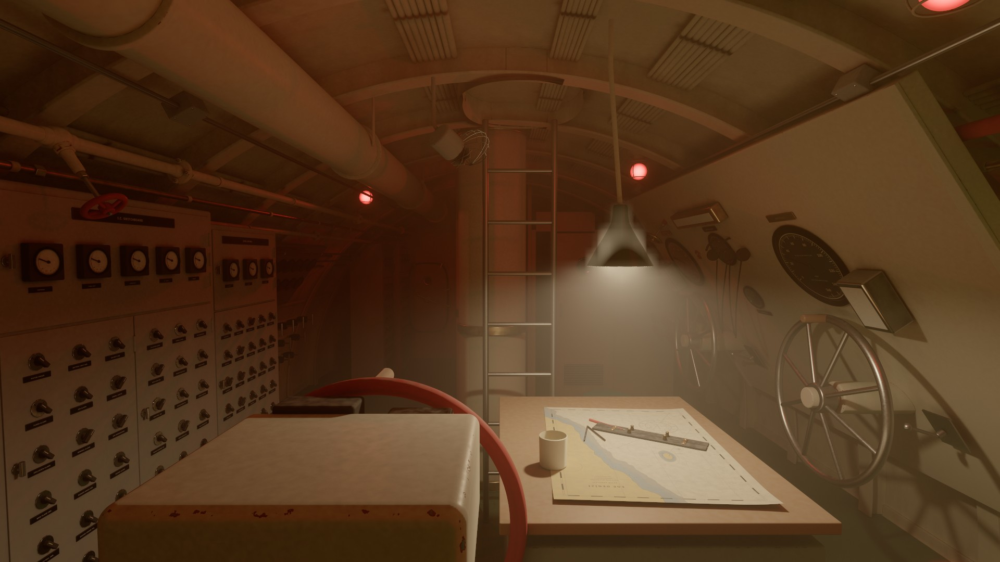](#8--denizaltı--ekim-2026)<br>**8 · Denizaltı** · atmosfer |
| [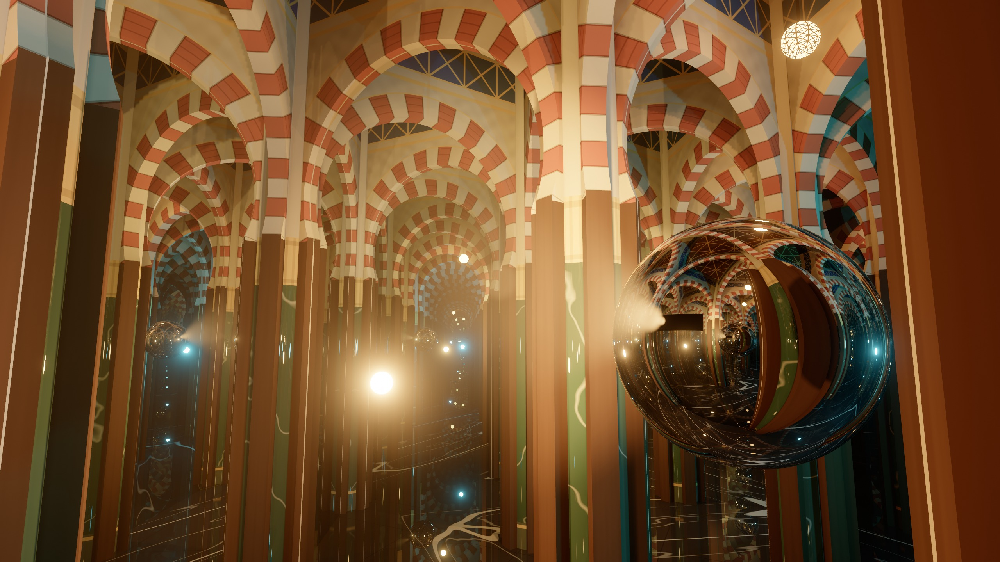](#9--ayna--ekim-2026)<br>**9 · Ayna** · yansıma | [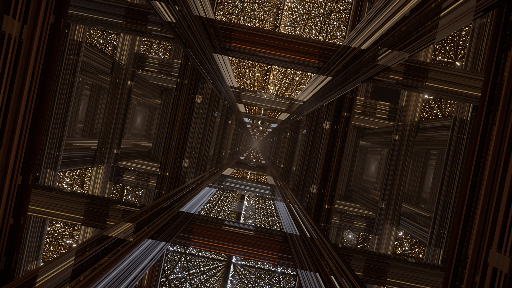](#10--kuyu--ekim-2026)<br>**10 · Kuyu** · sonsuzluk |
| [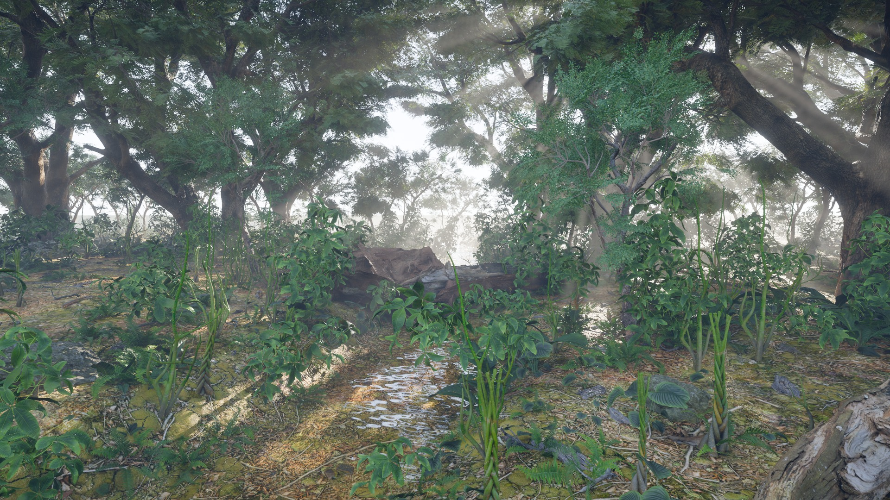](#11--orman--ekim-2026)<br>**11 · Orman** · yoğunluk | [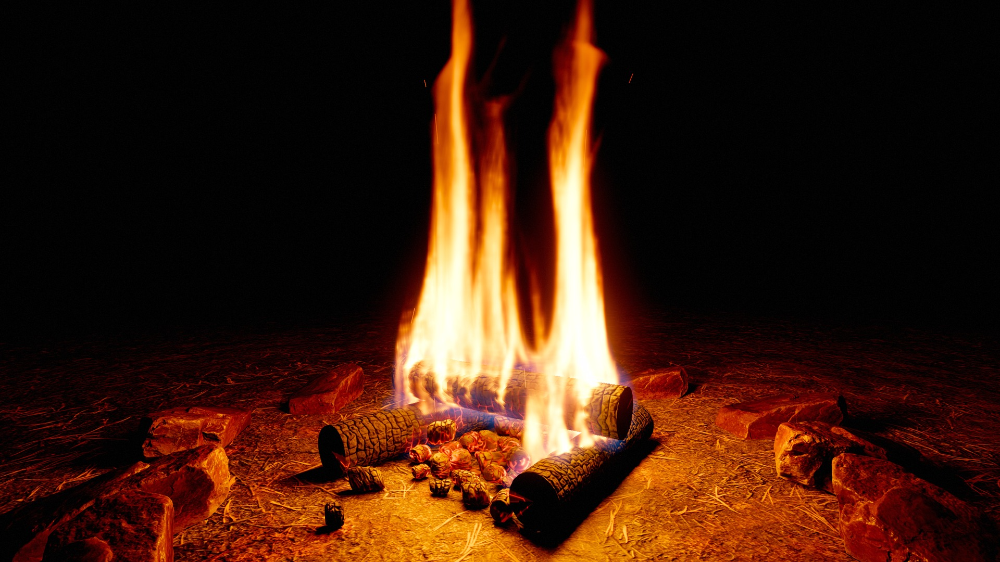](#12--ateş--ekim-2026)<br>**12 · Ateş** · fizik olarak ateş |
| [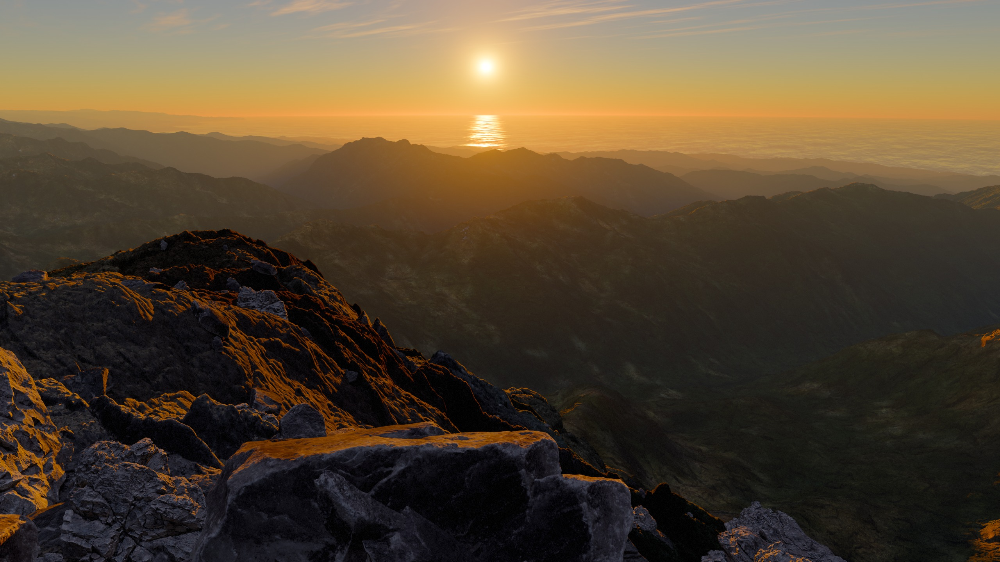](#13--dağ--kasım-2026)<br>**13 · Dağ** · çizim mesafesi | |

## Bu nedir

Tek bir Windows programında on üç sahne; C++20, CUDA ve OptiX 9.1 ile yazıldı, altında oyun motoru yok. Her sahnenin
çizicisi kendine ait: ortak bir çizici yok, her biri konusuna göre seçildi. Foton haritalamalı tayfsal bir yol izleyici
(1), gerçek zamanlı hacimsel bir gece (2), bir katı cisim ve kırılma çözücüsü (3), sıvılar ve taneler için bir tanecik
çözücüsü (4), su altında deterministik, tayfsal bir ışın izleyici (5), on bin kat yakınına inilen bir fraktalda uzaklık
kestirimi (6), gerçek veriyle 62 büyüklük mertebesini geçen bir kamera (7), önceden pişirilip tessellation ile çizilen
ışık (8), bir ayna labirenti ve sonsuz bir kafes için analitik izleyiciler (9, 10), sık bir orman için OptiX ve DLSS Ray
Reconstruction (11), kendi gaz ve odun fiziğiyle yanan bir ateş (12) ve ayrıntı seviyesi kullanmadan 387 km'ye kadar
çizilen bir arazi (13). OptiX programları çalışma anında NVRTC ile derlenir; buna izin veren sahnelerde bir
değişiklikten sonra F5 onları yeniden derlemeye gerek kalmadan yeniden yükler.

Sahneler birbiri ardına yapıldı; sonrakiler, öncekilerin öğrettiği kurallara uyuyor. Görüntü hareket hâlinde de temiz
olmalı: gren yok, kıpırtı yok. Bu yüzden canlı görüntülerde her piksel, zamansal bir süzgecin yumuşattığı gürültü
yerine her karede aynı sabit örnekleri alır; ancak kamera durunca netleşen bir görüntü sayılmaz. Netlik TAA'dan değil
süper örneklemeden gelir; yaprakları pikselden ince olan orman ise DLSS Ray Reconstruction kullanır. Kare süreleri GPU
zaman damgalarıyla ölçülür, titreme de yalnız gözle değerlendirilmez, yakınsamış bir referansa karşı ölçülür. Dokular
ve modeller açık lisanslı (CC0 ya da atıflı CC BY); gerçek bir taraması olan hiçbir şey elle çizilmez.

**Nasıl yapıldı.** Her sahnenin ne için olduğuna ve nasıl görüneceğine ben karar veriyorum, sonucu kendi ekranımda
değerlendiriyorum. Kodu yapay zekâ, Claude Code ile, uzun çalışma oturumlarında yazıyor; her sahnenin planı, kararları
ve ölçümleri [docs/](docs/) altındaki kendi klasöründe duruyor, denenip bırakılanlar ve doğrulanmayanlar da dahil.

## Uygulama

On üç sahnenin hepsi tek bir programda. Program bir galeriyle açılır: sahneler numaralı bir listede, seçilen sahne
yanında büyük, kısa bir açıklamayla; **Ayrıntılar**'da (A) nasıl yapıldığı. Sahne bir yükleme ekranının arkasında
yüklenir: GPU programları derlenir, dünyası ayrı bir iş parçacığında kurulur, böylece pencere canlı kalır. Sonra her
sahne aynı arayüzle çalışır: adı ve durumu sol altta, sahnenin kendi denetimleri varsa onlarla birlikte (Yıkım'da
depremin büyüklüğü ve süresi, Laboratuvar'da deney); kare süresi, GPU gücü ve belleği sağ üstte; tuşları **F1**'de. Esc
her zaman geri götürür; kapanan sahne ekran kartını bütünüyle geri verir. Ekrandaki her şey Türkçe ya da İngilizce (L
ya da galeride sağ üstte TR | EN).

| Galeri | Ayrıntılar: nasıl yapıldı |
| --- | --- |
| 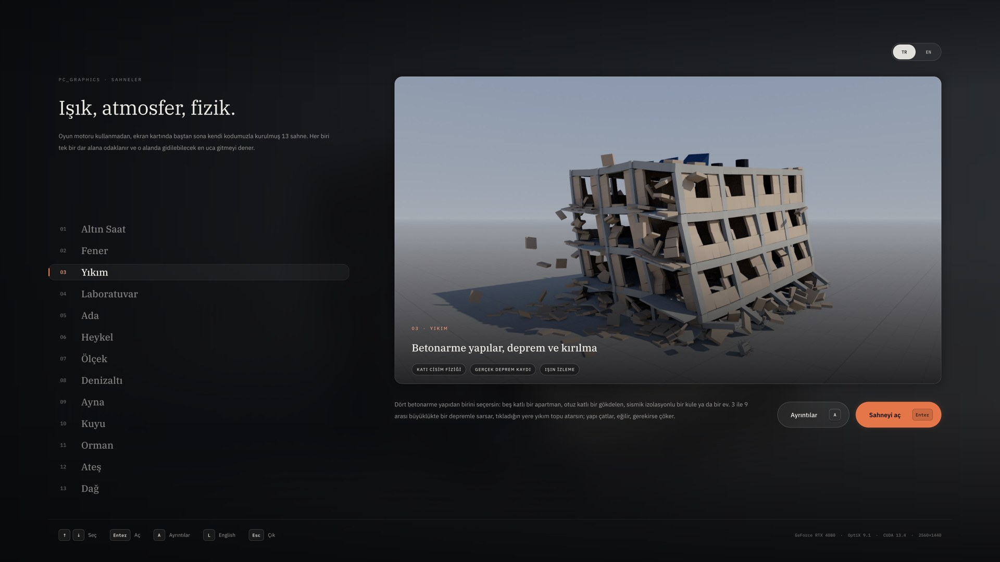 | 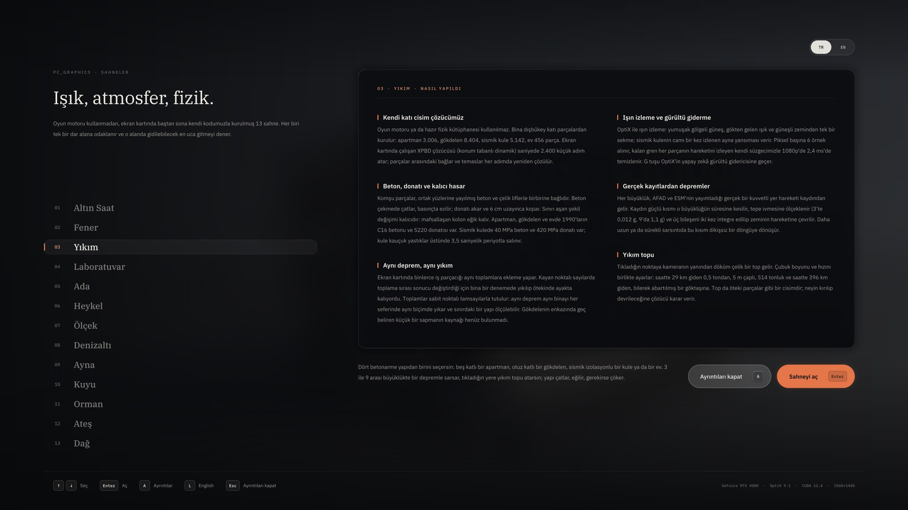 |
| **Çalışan bir sahne** | **Tuşları (F1)** |
| 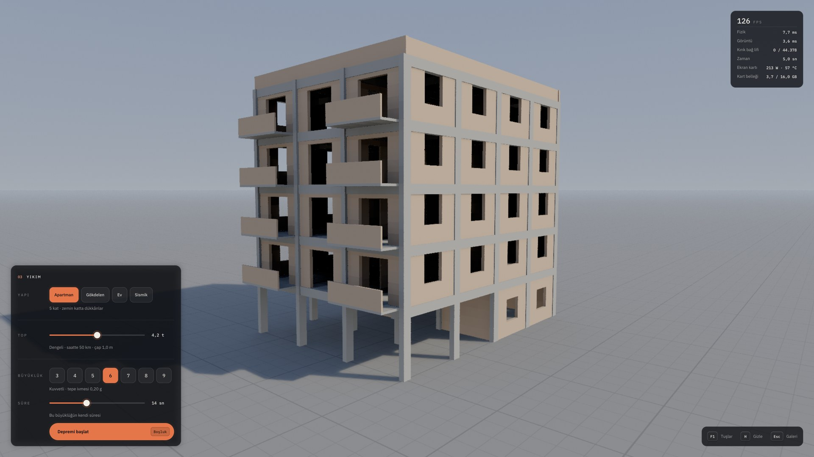 | 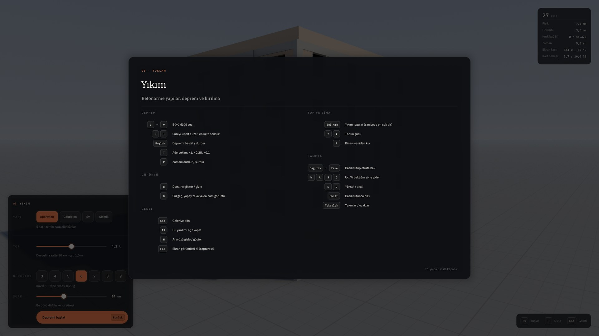 |

Görünüm tek bir aile: adlar için IBM Plex Serif, metin için Sans, sayılar ve tuşlar için Mono; resmin üstünde koyu cam
paneller ve her sahneye ışığından alınmış tek bir vurgu rengi. Bir sahne; çizicisi, ayarları ve GPU programlarıyla bir
klasör, artı sahne kaydında tek bir satırdır. Sözleşmeyi ve yeni bir sahnenin nasıl ekleneceğini
[docs/MIMARI.md](docs/MIMARI.md) anlatıyor.

## Sahneler ayrıntılı

### 1 · Altın saatte cam ve taş · Ekim 2026

Tadao Ando dilinde bir oda: kalıp derzli ve kalıp delikli brüt beton, pirinç derz şeritli cilalı terrazzo zemin,
beyaz sıva, sığ bir havuz. Güneş ufkun sekiz derece üstünde ve yalnız dar yarıklardan giriyor. Huzmelerde kristal
prizmalar asılı; her biri duvarlara kendi tayfını saçıyor, pusun içinde dağılan ışık renkli yelpazelere açılıyor.
Işığın içinde sabun köpükleri süzülüyor.

| Prizma natürmortu | Işık planı, tepeden |
| --- | --- |
| 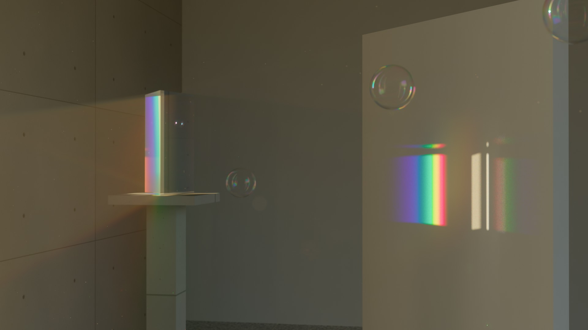 | 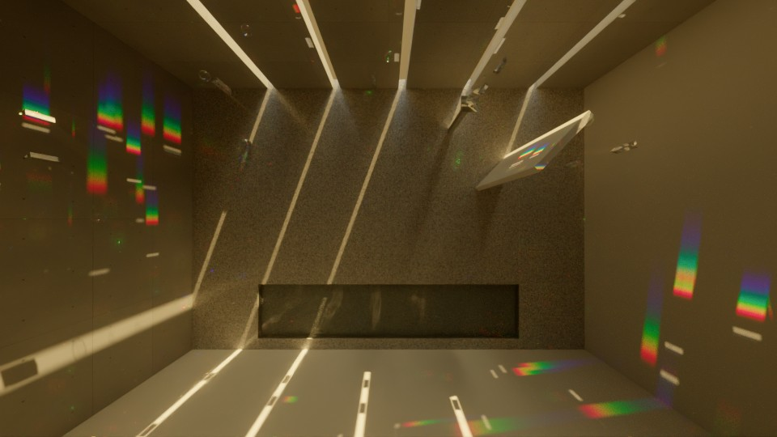 |

Sahne iki sanat turundan geçti. İlki *"ışık doğru mu?"* sorusunu yanıtladı ve doğru ama sessiz bir görüntü verdi.
İkincisi *"göz bir bakışta ne görüyor?"* sorusunu yanıtladı: karanlık oda, beş yarık, on dört kristal, sıcak denge.
İkisi arasında çizici değişmedi; sahne değişti.

| İlk ışık (1. aşama) | Canlı kip |
| --- | --- |
|  | 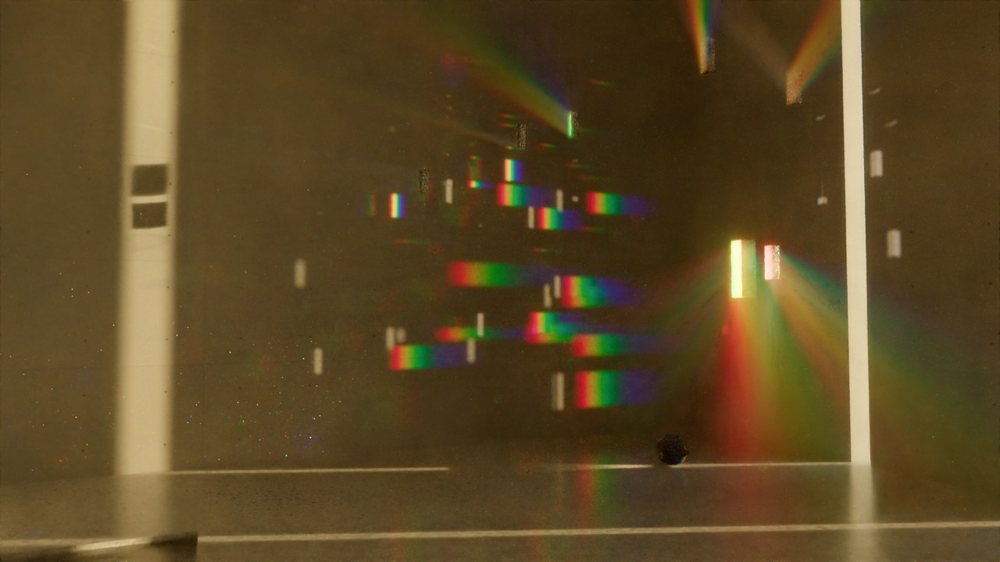 |

### 2 · Fener · Ekim 2026

Playdead'in *Inside*'ı tarzında bir gece: dönen huzmeyi taşıyacak kadar yoğun sis, kara köknar silüetleri, tek bir
sıcak pencereyle neredeyse tek renkli bir palet. Herhangi bir 3B'den önce çizilen üç değer etüdünden seçilmiş iki
sabit bakış: ormanlı bir adadan "Pencere" ve uzak bir burundan "Yücelik". Boşluk kamerayı ikisi arasında 782 m orman
içinden yürütür, ormanın karanlığı için göz uyumuyla; Tab küçük bir birinci şahıs yürüyüşe çevirir.


| Ormanın içi | Uzak burundan |
| --- | --- |
|  | 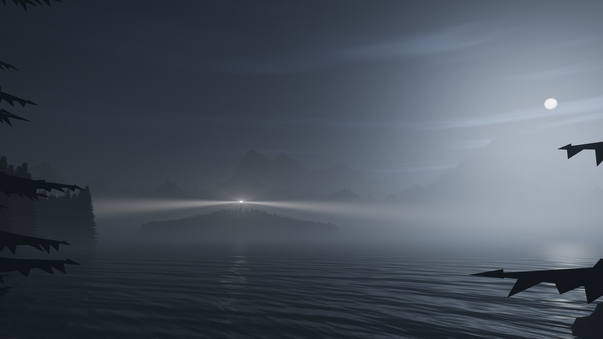 |

Yüzeyler, sonra tam çözünürlükte tek saçılımlı hacim, zamansal birikim, TAA ve parlama: 1440p'de kare başına 7,6 ms.
Bir kısmı bilerek fizik dışıdır (adıyla [docs/fener/DURUM.md](docs/fener/DURUM.md)'de): huzmenin ileri saçılımı yan
saçılımın ~100 katından 5 katına indirildi; kamera içindeyken bütün sisi yakan huzme doğrudur ama düzdür.

### 3 · Yıkım · Ekim 2026

Dört yapı. Üçü aynı beton, çelik ve tuğladan. Türkiye'nin kasabalarını dolduran türden beş katlı bir apartman: yüksek zemin
katta camlı dükkânlar, tuğla dolgu duvarlar, balkonlar, su depoları ve güneş kollektörleriyle düz çatı. Otuz katlı, 97
metrelik bir gökdelen: donatısız beton çekirdeğin çevresinde bir çerçeve, önde camlı bir lobi. Ve beşik çatılı, tek katlı bir
ev: mahya kirişi, beşik duvarları, baca. Ve Japon uygulamasından esinli sismik bir kule: üç kademede incelip çelik
bir iğneyle biten cam bir gövde, kauçuk izolatörlerin üstünde; sallanır, süzülür ama ayakta kalır. Zemini büyüklüğü 3'ten 9'a kadar depremler sallıyor (her biri gerçek bir
kuvvetli yer hareketi kaydından türetildi), ya da izleyen kişi yapıya fareyle yıkım topu fırlatıyor. Işık bilerek sade
bir güneşli gün; emek fiziğe gitti.


| Büyüklük 6: balkon korkulukları dökülür | Büyüklük 7: zemin kat dolgusunu yitirir, çerçeve ayakta |
| --- | --- |
| 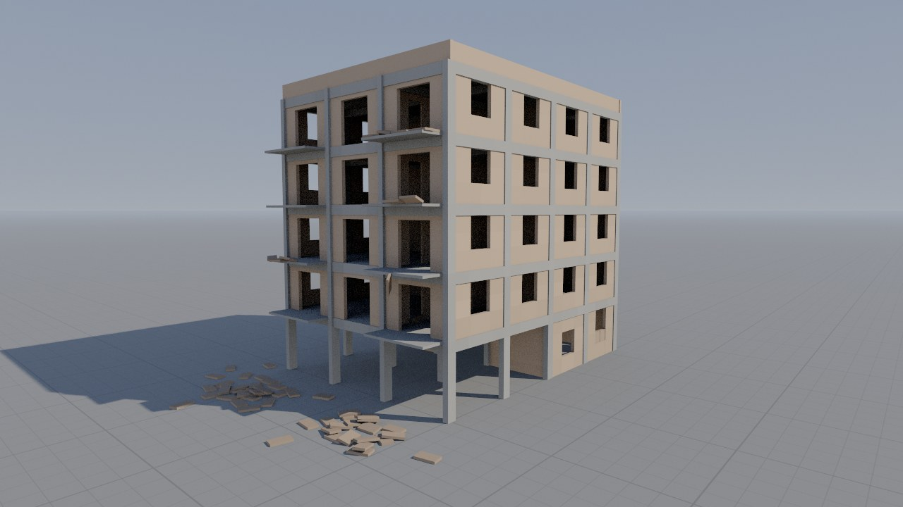 | 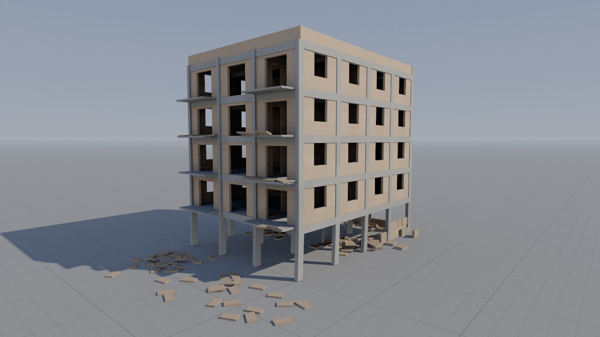 |

| Patlatılan köşe kolonundan kalan demirler | Büyüklük 9: yumuşak kat çöküyor |
| --- | --- |
|  | 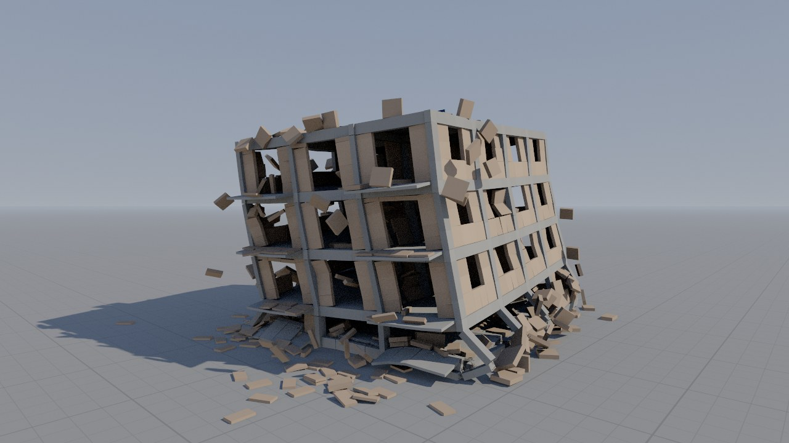 |

| Gökdelen: 30 kat, 97 m, 8.404 parça | Ev: beşik çatı, 456 parça |
| --- | --- |
| 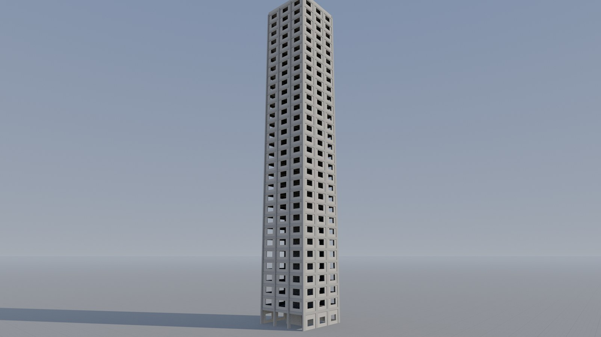 |  |

| Sismik kule: 26 kat ve iğne, ~123 m, 5.142 parça, taban izolasyonlu |
| --- |
| 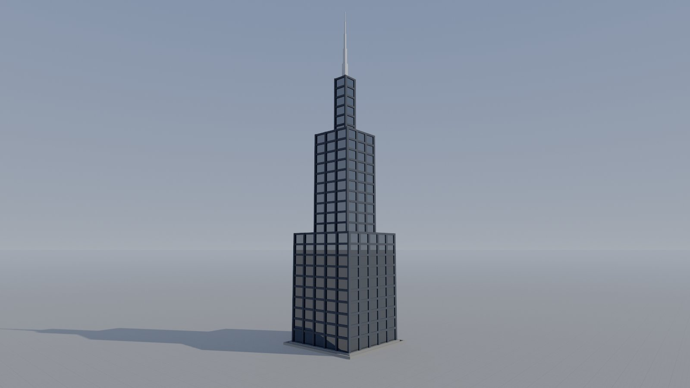 |

| Yıkım topu köşe kolona çarpar (4,2 t, 14 m/s) | Kolonun ayağı fırlamış, kolon eğik asılı, demirler açıkta |
| --- | --- |
|  |  |

Canlı çalışır: 1080p, RTX 4080'de gürültü giderici açıkken saniyede ~50 kare, fizik ve görüntü ekran kartında yan yana.
Büyüklüğü (3-9) ve süreyi (büyüklüğün kendi süresinden durdurana kadar) panelden fareyle ya da tuşla seç, başlat;
tıklayıp yıkım topu at, zamanı onda birine kadar yavaşlat.

### 4 · Laboratuvar · Ekim 2026

Bir ağır çekim fotoğraf masası: koyu bir set, deneyin arkasında büyük yumuşak bir ışık paneli, sıvı fotoğrafçılığının
klasik ışığı (cam ve sıvı kırılan kenarlarıyla okunur). Sekiz deney, yedisi kendi yazdığımız tek çözücüde tanecik,
biri ayrı bir çözücüde katı küpler, fizik ne derse o:

- **Su** eğilen bir beherden bardağa dökülür, 12 ile 45 cm arasından: sıçrar, taşar, masada birikir.
- **Bal** kaşıktan cam tabağa (canlı, kaşığı fareyle gezdir): tek kehribar ip, tabakta katlanıp kıvrılır, sonra göle
  yayılır.
- **Kum** huniden masaya ve behere (canlı): 32,5° ile yığılır (kuru kum 30-35°).
- **Su balonu** masada, iğneyle delinir: lastik 20-30 ms'de geri soyulurken su bir an balon biçiminde kalır, sonra çöker.
- **Karpuz** tüfekle vurulur (5,56, 7,62×51, .50 BMG; gerçek yükler): birkaç milisaniye şişer, sonra kabuğu taç gibi
  açılır.
- **Süt damlası** ince bir süt katmanına (0,4 mm tanecik, saniyenin 1/5000'i): taç açılır, damlacık saçar.
- **Balistik jel bloğu** tabancayla (.22, 9 mm, .50 AE): saydam bloğun içinde mermi yolu ve geçici boşluk, blok sarsılır.
- **Küçük plastik küplerden bir küp** (zeka küpünün altı rengi, 64'ten bir milyona, her biri 25 mm'den 1 mm'ye), ortasında
  patlayıcı: 3 mikrogram TNT'den (birkaç küp dökülür) 2 grama (patlar). Her küçük küp katı bir cisim: yüzünün üstüne
  düşer, takla atar, seker, kayar; küçükleri hava yavaşlatır.

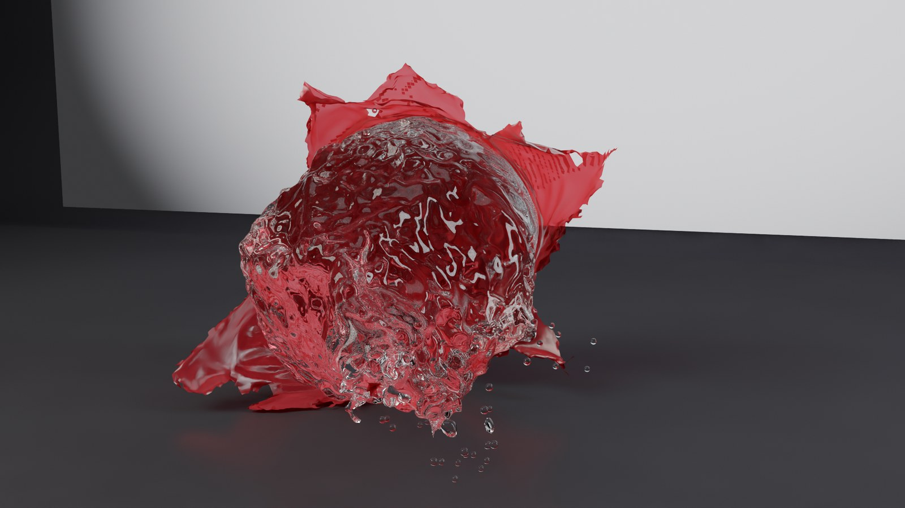

Hızlı olanlar **kaydedilebilir**: tetik kaba dünyada hemen oynar (kaba olduğu yazar); istenince ince dünya (0,4-2,5 mm
tanecik, 250 bine kadar) aynı girdileri bir işçi iş parçacığında hesaplar, saniyenin 1/600'ü ile 1/5000'i aralıklarla
ekran kartında saklar (jele saniyede bir atış; ince hesap hepsini yeniden oynatır, her atışın çevresinde her adımı,
arada saniyede 120 an). Canlı dünyada ağır çekim aynı fiziktir, yalnız yavaş: çözücünün alt adımları boyunu korur, daha
seyrek gelir, görüntü aralarında süzülür (kısaltılan alt adım duran bir süt kabını bir kez patlatmıştı). Hesaplanan kısım hemen izlenir, video yüklenir gibi; bitince bir kez gerçek hızda oynar, sonra
serbest: zaman çubuğunda gez, 1/10 ya da 1/100'e yavaşlat, dondur, WASD ile etrafında dolaş. Hiçbiri video değil:
saklanan fiziktir, her açıdan canlı çizilir. Bal ve kum yalnız canlı, çünkü akışları sahnenin kendisi.

| Dökme (ince kayıt, 1,45 sn) | Canlı dökülen kum: 32,5°'lik koni |
| --- | --- |
| 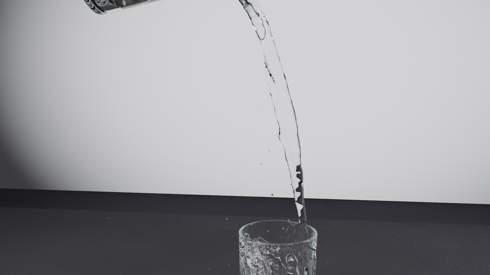 | 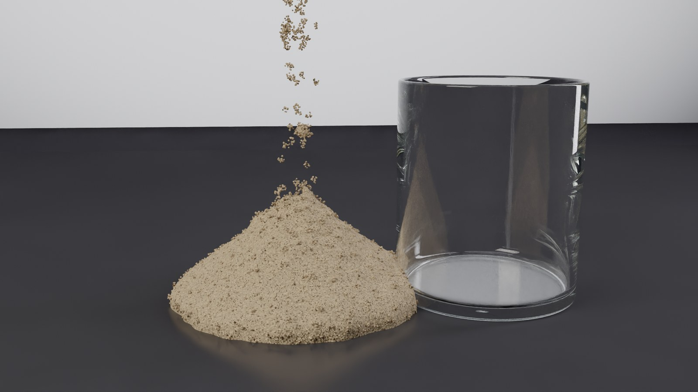 |

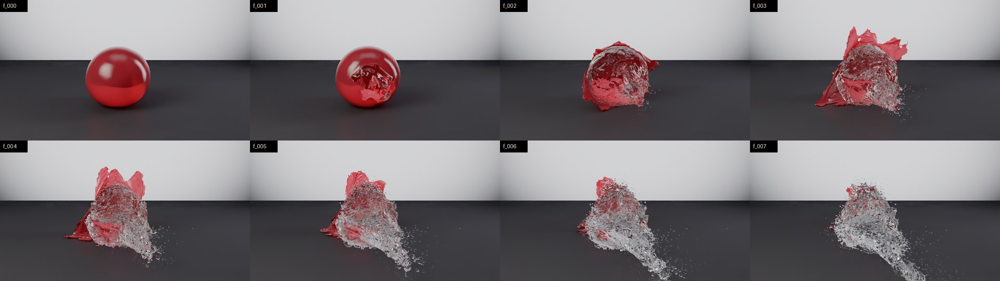

| Cam tabakta bal | Karpuzdan geçen 7,62×51 mermi, 0-24 ms |
| --- | --- |
| 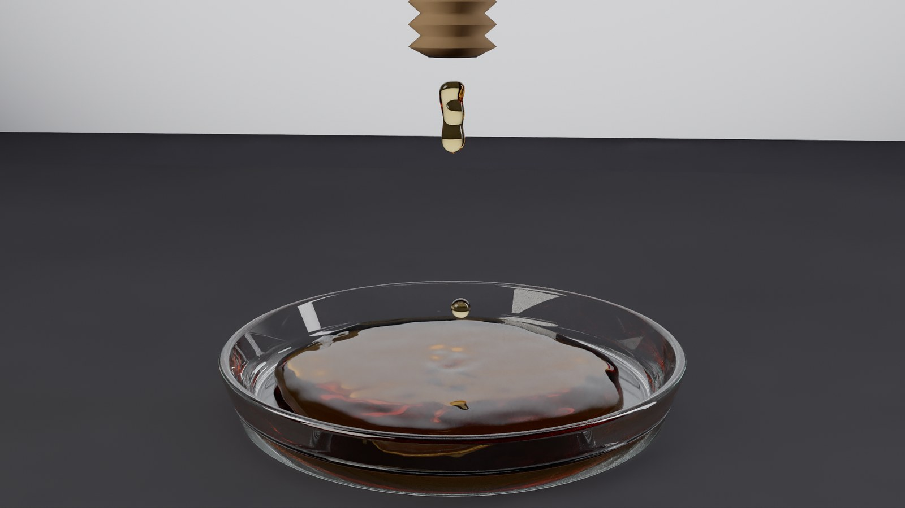 | 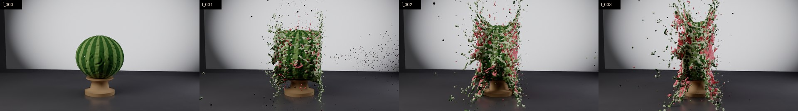 |

| Süt damlasının tacı, 16 ms | Balistik jelden geçen 9 mm, 1,2 ms: yol ve boşluğu |
| --- | --- |
| 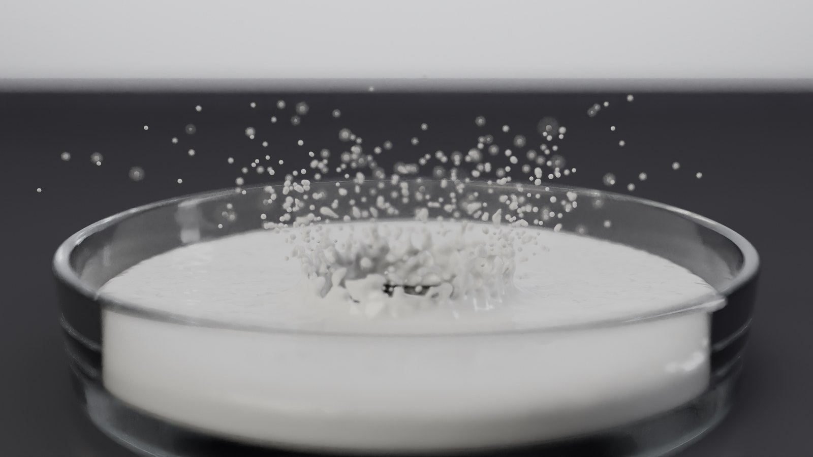 |  |

Nasıl yapıldığı ve yolda neyin ölçüldüğü (çalışma günlüğünde hepsi:
[docs/laboratuvar/DURUM.md](docs/laboratuvar/DURUM.md)):

- **Tek çözücü** (NVIDIA FleX'in yolu): su ve bal için Position Based Fluids, lastik, karpuz ve jel için XPBD
  bağları, kum için taneler; bütün bağlarını yitiren karpuz taneciği suyuna döner. Cam kaplar camın
  yüzeyinde tek katman kinematik tanecik, onu eğen elle birlikte hareket eder.
- **Su** dudaktan ancak biraz viskozite, yapışma ve yüzey gerilimiyle tek şerit olarak çıkıyor (onlarsız hemen
  erişteye bölünüyordu; dört varyant kareyle kıyaslandı).
- **Kum** önce sıvı gibi yayıldı (taneciğin temasları arasında itme gibi paylaşılan sürtünme kaymasının yalnız bir
  kısmını durduruyor): sürtünmeyi kök payla paylaşmak, daha çok geçiş ve hız düzeyinde durgun sürtünme yığını 0°'den
  32,5°'ye getirdi, eşik ölçerek seçildi (`--lab-test kum`).
- **Balonun** gerili lastiği, bağlarına alt adım başına yeterli geçiş verilene kadar suyun ağırlığıyla yırtıldı (kaba
  balonu tutan ayar ince balonu tutmadı: XPBD'nin sertliği çözünürlüğe bağlı); gerilimi oturma sırasında yavaşça
  verilir; yırtığın ucuna, kaba kafesin orada toplayamadığı gerilim verilir.
- **Balın** viskozitesi her taneciğin kendi komşularına göre alınır (ince ip de gövde kadar koyu olur), alt adımda
  tekrarlanır; bal en yeni katmanlarını tutan bir memeden çıkar. Yine de ipi damlalara bölünüyordu (PBF'te gerilmeye
  direnen gerilim yok); katmanları arasındaki viskoelastik yaylar (Clavet vd. 2005'ten, dinlenme boyu uzunluğu izler)
  onu incelen, katlanan ve tabakta kıvrılan tek bir ip tutar, sonra bırakır: kıvrımlar birleşip göl olur.
- **Karpuzun** kabuğu iki katman (yeşil deri, açık kabuk), yuvalı bir kaidede; bağlarında doğal kusurlar var (özdeş
  bağlar hep birden kırılıp kırıntı oluyordu); merminin yolu eski Tanecik sahnesinin jele kalibre balistiğinden.
- **Küplerin** kendi çözücüsü var: her biri katı cisim, kutu kutuya ayırıcı eksenlerle, gelen yüz kırpılarak (ODE'nin
  yolu); ekran kartında renklere bölünmüş Gauss-Seidel (köşegenin üçte biri genişlikte hücreler, 64 renk: aynı renkten iki
  küp asla değmez), ayrık itme (dışarı itilen iç içe geçme hız vermez), yığınlar için şok yayılımı (Guendelman, Bridson ve
  Fedkiw 2003), nokta nokta Coulomb sürtünmesi, öngörülü temas, hava direnci, uyuma. Testler: hepsi uyanık 512 küplük 8 kat
  yığın 0,09 mm içinde durur, sekme e² h'ye döner, kayma v²/(2 μ g)'de durur, 1 mm'lik küp direncinin son hızıyla düşer.
  Patlama yön yön Gurney'nin (yüzün ortası köşeden iki kat hızlı uçar), masa aşağı giden yarıyı yansıtır.
- **Görüntü:** OptiX ile yol izleme; kalınlıklı cam ve kırılan sıvılar tam Fresnel ile, bardaktaki su camla tek arayüzden
  geçer (yüzeyleri arasındaki kıl kadar hava yoksa ayna olurdu); yüzeyler her karede taneciklerden kurulur (anizotropik
  çekirdekler); kum, tane ölçeğinde dokulu bir yüzey ve ince taneler; karede 4 örnek, zaman içinde harmanlanır (kameradan geri
  izlenerek; bir piksel geçmişini ancak içinden geçen sabit ışın hâlâ aynı noktaya değip aynı yolu gidiyorsa tutar,
  akan su iz bırakmaz), cam ve sıvıda görünen ışık kutuları yansıma yönünde tam sayılır, sonra OptiX yapay zekâ
  gürültü gidericisi. Her kareyi ayrı temizlemek cam kenarlarını dalgalandırıyordu; harmanlanınca suyun dalgalanması
  on kat azaldı.

Açık: bal ipinin yüzeyi boğumlu (bir-üç tanecik kalınlığında); karpuz parçaları keskin kırık değil yumuşak yüzeyler olarak çiziliyor; balon asılı değil masada
(asılıyken hafif lastik suyun ağırlığını düğüme zamanında taşıyamadı).

### 5 · Ada · Ekim 2026

| 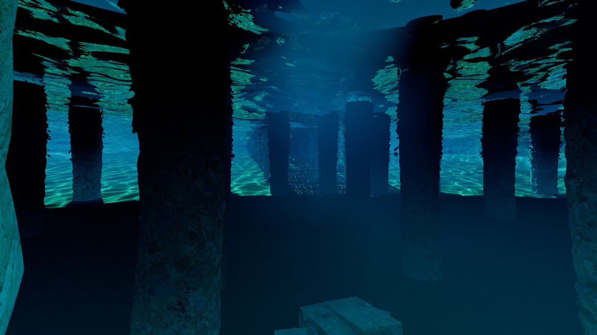 |
|---|
| 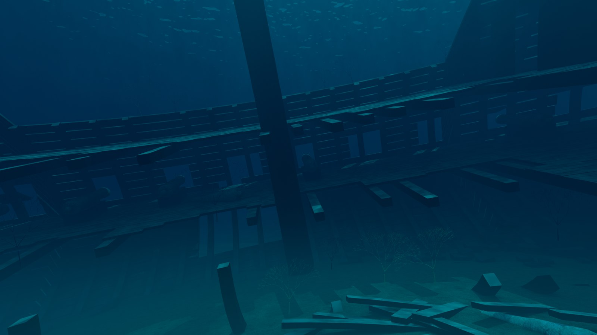 |
| 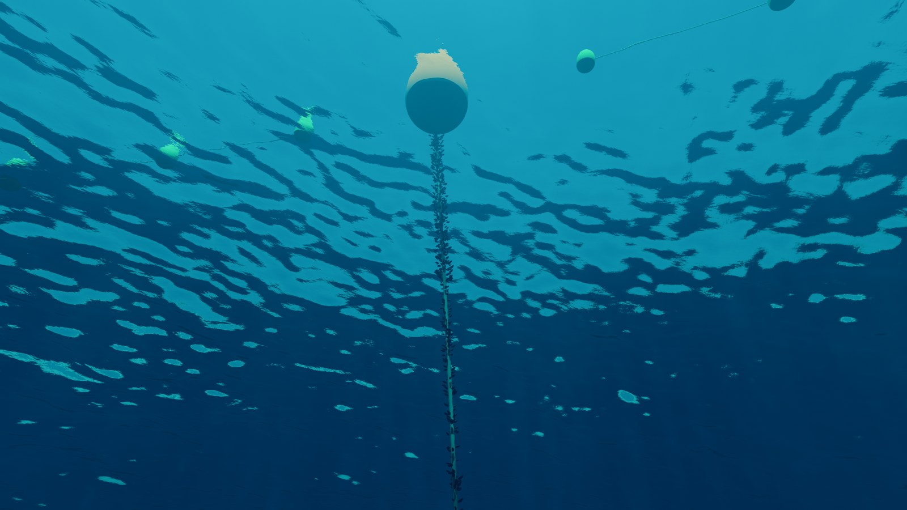 |

Akdeniz'de su altı, tüplü bir dalgıç gibi yüzülür. Küçük bir adanın iskelesinin beton başlığının altında karanlık bir
salonda başlarsın; dubaların çizdiği yoldan kum yavaş yavaş derinleşir: 12 m'de kayalara yaslanmış amforalar, 22 m'de
yarı yıkık bir kalyon, en uçta dibi görünmeyen maviye inen bir şamandıra halatı. Su üstü yalnız alttan görünür; yüzeye
çıkılmaz, çok derine inersen havadaki oksijenin kısmi basıncı seni geri yollar.

- **Zamansal hilesiz netlik:** her piksel her karede aynı sabit alt piksel örnekleriyle çizilir (4, döndürülmüş ızgara;
  titreşim yok, geçmiş yok), kenardaki piksele varsayılan toplam 12 örnek (32'ye kadar), pikselden biraz geniş bir
  Blackman-Harris süzgeci. Yakınsamış referansa karşı ölçülen kıpırtı (`tools/kararlilik.py`) ölçülen her yolda
  (iskelenin salonuna yüzüş, batığa yaklaşış) sahne 2'nin TAA'sının yarısının altında.
- **Su üstündekinden geçen gerçek zamanlı ışık:** güneşin gölge ışını yüzeyden sonra havada sürer, sudan çıkan ışık
  oradaki dalgayla kırılır; yürüyüş yolunun tahta aralıklarından ve başlığın kırık deliklerinden sızan ışık kumda
  kostik gibi salınır. Işık sütunları için her yapının üstünde bir güneş haritası: yüzeyin her noktasından kırılan
  güneşin ne kadar aşağı indiği ve güvertenin ne kadarını geçirdiği (mip düzeyli, o derinlikte güneş diskinin genişliği
  kadar okunur: çizgiler gerçekleri kadar yumuşak); bir gök haritası aynısını suyun dağınık ışığı için yapar, başlığın
  altında suyun kendisi kararır.
- **Pişirilmiş tayfsal su:** soğurma ve saçılma 5 nm adımla yayımlanmış ölçümlerden (Pope ve Fry, bir Jerlov tipi,
  Fournier-Forand), güneş ve gök tayfı, göz eğrileri; ışığın yol uzunluğuna göre tablolar, dağınık ışık alanı 110 m'ye
  kadar yedi dip derinliği için. Göz rengini çevresindeki ışığa yarı yolda, parlaklığını %30 uyarlar: salon karanlık kalır.
- **Gürültüsüz kostik (hüzme):** FFT yüzeyinin her hücresi, her derinlik diliminde kapladığı alana tam olarak yayılan bir
  ışık hüzmesi; hiçbir şey sayılmaz, kaynamaz. Güneş diskinin bulanıklaştırdığı 30 m'nin altında söner. ~5 ms.
- **Batık:** tek bir gövde fonksiyonundan (dip açısı, içe çekik bordalar, güverte çizgisi, ayna kıç) kereste kereste
  kurulmuş 38 metrelik bir kalyon: postalar, ek yerli kaplama sıraları, ambar ağızlı iki güverte, büyük kamaranın
  pencereli aynasıyla kıç kasaraları, baş kasarası, lumbaralar ve toplar, kırık direkler, dümen, çapa, küpeştede yelpaze
  mercanları. Yamaçta başı aşağıda, sancağa yatmış; sancak tarafı çökmüş. İçine girilir.
- **Gerisi:** adanın kireçtaşı ve iki sualtı sırtı uzaklık alanı olarak (yüzey ağı), köşeli bloklar; ayaklarda ve
  şamandıra halatında midyeler (~11 000); dalgayla inip kalkan dubalar (dalga yükseklikleri her karede ekran kartında
  örneklenir); önceki bölümün amforaları kayaların arasında (ArchAIDE profilleri, CC BY 4.0); taşlar, kırmızı deniz
  yıldızları, deniz hıyarları, yelpaze midyesi kabukları, siyah deniz kestaneleri.
- **Basınç:** P = 1,013 + 0,1005 d bar, ppO2 = 0,2095 P. 1,6 bar'ı (~66 m) aşınca bir zehirlenme dozu birikir (ne kadar
  yüksekse o kadar hızlı; gerçek gecikme kısaltıldı, kodda adıyla yazıyor): görüş daralır, kararır, merdivende yeniden
  başlarsın. Derinlik sarhoşluğu zihinsel bir etki, çizilmez.

Açık kalanlar: uygulamanın kendi testinde 33-35 fps (en yavaşı başlangıçtaki iskele salonu, kare ~32 ms); batığın
içindeki ışık ve görünüş komut satırı kareleriyle tartıldı, canlı yüzülerek henüz bakılmadı. Hepsi
`docs/koy/DURUM.md`'de.

### 6 · Heykel · Ekim 2026

|  |
|---|
| 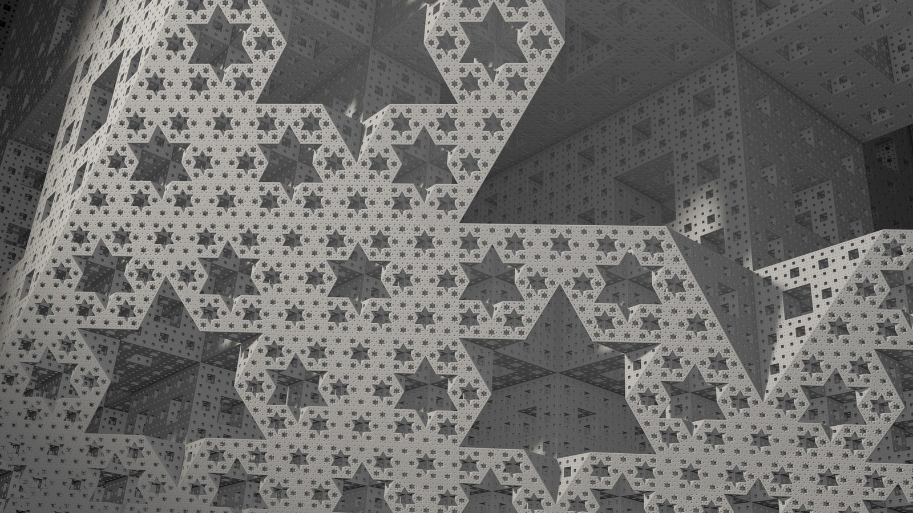 |
| 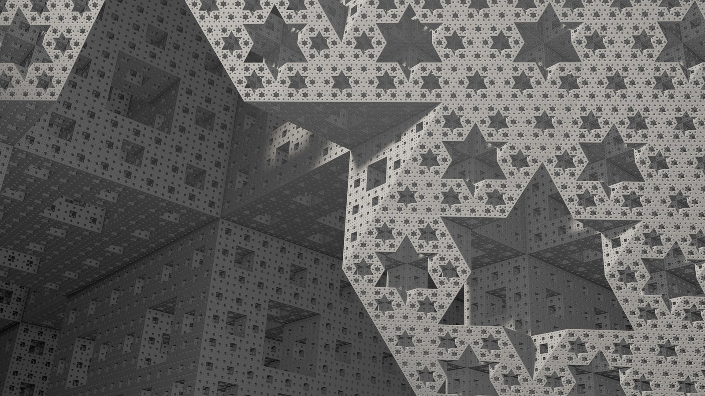 |

Yalnız geometrinin sahnesi: köşegeninden kesilmiş, karanlık bir odada kaidede dik duran beyaz, mat bir Menger süngeri;
kesitte altı köşeli yıldızlar. Herhangi bir noktasına yaklaş: on bin kata kadar yeni yıldızlar ve kare tüneller açılır.
Orada ekranın genişliği yaklaşık 0,13 mm, iki saç teli kadardır.

- **Vektör çizim kadar keskin:** her noktada yalnız en az dört piksel büyüklüğündeki delikler çizilir (daha küçükleri
  yalnız gren olurdu); yaklaştıkça bir sonraki düzeyin delikleri gerçek kare tüneller olarak merkezlerinden genişleyerek
  açılır: her ara biçim yine bir Menger süngeridir, hiçbir şey birden belirmez.
- **Hareket ederken de dururken de tek dünya** (5. sahnenin yolu): rastgele sayı yok, birikim yok. Her piksel her karede aynı
  dört sabit alt piksel örneğini alır; durunca kare olduğu gibi kalır, sonradan "ayarlanma" olmaz; lamba hiç atlamaz
  (hedefi yaklaştığın yere kayar, kapanan hat yerine açık olana yumuşakça döner). Işık sürüklenirken yakınsamış referansa
  karşı kıpırtı 0,0017 (sahnenin yol izlemeli ilk hâli: 0,0125).
- **On bin kat, float'la, pertürbasyonla:** orada bir piksel konumun birkaç float basamağıdır. Bir çapa noktasının
  yörüngesi ana işlemcide çift hassasiyetle katlamalardan geçer, her piksel onu float'ta küçük bir fark olarak izler;
  katlamalar parça parça doğrusal, her dalın kesin bir fark formülü var, dal kararları çift hassasiyetten. Düz çift
  hassasiyetli kestirime karşı: on bin katta pikselin on binde altısı.
- **Seninle içeri giren ışık:** tıkladığın yere bir spot (sürükleyince o noktanın çevresinde döner); sen yaklaştıkça o da
  yaklaşır, bir duvar yolunu kapatınca açık bir hat bulur. Mercekte kameranın görebileceği gölge düşürmeyen bir halka ışık;
  tavandan sönük bir ışık.
- **Dalış turu (T):** on altı rastgele dalıştan seçilmiş dört dalış, on bin kata kadar, her onda bir katta durur.

İlk hâli (yol izlenen sözde Klein bir "katedral") benim ilk bakışımdan sonra değişti: grenliydi, titriyordu ve yüzeyi her
ölçekte piksel boyu dairelerdi. Hepsi `docs/heykel/DURUM.md`'de.

### 7 · Ölçek · Ekim 2026

| 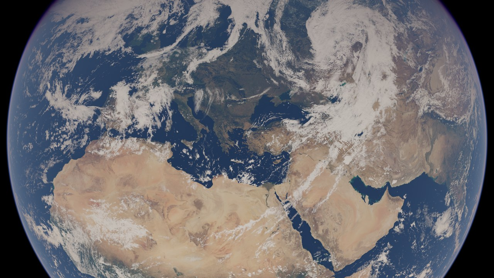 | 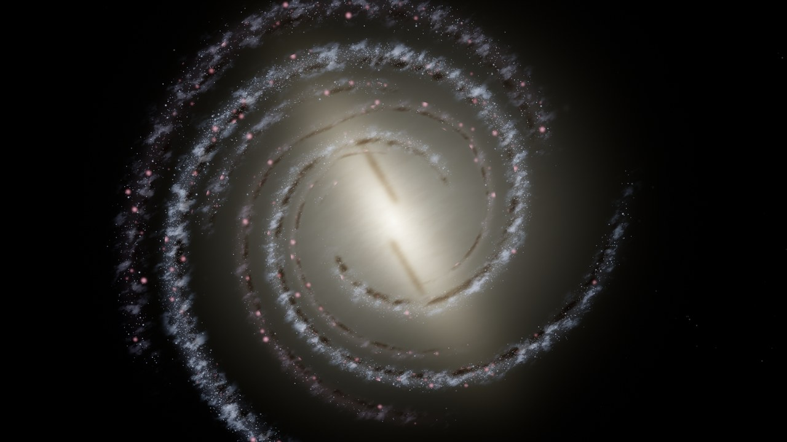 |
|---|---|
| 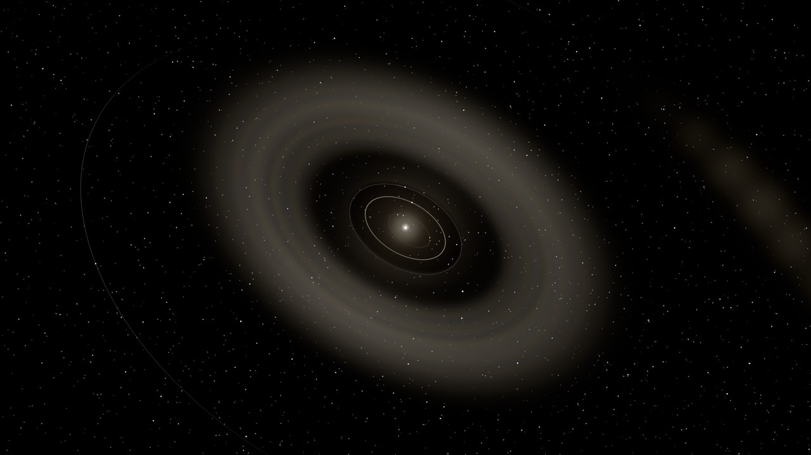 | 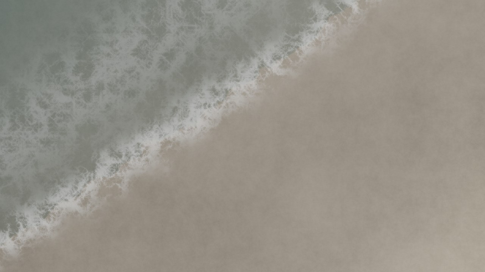 |
| 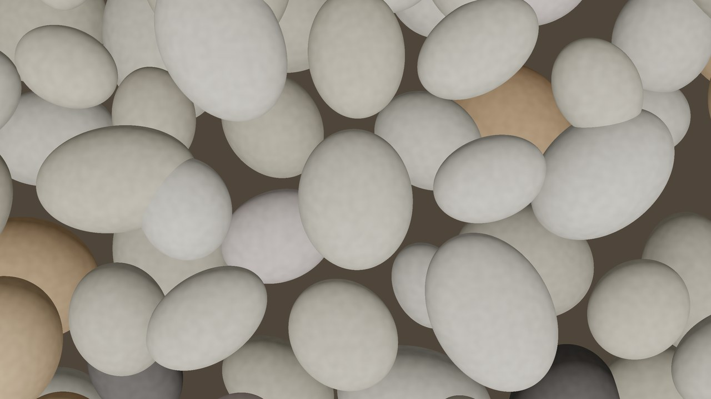 | 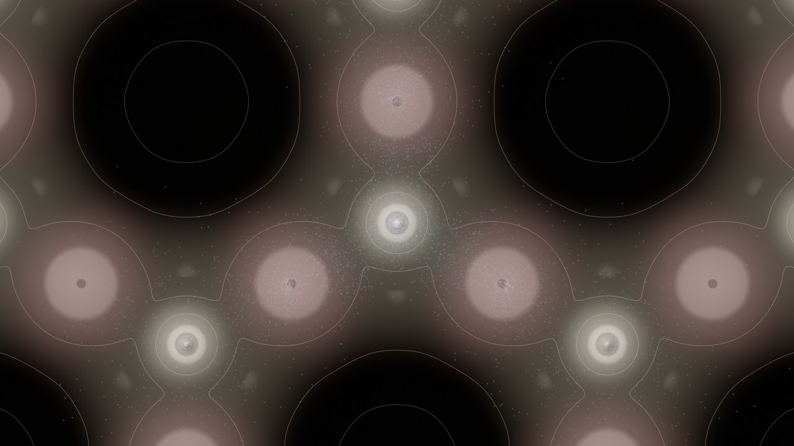 |
| 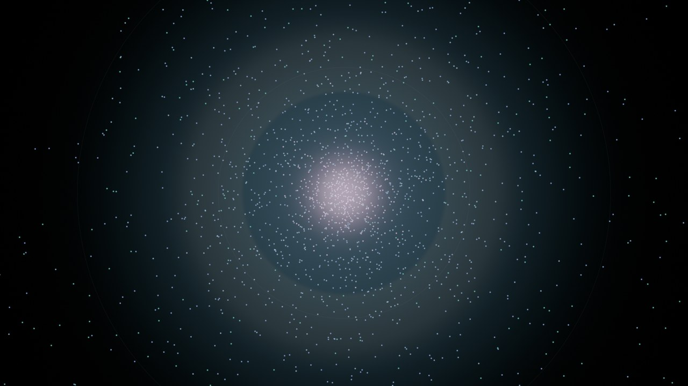 | 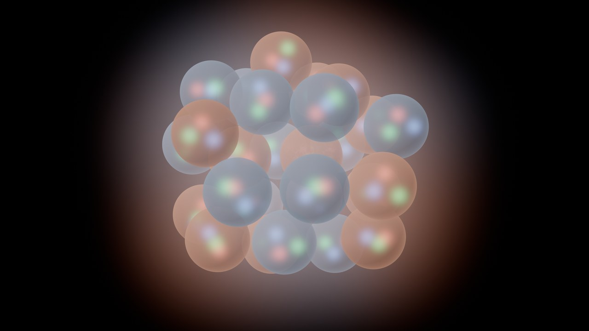 |
| 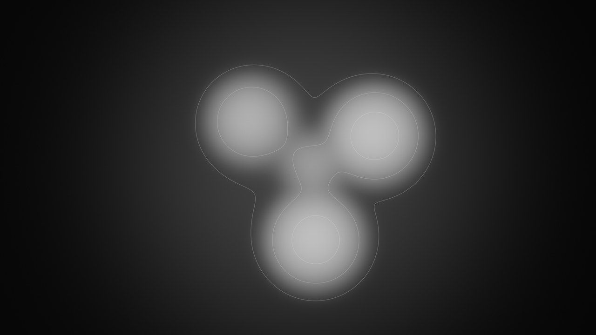 | 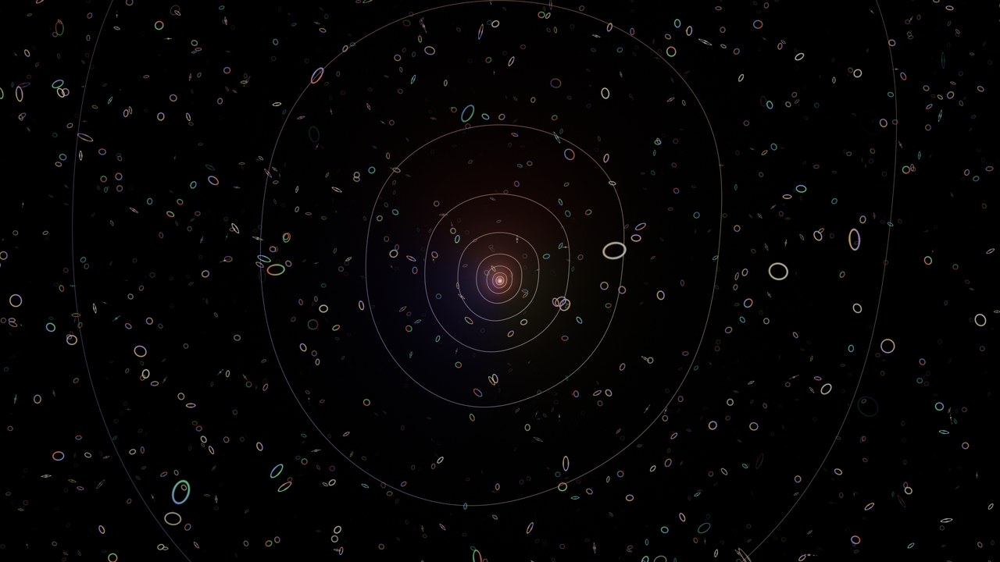 |
| 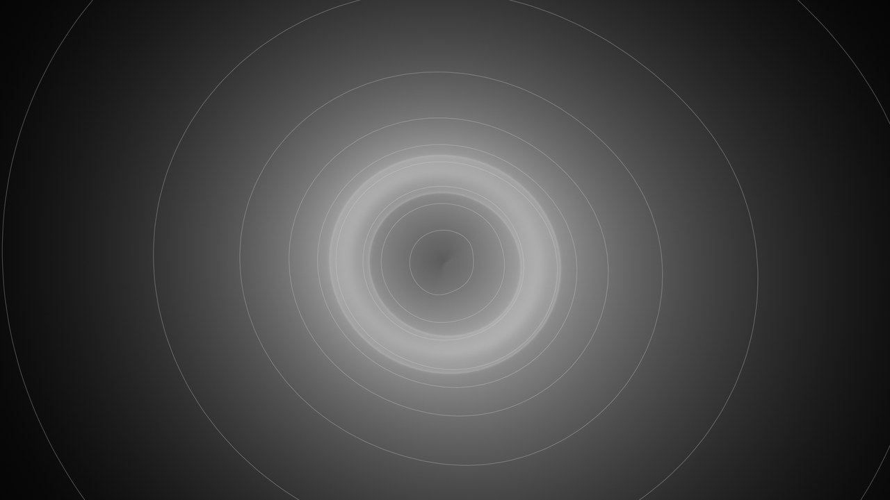 | |

Ölçeğin sahnesi. Çandarlı'da (İzmir, Dikili) kalenin önündeki kumsaldan başlarsın, yalnız tekerlekle uzaklaşır ya da
yaklaşırsın: dışarı evrenin kenarına, içeri Planck uzunluğuna. 62 onluk, kesintisiz, kesme ve solma yok. Her şey 5 Ekim
2026 öğlesindeki gerçek yerinde ve gerçek boyunda, aradaki boşluklar da gerçek uzunluğunda.

- **Mutlak konum yok:** her şey bir çapa ağacına asılı (Laniakea, Yerel Grup, Samanyolu'nun merkezi, Güneş, Dünya,
  sahildeki nokta, atom, çekirdek, proton, kuark). İki komşunun arası yalnız ortak atalarına kadar toplanır, kamera hep
  odağa göre tutulur. Ekranda aynı anda görünen beş onluk için float yetiyor: en kötü 10⁻⁴ piksel.
- **Işık olan yerde gerçek veri:**
  - Kumsal Sentinel-2'den (10 m), kıyı çizgisi oradan bir uzaklık alanı;
  - Dünya Blue Marble, üstünde o günlerin MODIS ve VIIRS bulutları. Uydunun deniz parıltısı, VIIRS'in bulut optik
    kalınlığı ürünüyle ayıklandı;
  - tek saçılımlı hava, Ay LRO'dan;
  - asteroit ve Kuiper kuşakları Minor Planet Center'ın 1,57 milyon yörüngesinden (zaman ortalamalı halkalar),
    Jüpiter'in Truvalıları iki küme; gezegenler yörüngelerinde nokta (pozlamanın sonundaki flaş);
  - 109.400 yıldız HYG'den; Samanyolu kollarıyla ölçümlerden (Reid ve ark. 2019, uzun çubuk Wegg ve ark. 2015),
    görünüşü tanıdık çizime doğru (iki yıldız kolu, iki gaz kolu, kümeler ve bulutsular); M31 ve M33 aynı modelle,
    gerçek yönelimleriyle;
  - 43.490 galaksi 2MRS'ten. Ötesi Zel'dovich yaklaşımıyla gerçek istatistikten bir kozmik ağ, bir dilim olarak
    (gigaparseklerce derinlik üst üste binince ağ sise dönüşür; her anket görseli bu yüzden bir dilimdir).
- **Işığın altında temsil, sayılar gerçek:** renk ışığın dalga boyunda söner, mikroskopların gri resimleri gelir;
  atomdan aşağısı temsili renkle parçacıklar.
  - Elektron mikroskobu gibi teraslar, atomik kuvvet mikroskobu gibi atomlar, sonra kuvarsın yoğunluk haritası
    (Clementi-Raimondi Slater yörüngeleri, kimyacıların renginde).
  - Atom: elektronları, kabuklarının radyal dağılımından ışık noktaları; değerlik elektronları dört bağ boyunca (sp³).
    İçeri girerken yıldızlar gibi yanından geçerler.
  - Silisyum-28'in 28 nükleonu (proton sıcak, nötron soğuk), protonun üç kuarkı (renk yükleri), Y biçimli gluon akısı,
    deniz kuarkları.
  - Kuarkın çevresinde her ölçekte sanal çift halkaları; türleri o boydaki bağlaşımlara göre (Standart Model, tek
    döngü), derine indikçe karışım dengelenir.
  - En dipte uzay-zaman köpüğünün baloncukları ve altın renkli kapalı bir sicim (kuram).
- **Zaman akıyormuş gibi:** her katmanın kendi saati var, hepsi tek kuralla (dışarı hızlanır, içeri yavaşlar). Gözün
  deklanşöründen hızlı olan ortalanır: yörünge halka olur, titreşen sicim kenarları parlak bir bant. Hiçbiri evi
  değiştirmez: sahile hep aynı öğlede, aynı ışıkta inilir.
- **Gren ve titreme yok:** her piksel her karede aynı dört sabit örneği alır. Pikselin altına inen her şey ışığını
  koruyarak noktaya döner. Pozlama ölçeğin tasarlanmış bir işlevi, görüntüden okunmaz. Bütün yolda kare ≤ 16 ms; bir
  sınama yolu 0,01 onluk adımla tarayıp sıçramaları ölçer; parçacıklar kimlikleriyle izlenir.

Plan, kararlar, plandan ayrılanlar ve ölçümler `docs/olcek/`'te.

#### İkinci seçenek: Hız

| 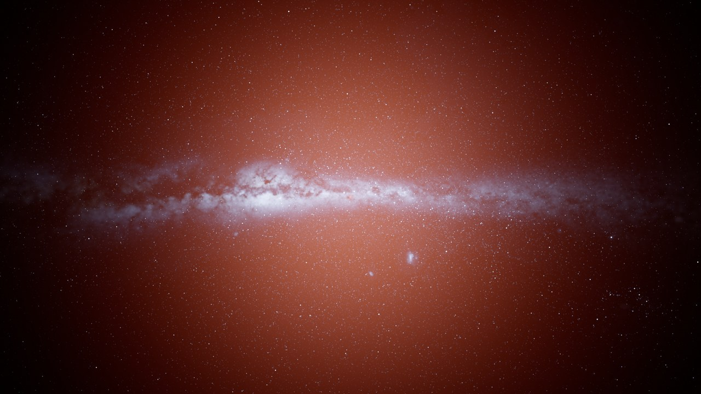 |  |
|---|---|
|  |  |
|  |  |

Roketle Dünya'dan Proxima Centauri'ye, oradan Andromeda'ya: özel görelilik eksiksiz, hiçbir şey ışınlanmıyor, zaman hep
gerçek (hızlandırma yok: yolculuğun süresi uzaklığın kendisi).

- **Yolculuk:** W itki, S fren, Boşluk panelde seçilen hedefe otomatik varış (Proxima ya da Andromeda, istenen anda;
  başka bir yöne giderken önce durup döner). Proxima, 4,25 ışık yılı: senin saatinde 15,2 dakika, Dünya'nınkinde 4,25
  yıl. Andromeda, 2,4 milyon ışık yılı: 72 dakika, 2,4 milyon yıl.
- **İtki:** durağanken 1 g ve hep artarak: bir dakikada ışık hızının %1'i, iki dakikada %10'u, beş buçuk dakikada %99'u,
  sekiz dakikada 21 dokuz (1 − β = 10⁻²¹), 11 milyon g'de. 1.638 dilimde sabit tutulur, her dilimde sabit ivmenin kapalı
  formülleriyle, hız açısı (rapidity) üzerinden (1 − β basamaklarını korur); bağımsız bir denetleyici (mpmath, 50
  basamak) 1,5 × 10⁻¹⁵'e kadar aynı sonucu veriyor.
- **Roketin gözü:** her pikselin ışını durgun çerçeveye geri çevrilir (sapınç), ışığı bir kara cisminki gibi Doppler
  kaymasıyla CIE 1931 tablolarından geçer:
  - 109.400 yıldız; Samanyolu'nun dağınık ışığı (ESO/S. Brunier panoraması, yıldızları çıkarılmış, bir pikselin
    izdüşümü kadar geniş mip düzeylerinde);
  - Güneş'in dipolüyle kozmik mikrodalga arka plan (Planck 2018);
  - galaksiler (dışarıdan Samanyolu, M31, M33, 2MRS);
  - Güneş, bugünün bulutlarıyla Dünya, Ay;
  - Proxima ve b'si, Alpha Centauri A ve B, ölçülmüş yerlerinde (Gaia DR3, Akeson ve ark. 2021).

  Hız arttıkça gök öne toplanır; ışık hızının yarısı geçilince geride kalan Güneş sapınçla öne döner, mavi-beyaz. Beş
  dokuz civarında kozmik arka plan önde kırmızı bir güneş gibi doğar, sonra turuncu, beyaz ve mavi olur; daha ötede
  ışığı görünür banttan çıkar. Göz bir gözün uyduğu gibi uyar (karanlıkta yarı yarıya, gün ışığında bütünüyle, baktığı
  yüze göre) ve kendi kamaşması var.
- **Enerji gözü** (başta açık; E): her bandın ışığı, tepesinin düştüğü banda göre sahte renkte (mikrodalgadan gama
  ışınlarına). Başlangıçta sıfırlanır: arka planın durağanken parıltısı çıkarılır, hareketin getirdiği görünür. Bir
  gösterge tam öndeki ışığın tepesinin nerede olduğunu gösterir.
- **Yandan:** Dünya'nın çerçevesinde bir harita. Kamera 14 m'lik roketi izler (γ kat kısa), yıldızlararası ortamın
  noktaları ışık çizgileri olarak akar, 1-6 tuşları ölçeğin durakları arasında atlar.
- **Duraklar:** yerdurağan yörünge yarıçapından Dünya; Proxima'nın lekeli, parlamalı yüzü 1,69° genişlikte, gezegeni b,
  Alpha Centauri A ve B (−6,8 ve −5,5) ve Kraliçe takımyıldızında (Cassiopeia) bizim Güneş; 100.000 ışık yılından 70°
  genişlikte Andromeda.
- **Beş grafik:** hız ve γ; uzay-zaman (roketin ızgarası ışık çizgisine doğru katlanır); yol (iki cetvel); saatler
  (seninki, Dünya'nınki, görüldüğü hâliyle Dünya'nınki); bedel (enerji, bir foton roketinin yakıtı, önden gelen ışık).

Plan ve ölçümler `docs/olcek/hiz/` içinde.

### 8 · Denizaltı · Ekim 2026

|  |  |
|---|---|
|  |  |

Ada'nın kardeşi; odağı atmosfer. Bir Tench sınıfı filo denizaltısının kontrol odası (örnek TCG Uluçalireis, eski USS
Thornback), Türk hizmetindeki hâliyle, gece kırmızısı altında: görevdeki bir tekne, bakımlı ama yaşanmış. Ada güncel
teknolojiyi doğrudan kullanıyordu; burada dolaylı: **bütün ışık önceden pişirilir, canlıda ışık hesabı yok**, ekran
kartının bütün gücü görüntüye gidiyor. Dar bir odada yürünür, her şeye 10-15 cm'den bakılır.

- **Gerçek ölçüler:** 8,23 m (posta 47 + 9" ile 58 + 3" arası), en geniş yerinde 4,886 m basınç gövdesi, sacın içinde 1" mantar,
  76,2 cm'de bir T posta, güverte eksenin 12 cm altında, 51 × 97 cm'lik oval su geçmez kapılar. Yerleşim Thornback'in
  1953/68 genel planlarından ve ABD Donanması'nın 1946 eğitim kitabından (NAVPERS 16160). Kaynaklar `docs/denizalti/REFERANS.md`.
- **Kodla yapılmış her parça:** borular ve dirsekler, flanşlar, somun ve dişli saplamalar, glob vanalar, el çarkları,
  göstergeler, döner şalterler, sigortalar, kafesli lambalar, menteşe ve kilitler. Keskin kenar yok: her köşe
  yuvarlatılmış. Panolar gövdedeki boru şeridinin önünde, postalara braketlerle bağlı; postalara ve borulara
  girmedikleri hesapla denetlendi.
- **Basılı yüzler:** kadranlar, etiketler ve harita bir çıkartma atlasına çizilir. 16" derinlik göstergesinde
  0,2 mm/piksel, pirinç etiketlerde yazı 0,25 mm oyulur. Masada uydurma bir kıyının **seyir haritası** var: derinlik
  eğrileri, iskandiller, pusula gülü, fener, kayalıklar, batık, nöbetçinin kurşun kalemle çizdiği rota, bir kahve halkası.
- **Önceden pişirilmiş ışık (OptiX):** her yüzey noktasına gelen ışık yönüyle birlikte yazılır (L1 küresel harmonik),
  bir örnek 12 sekmeye kadar izlenir. Her örnek texel'in alanında başka bir noktadan çıkar, gölge kenarları basamaksız
  olur. Lambaların parlamaları canlıda çizilir, gölgeleri pişmiş görünürlükten okunur (2010'ların "sabit ışık" yolu).
  Havadaki pus 4 cm'lik hücrelerde, lamba gölgeleriyle pişirilir. 54 yansıma yoklaması var, her pürüzlülük ayrı izlenir.
  İlk açılışta yaklaşık 5 dakika sürer, sonra önbellekten açılır.
- **Tessellation:** yüzeyler her karede kameraya göre bölünüp kabartılır. High'da kabartmalı yüzeylerde (diş, kaynak
  dikişi, mantar taneleri, oyma yazı) bir üçgen bir örnek kadardır. Eğriler Phong ile yuvarlanır; çatlak yoktur, altı
  açıdan siyah piksel sayılarak ölçülür.
- **Süper örnekleme:** her piksel 16 örneğe kadar ayrı ayrı gölgelendirilir. Rastgele sayı yok, her karede aynı desen
  kullanılır. 8K 16x yalnız fotoğrafta (F12): 1920 × 1080'lik parçalar, kenarlarında koruma bandıyla.
- **Ayarlar:** Tessellation, Grafik, Işık ve Efekt için ayrı ayrı Low/Medium/High; çözünürlük 720p-8K, SSAA 1x-16x.
  1440p'de High, SSAA kapalı ~14 ms; 4x SSAA ile ~33 ms.

Plan, kararlar ve ölçümler `docs/denizalti/`.

### 9 · Ayna · Ekim 2026

|  |  |
|---|---|
|  |  |

Odağı yansıma: *yansımanın yansımasının yansıması, tam kalitede*. 60° üçgen ızgarada kompakt bir ayna labirenti (1896
Luzern labirenti gibi), Kurtuba Camii ve Elhamra'dan giyinmiş. İçinde süzülen krom bir küresin; kendini yalnız
aynalarda görürsün. Kürenin yarığından kendi ışığını yakarsın (sekiz renk, sekiz şiddet), arkanda renkli lambalar
bırakırsın; aynalar her şeyi sonsuza dek çoğaltır.

- **Ayar değil fizik:** her ayna 6 mm float cam ve arkasında gümüş: önde Fresnel, içeri ve dışarı kırılma, gümüşün
  yansıtması, camın iki yöndeki soğurması, hepsi ölçülmüş değerlerden (cam Rubin 1985, gümüş Johnson ve Christy 1972,
  kromumuz Rakić 1998). Dik gelişte kırmızının %79'u, yeşil ve mavinin %84'ü döner: derin tünel kendiliğinden kararır
  ve camgöbeği-yeşile döner. Işın camın içinde gerçek bir aynadaki gibi yana kayar.
- **OptiX değil, kendi kesin izleyicimiz:** aynalar ızgara çizgilerinde durduğu için ışın hücreden hücreye yürür, her
  hücrede yalnız oranın zemini, tavanı, üç sütunu ve üç duvar modülüyle (yüz, pencere pervazı, aynanın camı ya da
  geçidin orta düzlemi) kesişir. Her yüzey kesin: yürütme, sınır hacmi, kendi kendini kesme ötelemesi yok. Tünelin
  kırkıncı kopyası hesaplanan yerinin on binde bir pikseli içinde.
- **Aynadan ışık, kesin:** yol izleyici nokta ışığın aynadan duvara yolunu bulamaz. Burada planda bir hüzme ağacı
  bulur (hücreden hücreye; Heckbert ve Hanrahan, 1984): her ışığın her aynadaki görüntüsü ve onun pencerelerden ve
  sütunlardan geçen kaması, jamb tepesinin üstünde 3B denetimle. Örnekleme yok, gren yok; aynı izleyiciden geçen bir
  milyar fotona karşı %99 uyum.
- **Işık haritaları:** lambalar ve fenerler durur: ışıkları (doğrudan ve bütün aynalardan) bırakıldıkları an yüzeylere
  pişer (23 milyon texel; bir karış öteden bakılan pervaz ve sütunlarda daha ince). Bizim ışığımız bizimle yürür: her
  kare yarım çözünürlükte yeniden pişer, kendi hücresindeki doğrudan ışığı piksel başına hesaplanır. Küremizin
  lambalardan düşen gölgesi her kare hesaplanır.
- **Aynanın ardında keskin:** her ışın kendi izdüşümünü taşır; düz ayna onu değiştirmez, küremiz genişletir. Desenler
  onunla süzülür: aynanın ardındaki desen, aynı uzaklıktan doğrudan bakıldığı kadar keskin ve sakin (ölçüldü: ideal
  aynadan aynı görüntü, piksel piksel). Küçük lambalar izdüşümdeki paylarıyla toplanır: derin tünelin lambaları titremez.
- **Görüntü:** pikselde altı sabit örnek, her kare aynı, birikim ve gürültü giderici yok; ileri saçan hafif bir pus her
  yol parçası boyunca kapalı biçimde; 2560 × 1440'ta saniyede 30-44 kare. Kalite ayarı yok.

Plan, kararlar, ölçümler ve doğrulanmayanlar `docs/ayna/` içinde.

### 10 · Kuyu · Ekim 2026

|  |  |
|---|---|
|  |  |

Odağı sonsuzluk, dışarıdan: *içinde sonsuz yansıma olan kapalı dünyalar ve yanlarından düşen bir gözlemci*. Sahne 9'un
kardeşi (orada labirentin içindeydik; burada sonsuz odalar kapalı, biz dışarıdayız). Cam odalardan sonsuz bir kübik
kafes; her oda tek yönlü aynadan bir kutu, kendi ışığı ve eşyasıyla; her odanın her kenarı sonsuza uzanan bir iplik
demeti olarak sürer (*Interstellar*'ın tesseract'ı gibi). İki oda sütunu arasındaki bir kuyudan yavaşça aşağı düşeriz.

- **Fizikten tek yönlü duvar:** duvar yarım inç gri float cam (veri sayfası: görünür geçirgenlik %18), içte 45 nm gümüş
  film (Johnson ve Christy 1972, ince filmin Airy toplamları), dışta yansıma önleyici kaplama. İçeride %94,4 döner, ışık
  sonsuza dek dolaşır; dışarıdan cam %4 yansıtır; içinden iki yönde de %0,7 geçer (karşılıklılık böyle ister: tek
  yönlülük yalnız aydınlık içeriyle karanlık dışarının farkı). İnce gümüş maviyi kırmızıdan çok geçirir: derin
  yansımalar kendiliğinden kehribara döner. Bağımsız bir hesapla (Abelès matrisleri) 1e-6'ya dek denetlendi.
- **Yirmi oda türü**, her biri küpün 48 simetrisinden biriyle döndürülmüş, komşular benzemez: çeşitli yüksekliklere
  asılı ampuller (Kusama'nın sonsuzluk odaları), tek lamba, soğuk ay ışığı, krom küre, T = 2π√(l/g) ile salınan bakır
  sarkaç, 45° ayna, köşe yansıtıcı, lamba sırası, mum ve kendi ışığı olmayan karanlık odalar.
- **Kendi kesin izleyicimiz (CUDA):** ışın kafeste hücreden hücreye yürür, her hücrede yalnız oranın odası ve on iki
  demetiyle kesişir; demetlerdeki çıtalar kesin yürünen bir kabartma. Odanın içinde gümüş duvarlar, aynalar ve metal
  arasında, toplayabileceği hiçbir şey görünmeyecek hâle gelene dek seker: sınır, bir ampulün bütün ışığı bölü ışının
  izdüşümü, pozlanmış görüntüde yarım kod değerinde kesilir. Bir lambanın 30. görüntüsü, görüntü kafesinin koyduğu
  yerin on binde bir pikseli içinde.
- **Yapıyı yalnız odalar aydınlatır:** iplikleri odaların camından sızan ışık aydınlatır. Kafes yinelendiği için bir
  hücrenin demetleri bir tablo taşır (460 bin texel, her biri Fibonacci sarmalında 4096 ışın: rastgele sayı yok):
  çevresindeki her oda yüzünün ne kadar ışık verdiği, gölgeler dahil; odaların kendi parıltısı (onlar yinelenmez)
  görüntü çizilirken çarpılır. Cilalı iplikler Fresnel'le, altın varaklılar altın gibi yansıtır.
- **Titremeyen küçük ışıklar:** bir pikselin aynı odaya giren örnekleri içeride tek bir ışını paylaşır; lambaların
  derin görüntüleri, pikselden küçük noktalar, piksel alanında bir Gauss izdüşümle toplanır (disk, hareket eden bir
  noktayı sırayla iki ila dört pikselde sayar ve nokta titrer). Pikselde altı sabit örnek, birikim ve gürültü giderici
  yok; 2560 × 1440'ta saniyede 33-42 kare. Kalite ayarı yok.

Plan, kararlar, ölçümler ve doğrulanmayanlar `docs/kuyu/` içinde.

### 11 · Orman · Ekim 2026

|  |  |
|---|---|
|  |  |

Odağı yoğunluk: *gerçek bir ormandaki gibi her yerde bir şeylerin olduğu küçük bir yağmur ormanı parçası; sonsuz
tekrar değil, sahneye konmuş kaos*. Oyun ormanları çoğunlukla üç dört malzemeyle kurulur (uzun ağaç, kısa örtü, odun,
toprak) ve temiz görünür; burada yağmurdan sonra erken sabah 30 m'lik bir parça var, bir dere, devrik bir gövde ve kat
kat bitki örtüsüyle; ekran kartının bütün gücü ne kadar çok şey olduğuna gidiyor. W A S D yürür, fare bakar.

- **Yalnız tarama:** elle modellenmiş hiçbir şey yok. 26 açık lisanslı tarama (Poly Haven ve ambientCG, CC0: ağaçlar,
  çalılar, eğreltiler, kökler, kayalar, gövdeler, yaprak atlasları) 80 prototip olur; `assets/orman/fetch.py` indirir
  ve denetler.
- **Sebepli yerleşim:** devrik gövde derenin üstünde iki kıyıya dayanır, kayalar kıyıda yarı gömülü, taşlar yatakta,
  eğreltiler nemde sık, geniş yapraklılar öbek öbek, yosun yatağın ıslak kenarında; her katın (zemin, çalı, fidan, genç
  ağaç, döküntü) kendi sebebi ve kendi aralığı var. Yere düşmüş yapraklar yaprak atlaslarının adalarından tek bir ağ
  olarak gelir; her biri zeminin kendi üçgenlerine yatar, gövdelerin ve taşların önüne yığılır.
- **Görüntü de ışın izlemeyle (OptiX):** karede piksel başına tek ışın; kareleri NVIDIA'nın DLSS Ray Reconstruction'ı
  doğal çözünürlükte (DLAA) toplar. Yaprağın alfası mip zinciri boyunca kapsamasını korur, güneşin gölge ışını yaprağın
  açık payı kadar geçer: güneş benekleri pırıldamaz, yürürken yapraklar kıpırdamaz.
- **Işık pişmiş, güneş canlı:** 30 cm'lik ızgarada 3,7 milyon yoklama (L1 küresel harmonik: gök ve güneş, sonra bir
  sekme) yumuşak ışığı taşır; güneş her örnekten bir gölge ışını; pus yerde en yoğun, huzmeleri güneşin görünürlüğünün
  pişmiş 10 cm'lik hacminden. Dere yansıtır ve kırar, derinde çay rengine döner.
- **Kenarı olmayan orman:** parça, 44 m'lik tek bir orman karosunun 80 kopyasının ortasında (9 × 9 hücre, 396 m, iki
  katlı kopyalama); dere hiç kopyalanmaz, her hücre kendi şeridini büyütür. Hücrelerin son sırası ilkine dikili, bir
  simit: dümdüz 396 m yürüyen dereye öbür yandan döner. Koordinatlar küçük kalır, göz ve DLSS'in geçmişi dikişten
  kesintisiz geçer.
- 8,3 milyon kopya, yaklaşık 108 milyar kopyalanmış üçgen (programın kendi sayımı), 2,2 GB doku; 2560 × 1440'ta kare
  17-21 ms, uygulamada saniyede 45-56 kare, kartta yaklaşık 8 GB, yükleme yaklaşık 35 sn. Panel kıyas için pikselde 1,
  4, 8 ya da 16 sabit örnek de sunar.

Plan, kararlar, ölçümler ve doğrulanmayanlar `docs/orman/` içinde.

### 12 · Ateş · Ekim 2026

|  |  |
|---|---|
|  |  |

Odağı *bilimsel ve hipergerçekçi* bir ateş; 3B sahnelerde ateş çoğunlukla bir simgeden ibarettir. Aysız bir gecede
açık havada, taş bir ocakta odun ateşi yanıyor ve yaptığı hiçbir şey elle çizilmiyor. W A S D ile ocağın
çevresinde yürünür, C ile çömelinir, R ateşi yeniden kurar.

- **Gaz:** sıcak gaz ocağın üstünde 7,5 mm'lik bir ızgarada akar (128 × 192 × 128): kaldırma kuvveti, ısının
  genleştirdiği hacim, havanın değişen yoğunluğu. Odunun uçucuları oksijenle karıştıkları hızda yanar; is yakıt
  tarafında oluşur, alev cephesinde yanar ve Planck yasasıyla ışır; alevin mavisi CH*, C2 Swan ve CO2* bantlarından
  gelir.
- **Odun:** her kütük yamalara bölünür, her yama yüzeyinden özüne katmanlanır: ısınır, kurur ve Di Blasi'nin üç
  tepkimesiyle gaza, katrana ve kömüre ayrışır. Kömür yüzeyinde yanar (közler), külü onu örter; kütükler ve közler
  ışınımlarıyla birbirini sıcak tutar.
- **Işık ve kıvılcımlar:** taşlar, zemin ve kütükler gazın kendi ışımasıyla aydınlanır, gölgeleri ışın izlemeyle
  (OptiX); kareleri NVIDIA'nın DLSS Ray Reconstruction'ı doğal çözünürlükte toplar. Her kıvılcım, bir çıtırtıyla
  fırlayan ya da kızgın bir kabuktan kopan bir kömür pulu; gaz onu taşır, karşılaştığı oksijenle yanar.
- **Temiz siyah:** dither, ekranın kod değerlerinde sabit mavi gürültüdür ve siyaha yaklaştıkça söner; gece göğü her
  pikselde 0 okunur, canlı görüntü de 16 alt piksel × 64 ışık örnekli bir referanstan fazla titremez.
- 2560 × 1440'ta saniyede yaklaşık 40 kare; 25 ms'nin 16 kadarı simülasyon.
- **Plandan dar kapandı:** plan başında durulacak bir ateşti: kibritle yakılan, beslenen, üflenen, boğulup közlerinden
  yeniden alevlenen. Görünüşüne ulaşıldı, dinamiğine ulaşılmadı (kibrit çırayı tutuşturamadı, üflemek görünmedi,
  kütükler dağılıp köz yatağına dönmedi); sahne izlenecek bir ateş olarak kapandı ve bu hareketler çıkarıldı. Kendi
  hâline bırakılınca yaklaşık 8-9 kW'la yanar.

Plan, kararlar, ölçümler ve doğrulanmayanlar `docs/ates/` içinde.

### 13 · Dağ · Kasım 2026

| | |
|:---:|:---:|
|  |  |
|  |  |

Tek dar hedef: **çizim mesafesi.** Kuzeydoğu Türkiye'de, Kaçkar'ın gerçek doruğunda küçük, korkuluklu bir teras, gün
batımı. Görüş oradan hesaplanıyor ve bu her şeyi belirliyor. Oyunlar uzağı ayrıntı seviyeleriyle çizer, çünkü oyuncu her
yere gidebilir. Burada 1 yay saniyelik yükseklik modelinin terastan görülebilen her hücresi bir kez bulunup üçgene
dönüşür ve bir daha değişmez: hiçbir şey birden belirip yer değiştiremez, dürbünle (30 kata kadar) bakınca da orada aynı
dağ durur. 146 milyon üçgen, saniyede 60 kare. Korkuluktaki bir açıklıktan yamaca inilebilir.

- **Gerçek zemin.** Copernicus GLO-30 yükseklik verisi, açık olmadığı yerde SRTM; uydunun kendi güneşi çıkarılmış
  Sentinel-2 bulutsuz renk; havanın olağan ışık kırılması hesaba katılmış bir küre. Panel dürbünün neye baktığını
  adıyla söyler.
- **Ölçüldü.** Çizilen en uzak yer 387 km, silueti göğe karşı hâlâ %3,7. Adı bilinen her doruğa nişanlanan ışın ona
  haritanın 0,2 km yakınında çarpar: Elbruz 299,2 km, haritada 299,0. Terasın hiçbir yerinden atılan ışın zeminin
  içinden geçmez (3 milyon denendi; bilerek fazla budanmış bir ağda 163.000'i geçmişti).
- **Solma fizikten.** Rayleigh, Mie, ozon, çoklu saçılım, dağların havadaki gölgeleri; sabit göz için bir kez
  hesaplanan tablolarda. Arazi gölgeleri her hücre için güneşe doğru kesin bir ufuk; terasa yakın kaya kendi gölgesini
  ışınla izler.
- **Yakını taranmış.** Taşlık ve kaya yüzleri (Poly Haven, CC0) hem geometride hem gölgelendirmede, taranmış kayaların
  1500 kopyası.
- **Pikselde on altı sabit ışın.** Zamansal birikim yok, gren yok. Dönerken ya da yürürken canlı görüntü 64 ışınlık
  referanstan fazla titremez (oran 1,01).

Plan, kararlar, ölçümler ve doğrulanmayanlar `docs/dag/` içinde. Yükseklik: Copernicus DEM, © DLR e.V. 2010-2014 ve
© Airbus Defence and Space GmbH 2014-2018, provided under COPERNICUS by the European Union and ESA; Mapzen Terrain
Tiles, SRTM terrain data courtesy of the U.S. Geological Survey. Renk: Sentinel-2 cloudless 2016 by EOX IT Services GmbH
(modified Copernicus Sentinel data 2016), CC BY 4.0.

## Sahne 1: neyi hesaplıyor

| | |
| --- | --- |
| **Spektral ışık taşıma** | Yol başına dört kahraman dalga boyuyla yol izleme (Wilkie ve diğ. 2014), gözün duyarlılığına göre örneklenen 360-830 nm (pbrt-v4), CIE 1931 gözlemcisi, sRGB'den uydurulan Jakob-Hanika sigmoid yansıtırlıkları. |
| **Güneş ve gök** | Kenar kararmalı 5778 K kara cisim, küresel bir atmosferde zayıflatılmış (Rayleigh, Mie aerosol, ozonun Chappuis bandı). Gök, aynı atmosferde tek saçılımdan hesaplanan 512×256×48 kanallı spektral bir harita; güneş her hareket ettiğinde yeniden hesaplanır. 10° yükseklikte güneş ~3480 K çıkar. |
| **Işık örnekleme** | Güneş diskine ve göğe *açıklıklar üzerinden* (portal) doğrudan ışık örneklemesi, BSDF örneklemesiyle çoklu önem örneklemesi (MIS) ile birleşir. |
| **Malzemeler** | Ando betonu (1820×910 mm panolar, her birinde altı kalıp deliği, V derzler, lekelenme), pirinç şeritli cilalı terrazzo, sıva, SF11 ve BK7 cam (Sellmeier), su (dağılım, Pope-Fry soğurması, kılcal-yerçekimi dalgacıkları), sabun filmi (Airy ince film girişimi), pirinç. Prosedürel ayrıntı aynı fonksiyonlardan bir kez döşenebilir dokuya pişirilir. |
| **Kostikler** | Aşamalı spektral foton haritası (Knaus ve Zwicker 2011): güneşten cama ve suya yöneltilen fotonlar, CUB ile sıralanan GPU hash ızgarası, kare kare küçülen toplama yarıçapı. |
| **Hacimsel kostikler** | Foton ışınları (Jarosz ve diğ. 2011): kostik fotonlarının pus içindeki uçuşları kendi ivme yapısını alır, kamera ışınları onları ışın izleme donanımıyla toplar. |
| **Pus** | Homojen katılımcı ortam, güneş ışığının tek saçılımı; mesafeler analitik olarak hesaplanan güneş huzmelerinin içinde örneklenir. |
| **Kamera ve ekran** | Dokuz bıçaklı diyaframlı ince mercek, Gauss piksel süzgeci, AgX ton eşleme, lens parlaması piramidi, Bradford uyarlamasıyla beyaz dengesi, 8 bit panel için mavi gürültü titreşimi. |
| **Gürültü giderme** | Albedo ve normal kılavuzlu OptiX yapay zekâ gürültü gidericisi. Kostikler ondan hiç geçmez: tayflar keskin kalsın diye sonradan eklenir. |

Foton geçişinin katkısı, aynı 512 örnekte:

| Fotonlar kapalı: yalnız yol izleme | Fotonlar açık |
| --- | --- |
|  |  |

## Durağan ve canlı (sahne 1)

| | Durağan | Canlı |
| --- | --- | --- |
| Hedef | referansa yakınsamak | akıcı kalmak |
| Çözünürlük | 2560×1440 izlenir | 1280×720 izlenir, `TEMPORAL_UPSCALE2X` ile ×2 büyütülür |
| Örnek | sınırsız birikir | kare başına piksel başına bir |
| Gürültü giderici | 8192 örneğe kadar yapay zekâ, sonra ham görüntü | her karede zamansal model |
| Sahne 1, kristaller | saniyede ~8 örnek | **24 fps** |
| Sahne 1, natürmort (ilk ışık ayarı) | saniyede ~16-20 örnek | 26-35 fps |

Hızlar Ekim 2026'da RTX 4080'de, 2560×1440'ta ölçüldü.

Boşluk tuşu ikisi arasında geçer. Canlı kipte su dalgalanır, toz ve köpükler süzülür.

## Okunmaya değer kararlar (sahne 1)

- **Tek OptiX programı, gölgelendirme ışın üretiminde.** Işınlar `optixTraverse` ile izlenir, iş parçacıkları
  `optixReorder` ile malzemeye göre yeniden gruplanır (gölgelendirici yürütme yeniden sıralaması), sonra yerinde
  gölgelendirilir. Ölçüldü: yeniden sıralama olmadan yol izleyici **6 kat yavaş**.
- **Küreler özel ilkel.** OptiX'in yerleşik küresi içeriden vurulmuyor; su dolu cam küre siyah çıktı, köpükler tek
  film gibi davrandı. Tek bayraklık bir deney içeriden sıfır vuruş gösterdi; özel kesişim iki kökü de raporluyor.
- **Varyans azaltmadan önce ölç.** Kazanmasını beklediğimiz iki teknik (güneşli lekelere üç yönlü MIS'le bağlanmak ve
  gök haritasının önem örneklemesi) yansız ve doğruydu ama eşit *sürede* kaybetti. Asıl kaldıraç maliyetti:
  prosedürel dokular karenin üçte ikisini alıyordu; pişirmek 2,3 kat verdi. İki teknik de kodda, varsayılan kapalı.
- **Kostikler gürültü gidericinin dışında kalır.** Tersi denendi: tayfları yaydı.
- **Zayıf dağılım için bedel ödenmez.** Suyun kırılma indisi görünür aralıkta ~0,01 değişir; kamera yolları onu
  yalnız kahraman dalga boyunda kırar. Her biri tek dalga boyu taşıyan fotonlar tamamen dağıtıcı kalır.
- **Prizma için tabakalı tayf bölme.** Dağıtıcı camı gören pikseller aynı yolu aynı rastgele sayılarla dört kez
  izler, camda her seferinde başka bir dalga boyunu taşır. Bu piksellere 16 ayrı örnek vermek ölçüldüğünde başlatmayı
  bekletti (11 → 48 ms): örnekler tek iş parçacığında sırayla koşuyordu.
- **Toz yalnız kamera için.** Binlerce toz zerresi kendi ivme yapısında, görünürlük maskesi 2 ile: yalnız birincil
  ışınlar görür. Maliyet 21 ms'den ölçülemeyecek kadar küçüğe indi.
- **Teknik olarak etkileyici olmak görsel olarak etkileyici olmakla aynı şey değil.** İlk biten sahne fiziksel olarak
  doğru, görsel olarak sadeydi. Çokluk ve renk (tek prizma yerine on dört kristal) ve karanlık bir oda bunu tek kısa
  turda değiştirdi; çiziciye dokunulmadı.

## Doğrulananlar (sahne 1)

| Denetim | Sonuç |
| --- | --- |
| Spektral seçim testi (`--selftest`) | D65 beyaz noktası x 0,31271, y 0,32907; D65 sRGB beyazına ±0,001; SF11 ve BK7 Fraunhofer F, d, C çizgilerinde katalogdan 6×10⁻⁵ içinde; Fresnel, ince film sıfırları ve sabun filminin Newton renk dizisi; sigmoid tayf uydurma gidiş-dönüş |
| Beyaz fırın (`--furnace`) | her yüzey beyaz, düzgün gök: ortalama parlaklık iki tohumda %0,02-0,03 içinde 1. Yolda iki gerçek hata yakaladı |
| Fotonlar, yol izlemeye karşı | düz yol izleme kostikleri bulabilsin diye güneş 5°'ye büyütüldü: kostik bölgelerde oran **0,991**, çift sayma yok |
| Yakınsama | 16, 64, 256, 1024 örnekte göreli piksel hatası 0,62, 0,35, 0,19, 0,11: beklenen 1/√n |
| 16.384 örneklik referansa uzaklık (NVIDIA FLIP, natürmort) | gürültü gidericili durağan: 16 örnekte 0,077 (0,7 s), 256'da 0,061, 1024'te 0,041; canlı 0,115 |
| Sonlu olmayan değer | hiçbir çalıştırmada yok |
| Gerçek monitörde | pencere RTX 4080 üzerinde (`GL_RENDERER` günlükte), 2560×1440 @ 165 Hz; canlı kare hızı RivaTuner göstergesiyle bağımsız olarak doğrulandı |

**Doğrulanmayanlar:** canlı kipte hareket gözle değil sayılarla (ardışık kare farkı) ve tek tek karelerle
değerlendirildi. Gökte çoklu saçılım yok; gerçek gökten biraz koyu ve daha az mavi. Kostik ışık yalnız ilk iki dağınık
sekmede toplanıyor (~%0,7 eksik). Canlı kipte prizmanın tayfı karıncalı.

## Sahne 3: fizik

Hedef mühendislik doğruluğu değil, film gerçekçiliğiydi: ağır ve inandırıcı hissettiren bir çöküş, ve gerçek deprem
kayıtları altında dağılmayan bir çözücü.

| | |
| --- | --- |
| **Cisimler** | Katı dışbükey parçalar: apartman 3.006, gökdelen 8.404, ev 456 (kolon ve kiriş parçaları, döşeme panelleri, çekirdek duvarları, tuğla bloklar, balkonlar, çatı); her birinin kendi kabuğu, kütlesi ve eylemsizliği. Konumlar çift duyarlıkta. Eğik parçalar (çatı, beşik) kesme düzlemli kutular; aynı düzlemle karşı yönden kesilmiş iki parça o düzlemden yapıştırılır, kesik yüzlerde lifler ortak bölgenin ince örneklemesinden. |
| **Bağlar** | 44.378 lif taşıyan 6.857 arayüz, uygulamalı eleman yönteminden (AEM) esinli: beton çekmede çatlar, basınçta ezilir (%30 kalan dayanım), donatı akar ve 6 cm plastik uzamada kopar, kayma önce kohezyon sonra sürtünme + dübel. Kapasiteyi aşan kısım kalıcı ofset olur: mafsallaşan kolon eğik kalır. |
| **Çözücü** | Ekran kartında XPBD, karede 40 alt adım. Arayüzler 13 graf renginde Gauss-Seidel ile çözülür (alt sınır: bir cisme değen en çok arayüz); çarpan geçişler boyunca biriktirilir, kapasite toplam kuvveti sınırlar. Temaslar Jacobi: bir çiftin iki cismi de aynı payı alır (1 / ikisinin temas sayısından büyüğü), çiftin momentumu korunur. Alt adım döngüsü kollu bir CUDA Graph: arayüzler yüksek öncelikli bir kolda, temaslar onlarla aynı anda, entegrasyondan hemen sonraki konumların kopyası üzerinde (ikisi arasında Jacobi). Ayakta süre parça sayısından çok renk geçişlerinden gelir (apartman ve 2,8 kat parçalı gökdelen 11-15 ms); gökdelenin göçüşünde 20-23 ms. |
| **Temas** | Önce dar faz kutuları değebilecek çiftleri listeler (çift başına bir iş parçacığı); sonra çift başına 8 şerit, bir warp'ta dört çift; büyük çiftler (üst üste çöken iki döşeme) kendi kollarında birer tam warp'la. Örnek noktalar, kutularıyla elenen gruplar hâlinde, ötekinin kabuk düzlemlerine karşı; normal düzeltmeler çift içinde ortalanır, sonra yama merkezinde statik ve dinamik bütçeli, çapalı (PhysX gibi) tek sürtünme; burulma sürtünmesi ve sekme. |
| **Taban izolasyonu** | Sismik kulenin radyesi zemine yapışık değil: kauçuğa oturuyor; yanlamasına yumuşak (kesme modülü, kule üstünde 3,5 sn periyotla salınsın diye: depremin güçlü kısmından uzun), düşeyde sert ve hiç kırılmayan bir malzeme; hendeğin çevresindeki bordür zeminle birlikte sallanır. Yüksek dayanımlı beton (40 MPa) ve donatı (420 MPa). Ölçülen: 6'da hiçbir şey kırılmaz, 8'de birkaç cam, 9'da boşluklarla ayakta. |
| **Cam** | Koyu bir rengin üstünde ayna yansıması, payı Schlick Fresnel'iyle (kaplamalı cam); yansıma bir kez izlenir ve her şey gibi aydınlatılır. |
| **Determinizm** | Temas ve arayüz toplamları kayan noktalı atomikler yerine 2⁻⁴⁰ sabit noktada, iş parçacıklarının varış sırasına başka bir şey de bırakılmadı (sürtünme çapası tablosu kareler arasında yeniden kurulur): aynı deprem aynı binayı her koşuda aynı biçimde yıkar. Bir açık var: gökdelenin göçüşü 24. sn'ye kadar aynı, sonrasında bir kez ayrıldı. |
| **Sönüm** | Serbest titreşimden ölçülen kritik sönümün %5,3'ü: kütleye orantılı, zemine göre, yalnız bağlı cisimlere, ivmesi sınırlı (düşen enkaz serbest kalır). |
| **Depremler** | Büyüklüğe göre, 3'ten 9'a: binanın ~15 km ötedeki o büyüklükte bir depremden hissettiği. Her biri gerçek bir kuvvetli yer hareketi kaydının dalgasından (ESM ve AFAD TADAS: 2023 Antakya, 1999 Yarımca ve İzmit, 2020 Bayraklı): o büyüklüğün getirdiği güçlü sarsıntı süresi kadar kesilir, küçükler daha hızlı oynatılır, o büyüklüğün tepe yer ivmesine ölçeklenir, taban çizgisi düzeltilir (zemin başladığı yerde durur); sonra iki kez integre edilip yer değiştirmeye çevrilir. Bir oyunun ölçeği, sismolojinin değil: sarsıntıyı büyüklük tek başına belirlemez. Daha uzun ya da durdurana kadar süren sarsıntıda güçlü kısım dikişsiz bir döngü olur: sonu başına karışır, ivmenin ve hızın ortalaması döngü boyunca çıkarılarak integre edilir (zemin kaymaz), kaydın kendi yükseliş ve sönüşüyle bir zarfın altında oynar. Durdurmak zemini 1,5 sn'de dindirir. |
| **Yıkım topu** | Tıklanan noktaya kameranın yanından gelen döküm çelik bir top, saniyede en çok bir. Gücü bir çubuk: boy ve hız birlikte, 0,52 t ve 8 m/s'den (kolonu kıpırdatmaz) dengeli 4,2 t ve 14 m/s'ye (köşe kolonun ayağını koparır), oradan bilerek abartılmış bir göktaşına: 5 m çap, 520 t, 110 m/s (tek atışta gökdeleni yıkar); yerçekimine göre nişanlı. Öteki parçalar gibi bir cisim, 256 teğet düzlemli dışbükey bir kabuk; görüntüde kürenin normaliyle gölgelenir. Kırılmaya ve devrilmeye çözücü karar verir. |
| **Görüntü** | OptiX: her parça kendi kabuğunun bir örneği, dönüşümleri fizik doğrudan örnek tamponuna yazar, üst yapı her kare yeniden kurulur. Yumuşak gölgeli güneş, gök, zeminden bir sekme, depremle birlikte kayan metre ızgarası. Donatı liflerin durumundan çizilir: tuttukça çatlağın üstünden geçer, koptuğunda eğri filizler olarak çıkar. |
| **Gürültü giderme** | Karede altı örnek, bir şey hareket ederken grenli. Kendi yazdığımız hafif bir SVGF: ışık (görüntü bölü albedo) her parçanın kendi hareketiyle kareden kareye taşınır, cisim, normal ve uzaklıkla denetlenir, üstünden gölge geçerken yeni karenin komşuluğuna kırpılır; sonra başka cisimde, normalde, derinlik basamağında ve ışık kenarında duran à-trous geçişleri. 1080p'de 2,4 ms. OptiX yapay zekâ gidericisi bir tuş ötede (G): daha da temiz, ama 9,7 ms tutuyor ve ekran kartını paylaşan fiziği yavaşlatıyor. |

Her büyüklüğün üç yapıya yaptığı (her biri bir koşu; sarsıntı bittikten ~8 sn sonra ölçüldü; en hızlı parça her koşuda
yapının tepesinden serbest düşüşün altında):

| Büyüklük | Tepe yer ivmesi | Güçlü sarsıntı | Apartman | Gökdelen | Ev |
| --- | --- | --- | --- | --- | --- |
| 3 · zayıf | 0,012 g | 3 sn | hiçbir şey kırılmaz | ölçülmedi | ölçülmedi |
| 4 · hafif | 0,035 g | 5 sn | kılcal çatlaklar | ölçülmedi | ölçülmedi |
| 5 · orta | 0,13 g | 8 sn | bağlarda çatlaklar, bir şey düşmez | kırılan yok | kırılan yok |
| 6 · kuvvetli | 0,20 g | 14 sn | balkon korkulukları ve zemin kat dolgusunun bir kısmı dökülür | kılcal çatlaklar, öteleme %0,07 | iki çatlak |
| 7 · şiddetli | 0,33 g | 26 sn | ağır hasar, öteleme %0,60, çerçeve ayakta | yumuşak kat: lobi katı gider, kule bütün olarak devrilir | altı çatlak |
| 8 · yıkıcı | 0,70 g | 32 sn | yumuşak kat göçmesi, çatı 13,5 m iner | ölçülmedi | göçer |
| 9 · felaket | 1,1 g | 45 sn | göçme, çatı 12,7 m iner | göçer | göçer |

Gerçek kayıtlar tam ölçekte (apartman, temas payı düzeltmesinden önce): bina 2020 Bayraklı, 1999 İzmit ve 1999 Yarımca'da ayakta kaldı, 2023 Antakya'da ve
Yarımca ×1,5'te göçtü. Pazarcık kaydı (3,0 g yatay vektör tepe) tam eşikteydi: en sonda düzeltilen bir modelleme hatasına
kadar binayı yıkıyordu (aşağıda), düzeltmeden sonra bina ayakta. Sınırındaki yapı kaotiktir; bu sonuçların bir şey ifade
etmesi için çözücünün önce deterministik olması gerekti. Bu kayıt büyüklükler arasında yok: enerjisi kısa periyotlarda,
bina göçene kadar ölçeklenince de enkazı başka hiçbir şeye benzemeyen biçimde fırlatıyor.

Okunmaya değer kararlar:

- **Kapasite her geçişi değil, biriken kuvveti sınırlar.** Geçiş başına sınırlanınca iki geçiş akma momentinin iki
  katını taşıdı: düşmesi gereken 6 m konsol 8,7 cm sarkıp durdu. Artık küçük "mafsal" testleri her kesiti tek başına
  sınıyor; çerçevenin davranışı ancak parçaları doğruysa okunabilir.
- **Sürtünme noktanın değil yamanın.** Nokta başına sürtünme 25°'lik eğimde bloğu 5 mm/s sürüdü; yalnız alt adım
  içindeki kaymayı geri alan sürtünme 15 bloklu piramidi 30 sn'de 0,65 m açtı; yama başına tek, çapalı sürtünme bunu
  0,6 mm'ye indirdi. Sıralı normal düzeltmeler düz düşen kutuyu döndürdü; çift içinde ortalanıyor.
- **İç içe geçmeyi itmek hız biriktirir.** Zemine gömülen enkaz 22-52 m/s ile fırladı. Ayrılma hızı sınırlandı; ilk
  sınırdaki cırcır (önceki ayrılma hızına izin) tek bir bloğun kare kare izinden bulundu.
- **Kesilen kolon binayı taşımaya devam eder.** Dört katın altında temas ve sürtünmeyle tutar; kolonu kaldırmak
  cismi dünyadan çıkarmak demek.
- **Kayan noktalı atomikler eşikteki binayı bir koşuda yıkıp öbüründe ayakta bıraktı.** Sabit noktalı toplama
  sonuçları tekrarlanabilir yaptı; sonraki her ölçümü anlamlı kılan buydu.
- **Sönüm, üçüncü deneme.** Arayüzlerde açık sönüm katsayı ne olursa olsun %0,5'te kaldı; kapalı rijitlik sönümü
  binayı yumuşattı (periyot 0,45 → 1,43 s); ivmesi sınırlı, kütleye orantılı sönüm periyodu değiştirmeden %5,3 verdi.
- **Canlı pencere bir durumu çizerken ekran kartı bir sonrakini hesaplar.** Fizik ve görüntü iki akışta, aralarında
  bir olay: 28 fps 55-75 oldu.
- **İç durumu göstermek denetlemektir.** Donatının göründüğü ilk karede yere düşmüş tuğla korkuluklardan demir
  çıkıyordu. Bir parçanın kendi donatı oranı (balkonların) değdiği tuğlaya sızıyordu: dayanımı sıfır ama korkuluğun
  tabanını 1,8 kat katılaştıran, çatlatan kuvveti de o kadar büyüten demirler. Hiçbir test ve klip göstermemişti.
  Düzeltmek Pazarcık ×1'i göçmeden ayakta kalmaya taşıdı.
- **İç içe geçmeyi itmek bir şey fırlatmamalı.** İç içe geçmeler 2 m/s'ye kadar hızla dışarı itiliyordu. Tuğla
  korkuluğun ezilen bağı onu kirişe birkaç santim gömüyor; son lif kopunca gömülme bir anda itiliyor, 150 kg'lık blok
  3-4 m/s ile yukarı fırlıyordu (ekranda gördüm: hafif parçalar düşmek yerine fırlıyordu). 0,5 m/s'de binadan fırlayan
  tuğla (yerden 1 m'nin üstünde, bir karede 2 m/s'den fazla hızlanan) Pazarcık'ta 93'ten 1'e, Antakya'nın çöküşünden
  önce 44'ten 0'a indi; testler ve her kaydın binaya yaptığı değişmedi.
- **Fiziğin yanına sığan gürültü giderici.** OptiX yapay zekâ gidericisi greni tamamen aldı, ama 9,7 ms'siyle fiziği
  14,5'ten 23 ms'ye yavaşlattı (ekran kartını paylaşıyorlar): 40 fps ve üçte iki hızında bir deprem. Katı cisimler
  daha ucuz bir süzgeci işletiyor: hareketleri tam bilindiği için her yüzey noktası kendi geçmişini taşıyor. İlk
  sürümü, yıkılan binanın gölgesi zeminde kayarken aydınlık lekeler bıraktı; geçmişi yeni karenin komşuluğuna kırpmak
  bunları sildi.
- **Yavaş fizik adımı yavaş dünyadır.** Pencere karede en çok bir adım atar; adımı 40-50 ms olan gökdelen göçüşü
  gerçek zamanın üçte biriyle akıyordu. Temas çekirdeğinin her bölümüne saat koyunca zamanın nereye gittiği göründü:
  sonraki yinelemelerde örnekleri yeniden taramak (%56) ve ilk tarama (%30); hesaptan çok bellek beklemesi. Nokta başına
  ucuzlatılan aritmetik ölçülebilir bir şey kazandırmadı; fiziği değiştiren bir kestirme (dört yerine tek temas
  yinelemesi: 16 ms) gökdeleni 7'de ayakta bıraktı. İşe yarayanlar: çift başına bir iş parçacıklı dar faz, warp yerine
  çift başına 8 şerit, kendi kolunda ilk yinelemesinin noktalarını yeniden kullanan büyük çiftler ve arayüzlerle aynı
  anda koşan temaslar (alt adım başına 26 küçük çekirdekleri kartın çoğunu boş bırakıyordu). Göçüşte 20-23 ms.
- **İki kez ölçmek bir yarış buldu.** İki koşuda gökdelenin göçüşü farklı çıktı (aynı anda 50 ve 101 bin kırık lif);
  apartmanınki aynıydı. Bir çift sürtünme çapası tablosunda yolda başka bir çiftin bayat yuvasını kapabiliyordu, arkadaki
  çapa hangi çiftin önce geldiğine göre sıfırlanıyor ya da sıfırlanmıyordu. Tablo artık kareler arasında yeniden
  kuruluyor, çift önce kendi kaydını arıyor: koşular 24. sn'ye kadar birebir aynı. Sonrasında bir kez ayrıldılar (çatı
  ötelemesi 75,3 ve 76,6 m): ikinci bir kaynak, henüz bulunmadı.
- **Kesik bir yüzün ortak bölgesi ince bir şerit olabilir.** Evin eğik çatısı ve beşikleri kesme düzlemli kutular;
  bağları önce kutunun yüzüne yayılan 4×4 ızgaradan alındı, ortak bölge ince ve eğik olunca mahyaya hiç lif düşmedi ve
  ev kendi ağırlığıyla otururken 163 lif koptu. Ortak bölge ince örneklenip lifler oradan seçilince: 0.
- **Bir çatı ya ittirir ya oturur.** Birbirine yaslanan iki çatı yarısı saçakları itti (2.174 çatlak; çatısız ev: 0).
  Mahya kirişi eklendi, ama beşik duvarlarının yüzüne yapışınca onları 6-9 mm dışarı itti; beşiklerin üstüne oturunca
  ev 0 çatlakla oturdu. Hepsi oturma sırasındaki kırık ve çatlak sayısıyla bulundu, gözle değil.
- **Momentumu korumayan ortalama, en büyük yıkımda patladı.** Temas düzeltmeleri her cismin kendi temas sayısına
  bölünüyordu. Gökdelenin göçüşünde birbirine saplanmış iki parça, biri çok temas ederken birbirini eşitsiz itti ve 105
  m/s ile 190 m'ye çıktı. Çiftin iki cismine aynı pay verilince en hızlı parça 43,5 m/s (tepeden serbest düşüş 43,8);
  testler ve apartmanın davranışı aynı kaldı.
- **Darbe bir cisimdir, sihir değil.** Tıklama önceleri parçayı dünyadan kaldırıyordu (ekranda kolon *"pıt diye yok
  oluyordu"*). Şimdi top atılıyor. 1,4 t'luk top köşe kolonu yalnız 7 cm kaydırdı: katı parçalı modelde darbe yerel ezme
  yapamaz, 2,2 m'lik parçanın tamamına dağılır ve iki bağın kayma kapasitesi momentumu kopma eşiğinden önce yer.
  4,2 t'luk top kolonun ayağını koparıp gövdesini devirdi; çözücüye hiç dokunulmadı.
- **Taşıyıcıyı ölç, üstünde duranı değil.** "Çatı ötelemesi" en üstteki parçaların ortalamasıydı, onlar da tuğla
  korkuluktu; savrulan korkuluk, ayakta duran binada çatının 9,7 m düştüğü diye okundu.

**Doğrulanmayanlar:** on katı parçalı 5 m'lik konsol varsayılan alt adım sayısında 2,9 kat yumuşak (uzun katı
zincirler yavaş yakınsıyor; binanın ölçülen periyodu 0,45 s, yönetmelik formülünün 0,54 s'sine yakın). Bina bir
mühendislik analiziyle karşılaştırılmadı; çözücünün testleri (serbest düşme, yığın, eğim, enerji, mafsal,
determinizm, sönüm, deprem döngüsü) fiziksel akıl sağlığı denetimleri, 34'ün 32'si geçiyor, kalan ikisi konsol. Hareketi kliplerden
ben değerlendirdim.

## Derleme

**Gerekenler:** Windows 11, OptiX 9.1'i taşıyan bir sürücüyle NVIDIA RTX ekran kartı (16 GB'lık RTX 4080'e göre
ayarlandı; birkaç sahne o belleğin çoğunu istiyor), C++ iş yüküyle Visual Studio 2026 (MSVC 14.51, içindeki CMake ve
Ninja), Git Bash, veri betikleri ve araçlar için Python 3 (`numpy`, `pillow`, `OpenEXR`, `flip-evaluator`).

```bash
bash third_party/fetch.sh        # CUDA 13.4 dağıtım arşivleri, OptiX 9.1 başlıkları, DLSS SDK, GLFW, stb, tinyexr, cgltf, GL başlıkları
```

Hiçbir şey kurulmaz ve ekran kartı sürücüsüne dokunulmaz: CUDA, NVIDIA'nın bileşen arşivleri olarak git'e işlenmeyen
`third_party/` klasörüne iner.

```bat
cmd /c build.bat                 :: bir kez yapılandırır, sonra build\pc_graphics.exe'yi (tek program) derler
```

Altı sahne, depoya işlenmeyip indirilen açık veriler okur; sahneyi açmadan önce betiğini bir kez çalıştır:

```bat
python assets/deprem/fetch.py    :: 3 · Yıkım: deprem kayıtları (ESM; Bayraklı kaydı AFAD TADAS'tan elle, betik nasıl yapılacağını yazar)
python assets/koy/fetch.py       :: 5 · Ada: CC0 taramalar (Poly Haven, ambientCG)
python tools/olcek_veri.py       :: 7 · Ölçek: haritalar, yıldızlar, galaksiler, kozmik ağ (kaynaklar: assets/olcek/KAYNAKLAR.md)
python assets/orman/fetch.py     :: 11 · Orman: CC0 taramalar (kaynaklar: docs/orman/VARLIK.md)
python assets/ates/fetch.py      :: 12 · Ateş: CC0 taramalar (kaynaklar: docs/ates/VARLIK.md)
python tools/dag_veri.py         :: 13 · Dağ: yükseklik ve uydu görüntüsü (kaynaklar: assets/dag/KAYNAKLAR.md)
```

Denizaltı (8) ışığını ilk açılışta pişirir; bu birkaç dakika sürer, sonuç `cache/` altında saklanır. OptiX cihaz
programları (`src/scenes/<sahne>/device/`) çalışma anında NVRTC ile derlenir; onları düzenlemek yeniden derleme
istemez: sahnede **F5**'e bas.

## Çalıştırma

```bat
build\pc_graphics.exe                       :: galeri, birincil monitörde kenarlıksız tam ekran
build\pc_graphics.exe --scene koy           :: klasör adıyla doğrudan bir sahneye; Esc galeriye götürür
build\pc_graphics.exe --windowed            :: 1280x720 pencerede
build\pc_graphics.exe --set anahtar=deger   :: sahnelerin bir ayarı (scenes/<sahne>.cfg), tekrarlanabilir
build\pc_graphics.exe --lang en             :: İngilizce (ya da tr); verilmezse galeride son seçilen
build\pc_graphics.exe --autotest            :: bütün uygulama bir kez, betikle; ekranlar captures\arayuz altına
```

| Her yerde | |
| --- | --- |
| Esc | geri: yardım → sahne → galeri → çıkış |
| F1 | sahnenin tuşları |
| H | arayüzü gizle |
| F12 | sahnenin ekran görüntüsü (`captures\<sahne>_<tarih>`; sahne 1 doğrusal EXR de yazar) |
| F5 | sahnenin ayarlarını ve GPU programlarını yeniden yükle |
| ↑ ↓, sayı tuşları, Enter, fare | galeride seç ve aç |
| A | galeride sahnenin ayrıntıları (nasıl yapıldı) |
| L | dil: Türkçe ↔ İngilizce |

Her sahnenin kendi tuşları içindeyken F1'de; [GOSTERI.md](GOSTERI.md) on üç sahnenin hepsini bir gösteri için adım adım
anlatıyor (İngilizcesi: [DEMO.md](DEMO.md)). Sahnelerin ölçüm araçları aynı programdan, pencere olmadan çalışır; örneğin:

```bat
build\pc_graphics.exe --scene altinsaat --headless --spp 2048 --denoise --out captures\ad     :: yakınsamış bir durağan kare
build\pc_graphics.exe --scene altinsaat --selftest                                            :: tayf öz testleri
build\pc_graphics.exe --scene yikim --test                                                    :: çözücünün fizik testleri
build\pc_graphics.exe --scene laboratuvar --lab-test                                          :: deneylerin ölçümleri
build\pc_graphics.exe --scene koy --test                                                      :: Snell penceresi, derinlikte renk, ...
build\pc_graphics.exe --scene olcek --test olcek-hassasiyet                                   :: kayan noktada 62 mertebe
```

Her sahnenin tam listesi `src/scenes/<sahne>/<sahne>_app.cpp` dosyasının başında.

## Depo düzeni

```
src/
  app/                uygulama: pencere, galeri, yükleme, sahnenin üstündeki arayüz, yardım, sahne kaydı
  ui/                 arayüz kiti: yuvarlak paneller, gölgeler, resimler, IBM Plex metin (OpenGL, tek GLSL programı)
  core/               sahnelerin ortak parçaları: ayar dosyaları, resim okuma-yazma, GPU ölçümleri (NVML), ışıltı
  shared/             konak ve cihaz kodunun ortak başlıkları: vektörler, ton eşleme, tayflar
  scenes/
    altinsaat/        1  · tayfsal yol izleyici, foton ızgarası, yapay zekâ gürültü giderici; device/ OptiX programları
    fener/            2  · dünya üretimi, gerçek zamanlı hacimsel ışık, yürüyüş ve oyuncu; device/
    yikim/            3  · kabuklar, GPU çözücüsü (phys.cu), yapılar, depremler, testler, gürültü süzgeci; device/
    laboratuvar/      4  · tanecik çözücüsü, sıvı yüzeyleri, deneyler, kayıtlar, balistik; device/
    koy/              5  · deterministik tayfsal ışın izleyici, ada, su altı, batık, amforalar; device/
    heykel/           6  · uzaklık kestirimiyle Menger süngeri, pertürbasyonla on bin kat yakınlaşma (CUDA)
    olcek/            7  · çapa ağacı, katman saatleri, CUDA çizici, haritalar, yoğunluk haritaları; ikinci seçenek Hız
    denizalti/        8  · oda ve teçhizat kiti, çıkartma atlası, OptiX fırını (device/), OpenGL 4.6 tessellation (glsl/)
    ayna/             9  · ızgara izleyici, labirent, hüzmeler, ışık haritaları, pus, malzemeler (CUDA)
    kuyu/             10 · sonsuz kafes, tek yönlü duvarlar, odaların içi, yapının ışık tablosu (CUDA)
    orman/            11 · glTF taramaları, ormanın yerleşimi, karo ve simit, pişmiş yoklama ızgarası, DLSS-RR; device/
    ates/             12 · gaz ızgarası, yanan odun, közler ve kıvılcımlar, katı cisim olarak kütükler, DLSS-RR; device/
    dag/              13 · yükseklik karoları, yakın zemin, atmosfer, dürbün; device/
scenes/               sahnelerin ayarları (<sahne>.cfg)
assets/               yazı tipleri (IBM Plex), galeri resimleri, mavi gürültü dokusu, deprem kayıtları; sahne sahne indirme betikleri
tools/                ölçüm ve veri betikleri: EXR istatistikleri, FLIP ve RMSE karşılaştırması, titreme, temas tabakaları,
                      Ölçek'in ve Dağ'ın verisi (çıktıları git'e işlenmez)
docs/                 Türkçe çalışma günlüğü: uygulamanın durumu ve mimarisi; her sahne için planı, durumu ve ölçümleri,
                      doğrulanmayanlar da dahil
third_party/fetch.sh  bağımlılıkları indirir; klasörün kendisi git'e işlenmez
```

## Lisans

Kod [MIT lisansıyla](LICENSE) açık; sahnelerden alınmış görüntüler olan `docs/` ve `assets/gallery/` altındaki resimler
de öyle. Bir resim üçüncü tarafın verisini gösteriyorsa (Ölçek'te yıldızlar ve Dünya, Dağ'da dağlar), o veri kendi
lisansını ve atfını korur; aşağıda ve [NOTICE.md](NOTICE.md)'de listeli.

- **Taramalar** (sahne 5, 11, 12 ve 13'ün dokuları ve modelleri): Poly Haven ve ambientCG, CC0; yukarıdaki betikler
  indirir, depoya işlenmez.
- **Sahne 5'in amfora profilleri**, koda yazıldı: ArchAIDE konsorsiyumu (2019), Southampton Üniversitesi çizimlerinin
  vektör profilleri (P. Copeland, *Roman Amphorae: a digital resource*, 2014), CC BY 4.0,
  https://doi.org/10.5284/1050896.
- **Sahne 7'nin verisi:** Copernicus Sentinel-2; NASA Blue Marble, GIBS (MODIS, VIIRS) ve LRO; JPL DE440; Minor Planet
  Center; HYG yıldız veritabanı v4.1 (CC BY-SA 4.0); 2MASS Redshift Survey; Gaia DR3; ESO/S. Brunier'nin Samanyolu
  panoraması (CC BY 4.0). Lisanslarıyla tam liste [assets/olcek/KAYNAKLAR.md](assets/olcek/KAYNAKLAR.md)'de.
- **Sahne 13'ün yüksekliği ve rengi:** Copernicus DEM GLO-30, © DLR e.V. 2010-2014 ve © Airbus Defence and Space GmbH
  2014-2018, provided under COPERNICUS by the European Union and ESA; Mapzen Terrain Tiles (SRTM, U.S. Geological
  Survey); Sentinel-2 cloudless 2016 by EOX IT Services GmbH (modified Copernicus Sentinel data 2016), CC BY 4.0.
- **Deprem kayıtları** (sahne 3, `assets/deprem/fetch.py` indirir): ESM, Engineering Strong-Motion veritabanı
  (Mascandola ve ark., doi 10.13127/esm.3), ve AFAD TADAS; özgün ağ TK (doi 10.7914/SN/TK).
- **Renk bilimi:** CIE renk eşleme fonksiyonları ve aydınlatıcıları (CIE, CC BY-SA 4.0).
- **Yazı tipleri:** IBM Plex, SIL Open Font License 1.1 ([assets/fonts/LICENSE.txt](assets/fonts/LICENSE.txt)).
- **Derleme sırasında indirilenler**, kendi lisanslarıyla: NVIDIA CUDA dağıtım arşivleri, OptiX SDK başlıkları ve DLSS
  SDK (NVIDIA lisansları), GLFW (zlib), stb (kamu malı), tinyexr (BSD), cgltf (MIT), Khronos GL başlıkları (MIT).
