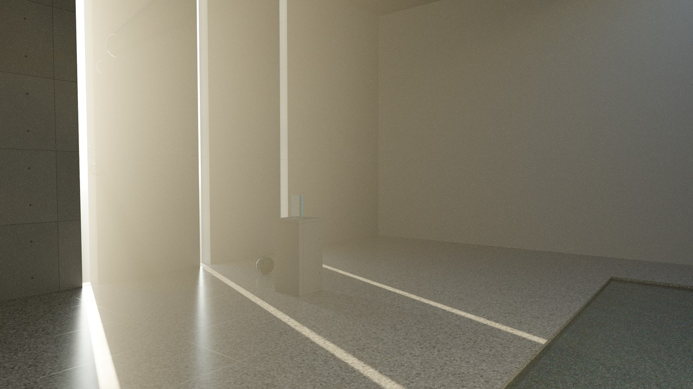
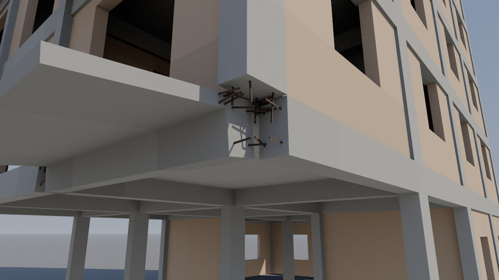
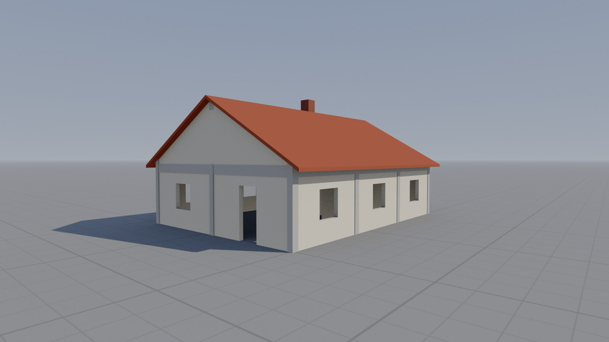
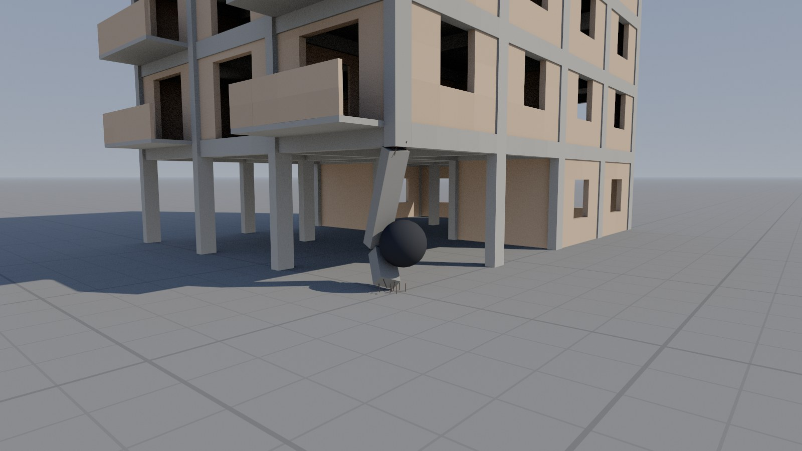
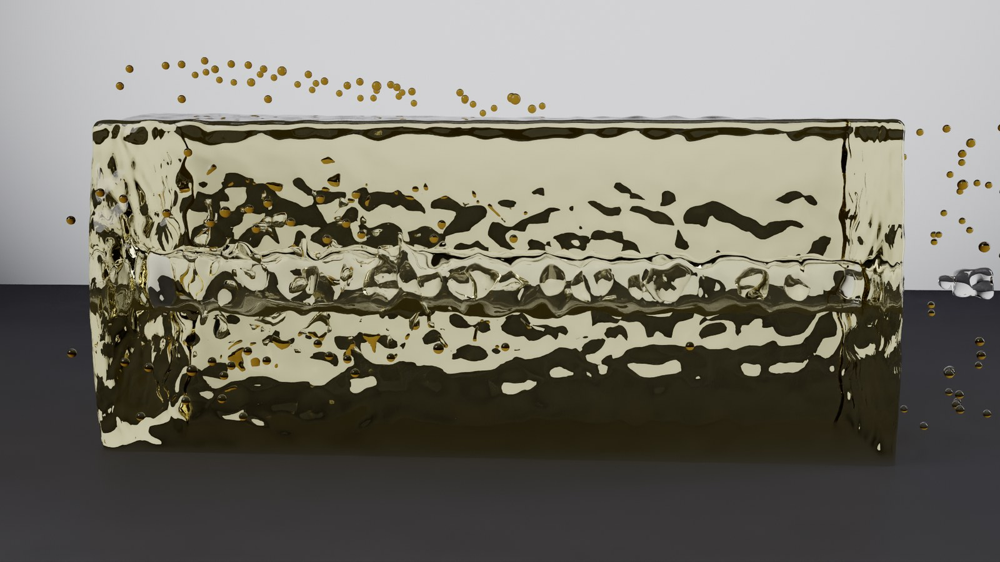
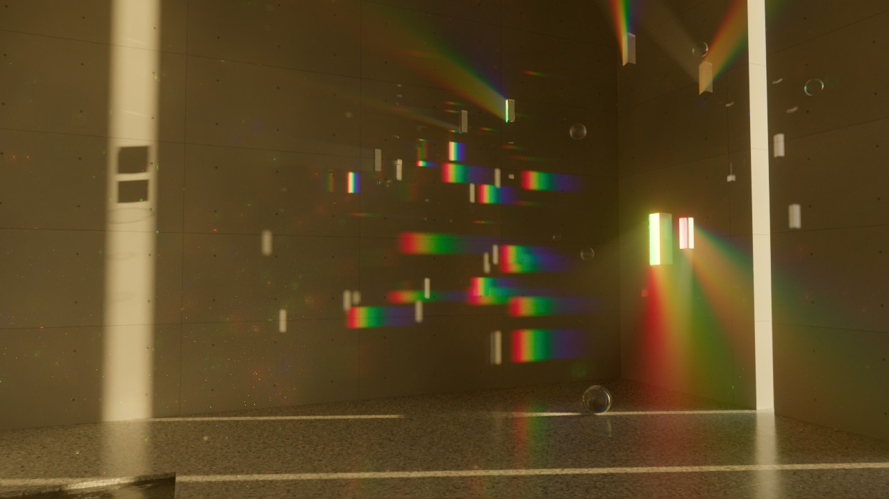

<div align="center">

# pc_graphics

**Ekran kartında sanat yönetimli sahneler; her birinin tek, dar bir hedefi var: doğru ışık, sonra güzellik, sonra fizik.**

[](https://isocpp.org)
[](https://developer.nvidia.com/cuda-toolkit)
[](https://developer.nvidia.com/rtx/ray-tracing/optix)
[](#derleme)
[](#derleme)
[](#durağan-ve-canlı)
[](#lisans)

[Uygulama](#uygulama) · [Sahneler](#sahneler) · [Sahne 1 ayrıntı](#sahne-1-neyi-hesaplıyor) · [Sahne 3 ayrıntı](#sahne-3-fizik) · [Derleme](#derleme) · [Çalıştırma](#çalıştırma) · [Düzen](#depo-düzeni)

*[English](README.md)*

</div>

---


Bilgisayar grafiğini sanat yönetimi olarak çalışmak için kişisel bir atölye: bir dizi sahne, her biri kendi
oturumunda tek ve dar bir hedefle. Oyun motoru da değil, performans testi de değil. İlk sahne ışığın matematiksel
olarak doğru olmasıyla, ikincisi güzellikle, üçüncüsü fizikle ilgiliydi: gerçek hissettiren bir binanın gerçek
hissettiren biçimde yıkılması. Dördüncüsü bir ağır çekim fotoğraf masası: sıvılar ve taneler, ince hesaplanıp ağır
çekimde izlenir.

Hepsi tek bir makine için (2560×1440 IPS monitörü süren bir RTX 4080) C++, CUDA ve OptiX ile yazıldı; altında motor
yok. Sahne 1 spektral bir yol izleyicidir: referans görüntüye yakınsayan **durağan kip** ve NVIDIA'nın yapay zekâ
gürültü gidericisiyle saniyede 20-30 kare tutan **canlı kip**. Sahne 2 gerçek zamanlı, hacimsel bir gece. Sahne 3
kendi yazdığımız bir katı cisim ve kırılma çözücüsü; sade bir gündüz ışın izleyicisiyle çiziliyor. Sahne 4 bir tanecik
çözücüsü (sıvılar, taneler, kopabilen bağlar); hızlı anları arka planda ince hesaplanır ve video olarak değil, fizik
olarak saklanır.

## Uygulama

Dört sahne tek bir programda yaşıyor. Program bir galeriyle açılır; sahne bir yükleme ekranının arkasında yüklenir
(programları derlenir, dünyası kurulur; bunlar ayrı bir iş parçacığında yapıldığı için pencere canlı kalır) ve sonra hepsi
için aynı olan bir arayüzün altında çalışır: kim ve ne sol altta, süreler sağ üstte, çıkış yolu sağ altta, tuşlar F1'de.
Sol alttaki panel fareyle kullanılır: sahne oraya seçenek sıraları, kaydırma çubukları ve düğmeler koyabilir (Yıkım'da
büyüklük, süre, başlat/durdur). Galeride her sahnenin kısa bir açıklaması ve **Ayrıntılar**'da nasıl yapıldığı var.
Esc her zaman geri götürür; kapanan sahne ekran kartını bütünüyle geri verir. Uygulama Türkçe ya da İngilizce
(galeride sağ üstte TR | EN, ya da L); seçim hatırlanır.

| Galeri | Ayrıntılar: nasıl yapıldı |
| --- | --- |
|  |  |


Görünüm tek bir yazı ailesiyle kurulu, IBM Plex: adlar için Serif, sözcükler için Sans, sayılar ve tuşlar için Mono.
Resimlerin üstünde koyu cam paneller ve her sahneye ışığından alınmış tek bir vurgu rengi: sıcak altın, soğuk mavi,
güvenlik turuncusu, deniz yeşili. Bir sahne; renderer'ı, ayarları ve OptiX programlarıyla bir klasör ve sahne kaydında tek bir
satırdır; sözleşme ve yeni sahne eklemek [docs/MIMARI.md](docs/MIMARI.md)'de.

## Sahneler

### 1 · Altın saatte cam ve taş · Ekim 2026

Tadao Ando dilinde bir oda: kalıp derzli ve kalıp delikli brüt beton, pirinç derz şeritli cilalı terrazzo zemin,
beyaz sıva, sığ bir havuz. Güneş ufkun sekiz derece üstünde ve yalnız dar yarıklardan giriyor. Huzmelerde kristal
prizmalar asılı; her biri duvarlara kendi tayfını saçıyor, pusun içinde dağılan ışık renkli yelpazelere açılıyor.
Işığın içinde sabun köpükleri süzülüyor.

| Prizma natürmortu | Işık planı, tepeden |
| --- | --- |
|  |  |

Sahne iki sanat turundan geçti. İlki *"ışık doğru mu?"* sorusunu yanıtladı ve doğru ama sessiz bir görüntü verdi.
İkincisi *"göz bir bakışta ne görüyor?"* sorusunu yanıtladı: karanlık oda, beş yarık, on dört kristal, sıcak denge.
İkisi arasında çizici değişmedi; sahne değişti.

| İlk ışık (1. aşama) | Canlı kip, 24 fps |
| --- | --- |
|  |  |

### 2 · Fener · Ekim 2026

Playdead'in *Inside*'ı tarzında bir gece: dönen huzmeyi taşıyacak kadar yoğun sis, kara köknar silüetleri, tek bir
sıcak pencereyle neredeyse tek renkli bir palet. Herhangi bir 3B'den önce çizilen üç değer etüdünden seçilmiş iki
sabit bakış: ormanlı bir adadan "Pencere" ve uzak bir burundan "Yücelik". Boşluk kamerayı ikisi arasında 778 m orman
içinden yürütür, ormanın karanlığı için göz uyumuyla; Tab küçük bir birinci şahıs yürüyüşe çevirir.


| Ormanın içi | Uzak burundan |
| --- | --- |
|  |  |

Yüzeyler, sonra tam çözünürlükte tek saçılımlı hacim, zamansal birikim, TAA ve parlama: 1440p'de kare başına 7,6 ms.
Bir kısmı bilerek fizik dışıdır (adıyla [docs/fener/DURUM.md](docs/fener/DURUM.md)'de): huzmenin ileri saçılımı yan
saçılımın ~100 katından 5 katına indirildi; kamera içindeyken bütün sisi yakan huzme doğrudur ama düzdür.

### 3 · Yıkım · Ekim 2026

Dört yapı. Üçü aynı beton, çelik ve tuğladan. Türkiye'nin kasabalarını dolduran türden beş katlı bir apartman: yüksek zemin
katta camlı dükkânlar, tuğla dolgu duvarlar, balkonlar, su depoları ve güneş kollektörleriyle düz çatı. Otuz katlı, 97
metrelik bir gökdelen: donatısız beton çekirdeğin çevresinde bir çerçeve, önde camlı bir lobi. Ve beşik çatılı, tek katlı bir
ev: mahya kirişi, beşik duvarları, baca. Ve Japon uygulamasından esinli sismik bir kule: üç kademede incelip çelik
bir iğneyle biten cam bir gövde, kauçuk izolatörlerin üstünde; sallanır, süzülür ama ayakta kalır. Zemini büyüklüğü 3'ten 9'a kadar depremler sallıyor (her biri gerçek bir
kuvvetli yer hareketi kaydından türetildi), ya da izleyen kişi yapıya fareyle yıkım topu fırlatıyor. Işık bilerek sade
bir güneşli gün; emek fiziğe gitti.


| Büyüklük 6: balkon korkulukları dökülür | Büyüklük 7: zemin kat dolgusunu yitirir, çerçeve ayakta |
| --- | --- |
|  |  |

| Patlatılan köşe kolonundan kalan demirler | Büyüklük 9: yumuşak kat çöküyor |
| --- | --- |
|  |  |

| Gökdelen: 30 kat, 97 m, 8.404 parça | Ev: beşik çatı, 456 parça |
| --- | --- |
|  |  |

| Sismik kule: 26 kat ve iğne, ~123 m, 5.142 parça, taban izolasyonlu |
| --- |
|  |

| Yıkım topu köşe kolona çarpar (4,2 t, 14 m/s) | Kolonun ayağı fırlamış, kolon eğik asılı, demirler açıkta |
| --- | --- |
|  |  |

Canlı çalışır: 1080p, RTX 4080'de gürültü giderici açıkken saniyede ~50 kare, fizik ve görüntü ekran kartında yan yana.
Büyüklüğü (3-9) ve süreyi (büyüklüğün kendi süresinden durdurana kadar) panelden fareyle ya da tuşla seç, başlat;
tıklayıp yıkım topu at, zamanı onda birine kadar yavaşlat.

### 4 · Laboratuvar · Ekim 2026

Bir ağır çekim fotoğraf masası: koyu bir set, deneyin arkasında büyük yumuşak bir ışık paneli, sıvı fotoğrafçılığının
klasik ışığı (cam ve sıvı kırılan kenarlarıyla okunur). Yedi deney, hepsi kendi yazdığımız tek çözücüde tanecik, fizik
ne derse o:

- **Su** eğilen bir beherden bardağa dökülür, 12 ile 45 cm arasından: sıçrar, taşar, masada birikir.
- **Bal** kaşıktan cam tabağa (canlı, kaşığı fareyle gezdir): tek kehribar ip, tabakta katlanıp kıvrılır, sonra göle
  yayılır.
- **Kum** huniden masaya ve behere (canlı): 32,5° ile yığılır (kuru kum 30-35°); çelik bilye bırakılabilir.
- **Su balonu** masada, iğneyle delinir: lastik 20-30 ms'de geri soyulurken su bir an balon biçiminde kalır, sonra çöker.
- **Karpuz** tüfekle vurulur (5,56, 7,62×51, .50 BMG; gerçek yükler): birkaç milisaniye şişer, sonra kabuğu taç gibi
  açılır.
- **Süt damlası** ince bir süt katmanına (0,4 mm tanecik, saniyenin 1/5000'i): taç açılır, damlacık saçar.
- **Balistik jel bloğu** tabancayla (.22, 9 mm, .50 AE): saydam bloğun içinde mermi yolu ve geçici boşluk, blok sarsılır.


Hızlı olanlar **kaydedilir**: tetik kaba dünyada hemen oynar (önizleme olduğu yazar), ince dünya (1,5-2,5 mm tanecik,
150 bine kadar) aynı girdileri bir işçi iş parçacığında hesaplar, saniyenin 1/600'ü ile 1/1000'i aralıklarla ekran
kartında saklar. Hesaplanan kısım hemen izlenir, video yüklenir gibi; bitince bir kez gerçek hızda oynar, sonra
serbest: zaman çubuğunda gez, 1/10 ya da 1/100'e yavaşlat, dondur, WASD ile etrafında dolaş. Hiçbiri video değil:
saklanan fiziktir, her açıdan canlı çizilir. Bal ve kum yalnız canlı, çünkü akışları sahnenin kendisi.

| Dökme (ince kayıt, 1,45 sn) | Canlı dökülen kum: 32,5°'lik koni |
| --- | --- |
|  |  |


| Cam tabakta bal | Karpuzdan geçen 7,62×51 mermi, 0-24 ms |
| --- | --- |
|  |  |

| Süt damlasının tacı, 16 ms | Balistik jelden geçen 9 mm, 1,2 ms: yol ve boşluğu |
| --- | --- |
|  |  |

Nasıl yapıldığı ve yolda neyin ölçüldüğü (çalışma günlüğünde hepsi:
[docs/laboratuvar/DURUM.md](docs/laboratuvar/DURUM.md)):

- **Tek çözücü** (NVIDIA FleX'in yolu): su ve bal için Position Based Fluids, lastik ve karpuz için XPBD bağları, çelik
  bilye için şekil eşleme, kum için taneler; bütün bağlarını yitiren karpuz taneciği suyuna döner. Cam kaplar camın
  yüzeyinde tek katman kinematik tanecik, onu eğen elle birlikte hareket eder.
- **Su** dudaktan ancak biraz viskozite, yapışma ve yüzey gerilimiyle tek şerit olarak çıkıyor (onlarsız hemen
  erişteye bölünüyordu; dört varyant kareyle kıyaslandı).
- **Kum** önce sıvı gibi yayıldı (taneciğin temasları arasında itme gibi paylaşılan sürtünme kaymasının yalnız bir
  kısmını durduruyor): sürtünmeyi kök payla paylaşmak, daha çok geçiş ve hız düzeyinde durgun sürtünme yığını 0°'den
  32,5°'ye getirdi, eşik ölçerek seçildi (`--lab-test kum`).
- **Balonun** gerili lastiği, bağlarına alt adım başına yeterli geçiş verilene kadar suyun ağırlığıyla yırtıldı (kaba
  balonu tutan ayar ince balonu tutmadı: XPBD'nin sertliği çözünürlüğe bağlı); gerilimi oturma sırasında yavaşça
  verilir; yırtığın ucuna, kaba kafesin orada toplayamadığı gerilim verilir.
- **Balın** viskozitesi her taneciğin kendi komşularına göre alınır (ince ip de gövde kadar koyu olur), alt adımda
  tekrarlanır; bal en yeni katmanlarını tutan bir memeden çıkar. Yine de ipi damlalara bölünüyordu (PBF'te gerilmeye
  direnen gerilim yok); katmanları arasındaki viskoelastik yaylar (Clavet vd. 2005'ten, dinlenme boyu uzunluğu izler)
  onu incelen, katlanan ve tabakta kıvrılan tek bir ip tutar, sonra bırakır: kıvrımlar birleşip göl olur.
- **Karpuzun** kabuğu iki katman (yeşil deri, açık kabuk), yuvalı bir kaidede; bağlarında doğal kusurlar var (özdeş
  bağlar hep birden kırılıp kırıntı oluyordu); merminin yolu eski Tanecik sahnesinin jele kalibre balistiğinden.
- **Görüntü:** OptiX ile yol izleme; kalınlıklı cam ve kırılan sıvılar tam Fresnel ile, bardaktaki su camla tek arayüzden
  geçer (yüzeyleri arasındaki kıl kadar hava yoksa ayna olurdu); yüzeyler her karede taneciklerden kurulur (anizotropik
  çekirdekler); kum, tane ölçeğinde dokulu bir yüzey ve ince taneler; karede 4 örnek, zaman içinde harmanlanır (kameradan geri
  izlenerek; bir piksel geçmişini ancak içinden geçen sabit ışın hâlâ aynı noktaya değip aynı yolu gidiyorsa tutar,
  akan su iz bırakmaz), cam ve sıvıda görünen ışık kutuları yansıma yönünde tam sayılır, sonra OptiX yapay zekâ
  gürültü gidericisi. Her kareyi ayrı temizlemek cam kenarlarını dalgalandırıyordu; harmanlanınca suyun dalgalanması
  on kat azaldı.

Açık: bal ipinin yüzeyi boğumlu (bir-üç tanecik kalınlığında); karpuz parçaları keskin kırık değil yumuşak yüzeyler olarak çiziliyor; balon asılı değil masada
(asılıyken hafif lastik suyun ağırlığını düğüme zamanında taşıyamadı).

## Sahne 1: neyi hesaplıyor

| | |
| --- | --- |
| **Spektral ışık taşıma** | Yol başına dört kahraman dalga boyuyla yol izleme (Wilkie ve diğ. 2014), gözün duyarlılığına göre örneklenen 360-830 nm (pbrt-v4), CIE 1931 gözlemcisi, sRGB'den uydurulan Jakob-Hanika sigmoid yansıtırlıkları. |
| **Güneş ve gök** | Kenar kararmalı 5778 K kara cisim, küresel bir atmosferde zayıflatılmış (Rayleigh, Mie aerosol, ozonun Chappuis bandı). Gök, aynı atmosferde tek saçılımdan hesaplanan 512×256×48 kanallı spektral bir harita; güneş her hareket ettiğinde yeniden hesaplanır. 10° yükseklikte güneş ~3480 K çıkar. |
| **Işık örnekleme** | Güneş diskine ve göğe *açıklıklar üzerinden* (portal) doğrudan ışık örneklemesi, BSDF örneklemesiyle çoklu önem örneklemesi (MIS) ile birleşir. |
| **Malzemeler** | Ando betonu (1820×910 mm panolar, her birinde altı kalıp deliği, V derzler, lekelenme), pirinç şeritli cilalı terrazzo, sıva, SF11 ve BK7 cam (Sellmeier), su (dağılım, Pope-Fry soğurması, kılcal-yerçekimi dalgacıkları), sabun filmi (Airy ince film girişimi), pirinç. Prosedürel ayrıntı aynı fonksiyonlardan bir kez döşenebilir dokuya pişirilir. |
| **Kostikler** | Aşamalı spektral foton haritası (Knaus ve Zwicker 2011): güneşten cama ve suya yöneltilen fotonlar, CUB ile sıralanan GPU hash ızgarası, kare kare küçülen toplama yarıçapı. |
| **Hacimsel kostikler** | Foton ışınları (Jarosz ve diğ. 2011): kostik fotonlarının pus içindeki uçuşları kendi ivme yapısını alır, kamera ışınları onları ışın izleme donanımıyla toplar. |
| **Pus** | Homojen katılımcı ortam, güneş ışığının tek saçılımı; mesafeler analitik olarak hesaplanan güneş huzmelerinin içinde örneklenir. |
| **Kamera ve ekran** | Dokuz bıçaklı diyaframlı ince mercek, Gauss piksel süzgeci, AgX ton eşleme, lens parlaması piramidi, Bradford uyarlamasıyla beyaz dengesi, 8 bit panel için mavi gürültü titreşimi. |
| **Gürültü giderme** | Albedo ve normal kılavuzlu OptiX yapay zekâ gürültü gidericisi. Kostikler ondan hiç geçmez: tayflar keskin kalsın diye sonradan eklenir. |

Foton geçişinin katkısı, aynı 512 örnekte:

| Fotonlar kapalı: yalnız yol izleme | Fotonlar açık |
| --- | --- |
|  |  |

## Durağan ve canlı (sahne 1)

| | Durağan | Canlı |
| --- | --- | --- |
| Hedef | referansa yakınsamak | akıcı kalmak |
| Çözünürlük | 2560×1440 izlenir | 1280×720 izlenir, `TEMPORAL_UPSCALE2X` ile ×2 büyütülür |
| Örnek | sınırsız birikir | kare başına piksel başına bir |
| Gürültü giderici | 8192 örneğe kadar yapay zekâ, sonra ham görüntü | her karede zamansal model |
| Sahne 1, kristaller | saniyede ~8 örnek | **24 fps** |
| Sahne 1, natürmort (ilk ışık ayarı) | saniyede ~16-20 örnek | 26-35 fps |

Boşluk tuşu ikisi arasında geçer. Canlı kipte su dalgalanır, toz ve köpükler süzülür.

## Okunmaya değer kararlar (sahne 1)

- **Tek OptiX programı, gölgelendirme ışın üretiminde.** Işınlar `optixTraverse` ile izlenir, iş parçacıkları
  `optixReorder` ile malzemeye göre yeniden gruplanır (gölgelendirici yürütme yeniden sıralaması), sonra yerinde
  gölgelendirilir. Ölçüldü: yeniden sıralama olmadan yol izleyici **6 kat yavaş**.
- **Küreler özel ilkel.** OptiX'in yerleşik küresi içeriden vurulmuyor; su dolu cam küre siyah çıktı, köpükler tek
  film gibi davrandı. Tek bayraklık bir deney içeriden sıfır vuruş gösterdi; özel kesişim iki kökü de raporluyor.
- **Varyans azaltmadan önce ölç.** Kazanmasını beklediğim iki teknik (güneşli lekelere üç yönlü MIS'le bağlanmak ve
  gök haritasının önem örneklemesi) yansız ve doğruydu ama eşit *sürede* kaybetti. Asıl kaldıraç maliyetti:
  prosedürel dokular karenin üçte ikisini alıyordu; pişirmek 2,3 kat verdi. İki teknik de kodda, varsayılan kapalı.
- **Kostikler gürültü gidericinin dışında kalır.** Tersi denendi: tayfları yaydı.
- **Zayıf dağılım için bedel ödenmez.** Suyun kırılma indisi görünür aralıkta ~0,01 değişir; kamera yolları onu
  yalnız kahraman dalga boyunda kırar. Her biri tek dalga boyu taşıyan fotonlar tamamen dağıtıcı kalır.
- **Prizma için tabakalı tayf bölme.** Dağıtıcı camı gören pikseller aynı yolu aynı rastgele sayılarla dört kez
  izler, camda her seferinde başka bir dalga boyunu taşır. Bu piksellere 16 ayrı örnek vermek ölçüldüğünde başlatmayı
  bekletti (11 → 48 ms): örnekler tek iş parçacığında sırayla koşuyordu.
- **Toz yalnız kamera için.** Binlerce toz zerresi kendi ivme yapısında, görünürlük maskesi 2 ile: yalnız birincil
  ışınlar görür. Maliyet 21 ms'den ölçülemeyecek kadar küçüğe indi.
- **Teknik olarak etkileyici olmak görsel olarak etkileyici olmakla aynı şey değil.** İlk biten sahne fiziksel olarak
  doğru, görsel olarak sadeydi. Çokluk ve renk (tek prizma yerine on dört kristal) ve karanlık bir oda bunu tek kısa
  turda değiştirdi; çiziciye dokunulmadı.

## Doğrulananlar (sahne 1)

| Denetim | Sonuç |
| --- | --- |
| Spektral seçim testi (`--selftest`) | D65 beyaz noktası x 0,31271, y 0,32907; D65 sRGB beyazına ±0,001; SF11 ve BK7 Fraunhofer F, d, C çizgilerinde katalogdan 6×10⁻⁵ içinde; Fresnel, ince film sıfırları ve sabun filminin Newton renk dizisi; sigmoid tayf uydurma gidiş-dönüş |
| Beyaz fırın (`--furnace`) | her yüzey beyaz, düzgün gök: ortalama parlaklık iki tohumda %0,02-0,03 içinde 1. Yolda iki gerçek hata yakaladı |
| Fotonlar, yol izlemeye karşı | düz yol izleme kostikleri bulabilsin diye güneş 5°'ye büyütüldü: kostik bölgelerde oran **0,991**, çift sayma yok |
| Yakınsama | 16, 64, 256, 1024 örnekte göreli piksel hatası 0,62, 0,35, 0,19, 0,11: beklenen 1/√n |
| 16.384 örneklik referansa uzaklık (NVIDIA FLIP, natürmort) | gürültü gidericili durağan: 16 örnekte 0,077 (0,7 s), 256'da 0,061, 1024'te 0,041; canlı 0,115 |
| Sonlu olmayan değer | hiçbir çalıştırmada yok |
| Gerçek monitörde | pencere RTX 4080 üzerinde (`GL_RENDERER` günlükte), 2560×1440 @ 165 Hz; canlı kare hızı RivaTuner göstergesiyle bağımsız olarak doğrulandı |

**Doğrulanmayanlar:** canlı kipte hareket gözle değil sayılarla (ardışık kare farkı) ve tek tek karelerle
değerlendirildi. Gökte çoklu saçılım yok; gerçek gökten biraz koyu ve daha az mavi. Kostik ışık yalnız ilk iki dağınık
sekmede toplanıyor (~%0,7 eksik). Canlı kipte prizmanın tayfı karıncalı.

## Sahne 3: fizik

Hedef mühendislik doğruluğu değil, film gerçekçiliğiydi: ağır ve inandırıcı hissettiren bir çöküş, ve gerçek deprem
kayıtları altında dağılmayan bir çözücü.

| | |
| --- | --- |
| **Cisimler** | Katı dışbükey parçalar: apartman 3.006, gökdelen 8.404, ev 456 (kolon ve kiriş parçaları, döşeme panelleri, çekirdek duvarları, tuğla bloklar, balkonlar, çatı); her birinin kendi kabuğu, kütlesi ve eylemsizliği. Konumlar çift duyarlıkta. Eğik parçalar (çatı, beşik) kesme düzlemli kutular; aynı düzlemle karşı yönden kesilmiş iki parça o düzlemden yapıştırılır, kesik yüzlerde lifler ortak bölgenin ince örneklemesinden. |
| **Bağlar** | 44.378 lif taşıyan 6.857 arayüz, uygulamalı eleman yönteminden (AEM) esinli: beton çekmede çatlar, basınçta ezilir (%30 kalan dayanım), donatı akar ve 6 cm plastik uzamada kopar, kayma önce kohezyon sonra sürtünme + dübel. Kapasiteyi aşan kısım kalıcı ofset olur: mafsallaşan kolon eğik kalır. |
| **Çözücü** | Ekran kartında XPBD, karede 40 alt adım. Arayüzler 13 graf renginde Gauss-Seidel ile çözülür (alt sınır: bir cisme değen en çok arayüz); çarpan geçişler boyunca biriktirilir, kapasite toplam kuvveti sınırlar. Temaslar Jacobi: bir çiftin iki cismi de aynı payı alır (1 / ikisinin temas sayısından büyüğü), çiftin momentumu korunur. Alt adım döngüsü kollu bir CUDA Graph: arayüzler yüksek öncelikli bir kolda, temaslar onlarla aynı anda, entegrasyondan hemen sonraki konumların kopyası üzerinde (ikisi arasında Jacobi). Ayakta süre parça sayısından çok renk geçişlerinden gelir (apartman ve 2,8 kat parçalı gökdelen 11-15 ms); gökdelenin göçüşünde 20-23 ms. |
| **Temas** | Önce dar faz kutuları değebilecek çiftleri listeler (çift başına bir iş parçacığı); sonra çift başına 8 şerit, bir warp'ta dört çift; büyük çiftler (üst üste çöken iki döşeme) kendi kollarında birer tam warp'la. Örnek noktalar, kutularıyla elenen gruplar hâlinde, ötekinin kabuk düzlemlerine karşı; normal düzeltmeler çift içinde ortalanır, sonra yama merkezinde statik ve dinamik bütçeli, çapalı (PhysX gibi) tek sürtünme; burulma sürtünmesi ve sekme. |
| **Taban izolasyonu** | Sismik kulenin radyesi zemine yapışık değil: kauçuğa oturuyor; yanlamasına yumuşak (kesme modülü, kule üstünde 3,5 sn periyotla salınsın diye: depremin güçlü kısmından uzun), düşeyde sert ve hiç kırılmayan bir malzeme; hendeğin çevresindeki bordür zeminle birlikte sallanır. Yüksek dayanımlı beton (40 MPa) ve donatı (420 MPa). Ölçülen: 6'da hiçbir şey kırılmaz, 8'de birkaç cam, 9'da boşluklarla ayakta. |
| **Cam** | Koyu bir rengin üstünde ayna yansıması, payı Schlick Fresnel'iyle (kaplamalı cam); yansıma bir kez izlenir ve her şey gibi aydınlatılır. |
| **Determinizm** | Temas ve arayüz toplamları kayan noktalı atomikler yerine 2⁻⁴⁰ sabit noktada, iş parçacıklarının varış sırasına başka bir şey de bırakılmadı (sürtünme çapası tablosu kareler arasında yeniden kurulur): aynı deprem aynı binayı her koşuda aynı biçimde yıkar. Bir açık var: gökdelenin göçüşü 24. sn'ye kadar aynı, sonrasında bir kez ayrıldı. |
| **Sönüm** | Serbest titreşimden ölçülen kritik sönümün %5,3'ü: kütleye orantılı, zemine göre, yalnız bağlı cisimlere, ivmesi sınırlı (düşen enkaz serbest kalır). |
| **Depremler** | Büyüklüğe göre, 3'ten 9'a: binanın ~15 km ötedeki o büyüklükte bir depremden hissettiği. Her biri gerçek bir kuvvetli yer hareketi kaydının dalgasından (ESM ve AFAD TADAS: 2023 Antakya, 1999 Yarımca ve İzmit, 2020 Bayraklı): o büyüklüğün getirdiği güçlü sarsıntı süresi kadar kesilir, küçükler daha hızlı oynatılır, o büyüklüğün tepe yer ivmesine ölçeklenir, taban çizgisi düzeltilir (zemin başladığı yerde durur); sonra iki kez integre edilip yer değiştirmeye çevrilir. Bir oyunun ölçeği, sismolojinin değil: sarsıntıyı büyüklük tek başına belirlemez. Daha uzun ya da durdurana kadar süren sarsıntıda güçlü kısım dikişsiz bir döngü olur: sonu başına karışır, ivmenin ve hızın ortalaması döngü boyunca çıkarılarak integre edilir (zemin kaymaz), kaydın kendi yükseliş ve sönüşüyle bir zarfın altında oynar. Durdurmak zemini 1,5 sn'de dindirir. |
| **Yıkım topu** | Tıklanan noktaya kameranın yanından gelen döküm çelik bir top, saniyede en çok bir. Gücü bir çubuk: boy ve hız birlikte, 0,52 t ve 8 m/s'den (kolonu kıpırdatmaz) dengeli 4,2 t ve 14 m/s'ye (köşe kolonun ayağını koparır), oradan bilerek abartılmış bir göktaşına: 5 m çap, 520 t, 110 m/s (tek atışta gökdeleni yıkar); yerçekimine göre nişanlı. Öteki parçalar gibi bir cisim, 256 teğet düzlemli dışbükey bir kabuk; görüntüde kürenin normaliyle gölgelenir. Kırılmaya ve devrilmeye çözücü karar verir. |
| **Görüntü** | OptiX: her parça kendi kabuğunun bir örneği, dönüşümleri fizik doğrudan örnek tamponuna yazar, üst yapı her kare yeniden kurulur. Yumuşak gölgeli güneş, gök, zeminden bir sekme, depremle birlikte kayan metre ızgarası. Donatı liflerin durumundan çizilir: tuttukça çatlağın üstünden geçer, koptuğunda eğri filizler olarak çıkar. |
| **Gürültü giderme** | Karede altı örnek, bir şey hareket ederken grenli. Kendi yazdığımız hafif bir SVGF: ışık (görüntü bölü albedo) her parçanın kendi hareketiyle kareden kareye taşınır, cisim, normal ve uzaklıkla denetlenir, üstünden gölge geçerken yeni karenin komşuluğuna kırpılır; sonra başka cisimde, normalde, derinlik basamağında ve ışık kenarında duran à-trous geçişleri. 1080p'de 2,4 ms. OptiX yapay zekâ gidericisi bir tuş ötede (G): daha da temiz, ama 9,7 ms tutuyor ve ekran kartını paylaşan fiziği yavaşlatıyor. |

Her büyüklüğün üç yapıya yaptığı (her biri bir koşu; sarsıntı bittikten ~8 sn sonra ölçüldü; en hızlı parça her koşuda
yapının tepesinden serbest düşüşün altında):

| Büyüklük | Tepe yer ivmesi | Güçlü sarsıntı | Apartman | Gökdelen | Ev |
| --- | --- | --- | --- | --- | --- |
| 3 · zayıf | 0,012 g | 3 sn | hiçbir şey kırılmaz | ölçülmedi | ölçülmedi |
| 4 · hafif | 0,035 g | 5 sn | kılcal çatlaklar | ölçülmedi | ölçülmedi |
| 5 · orta | 0,13 g | 8 sn | bağlarda çatlaklar, bir şey düşmez | kırılan yok | kırılan yok |
| 6 · kuvvetli | 0,20 g | 14 sn | balkon korkulukları ve zemin kat dolgusunun bir kısmı dökülür | kılcal çatlaklar, öteleme %0,07 | iki çatlak |
| 7 · şiddetli | 0,33 g | 26 sn | ağır hasar, öteleme %0,60, çerçeve ayakta | yumuşak kat: lobi katı gider, kule bütün olarak devrilir | altı çatlak |
| 8 · yıkıcı | 0,70 g | 32 sn | yumuşak kat göçmesi, çatı 13,5 m iner | ölçülmedi | göçer |
| 9 · felaket | 1,1 g | 45 sn | göçme, çatı 12,7 m iner | göçer | göçer |

Gerçek kayıtlar tam ölçekte (apartman, temas payı düzeltmesinden önce): bina 2020 Bayraklı, 1999 İzmit ve 1999 Yarımca'da ayakta kaldı, 2023 Antakya'da ve
Yarımca ×1,5'te göçtü. Pazarcık kaydı (3,0 g yatay vektör tepe) tam eşikteydi: en sonda düzeltilen bir modelleme hatasına
kadar binayı yıkıyordu (aşağıda), düzeltmeden sonra bina ayakta. Sınırındaki yapı kaotiktir; bu sonuçların bir şey ifade
etmesi için çözücünün önce deterministik olması gerekti. Bu kayıt büyüklükler arasında yok: enerjisi kısa periyotlarda,
bina göçene kadar ölçeklenince de enkazı başka hiçbir şeye benzemeyen biçimde fırlatıyor.

Okunmaya değer kararlar:

- **Kapasite her geçişi değil, biriken kuvveti sınırlar.** Geçiş başına sınırlanınca iki geçiş akma momentinin iki
  katını taşıdı: düşmesi gereken 6 m konsol 8,7 cm sarkıp durdu. Artık küçük "mafsal" testleri her kesiti tek başına
  sınıyor; çerçevenin davranışı ancak parçaları doğruysa okunabilir.
- **Sürtünme noktanın değil yamanın.** Nokta başına sürtünme 25°'lik eğimde bloğu 5 mm/s sürüdü; yalnız alt adım
  içindeki kaymayı geri alan sürtünme 15 bloklu piramidi 30 sn'de 0,65 m açtı; yama başına tek, çapalı sürtünme bunu
  0,6 mm'ye indirdi. Sıralı normal düzeltmeler düz düşen kutuyu döndürdü; çift içinde ortalanıyor.
- **İç içe geçmeyi itmek hız biriktirir.** Zemine gömülen enkaz 22-52 m/s ile fırladı. Ayrılma hızı sınırlandı; ilk
  sınırdaki cırcır (önceki ayrılma hızına izin) tek bir bloğun kare kare izinden bulundu.
- **Kesilen kolon binayı taşımaya devam eder.** Dört katın altında temas ve sürtünmeyle tutar; kolonu kaldırmak
  cismi dünyadan çıkarmak demek.
- **Kayan noktalı atomikler eşikteki binayı bir koşuda yıkıp öbüründe ayakta bıraktı.** Sabit noktalı toplama
  sonuçları tekrarlanabilir yaptı; sonraki her ölçümü anlamlı kılan buydu.
- **Sönüm, üçüncü deneme.** Arayüzlerde açık sönüm katsayı ne olursa olsun %0,5'te kaldı; kapalı rijitlik sönümü
  binayı yumuşattı (periyot 0,45 → 1,43 s); ivmesi sınırlı, kütleye orantılı sönüm periyodu değiştirmeden %5,3 verdi.
- **Canlı pencere bir durumu çizerken ekran kartı bir sonrakini hesaplar.** Fizik ve görüntü iki akışta, aralarında
  bir olay: 28 fps 55-75 oldu.
- **İç durumu göstermek denetlemektir.** Donatının göründüğü ilk karede yere düşmüş tuğla korkuluklardan demir
  çıkıyordu. Bir parçanın kendi donatı oranı (balkonların) değdiği tuğlaya sızıyordu: dayanımı sıfır ama korkuluğun
  tabanını 1,8 kat katılaştıran, çatlatan kuvveti de o kadar büyüten demirler. Hiçbir test ve klip göstermemişti.
  Düzeltmek Pazarcık ×1'i göçmeden ayakta kalmaya taşıdı.
- **İç içe geçmeyi itmek bir şey fırlatmamalı.** İç içe geçmeler 2 m/s'ye kadar hızla dışarı itiliyordu. Tuğla
  korkuluğun ezilen bağı onu kirişe birkaç santim gömüyor; son lif kopunca gömülme bir anda itiliyor, 150 kg'lık blok
  3-4 m/s ile yukarı fırlıyordu (Özcan gördü: hafif parçalar düşmek yerine fırlıyor). 0,5 m/s'de binadan fırlayan
  tuğla (yerden 1 m'nin üstünde, bir karede 2 m/s'den fazla hızlanan) Pazarcık'ta 93'ten 1'e, Antakya'nın çöküşünden
  önce 44'ten 0'a indi; testler ve her kaydın binaya yaptığı değişmedi.
- **Fiziğin yanına sığan gürültü giderici.** OptiX yapay zekâ gidericisi greni tamamen aldı, ama 9,7 ms'siyle fiziği
  14,5'ten 23 ms'ye yavaşlattı (ekran kartını paylaşıyorlar): 40 fps ve üçte iki hızında bir deprem. Katı cisimler
  daha ucuz bir süzgeci işletiyor: hareketleri tam bilindiği için her yüzey noktası kendi geçmişini taşıyor. İlk
  sürümü, yıkılan binanın gölgesi zeminde kayarken aydınlık lekeler bıraktı; geçmişi yeni karenin komşuluğuna kırpmak
  bunları sildi.
- **Yavaş fizik adımı yavaş dünyadır.** Pencere karede en çok bir adım atar; adımı 40-50 ms olan gökdelen göçüşü
  gerçek zamanın üçte biriyle akıyordu. Temas çekirdeğinin her bölümüne saat koyunca zamanın nereye gittiği göründü:
  sonraki yinelemelerde örnekleri yeniden taramak (%56) ve ilk tarama (%30); hesaptan çok bellek beklemesi. Nokta başına
  ucuzlatılan aritmetik ölçülebilir bir şey kazandırmadı; fiziği değiştiren bir kestirme (dört yerine tek temas
  yinelemesi: 16 ms) gökdeleni 7'de ayakta bıraktı. İşe yarayanlar: çift başına bir iş parçacıklı dar faz, warp yerine
  çift başına 8 şerit, kendi kolunda ilk yinelemesinin noktalarını yeniden kullanan büyük çiftler ve arayüzlerle aynı
  anda koşan temaslar (alt adım başına 26 küçük çekirdekleri kartın çoğunu boş bırakıyordu). Göçüşte 20-23 ms.
- **İki kez ölçmek bir yarış buldu.** İki koşuda gökdelenin göçüşü farklı çıktı (aynı anda 50 ve 101 bin kırık lif);
  apartmanınki aynıydı. Bir çift sürtünme çapası tablosunda yolda başka bir çiftin bayat yuvasını kapabiliyordu, arkadaki
  çapa hangi çiftin önce geldiğine göre sıfırlanıyor ya da sıfırlanmıyordu. Tablo artık kareler arasında yeniden
  kuruluyor, çift önce kendi kaydını arıyor: koşular 24. sn'ye kadar birebir aynı. Sonrasında bir kez ayrıldılar (çatı
  ötelemesi 75,3 ve 76,6 m): ikinci bir kaynak, henüz bulunmadı.
- **Kesik bir yüzün ortak bölgesi ince bir şerit olabilir.** Evin eğik çatısı ve beşikleri kesme düzlemli kutular;
  bağları önce kutunun yüzüne yayılan 4×4 ızgaradan alındı, ortak bölge ince ve eğik olunca mahyaya hiç lif düşmedi ve
  ev kendi ağırlığıyla otururken 163 lif koptu. Ortak bölge ince örneklenip lifler oradan seçilince: 0.
- **Bir çatı ya ittirir ya oturur.** Birbirine yaslanan iki çatı yarısı saçakları itti (2.174 çatlak; çatısız ev: 0).
  Mahya kirişi eklendi, ama beşik duvarlarının yüzüne yapışınca onları 6-9 mm dışarı itti; beşiklerin üstüne oturunca
  ev 0 çatlakla oturdu. Hepsi oturma sırasındaki kırık ve çatlak sayısıyla bulundu, gözle değil.
- **Momentumu korumayan ortalama, en büyük yıkımda patladı.** Temas düzeltmeleri her cismin kendi temas sayısına
  bölünüyordu. Gökdelenin göçüşünde birbirine saplanmış iki parça, biri çok temas ederken birbirini eşitsiz itti ve 105
  m/s ile 190 m'ye çıktı. Çiftin iki cismine aynı pay verilince en hızlı parça 43,5 m/s (tepeden serbest düşüş 43,8);
  testler ve apartmanın davranışı aynı kaldı.
- **Darbe bir cisimdir, sihir değil.** Tıklama önceleri parçayı dünyadan kaldırıyordu (Özcan: *"kolon pıt diye yok
  oluyor"*). Şimdi top atılıyor. 1,4 t'luk top köşe kolonu yalnız 7 cm kaydırdı: katı parçalı modelde darbe yerel ezme
  yapamaz, 2,2 m'lik parçanın tamamına dağılır ve iki bağın kayma kapasitesi momentumu kopma eşiğinden önce yer.
  4,2 t'luk top kolonun ayağını koparıp gövdesini devirdi; çözücüye hiç dokunulmadı.
- **Taşıyıcıyı ölç, üstünde duranı değil.** "Çatı ötelemesi" en üstteki parçaların ortalamasıydı, onlar da tuğla
  korkuluktu; savrulan korkuluk, ayakta duran binada çatının 9,7 m düştüğü diye okundu.

**Doğrulanmayanlar:** on katı parçalı 5 m'lik konsol varsayılan alt adım sayısında 2,9 kat yumuşak (uzun katı
zincirler yavaş yakınsıyor; binanın ölçülen periyodu 0,45 s, yönetmelik formülünün 0,54 s'sine yakın). Bina bir
mühendislik analiziyle karşılaştırılmadı; çözücünün testleri (serbest düşme, yığın, eğim, enerji, mafsal,
determinizm, sönüm, deprem döngüsü) fiziksel akıl sağlığı denetimleri, 34'ün 32'si geçiyor, kalan ikisi konsol. Hareketi kliplerden
Özcan değerlendirdi, yazarın gözü değil.

## Derleme

**Gerekenler:** Windows 11, OptiX 9.1'i taşıyan sürücüyle bir NVIDIA RTX GPU (RTX 4080 ve 617.14 sürücüsüyle
denendi), C++ iş yüküyle Visual Studio 2026 (MSVC 14.51, içindeki CMake ve Ninja), Git Bash, araçlar için Python 3
(`numpy`, `pillow`, `OpenEXR`, `flip-evaluator`).

```bash
bash third_party/fetch.sh        # CUDA 13.4.2 dağıtım arşivleri, OptiX 9.1 başlıkları, GLFW, stb (stb_truetype dahil), tinyexr
```

Hiçbir şey kurulmaz ve ekran kartı sürücüsüne dokunulmaz: CUDA, NVIDIA'nın bileşen arşivleri olarak git'e
işlenmeyen `third_party/` klasörüne iner.

```bat
cmd /c build.bat                 :: bir kez yapılandırır, sonra build\pc_graphics.exe'yi (tek program) derler
```

OptiX cihaz programları (`src/scenes/<sahne>/device/`) çalışma anında NVRTC ile derlenir; onları düzenlemek yeniden
derleme istemez: sahnede **F5**'e bas.

## Çalıştırma

```bat
build\pc_graphics.exe                       :: galeri, birincil monitörde kenarlıksız tam ekran
build\pc_graphics.exe --scene yikim         :: doğrudan bir sahneye (altinsaat, fener, yikim, laboratuvar); Esc galeriye götürür
build\pc_graphics.exe --windowed            :: 1280x720 pencerede
build\pc_graphics.exe --set anahtar=deger   :: sahnelerin bir ayarı (scenes/<sahne>.cfg), tekrarlanabilir
build\pc_graphics.exe --lang en             :: İngilizce (ya da tr); yoksa galeride son seçilen
build\pc_graphics.exe --autotest            :: bütün uygulama bir kez, betikle; ekranlar captures\arayuz altına
```

| Her yerde | |
| --- | --- |
| Esc | geri: yardım → sahne → galeri → çıkış |
| F1 | sahnenin tuşları |
| H | arayüzü gizle |
| F12 | sahnenin ekran görüntüsü (`captures\<sahne>_<tarih>`; sahne 1 doğrusal EXR de yazar) |
| F5 | sahnenin ayarlarını yeniden oku, OptiX programlarını yeniden derle (sahne 1 ve 2) |
| ↑ ↓, 1-4, Enter, fare | galeride seç ve aç |
| A | galeride sahnenin ayrıntıları (nasıl yapıldı) |
| L | galeride dil: Türkçe ↔ İngilizce (sağ üstte TR \| EN) |

| Sahne 1 · Altın Saat | Sahne 2 · Fener | Sahne 3 · Yıkım | Sahne 4 · Laboratuvar |
| --- | --- | --- | --- |
| Boşluk durağan ↔ canlı · C sonraki kamera · ↑ ↓ pozlama · ← → odak · R sıfırla · P, V, N, D, G fotonlar, pus, doğrudan ışık örneklemesi, gürültü giderici, güneş lekeleri · 1-5 güzel, albedo, normal, kostikler, maliyet | Boşluk A ↔ B yürü · B öbür bakışa atla · P zamanı durdur · ← → zaman ∓1 sn · ↑ ↓ pozlama · 1-5 görünümler · Tab birinci şahıs (WASD, fare, Shift koş, Boşluk zıpla) | panelde Yapı: apartman, gökdelen, ev · 3-9 büyüklük · ← → süre (en sonda: durdurana kadar) · Boşluk başlat ya da durdur (panelde fareyle de) · T ağır çekim · P durdur · sol tık yıkım topu (saniyede en çok bir) · ↑ ↓ topun gücü · R baştan kur · sağ tık bak · WASD, E/Q uç · Shift hızlı · tekerlek yakınlaş · B donatı · G gürültü giderici | 1-5 deney · Boşluk dök, akıt, durdur · sol tık iğne, ateş; balda ve kumda sürükle: gezdir · B çelik bilye · T hız ×1, ×1/10, ×1/100 · P durdur ya da oynat · ← → kayıtta adım · sağ tık bak · WASD, E/Q uç · R yeniden kur |

Sahnelerin araçları pencere olmadan, aynı programdan çalışır:

```bat
build\pc_graphics.exe --headless --spp 2048 --denoise --out captures\ad            :: sahne 1 (--scene altinsaat ile de)
build\pc_graphics.exe --headless --live 80 --out captures\live\ad
build\pc_graphics.exe --selftest
build\pc_graphics.exe --scene fener --headless --frames 64 --out captures\ad
build\pc_graphics.exe --scene fener --map captures\harita.png
build\pc_graphics.exe --scene yikim --test                                          :: çözücünün fizik testleri
build\pc_graphics.exe --scene yikim --clip sarsinti --seconds 40 --set deprem.magnitude=7 --out captures\yikim\ad
build\pc_graphics.exe --scene laboratuvar --still --deney balon --tetik --kayit --t 0.024 --spp 192 --out captures\x.png
build\pc_graphics.exe --scene laboratuvar --lab-test                                :: deneylerin ölçümleri
```

Her sahnenin listesi `src/scenes/<sahne>/<sahne>_app.cpp` başında. Gösteri için kısa rehber: [GOSTERI.md](GOSTERI.md) (İngilizcesi [DEMO.md](DEMO.md)).

## Depo düzeni

```
src/
  app/                uygulama: pencere, galeri, yükleme, sahnenin üstündeki arayüz, yardım, sahne kaydı
  ui/                 arayüz kiti: yuvarlak paneller, gölgeler, resimler, IBM Plex metin (OpenGL 2, tek GLSL programı)
  core/               sahnelerin ortak parçaları: ayar dosyaları, resim okuma-yazma, GPU ölçümleri (NVML), ışıltı
  shared/             konak ve cihaz kodunun ortak başlıkları: vektörler, ton eşleme, tayflar
  scenes/
    altinsaat/        sahne 1: spektral yol izleyici, foton ızgarası, yapay zekâ gürültü giderici; device/ OptiX programları
    fener/            sahne 2: dünya üretimi, gerçek zamanlı ışık hattı, oyuncu; device/
    yikim/            sahne 3: kabuklar, ekran kartı çözücüsü (phys.cu), bina, depremler, testler, gürültü süzgeci; device/
    laboratuvar/      sahne 4: tanecik çözücüsü, sıvı yüzeyleri, deneyler, kayıtlar, balistik; device/
scenes/               sahnelerin ayarları (<sahne>.cfg)
assets/               yazı tipleri (IBM Plex), galeri resimleri, mavi gürültü dokusu, deprem kayıtları (ESM, AFAD TADAS)
tools/                EXR istatistikleri, FLIP ve RMSE karşılaştırması, gürültü haritaları, temas tabakaları, prizma planlayıcı, değer etütleri
docs/                 Türkçe çalışma günlüğü: uygulamanın durumu ve mimarisi; her sahneye bir klasör (plan, durum)
third_party/fetch.sh  bağımlılıkları indirir; klasörün kendisi git'te değil
```

## Sıradaki sahneler

- Konuşuldu, başlatılmadı: motorsuz, küçük ama tam bir oyun, fenerin dünyasında (feneri yeniden yak, huzme bulmacada,
  karanlıkta tehlike).
- Sahne 3'e hâlâ toz (sahne 2'nin sis düzeneği başlangıç noktası), daha pürüzlü kırık yüzeyler ve cam eklenebilir;
  bilerek bunlarsız kapandı: hedefi fizikti.

## Lisans

Özel depo. Tüm hakları saklıdır. Üçüncü taraf bileşenler derleme sırasında kendi lisanslarıyla indirilir: NVIDIA
CUDA dağıtım arşivleri ve OptiX SDK başlıkları, GLFW (zlib), stb (kamu malı), tinyexr (BSD). `assets/fonts`
altındaki IBM Plex yazı tipleri SIL Open Font License ile (`assets/fonts/LICENSE.txt`). Deprem kayıtları: ESM,
Engineering Strong-Motion veritabanı (Mascandola ve diğ., doi 10.13127/esm.3) ve AFAD TADAS.

Claude Code (Anthropic) ile uzun otonom oturumlarda geliştirildi; her kararın arkasındaki ölçümler
[docs/DURUM.md](docs/DURUM.md) (uygulama), [docs/altinsaat/DURUM.md](docs/altinsaat/DURUM.md),
[docs/fener/DURUM.md](docs/fener/DURUM.md) ve [docs/yikim/DURUM.md](docs/yikim/DURUM.md)'de, sahne 1'de işin nerede yanlış
gittiğinin dürüst dökümü [docs/altinsaat/SINIRLAR.md](docs/altinsaat/SINIRLAR.md)'de.
