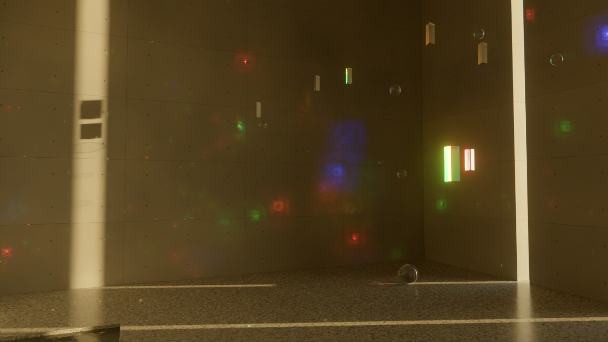

<div align="center">

# pc_graphics

**Spektral bir yol izleyici üzerinde sanat yönetimli sahneler. Işığın her ışını hesaplanıyor; hiçbir şey boyanmış değil.**

[](https://isocpp.org)
[](https://developer.nvidia.com/cuda-toolkit)
[](https://developer.nvidia.com/rtx/ray-tracing/optix)
[](#derleme)
[](#derleme)
[](#durağan-ve-canlı)
[](#lisans)

[Sahneler](#sahneler) · [Neyi hesaplıyor](#neyi-hesaplıyor) · [Durağan ve canlı](#durağan-ve-canlı) · [Kararlar](#okunmaya-değer-kararlar) · [Doğrulananlar](#doğrulananlar) · [Derleme](#derleme) · [Çalıştırma](#çalıştırma) · [Sıradaki](#sıradaki-sahneler)

*[English](README.md)*

</div>

---


Bilgisayar grafiğini sanat yönetimi olarak çalışmak için kişisel bir atölye: tek bir çizici, bir dizi sahne. Oyun
motoru da değil, performans testi de değil. Her sahne ışığın etrafında kurulur: göz önce neyi görmeli, ve bunun
inandırıcı olması için fiziğin neyi doğru yapması gerekir.

Çizici tek bir makine için yazılmış spektral bir yol izleyicidir (2560×1440 IPS monitörü süren bir RTX 4080). İki
kipte çalışır: referans görüntüye yakınsayan **durağan kip** ve NVIDIA'nın yapay zekâ gürültü gidericisinin
yardımıyla saniyede 20-30 kare tutan **canlı kip**.

## Sahneler

### 1 · Altın saatte cam ve taş · Ekim 2026

Tadao Ando dilinde bir oda: kalıp derzli ve kalıp delikli brüt beton, pirinç derz şeritli cilalı terrazzo zemin,
beyaz sıva, sığ bir havuz. Güneş ufkun sekiz derece üstünde ve yalnız dar yarıklardan giriyor. Huzmelerde kristal
prizmalar asılı; her biri duvarlara kendi tayfını saçıyor, pusun içinde dağılan ışık renkli yelpazelere açılıyor.
Işığın içinde sabun köpükleri süzülüyor.

| Prizma natürmortu | Işık planı, tepeden |
| --- | --- |
|  |  |

Sahne iki sanat turundan geçti. İlki *"ışık doğru mu?"* sorusunu yanıtladı ve doğru ama sessiz bir görüntü verdi.
İkincisi *"göz bir bakışta ne görüyor?"* sorusunu yanıtladı: karanlık oda, beş yarık, on dört kristal, sıcak denge.
İkisi arasında çizici değişmedi; sahne değişti.

| İlk ışık (1. aşama) | Canlı kip, 24 fps |
| --- | --- |
|  |  |

## Neyi hesaplıyor

| | |
| --- | --- |
| **Spektral ışık taşıma** | Yol başına dört kahraman dalga boyuyla yol izleme (Wilkie ve diğ. 2014), gözün duyarlılığına göre örneklenen 360-830 nm (pbrt-v4), CIE 1931 gözlemcisi, sRGB'den uydurulan Jakob-Hanika sigmoid yansıtırlıkları. |
| **Güneş ve gök** | Kenar kararmalı 5778 K kara cisim, küresel bir atmosferde zayıflatılmış (Rayleigh, Mie aerosol, ozonun Chappuis bandı). Gök, aynı atmosferde tek saçılımdan hesaplanan 512×256×48 kanallı spektral bir harita; güneş her hareket ettiğinde yeniden hesaplanır. 10° yükseklikte güneş ~3480 K çıkar. |
| **Işık örnekleme** | Güneş diskine ve göğe *açıklıklar üzerinden* (portal) doğrudan ışık örneklemesi, BSDF örneklemesiyle çoklu önem örneklemesi (MIS) ile birleşir. |
| **Malzemeler** | Ando betonu (1820×910 mm panolar, her birinde altı kalıp deliği, V derzler, lekelenme), pirinç şeritli cilalı terrazzo, sıva, SF11 ve BK7 cam (Sellmeier), su (dağılım, Pope-Fry soğurması, kılcal-yerçekimi dalgacıkları), sabun filmi (Airy ince film girişimi), pirinç. Prosedürel ayrıntı aynı fonksiyonlardan bir kez döşenebilir dokuya pişirilir. |
| **Kostikler** | Aşamalı spektral foton haritası (Knaus ve Zwicker 2011): güneşten cama ve suya yöneltilen fotonlar, CUB ile sıralanan GPU hash ızgarası, kare kare küçülen toplama yarıçapı. |
| **Hacimsel kostikler** | Foton ışınları (Jarosz ve diğ. 2011): kostik fotonlarının pus içindeki uçuşları kendi ivme yapısını alır, kamera ışınları onları ışın izleme donanımıyla toplar. |
| **Pus** | Homojen katılımcı ortam, güneş ışığının tek saçılımı; mesafeler analitik olarak hesaplanan güneş huzmelerinin içinde örneklenir. |
| **Kamera ve ekran** | Dokuz bıçaklı diyaframlı ince mercek, Gauss piksel süzgeci, AgX ton eşleme, lens parlaması piramidi, Bradford uyarlamasıyla beyaz dengesi, 8 bit panel için mavi gürültü titreşimi. |
| **Gürültü giderme** | Albedo ve normal kılavuzlu OptiX yapay zekâ gürültü gidericisi. Kostikler ondan hiç geçmez: tayflar keskin kalsın diye sonradan eklenir. |

Foton geçişinin katkısı, aynı 512 örnekte:

| Fotonlar kapalı: yalnız yol izleme | Fotonlar açık |
| --- | --- |
|  |  |

## Durağan ve canlı

| | Durağan | Canlı |
| --- | --- | --- |
| Hedef | referansa yakınsamak | akıcı kalmak |
| Çözünürlük | 2560×1440 izlenir | 1280×720 izlenir, `TEMPORAL_UPSCALE2X` ile ×2 büyütülür |
| Örnek | sınırsız birikir | kare başına piksel başına bir |
| Gürültü giderici | 8192 örneğe kadar yapay zekâ, sonra ham görüntü | her karede zamansal model |
| Sahne 1, kristaller | saniyede ~8 örnek | **24 fps** |
| Sahne 1, natürmort (ilk ışık ayarı) | saniyede ~16-20 örnek | 26-35 fps |

Boşluk tuşu ikisi arasında geçer. Canlı kipte su dalgalanır, toz ve köpükler süzülür.

## Okunmaya değer kararlar

- **Tek OptiX programı, gölgelendirme ışın üretiminde.** Işınlar `optixTraverse` ile izlenir, iş parçacıkları
  `optixReorder` ile malzemeye göre yeniden gruplanır (gölgelendirici yürütme yeniden sıralaması), sonra yerinde
  gölgelendirilir. Ölçüldü: yeniden sıralama olmadan yol izleyici **6 kat yavaş**.
- **Küreler özel ilkel.** OptiX'in yerleşik küresi içeriden vurulmuyor; su dolu cam küre siyah çıktı, köpükler tek
  film gibi davrandı. Tek bayraklık bir deney içeriden sıfır vuruş gösterdi; özel kesişim iki kökü de raporluyor.
- **Varyans azaltmadan önce ölç.** Kazanmasını beklediğim iki teknik (güneşli lekelere üç yönlü MIS'le bağlanmak ve
  gök haritasının önem örneklemesi) yansız ve doğruydu ama eşit *sürede* kaybetti. Asıl kaldıraç maliyetti:
  prosedürel dokular karenin üçte ikisini alıyordu; pişirmek 2,3 kat verdi. İki teknik de kodda, varsayılan kapalı.
- **Kostikler gürültü gidericinin dışında kalır.** Tersi denendi: tayfları yaydı.
- **Zayıf dağılım için bedel ödenmez.** Suyun kırılma indisi görünür aralıkta ~0,01 değişir; kamera yolları onu
  yalnız kahraman dalga boyunda kırar. Her biri tek dalga boyu taşıyan fotonlar tamamen dağıtıcı kalır.
- **Prizma için tabakalı tayf bölme.** Dağıtıcı camı gören pikseller aynı yolu aynı rastgele sayılarla dört kez
  izler, camda her seferinde başka bir dalga boyunu taşır. Bu piksellere 16 ayrı örnek vermek ölçüldüğünde başlatmayı
  bekletti (11 → 48 ms): örnekler tek iş parçacığında sırayla koşuyordu.
- **Toz yalnız kamera için.** Binlerce toz zerresi kendi ivme yapısında, görünürlük maskesi 2 ile: yalnız birincil
  ışınlar görür. Maliyet 21 ms'den ölçülemeyecek kadar küçüğe indi.
- **Teknik olarak etkileyici olmak görsel olarak etkileyici olmakla aynı şey değil.** İlk biten sahne fiziksel olarak
  doğru, görsel olarak sadeydi. Çokluk ve renk (tek prizma yerine on dört kristal) ve karanlık bir oda bunu tek kısa
  turda değiştirdi; çiziciye dokunulmadı.

## Doğrulananlar

| Denetim | Sonuç |
| --- | --- |
| Spektral seçim testi (`--selftest`) | D65 beyaz noktası x 0,31271, y 0,32907; D65 sRGB beyazına ±0,001; SF11 ve BK7 Fraunhofer F, d, C çizgilerinde katalogdan 6×10⁻⁵ içinde; Fresnel, ince film sıfırları ve sabun filminin Newton renk dizisi; sigmoid tayf uydurma gidiş-dönüş |
| Beyaz fırın (`--furnace`) | her yüzey beyaz, düzgün gök: ortalama parlaklık iki tohumda %0,02-0,03 içinde 1. Yolda iki gerçek hata yakaladı |
| Fotonlar, yol izlemeye karşı | düz yol izleme kostikleri bulabilsin diye güneş 5°'ye büyütüldü: kostik bölgelerde oran **0,991**, çift sayma yok |
| Yakınsama | 16, 64, 256, 1024 örnekte göreli piksel hatası 0,62, 0,35, 0,19, 0,11: beklenen 1/√n |
| 16.384 örneklik referansa uzaklık (NVIDIA FLIP, natürmort) | gürültü gidericili durağan: 16 örnekte 0,077 (0,7 s), 256'da 0,061, 1024'te 0,041; canlı 0,115 |
| Sonlu olmayan değer | hiçbir çalıştırmada yok |
| Gerçek monitörde | pencere RTX 4080 üzerinde (`GL_RENDERER` günlükte), 2560×1440 @ 165 Hz; canlı kare hızı RivaTuner göstergesiyle bağımsız olarak doğrulandı |

**Doğrulanmayanlar:** canlı kipte hareket gözle değil sayılarla (ardışık kare farkı) ve tek tek karelerle
değerlendirildi. Gökte çoklu saçılım yok; gerçek gökten biraz koyu ve daha az mavi. Kostik ışık yalnız ilk iki dağınık
sekmede toplanıyor (~%0,7 eksik). Canlı kipte prizmanın tayfı karıncalı.

## Derleme

**Gerekenler:** Windows 11, OptiX 9.1'i taşıyan sürücüyle bir NVIDIA RTX GPU (RTX 4080 ve 617.14 sürücüsüyle
denendi), C++ iş yüküyle Visual Studio 2026 (MSVC 14.51, içindeki CMake ve Ninja), Git Bash, araçlar için Python 3
(`numpy`, `pillow`, `OpenEXR`, `flip-evaluator`).

```bash
bash third_party/fetch.sh        # CUDA 13.4.2 dağıtım arşivleri, OptiX 9.1 başlıkları, GLFW, stb, tinyexr
```

Hiçbir şey kurulmaz ve ekran kartı sürücüsüne dokunulmaz: CUDA, NVIDIA'nın bileşen arşivleri olarak git'e
işlenmeyen `third_party/` klasörüne iner.

```bat
cmd /c build.bat                 :: bir kez yapılandırır, sonra build\pc_graphics.exe'yi derler
```

`src/device/` içindeki OptiX cihaz programları çalışma anında NVRTC ile derlenir; onları düzenlemek yeniden derleme
istemez: pencerede **F5**'e bas.

## Çalıştırma

```bat
build\pc_graphics.exe                                   :: kenarlıksız tam ekran, durağan kip
build\pc_graphics.exe --headless --spp 2048 --denoise --out captures\ad
build\pc_graphics.exe --headless --live 80 --out captures\live\ad
build\pc_graphics.exe --selftest
build\pc_graphics.exe --headless --furnace --spp 512 --out captures\furnace
```

| Tuş | |
| --- | --- |
| Boşluk | durağan ↔ canlı |
| C | sonraki kamera |
| H | gösterge (fps, geçiş başına ms, örnek, watt, sıcaklık) |
| S | ekran görüntüsü, PNG ve doğrusal EXR |
| ↑ ↓ / ← → | pozlama / odak uzaklığı |
| D, P, V, N | gürültü giderici, fotonlar, pus, doğrudan ışık örneklemesi aç-kapa |
| 1-5 | güzel, albedo, normal, yalnız kostikler, maliyet ısı haritası |
| F5 | cihaz programlarını yeniden derle, `scene.cfg`'yi yeniden oku |

Sahne parametreleri (güneş, pus, beyaz dengesi, kameralar, kristaller) `scene.cfg` içinde. Gösteri için kısa rehber:
[GOSTERI.md](GOSTERI.md).

## Depo düzeni

```
src/
  main.cpp            pencere, tuşlar, başsız ve canlı ölçüm kipleri
  renderer.cpp        OptiX bağlamı, NVRTC, boru hattı, ivme yapıları, başlatmalar
  scene.cpp           oda, malzemeler, kameralar, spektral uydurma ve seçim testleri
  photons.cu          foton hash ızgarası (CUB radix sort), ışın sınır kutuları
  kernels.cu          gürültü giderici girdileri, lens parlaması piramidi
  denoiser.cpp        OptiX yapay zekâ gürültü gidericisi: AOV, zamansal, zamansal 2× büyütme
  device/             OptiX programları: yol izleyici, fotonlar, gök, ton eşleme (çalışma anında derlenir)
  shared/             konak ve cihazın ortak kodu: vektörler, tayflar, parametreler, ekran dönüşümü
tools/                EXR istatistikleri, FLIP ve RMSE karşılaştırması, gürültü haritaları, temas tabakaları, prizma planlayıcı
assets/               mavi gürültü dokusu (void and cluster, tools/bluenoise.py üretir)
docs/                 Türkçe çalışma günlüğü: plan, her ölçümüyle durum panosu, sınırlar raporu
third_party/fetch.sh  bağımlılıkları indirir; klasörün kendisi git'te değil
```

## Sıradaki sahneler

- ***Inside* tarzında bir deniz feneri** (Playdead): dönen bir huzmeyi taşıyacak kadar yoğun sis, soluk göğe karşı
  silüetler, yağmur, tek bir vurgu rengiyle neredeyse tek renkli palet. Sahne 1'in hacim düzeneği (huzme
  örneklemesi, tek saçılım, foton ışınları) başlangıç noktası.
- Komut satırından sahne seçimi, her sahneye bir yapılandırma dosyası.

## Lisans

Özel depo. Tüm hakları saklıdır. Üçüncü taraf bileşenler derleme sırasında kendi lisanslarıyla indirilir: NVIDIA
CUDA dağıtım arşivleri ve OptiX SDK başlıkları, GLFW (zlib), stb (kamu malı), tinyexr (BSD).

Claude Code (Anthropic) ile uzun otonom oturumlarda geliştirildi; her kararın arkasındaki ölçümler
[docs/DURUM.md](docs/DURUM.md)'de, işin nerede yanlış gittiğinin dürüst dökümü [docs/SINIRLAR.md](docs/SINIRLAR.md)'de.
